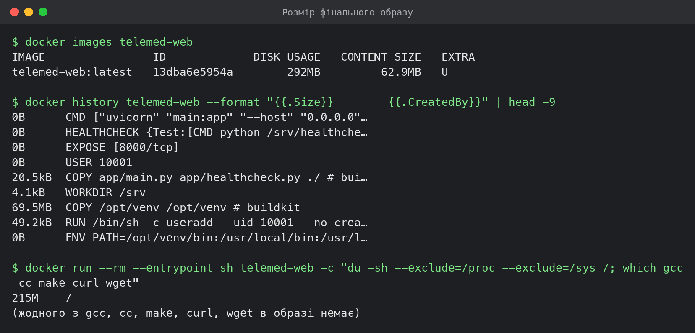
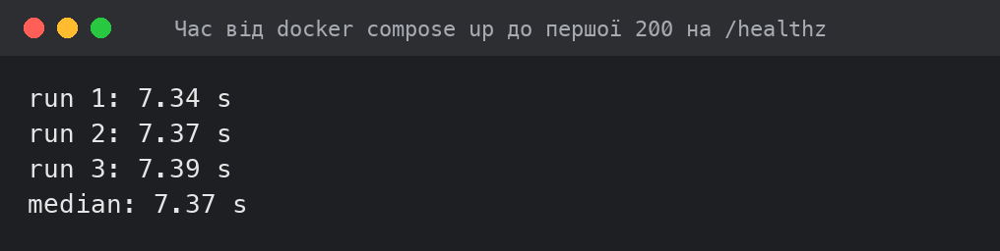
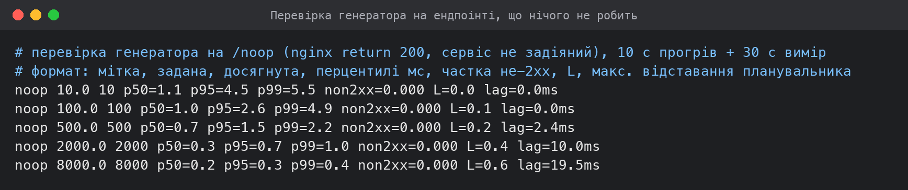
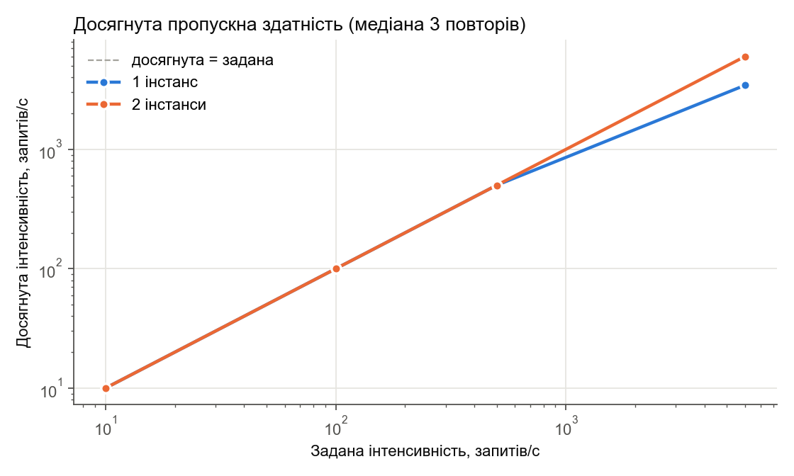
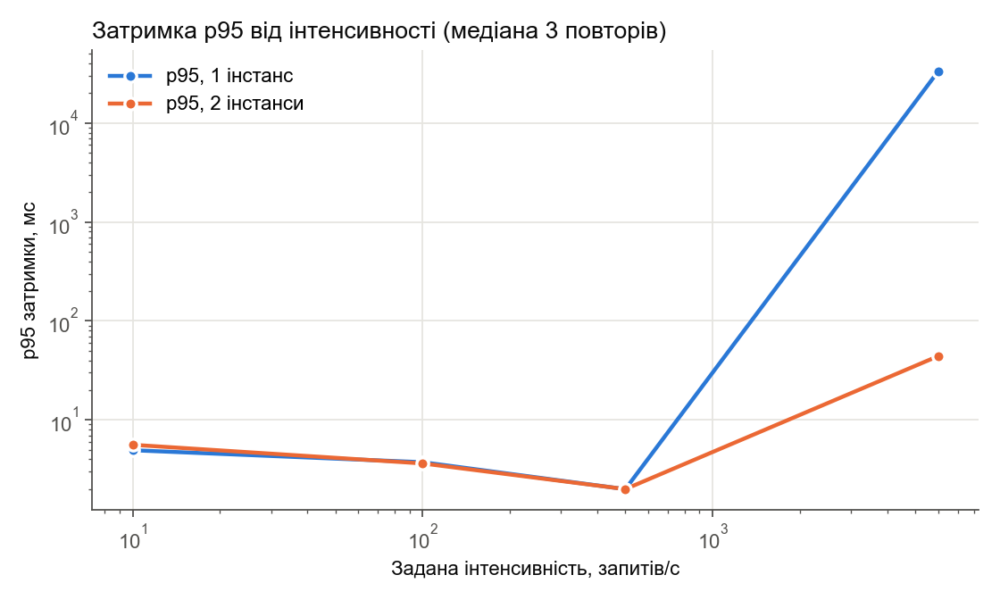
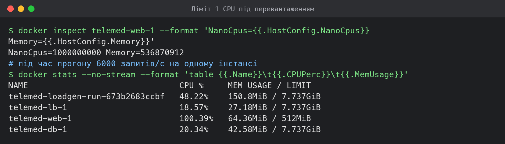
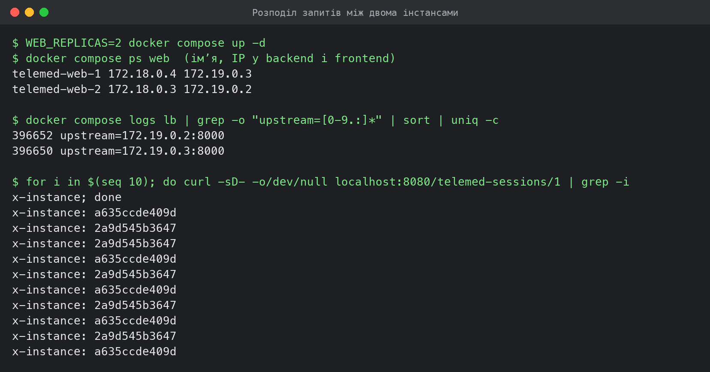
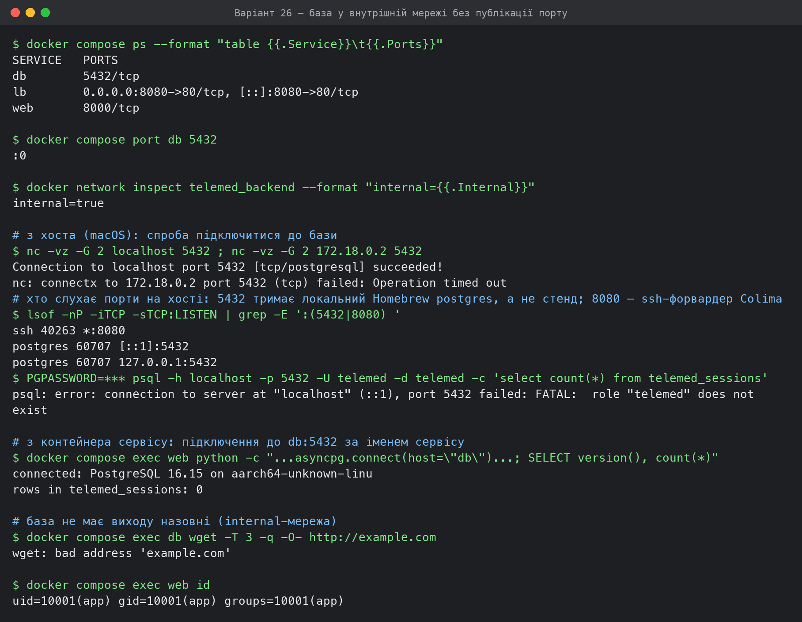
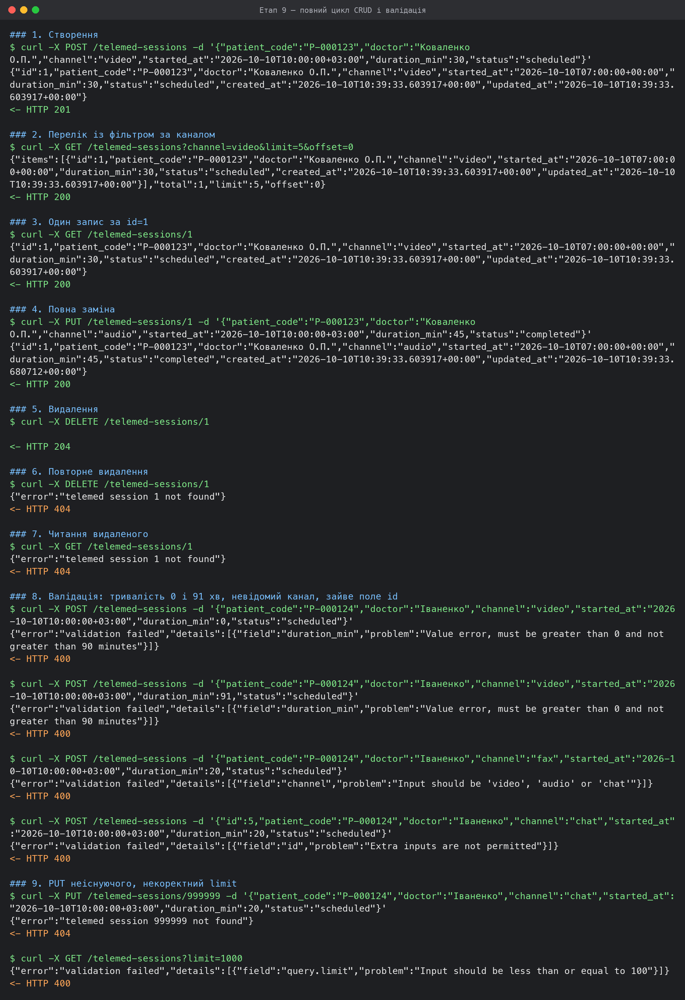
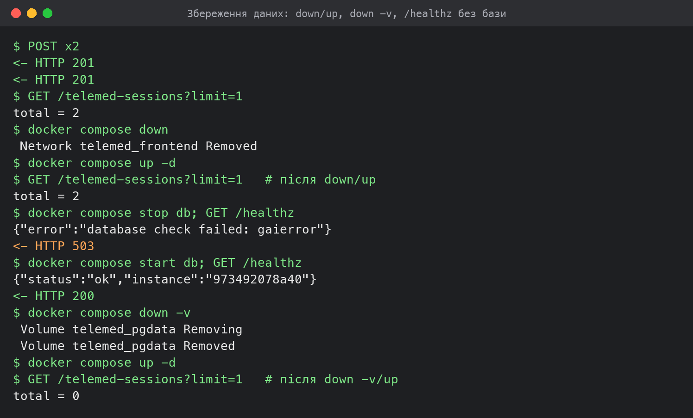

# Вихідні дані варіанта

| Параметр | Значення за варіантом 26 |
|---|---|
| Сутність, шлях ресурсу | Телемедична консультація, `/telemed-sessions` |
| Обовʼязкові поля | код пацієнта, лікар, канал звʼязку, час початку, тривалість у хвилинах, статус |
| Фільтр у переліку | за каналом звʼязку |
| Правило валідації | тривалість більша за нуль і не більша за 90 хвилин |
| Базовий образ фінальної стадії | `python:3.12-slim` |
| Ліміти контейнера сервісу | 1 CPU, 512 МБ |
| Додаткова вимога | база у внутрішній мережі без публікації порту на хост |

**Стек:** Python 3.12, FastAPI 0.115, asyncpg 0.30, uvicorn (uvloop + httptools), PostgreSQL 16 (`postgres:16-alpine`), балансувальник nginx 1.27 (`nginx:1.27-alpine`).

**Стенд вимірювань:** Docker 29.5 працює у віртуальній машині Colima (vz, 8 vCPU, 8 ГБ). **Генератор і сервіс працюють на одній машині** і в одній ВМ: генератор запущений контейнером у мережі `frontend` поряд із балансувальником. Так він не проходить через ssh-форвардинг порту Colima, але на верхніх рівнях конкурує з сервісом, базою і nginx за 8 vCPU.

**Репозиторій.** Звіт лежить у репозиторії поряд з усім, на що він посилається: код сервісу (`app/`), `Dockerfile`, `.dockerignore`, `docker-compose.yml`, `db/schema.sql`, `nginx/nginx.conf`, `.env.example`, генератор (`loadgen/loadgen.py`), скрипти перевірки, засіву, серії й аналізу (`scripts/`) і сирі результати кожного прогону (`results/`). Файл `.env` у репозиторій не входить (`.gitignore`). Стенд піднімається з клону однією командою з папки `lab1/`: `cp .env.example .env && docker compose up -d --build`.

# Етап 1. Проєктування

## Первинний проєкт (до коду)

Перед написанням коду в README було зафіксовано таке:

* **Таблиця** `telemed_sessions`: `id` (ціле, генерує база), `patient_code`, `doctor`, `channel`, `started_at`, `duration_min`, `status`, усі обовʼязкові. Для `channel` і `status` — типи `ENUM` PostgreSQL. Індекси: первинний ключ і окремий індекс за `channel` для фільтра.
* **API**: шість ендпоінтів з тими самими шляхами і методами, що в таблиці нижче. `POST` → 201, `GET` за id → 200/404, `PUT` повна заміна → 200/404, `DELETE` → 204/404, помилки валідації → 400 з назвою поля. Перелік повертає `{"items", "total", "limit", "offset"}`, `limit` за замовчуванням 20, межа 100, більше — обрізається до 100.
* **Схема** створюється сервісом на старті (`CREATE TABLE IF NOT EXISTS`).

## Що змінилось під час реалізації

| Було в первинному проєкті | Стало | Чому |
|---|---|---|
| `ENUM` для `channel` і `status` | `VARCHAR(16)` + `CHECK` | перелік простіше змінити через CHECK; валідація однаково в сервісі (відкинуте рішення 5) |
| окремий індекс за `channel` | складений `(channel, id)` | один індекс обслуговує і `WHERE channel = $1`, і `ORDER BY id` для пагінації |
| `limit > 100` обрізається до 100 | 400 з поясненням | клієнт інакше не дізнається, що отримав менше (відкинуте рішення 6) |
| схема з коду сервісу | `db/schema.sql` у `docker-entrypoint-initdb.d` | з двома репліками DDL виконувався б двічі одночасно (відкинуте рішення 1) |
| поля `created_at`, `updated_at` не планувались | додані | службові поля аудиту; видно, що PUT справді змінив запис |
| `started_at` без вимог до часового поясу | обовʼязковий зсув (`+03:00`) | інакше один і той самий рядок різні клієнти трактують по-різному |
| 503 не передбачено | 503, поки немає зʼєднання з базою | вимога «сервіс чекає на базу» і перевірка `/healthz` при зупиненій базі |

Нижче — остаточний проєкт, за яким працює сервіс.

## Схема таблиці

Таблиця `telemed_sessions` (`db/schema.sql`):

*Лістинг 1 – Схема таблиці, db/schema.sql*

```sql
-- Схема накочується автоматично: файл змонтовано в /docker-entrypoint-initdb.d,
-- postgres виконує його один раз при ініціалізації порожнього тому.

CREATE TABLE IF NOT EXISTS telemed_sessions (
    id            BIGINT GENERATED ALWAYS AS IDENTITY PRIMARY KEY,
    patient_code  VARCHAR(32)  NOT NULL CHECK (patient_code ~ '^[A-Za-z0-9-]{4,32}$'),
    doctor        VARCHAR(100) NOT NULL CHECK (length(btrim(doctor)) > 0),
    channel       VARCHAR(16)  NOT NULL CHECK (channel IN ('video', 'audio', 'chat')),
    started_at    TIMESTAMPTZ  NOT NULL,
    duration_min  SMALLINT     NOT NULL CHECK (duration_min > 0 AND duration_min <= 90),
    status        VARCHAR(16)  NOT NULL CHECK (status IN ('scheduled', 'in_progress', 'completed', 'cancelled')),
    created_at    TIMESTAMPTZ  NOT NULL DEFAULT now(),
    updated_at    TIMESTAMPTZ  NOT NULL DEFAULT now()
);

-- Фільтр переліку йде за каналом, сортування за id: складений індекс
-- обслуговує і WHERE channel = $1, і ORDER BY id LIMIT/OFFSET без сортування.
CREATE INDEX IF NOT EXISTS idx_telemed_sessions_channel_id
    ON telemed_sessions (channel, id);
```

| Поле | Тип | Обовʼязкове | Обмеження | Чому такий тип |
|---|---|---|---|---|
| `id` | `BIGINT GENERATED ALWAYS AS IDENTITY` | так, PK | генерує база | 64-бітний лічильник без ризику переповнення; `ALWAYS` не дає клієнту підставити свій id |
| `patient_code` | `VARCHAR(32)` | так | `^[A-Za-z0-9-]{4,32}$` | знеособлений код: короткий рядок без ПІБ, з фіксованим алфавітом |
| `doctor` | `VARCHAR(100)` | так | не порожній | ПІБ або ідентифікатор лікаря |
| `channel` | `VARCHAR(16)` | так | `video`, `audio`, `chat` | закритий перелік; CHECK простіше змінювати, ніж `ENUM`-тип |
| `started_at` | `TIMESTAMPTZ` | так | — | момент часу з часовим поясом; консультації бувають між різними поясами |
| `duration_min` | `SMALLINT` | так | `> 0 AND <= 90` | ціле число хвилин; правило варіанта продубльоване в базі як останній рубіж |
| `status` | `VARCHAR(16)` | так | `scheduled`, `in_progress`, `completed`, `cancelled` | закритий перелік станів консультації |
| `created_at` | `TIMESTAMPTZ` | так | `DEFAULT now()` | службове поле аудиту |
| `updated_at` | `TIMESTAMPTZ` | так | `DEFAULT now()` | оновлюється при PUT |

**Індекси:** первинний ключ за `id` (B-tree, читання за ідентифікатором) і складений `idx_telemed_sessions_channel_id (channel, id)`. Складений індекс обслуговує фільтр переліку `WHERE channel = $1` разом із сортуванням `ORDER BY id`, тож пагінація не потребує окремого сортування.

## API

Ресурс `/telemed-sessions`. Тіло запису (POST і PUT, усі поля обовʼязкові, зайві поля, зокрема `id`, відхиляються):

*Лістинг 2 – Приклад тіла запису для POST і PUT*

```json
{"patient_code": "P-000123", "doctor": "Коваленко О.П.", "channel": "video",
 "started_at": "2026-10-10T10:00:00+03:00", "duration_min": 30, "status": "scheduled"}
```

Відповідь із записом містить ще `id`, `created_at`, `updated_at`. Помилка має вигляд `{"error": "...", "details": [{"field": "...", "problem": "..."}]}`.

| Метод і шлях | Тіло запиту | Тіло відповіді | Успіх | Помилки |
|---|---|---|---|---|
| `POST /telemed-sessions` | запис без `id` | створений запис з `id` | 201 | 400: невалідне поле, зайве поле, некоректний JSON; 503: база недоступна |
| `GET /telemed-sessions?limit=&offset=&channel=` | — | `{"items": [...], "total": N, "limit": L, "offset": O}` | 200 | 400: `limit` поза 1..100, `offset` < 0, невідомий `channel` |
| `GET /telemed-sessions/{id}` | — | запис | 200 | 404: немає запису; 400: `id` не ціле додатне |
| `PUT /telemed-sessions/{id}` | повний запис без `id` | оновлений запис | 200 | 404: немає запису; 400: невалідні дані |
| `DELETE /telemed-sessions/{id}` | — | порожньо | 204 | 404: немає запису, зокрема при повторному видаленні |
| `GET /healthz` | — | `{"status": "ok", "instance": "<hostname>"}` | 200 | 503: пул до бази ще не створено або `SELECT 1` не пройшов за 1 с |

**Пагінація:** `limit` за замовчуванням 20, верхня межа 100 (більше дає 400, а не тихе обрізання); `offset` за замовчуванням 0. `total` рахується з тим самим фільтром, що й `items`.

**Валідація** виконується в сервісі моделлю Pydantic і повертає 400 з назвою поля і причиною. Правило варіанта: `duration_min` має бути цілим, більшим за 0 і не більшим за 90 (рядок `"30"` або `30.5` теж дають 400). Ті самі обмеження стоять CHECK-ами в таблиці, тож навіть помилка в коді не запише недопустимий рядок.

# Етап 2. Сервіс

Код: `app/main.py`, `app/healthcheck.py`, `app/requirements.txt` (повний текст — у додатку А). Основні рішення:

* **Валідація до звернення до бази.** Тіло POST/PUT оголошене параметром типу `SessionIn` (Pydantic, `extra="forbid"`), а `id`, `limit`, `offset`, `channel` — через `Path(ge=1, …)` і `Query(ge=…, le=…)`. FastAPI розбирає й перевіряє їх до виклику обробника, тож при невалідних даних обробник не викликається і SQL не виконується. Ті самі обмеження стоять CHECK-ами в таблиці як другий рубіж.
* **`/healthz` звертається до бази:** виконує `SELECT 1` через пул з таймаутом 1 с і віддає 503, якщо пулу ще немає або запит не пройшов.
* Пул підключень asyncpg створюється у фоновій задачі з повторами (0.2 → 2 с). Поки пулу немає, `/healthz` віддає 503, а запити до ресурсу 503 `database unavailable`, а не 500.
* Сервіс не тримає стану в памʼяті: на рівні модуля лише константи і hostname, кожен обробник читає й пише тільки через пул asyncpg. Тому дві репліки взаємозамінні, а записи переживають перезапуск сервісу.
* Кожна відповідь має заголовок `X-Instance` з hostname контейнера: так видно, який інстанс відповів.
* Обробник `RequestValidationError` перетворює стандартну 422 FastAPI на 400 з переліком полів.
* PUT робить `UPDATE ... RETURNING`, DELETE робить `DELETE ... RETURNING id`: одна операція з базою визначає і результат, і 404.

# Етап 3. Образ

Збірка двоетапна. У стадії `builder` встановлюються `build-essential` і залежності у віртуальне середовище `/opt/venv`. Фінальна стадія на `python:3.12-slim` копіює лише `/opt/venv` і два файли коду. Компіляторів, `curl` і `wget` у ній немає. Процес працює від користувача з uid 10001. Healthcheck написаний на стандартному `urllib`.

*Лістинг 3 – Dockerfile*

```dockerfile
# syntax=docker/dockerfile:1

# ---- Стадія 1: збірка залежностей ----
FROM python:3.12-slim AS builder
RUN apt-get update \
 && apt-get install -y --no-install-recommends build-essential \
 && rm -rf /var/lib/apt/lists/*
RUN python -m venv /opt/venv
ENV PATH="/opt/venv/bin:$PATH"
# Спершу лише requirements.txt: шар із залежностями перебудовується
# тільки коли змінюється перелік пакетів, а не при кожній правці коду.
COPY app/requirements.txt /tmp/requirements.txt
RUN pip install --no-cache-dir -r /tmp/requirements.txt

# ---- Стадія 2: фінальний образ без компіляторів ----
FROM python:3.12-slim
ENV PATH="/opt/venv/bin:$PATH" \
    PYTHONDONTWRITEBYTECODE=1 \
    PYTHONUNBUFFERED=1
RUN useradd --uid 10001 --no-create-home --shell /usr/sbin/nologin app
COPY --from=builder /opt/venv /opt/venv
WORKDIR /srv
COPY app/main.py app/healthcheck.py ./
USER 10001
EXPOSE 8000
HEALTHCHECK --interval=2s --timeout=2s --start-period=5s --retries=3 \
    CMD ["python", "/srv/healthcheck.py"]
CMD ["uvicorn", "main:app", "--host", "0.0.0.0", "--port", "8000", "--workers", "1", "--no-access-log"]
```

*Лістинг 4 – .dockerignore*

```
.env
.env.*
!.env.example
.git
**/__pycache__
**/*.pyc
results/
screens/
loadgen/
scripts/
report/
*.md
*.docx
```

Образ збирається з кореня репозиторію: `docker compose build` або `docker build -t telemed-web .`.

Пароль не потрапляє в образ: у Dockerfile немає `ARG`/`ENV` з паролем, `.env` виключено в `.dockerignore`, пароль приходить у контейнер лише змінною середовища під час запуску.

# Етап 4. Стенд

*Лістинг 5 – docker-compose.yml*

```yaml
name: telemed

services:
  db:
    image: postgres:16-alpine
    environment:
      POSTGRES_USER: ${POSTGRES_USER:-telemed}
      POSTGRES_DB: ${POSTGRES_DB:-telemed}
      POSTGRES_PASSWORD: ${POSTGRES_PASSWORD:?set POSTGRES_PASSWORD in .env}
    volumes:
      - pgdata:/var/lib/postgresql/data
      - ./db/schema.sql:/docker-entrypoint-initdb.d/01-schema.sql:ro
    # -h 127.0.0.1: під час initdb тимчасовий сервер слухає лише unix-сокет,
    # тож перевірка по TCP не дасть хибного "готово" до накатування схеми.
    healthcheck:
      test: ["CMD-SHELL", "pg_isready -h 127.0.0.1 -U $${POSTGRES_USER} -d $${POSTGRES_DB}"]
      interval: 1s
      timeout: 2s
      retries: 30
    # Порт бази на хост не публікується (додаткова вимога варіанта 26).
    networks: [backend]

  web:
    build: .
    image: telemed-web:latest
    environment:
      DB_HOST: db
      DB_PORT: "5432"
      DB_USER: ${POSTGRES_USER:-telemed}
      DB_NAME: ${POSTGRES_DB:-telemed}
      DB_PASSWORD: ${POSTGRES_PASSWORD:?set POSTGRES_PASSWORD in .env}
    depends_on:
      db:
        condition: service_healthy
    deploy:
      replicas: ${WEB_REPLICAS:-1}
      resources:
        limits:
          cpus: "1"
          memory: 512M
    networks: [backend, frontend]

  lb:
    image: nginx:1.27-alpine
    volumes:
      - ./nginx/nginx.conf:/etc/nginx/nginx.conf:ro
    ports:
      - "8080:80"
    depends_on:
      web:
        condition: service_healthy
    networks: [frontend]

  # Генератор навантаження: запускається окремо, у тій самій мережі, що й балансувальник.
  loadgen:
    image: python:3.12-slim
    profiles: [tools]
    working_dir: /loadgen
    volumes:
      - ./loadgen:/loadgen
      - ./results:/results
    networks: [frontend]
    entrypoint: ["python", "/loadgen/loadgen.py"]

networks:
  # internal: true — мережа без виходу назовні і без можливості
  # опублікувати з неї порт; у ній живуть лише база і вебінстанси.
  backend:
    internal: true
  frontend: {}

volumes:
  pgdata: {}
```

*Лістинг 6 – Конфігурація балансувальника, nginx/nginx.conf*

```nginx
worker_processes auto;
events { worker_connections 4096; }

http {
    # $upstream_addr у логах показує, на який інстанс пішов запит.
    log_format lb '$remote_addr "$request" $status upstream=$upstream_addr rt=$request_time';
    access_log /var/log/nginx/access.log lb buffer=64k flush=1s;

    # nginx резолвить імʼя web при старті і отримує від DNS Compose
    # стільки IP, скільки запущено реплік; далі round-robin між ними.
    upstream web {
        server web:8000;
        keepalive 128;
    }

    server {
        listen 80;

        # Ендпоінт, що нічого не робить: для перевірки самого генератора.
        location = /noop {
            access_log off;
            return 200 "ok\n";
        }

        location / {
            proxy_pass http://web;
            proxy_http_version 1.1;
            proxy_set_header Connection "";
            proxy_set_header Host $host;
            proxy_connect_timeout 2s;
            proxy_read_timeout 30s;
        }
    }
}
```

*Лістинг 7 – Зразок змінних середовища, .env.example*

```bash
# Скопіюйте у .env і задайте свій пароль. Сам .env у репозиторій не комітиться.
POSTGRES_USER=telemed
POSTGRES_DB=telemed
POSTGRES_PASSWORD=change_me_please
# Кількість вебінстансів за балансувальником (1 або 2)
WEB_REPLICAS=1
```

Що забезпечує вимоги:

* **Єдина точка входу:** порт публікує лише `lb` (`8080:80`). У `web` і `db` секції `ports` немає.
* **Кількість інстансів одним параметром:** `deploy.replicas: ${WEB_REPLICAS:-1}`. `WEB_REPLICAS=2 docker compose up -d` піднімає дві репліки без правок файлів. Працює й `docker compose up -d --scale web=2`. nginx отримує від DNS Compose усі IP імені `web` і розподіляє запити між ними по колу.
* **Схема накочується автоматично:** `db/schema.sql` змонтовано в `/docker-entrypoint-initdb.d/`, postgres виконує його при ініціалізації порожнього тому.
* **Очікування бази:** `depends_on: db: condition: service_healthy`. Healthcheck бази `pg_isready -h 127.0.0.1` йде через TCP: під час initdb тимчасовий сервер слухає лише unix-сокет, тож «готово» не настане до накатування схеми. Додатково сервіс сам повторює підключення, а `lb` стартує тільки після `service_healthy` вебінстансу. Перший же запит після `up` отримує відповідь.
* **Ліміти:** `deploy.resources.limits` — 1 CPU, 512 МБ (`docker inspect`: `NanoCpus=1000000000 Memory=536870912`).
* **Секрети:** пароль бере `${POSTGRES_PASSWORD:?}` з `.env`, якого немає в репозиторії: `.env` стоїть у `.gitignore`, і `git ls-files | grep env` показує лише `.env.example`. У `docker-compose.yml` лише посилання на змінну.

Запуск стенду: `cp .env.example .env && docker compose up -d --build`.

# Вимірювання розгортання

## Розмір образу

| Показник | Значення |
|---|---|
| Сума шарів фінального образу (розпакований) | **≈ 229 МБ** (110 + 5 + 44.6 МБ базовий `python:3.12-slim`, 69.5 МБ `/opt/venv`, ~0.1 МБ код і користувач) |
| `du -sh /` усередині контейнера | 215 МБ |
| Стиснений вміст (`CONTENT SIZE`, що тягнеться з реєстру) | 62.9 МБ |
| `DISK USAGE` у `docker images` | 292 МБ |

**Звідки 229 МБ і чому `docker images` показує 292 МБ.** Число ≈ 229 МБ — сума колонки `SIZE` у `docker history telemed-web` по всіх шарах, тобто розпакована файлова система образу. Docker 29 зберігає образи в containerd image store, і колонка `DISK USAGE` у `docker images` рахує все, що образ займає на диску: розпаковані шари (≈ 229 МБ) **плюс** стиснені блоби шарів, які containerd тримає поряд (`CONTENT SIZE` = 62.9 МБ). 229 + 62.9 ≈ 292 МБ, що й показує вивід. За розмір образу взято розпакований обсяг (229 МБ), бо саме стільки займає файлова система контейнера; `du -sh /` усередині дає близьке значення 215 МБ (`du` рахує блоки файлів, а не розміри tar-шарів).

Сервісу належить лише шар `/opt/venv` (69.5 МБ). Решта — базовий образ, який задає варіант. У фінальній стадії немає `gcc`, `cc`, `make`, `curl`, `wget`.

*Лістинг 8 – Розмір образу і відсутність засобів збірки, results/image.log*

```
$ docker images telemed-web
IMAGE                ID             DISK USAGE   CONTENT SIZE   EXTRA
telemed-web:latest   13dba6e5954a        292MB         62.9MB   U    

$ docker history telemed-web --format "{{.Size}}	{{.CreatedBy}}" | head -9
0B	CMD ["uvicorn" "main:app" "--host" "0.0.0.0"…
0B	HEALTHCHECK {Test:[CMD python /srv/healthche…
0B	EXPOSE [8000/tcp]
0B	USER 10001
20.5kB	COPY app/main.py app/healthcheck.py ./ # bui…
4.1kB	WORKDIR /srv
69.5MB	COPY /opt/venv /opt/venv # buildkit
49.2kB	RUN /bin/sh -c useradd --uid 10001 --no-crea…
0B	ENV PATH=/opt/venv/bin:/usr/local/bin:/usr/l…

$ docker run --rm --entrypoint sh telemed-web -c "du -sh --exclude=/proc --exclude=/sys /; which gcc cc make curl wget"
215M	/
(жодного з gcc, cc, make, curl, wget в образі немає)
```



## Час до першої відповіді 200 на /healthz

Скрипт `scripts/startup_time.py`: `docker compose down -v`, потім `docker compose up -d` і опитування `GET /healthz` кожні 50 мс до першої 200. Образи зібрані, том бази порожній, тобто кожен раз виконується initdb і накочується схема.

| Повтор | 1 | 2 | 3 | **Медіана** |
|---|---|---|---|---|
| Час, с | 7.34 | 7.37 | 7.39 | **7.37** |

Час складається з ініціалізації порожньої бази (initdb, схема, перезапуск postgres), healthcheck бази з інтервалом 1 с, старту uvicorn і healthcheck вебінстансу з інтервалом 2 с, після чого стартує nginx.



# Етапи 5–6. Навантаження

## Генератор і сценарій

Генератор `loadgen/loadgen.py` написаний на Python лише зі стандартною бібліотекою.

* **Відкритий контур.** Задана інтенсивність `rate` ділиться між `P = os.cpu_count()` процесами (8). Процес `i` відправляє запити з номерами `k·P + i` у моменти `start + (k·P + i)/rate`. Ці моменти обчислюються наперед від спільного `start`, а не після відповіді. Цикл планування лише кладе запит у `ThreadPoolExecutor` (64 потоки на процес, HTTP/1.1 keep-alive, одне зʼєднання на потік) і не чекає відповіді.
* **Затримка** рахується від запланованого моменту відправки. Якщо всі потоки пулу зайняті, час очікування в черзі генератора теж потрапляє в затримку, тобто вимір не маскує перевантаження (немає coordinated omission).
* **Досягнута інтенсивність** — кількість відповідей, що завершились у 30-секундному вимірювальному вікні, поділена на 30 с.
* **Кількість запитів у системі** (`sent − completed`) знімається окремим потоком кожні 5 мс у вимірювальному вікні. Середнє за прогін — виміряне L. Окремо рахується `active`: скільки запитів реально «на дроті» (потік чекає відповідь).
* **Закритий контур** (`closed --concurrency C`): C потоків, кожен відправляє наступний запит одразу після відповіді на попередній.
* Прогрів 10 с, вимір 30 с, дані прогріву відкидаються. Кожен рівень тричі, у таблиці медіана.
* Кожен прогін зберігає зведення в `results/<прогін>.json` і сирі мітки кожного запиту (заплановано, завершено, код) у `results/<прогін>.raw.csv.gz`.

Повний текст генератора — у додатку Б. Ключове місце відкритого контуру (`loadgen/loadgen.py`): момент відправки рахується від `start` за номером запиту, планувальник лише передає запит пулу і переходить до наступного.

*Лістинг 9 – Планування моментів відправки у відкритому контурі, loadgen/loadgen.py*

```python
pool = ThreadPoolExecutor(max_workers=threads)
threading.Thread(target=sampler, daemon=True).start()
k = idx
while k < n_total:
    target = start + k / rate
    delay = target - time.monotonic()
    if delay > 0:
        time.sleep(delay)
    else:
        lag_max[0] = max(lag_max[0], -delay)
    with lock:
        inflight[0] += 1
    pool.submit(do, target)
    k += procs
```

**Засів даних.** Сценарій `GET /telemed-sessions/{id}`, де `id` випадково обирається з 1..100. Перед кожною серією `scripts/series.sh` піднімає стенд з порожнім томом і викликає `scripts/seed.sh`, який заносить 100 записів через `POST` і перевіряє результат переліком:

*Лістинг 10 – Засів 100 записів, scripts/seed.sh*

```bash
#!/usr/bin/env bash
# Заносить 100 записів перед серією; id у сценарії беруться з діапазону 1-100.
set -eu
ch=(video audio chat); st=(scheduled in_progress completed cancelled)
for i in $(seq 1 100); do
  curl -s -o /dev/null -X POST http://localhost:8080/telemed-sessions -H 'Content-Type: application/json' \
    -d "{\"patient_code\":\"P-$(printf %06d $i)\",\"doctor\":\"Лікар $((i%7+1))\",\"channel\":\"${ch[$((i%3))]}\",\"started_at\":\"2026-10-0$((i%9+1))T09:00:00+03:00\",\"duration_min\":$(( (i%18+1)*5 )),\"status\":\"${st[$((i%4))]}\"}"
done
curl -s "http://localhost:8080/telemed-sessions?limit=1" | python3 -c 'import sys,json;d=json.load(sys.stdin);print("seeded, total =",d["total"],"first id =",d["items"][0]["id"])'
```

Вивід засіву в журналі серії (`results/series.log`), для кожного з трьох підйомів стенду:

*Лістинг 11 – Вивід засіву, results/series.log*

```
seeded, total = 100 first id = 1
```

Тобто в базі рівно 100 записів з `id` 1..100, і всі запити сценарію влучають в існуючі записи (у всіх прогонах `non2xx = 0`).

Серія запускається командами:

*Лістинг 12 – Команди запуску серії*

```bash
./scripts/series.sh 1     # стенд з 1 інстансом: перевірка генератора, серія, закритий контур
./scripts/series.sh 2     # стенд з 2 інстансами: серія, розподіл запитів
```

Один прогін вручну:

*Лістинг 13 – Команда одного прогону*

```bash
docker compose --profile tools run --rm loadgen open \
  --url 'http://lb/telemed-sessions/{id}' --ids 1-100 --rate 500 --duration 30 --warmup 10
```

## Перевірка генератора

Перед серією генератор прогнано проти `GET /noop`. Цей ендпоінт nginx віддає сам (`return 200`), сервіс і база не задіяні. Прогрів 10 с, вимір 30 с.

| Задана, запитів/с | Досягнута | p50, мс | p95, мс | p99, мс | Макс. відставання планувальника, мс |
|---|---|---|---|---|---|
| 10 | 10.0 | 1.11 | 4.46 | 5.47 | 0.0 |
| 100 | 100.0 | 1.04 | 2.58 | 4.95 | 0.0 |
| 500 | 500.0 | 0.71 | 1.48 | 2.17 | 2.4 |
| 2000 | 2000.0 | 0.34 | 0.69 | 0.96 | 10.0 |
| 8000 | 7999.9 | 0.18 | 0.28 | 0.35 | 19.5 |

Генератор тримає задану інтенсивність до 8000 запитів/с включно, що вище за всі рівні серії. Отже, обмеження, видні в серії, задає стенд, а не генератор. Затримка на `/noop` падає з ростом інтенсивності, бо при частих запитах keep-alive-зʼєднання і потоки залишаються «гарячими».



## Результати серії

Сценарій `GET /telemed-sessions/{id}`, 3 повтори на рівень, у таблиці медіана. Рівні 10, 100 і 500 задані умовою. На них один інстанс не наближається до межі: на 500 запитах/с CPU вебінстансу завантажений приблизно на 12%. Тому додано один рівень перевантаження, **6000 запитів/с**. Без нього неможливо показати, де сервіс перестає встигати, порахувати прискорення від другого інстансу і порівняти з закритим контуром.

| Інстансів | Задана, запитів/с | Досягнута, запитів/с | p50, мс | p95, мс | p99, мс | Не-2xx | L (у системі) |
|---|---|---|---|---|---|---|---|
| 1 | 10 | 10.0 | 3.07 | 4.94 | 7.36 | 0% | 0.03 |
| 1 | 100 | 100.0 | 2.14 | 3.74 | 4.92 | 0% | 0.2 |
| 1 | 500 | 500.0 | 1.12 | 2.00 | 3.15 | 0% | 0.5 |
| 1 | 6000 | **3443.6** | **20 848** | **33 411** | **35 012** | 0% | **68 815** |
| 2 | 10 | 10.0 | 3.43 | 5.61 | 7.56 | 0% | 0.03 |
| 2 | 100 | 100.0 | 2.25 | 3.64 | 4.53 | 0% | 0.2 |
| 2 | 500 | 500.0 | 1.08 | 2.00 | 2.89 | 0% | 0.5 |
| 2 | 6000 | 5999.9 | 0.59 | 44.2 | 155.4 | 0% | 44.7 |

Шість конфігурацій, які вимагає умова, — рядки 10/100/500 для 1 і 2 інстансів.

**Як зібрано вивід серії.** Нижче — повний журнал `results/series.log` без вирізання рядків. Він складається з трьох запусків скрипта: `./scripts/series.sh 1` двічі і `./scripts/series.sh 2` один раз. Перший запуск `series.sh 1` перервався після рівня 100 (повтори 10 і 100 і перевірка генератора на `/noop` на той момент уже були записані). Скрипт пропускає прогін, якщо його файл `results/*.json` уже існує (`[ -f ... ] && continue`), тож другий запуск `series.sh 1` знову підняв стенд з порожнім томом, засіяв 100 записів, надрукував заголовки «стенд з 1 інстансами» і «перевірка генератора на /noop», але самі прогони `/noop`, 10 і 100 пропустив і почав з рівня 500. Тому другий заголовок «перевірка генератора» стоїть без результатів під ним, а під ним — уже рядки сервісу. Усі прогони рівнів 500 і 6000 та закритий контур зняті в другому запуску на свіжому стенді. Результати `/noop` — з першого запуску (рядки `noop …`).

*Лістинг 14 – Повний журнал серії, results/series.log*

```
== стенд з 1 інстансами (томи порожні)
telemed-db-1 Up 7 seconds (healthy)
telemed-lb-1 Up Less than a second
telemed-web-1 Up 5 seconds (healthy)
seeded, total = 100 first id = 1
== перевірка генератора на /noop (nginx return 200, сервіс не задіяний)
noop 10.0 10 p50=1.1 p95=4.5 p99=5.5 non2xx=0.000 L=0.0 lag=0.0ms
noop 100.0 100 p50=1.0 p95=2.6 p99=4.9 non2xx=0.000 L=0.1 lag=0.0ms
noop 500.0 500 p50=0.7 p95=1.5 p99=2.2 non2xx=0.000 L=0.2 lag=2.4ms
noop 2000.0 2000 p50=0.3 p95=0.7 p99=1.0 non2xx=0.000 L=0.4 lag=10.0ms
noop 8000.0 8000 p50=0.2 p95=0.3 p99=0.4 non2xx=0.000 L=0.6 lag=19.5ms
n=1 rep1 10.0 10 p50=3.1 p95=4.9 p99=7.7 non2xx=0.000 L=0.0 lag=0.0ms
n=1 rep2 10.0 10 p50=3.2 p95=5.8 p99=7.4 non2xx=0.000 L=0.0 lag=0.0ms
n=1 rep3 10.0 10 p50=3.0 p95=4.2 p99=6.2 non2xx=0.000 L=0.0 lag=0.0ms
n=1 rep1 100.0 100 p50=2.1 p95=3.7 p99=5.9 non2xx=0.000 L=0.2 lag=0.0ms
n=1 rep2 100.0 100 p50=2.4 p95=3.9 p99=4.9 non2xx=0.000 L=0.2 lag=0.0ms
n=1 rep3 100.0 100 p50=2.1 p95=3.7 p99=4.6 non2xx=0.000 L=0.2 lag=0.0ms
== стенд з 1 інстансами (томи порожні)
telemed-db-1 Up 7 seconds (healthy)
telemed-lb-1 Up Less than a second
telemed-web-1 Up 5 seconds (healthy)
seeded, total = 100 first id = 1
== перевірка генератора на /noop (nginx return 200, сервіс не задіяний)
n=1 rep1 500.0 500 p50=1.1 p95=1.9 p99=2.9 non2xx=0.000 L=0.5 lag=0.0ms
n=1 rep2 500.0 500 p50=1.1 p95=2.0 p99=3.1 non2xx=0.000 L=0.5 lag=0.0ms
n=1 rep3 500.0 500 p50=1.2 p95=2.0 p99=4.2 non2xx=0.000 L=0.5 lag=0.0ms
n=1 rep1 6000.0 3214 p50=23129.6 p95=35210.0 p99=36736.9 non2xx=0.000 L=76078.0 lag=43.9ms
n=1 rep2 6000.0 3444 p50=20848.5 p95=33410.5 p99=35012.4 non2xx=0.000 L=68814.6 lag=244.7ms
n=1 rep3 6000.0 3696 p50=16029.5 p95=27934.8 p99=28721.7 non2xx=0.000 L=62732.8 lag=22.2ms
== закритий контур на рівні 6000: concurrency = 512 (середня кількість одночасних запитів у відкритому контурі)
closed rep1 512 4217 p50=5.1 p95=665.4 p99=1619.1 non2xx=0.000 L=512.0 lag=0.0ms
== стенд з 2 інстансами (томи порожні)
telemed-db-1 Up 7 seconds (healthy)
telemed-lb-1 Up Less than a second
telemed-web-1 Up 5 seconds (healthy)
telemed-web-2 Up 5 seconds (healthy)
seeded, total = 100 first id = 1
n=2 rep1 10.0 10 p50=3.4 p95=5.6 p99=7.5 non2xx=0.000 L=0.0 lag=0.0ms
n=2 rep2 10.0 10 p50=3.3 p95=5.7 p99=8.0 non2xx=0.000 L=0.0 lag=0.0ms
n=2 rep3 10.0 10 p50=3.6 p95=5.4 p99=7.6 non2xx=0.000 L=0.0 lag=0.0ms
n=2 rep1 100.0 100 p50=2.2 p95=3.6 p99=4.5 non2xx=0.000 L=0.2 lag=0.0ms
n=2 rep2 100.0 100 p50=2.3 p95=3.6 p99=4.8 non2xx=0.000 L=0.2 lag=0.0ms
n=2 rep3 100.0 100 p50=2.2 p95=3.6 p99=4.5 non2xx=0.000 L=0.2 lag=0.0ms
n=2 rep1 500.0 500 p50=1.1 p95=2.0 p99=2.9 non2xx=0.000 L=0.5 lag=0.0ms
n=2 rep2 500.0 500 p50=1.1 p95=2.0 p99=3.0 non2xx=0.000 L=0.5 lag=0.0ms
n=2 rep3 500.0 500 p50=1.0 p95=1.8 p99=2.7 non2xx=0.000 L=0.4 lag=0.0ms
n=2 rep1 6000.0 6000 p50=0.6 p95=44.2 p99=155.4 non2xx=0.000 L=44.7 lag=26.5ms
n=2 rep2 6000.0 6000 p50=0.6 p95=63.2 p99=217.2 non2xx=0.000 L=71.1 lag=9.2ms
n=2 rep3 6000.0 6000 p50=0.6 p95=27.3 p99=82.6 non2xx=0.000 L=24.9 lag=11.7ms
== розподіл запитів між інстансами
telemed-web-1 172.18.0.4 172.19.0.3 
telemed-web-2 172.18.0.3 172.19.0.2 
396652 upstream=172.19.0.2:8000
396650 upstream=172.19.0.3:8000
x-instance: a635ccde409d
x-instance: 2a9d545b3647
x-instance: 2a9d545b3647
x-instance: a635ccde409d
x-instance: 2a9d545b3647
x-instance: a635ccde409d
x-instance: 2a9d545b3647
x-instance: a635ccde409d
x-instance: 2a9d545b3647
x-instance: a635ccde409d
```





## Де сервіс перестав тримати інтенсивність

**На 10, 100 і 500 запитах/с** обидві конфігурації тримають задану інтенсивність повністю: досягнута дорівнює заданій, p99 не більше 8 мс, помилок немає. Затримка на 10 запитах/с навіть вища, ніж на 500. Причина в тому, що при рідких запитах зʼєднання й процеси «холонуть», а не в навантаженні.

**На 6000 запитах/с один інстанс не встигає.** Це видно з трьох чисел:

1. Досягнута інтенсивність зупинилась на **3444** запитах/с (у трьох повторах 3214, 3444 і 3696) при заданих 6000.
2. Затримка зросла з 2 мс до **p50 = 20.8 с, p95 = 33.4 с**. Щосекунди надходить на ~2550 запитів більше, ніж сервіс обробляє, і черга росте весь прогін. Тому чим пізніше запит заплановано, тим довше він чекає.
3. Кількість запитів у системі зросла з 0.5 до **≈ 68 800**.

Обмежував процесор вебінстансу. Під час прогону `docker stats` показує `telemed-web-1` на **100%** (ліміт 1 CPU), а nginx і база мають запас.



Окремі короткі проби (по 5 с) показали, що один інстанс ще тримає 4000 запитів/с (p95 ≈ 99 мс), тобто межа пропускної здатності одного інстансу лежить між 4000 і ~4300 запитів/с. У 30-секундному прогоні на 6000 досягнуто менше (3444), бо в тій самій ВМ генератор обслуговує чергу з десятків тисяч відкладених запитів і забирає частину процесорного часу.

**Що змінилось після другого інстансу.** На 6000 запитах/с два інстанси тримають задану інтенсивність повністю (5999.9) без помилок, p50 = 0.6 мс. Але хвіст уже росте: p95 = 44 мс і p99 = 155 мс проти 2 і 3 мс на 500. Отже, і два інстанси наближаються до своєї межі. На рівнях 10–500 другий інстанс нічого не змінює (різниця в межах шуму), бо один і так недовантажений.

**Спільними для обох інстансів лишились** одна база PostgreSQL, один балансувальник nginx і, у цьому стенді, ще 8 vCPU однієї ВМ, на яких працює і генератор.

## Підтвердження розподілу запитів

Для стенду з двома інстансами nginx логує `upstream=$upstream_addr`. Після серії в лозі балансувальника **396 652** запити пішли на `172.19.0.2:8000` (`telemed-web-2`) і **396 650** на `172.19.0.3:8000` (`telemed-web-1`): розподіл 50/50, round-robin. Сервіс також повертає заголовок `X-Instance` з hostname контейнера, і 10 послідовних запитів чергуються між двома різними hostname.



# Етап 7. Розрахунки

## Прискорення і метрика Карпа-Флатта

Прискорення S = X₂ / X₁, де X — досягнута інтенсивність на тому самому рівні. Для N = 2: e = (1/S − 1/N) / (1 − 1/N) = (1/S − 0.5) / 0.5.

| Рівень, запитів/с | X₁ | X₂ | S | e |
|---|---|---|---|---|
| 10 | 10.0 | 10.0 | 1.00 | 1.00 |
| 100 | 100.0 | 100.0 | 1.00 | 1.00 |
| 500 | 500.0 | 500.0 | 1.00 | 1.00 |
| **6000** | **3443.6** | **5999.9** | **1.742** | **0.148** |

На 10–500 запитах/с S = 1 і e = 1 нічого не кажуть про масштабованість. Обидві конфігурації обробляють усе, що надходить, і пропускну здатність обмежує генератор, а не сервіс.

Змістовний рядок — **6000**:

S = 5999.9 / 3443.6 = **1.742**

e = (1 / 1.742 − 0.5) / 0.5 = (0.574 − 0.5) / 0.5 = **0.148**

Важливе застереження: на 6000 два інстанси **ще не насичені**, бо досягли всієї заданої інтенсивності. Справжня межа двох інстансів вища за 6000, тож виміряне прискорення є **нижньою оцінкою (S ≥ 1.74)**, а частка нерозпаралеленої роботи — **верхньою (e ≤ 0.15)**. Інтерпретація: не більше ~15% роботи не дістало виграшу від другого інстансу. Ця частка припадає на **спільну базу PostgreSQL** (обидва інстанси читають ту саму таблицю на одному сервері PostgreSQL), **один nginx** і спільні vCPU ВМ разом із генератором. Ріст p95/p99 на двох інстансах при 6000 якраз показує, що спільні складові починають ставати в чергу.

## Перевірка закону Літтла

L = λ · W, рівень 100 запитів/с, один інстанс (медіанний з трьох повторів):

| Величина | Значення |
|---|---|
| λ, досягнута інтенсивність | 100.0 запитів/с |
| W, середній час відповіді | 2.165 мс = 0.002165 с |
| λ · W | 100.0 × 0.002165 = **0.2165** |
| L виміряне, потік-семплер кожні 5 мс | **0.1675** |
| Розбіжність | (0.1675 − 0.2165) / 0.2165 = **−22.6%** |

Виміряне L — це середнє значення лічильника «відправлені − завершені», який генератор знімає окремим потоком кожні 5 мс (`inflight_mean` у `results/open_n1_100_rep2.json`). Це єдина незалежна від λ і W оцінка L у роботі, і розбіжність з λ·W становить **−22.6%**.

Чому не точне інтегрування. Можна порахувати середнє «відправлені − завершені» точно, інтегруючи за часом по сирих мітках запитів. Але інтеграл кількості запитів у системі за час T дорівнює сумі часів перебування всіх запитів, тобто (λ·T)·W, і після ділення на T дає рівно λ·W. Така величина збігається з λ·W **за побудовою** (у нас 0.2165 проти 0.2165) і закон Літтла не перевіряє, а лише підтверджує, що мітки записано без втрат. Тому в перевірку вона не йде.

Звідки −22.6% у семплера. Семплер — потік Python, і прочитати лічильник він може лише тоді, коли тримає GIL. Значна частина з 2.2 мс кожного запиту припадає на розбір відповіді в `http.client` у потоці пулу, а цей потік у цей час тримає GIL. Отже, семплер систематично прокидається в моменти, коли запитів «у системі» менше, і занижує L. При цьому 0.2 запиту в середньому — це дуже мала величина: при 100 запитах/с і 2 мс на запит система більшість часу порожня, і похибка кожного пропущеного запиту дає великий відносний внесок. Висновок: на рівні 100 запитів/с закон Літтла виконується з точністю до похибки методу виміру L; щоб звузити розбіжність, лічильник треба опитувати не з того самого процесу Python (наприклад, з окремого процесу через спільну памʼять) або на вищій інтенсивності, де L більше.

## Порівняння з закритим контуром

Рівень, де сервіс уже не тримає задану інтенсивність: **6000 запитів/с, один інстанс**.

**Яку кількість одночасних запитів брати.** Генератор на цьому рівні показує дві різні величини:

| Величина | Середнє за прогін (медіанний повтор) | Що це |
|---|---|---|
| `inflight_mean` (відправлені − завершені) | 68 815 | запити, що вже настав час відправити, разом із чергою всередині генератора |
| `active_mean` (запити «на дроті») | 512 | запити, на які потік пулу реально чекає відповідь від сервісу |

68 815 — не одночасні запити до сервісу. Майже всі вони стоять у черзі `ThreadPoolExecutor` самого генератора: їх уже заплановано, але вільного потоку для відправки немає. Сервіс одночасно бачить лише ті запити, що передані по зʼєднанню, а таких не може бути більше, ніж потоків у пулі генератора: 8 процесів × 64 потоки = **512**, по одному keep-alive-зʼєднанню на потік. Тобто межу 512 задає конфігурація генератора, а не сервіс, і на 6000 запитах/с вона досягнута повністю (`active_mean = 512` у всіх трьох повторах). Умова вимагає, щоб у закритому контурі кількість одночасних запитів дорівнювала тій, що спостерігалась у відкритому, а одночасними для сервісу є саме запити на дроті. Тому закритий контур запущено з **C = 512** (`series.sh` бере медіану `active_mean` з трьох повторів). Запуск закритого контуру з 68 815 потоками означав би інше навантаження, ніж те, що бачив сервіс у відкритому контурі.

Кожен потік закритого контуру відправляє наступний запит лише після відповіді на попередній.

| Контур | Досягнута інтенсивність, запитів/с | p95, мс |
|---|---|---|
| Відкритий, задано 6000 запитів/с | 3443.6 | **33 410** |
| Закритий, 512 одночасних запитів | 4217.0 | **665** |

Закритий контур на тому самому сервісі показує затримку в **50 разів меншу**. Причина в зворотному звʼязку. У закритому контурі клієнт не відправляє новий запит, поки не отримав відповідь, тож надходження автоматично сповільнюється до швидкості обслуговування. У системі ніколи не буває більше 512 запитів, і затримка обмежена часом проходу через цю чергу (L/X ≈ 512 / 4217 ≈ 121 мс у середньому, хвіст до 665 мс). Запити, які «мали б» прийти, поки сервіс зайнятий, просто не створюються, і їхнє очікування ніде не рахується (coordinated omission). У відкритому контурі запити надходять із заданою швидкістю незалежно від сервісу. Надлишок (~2500 запитів/с) накопичується в черзі, і кожен наступний запит чекає довше за попередній. Так виглядає реальна поведінка для користувачів, які не узгоджують свої запити з сервером. Досягнута інтенсивність у закритому контурі вища (4217 проти 3444), бо генератор не тримає величезної черги і менше забирає CPU у спільної ВМ.

# Етап 8. Додаткова вимога варіанта: база у внутрішній мережі

Реалізація в `docker-compose.yml`:

* мережа `backend` оголошена з `internal: true`, у ній лише `db` і `web`;
* у сервісу `db` немає секції `ports`, тож його порт 5432 на хост не публікується;
* `web` підключений до обох мереж (`backend` для бази, `frontend` для nginx), `lb` — лише до `frontend`.

Підтвердження (`scripts/variant_check.sh`):

1. `docker compose ps`: у `db` лише `5432/tcp` без привʼязки до хоста. Опубліковано тільки `0.0.0.0:8080->80/tcp` у `lb`. `docker compose port db 5432` повертає порожню адресу `:0`.
2. `docker network inspect telemed_backend` → `internal=true`.
3. **З хоста підключення до бази стенду немає.** Підключення до IP контейнера бази `172.18.0.2:5432` дає таймаут. На `localhost:5432` хоста відповідає **інший** сервер: `lsof` показує, що цей порт тримає локальний Homebrew `postgres` (PID 60707), а не стенд. `psql -U telemed` до нього отримує `role "telemed" does not exist`, тобто це не наша база. Порт 8080 при цьому тримає ssh-форвардер Colima, бо його опубліковано.
4. **З контейнера сервісу підключення є:** `docker compose exec web python -c "asyncpg.connect(host='db') ..."` повертає `PostgreSQL 16.15` і кількість рядків у `telemed_sessions`.
5. Мережа справді ізольована: з контейнера бази `wget http://example.com` дає `bad address`, бо в internal-мережі немає ні DNS назовні, ні маршруту.



# Етап 9. Журнал перевірки

`scripts/verify.sh` проти стенду з одним інстансом:

| № | Запит | Відповідь |
|---|---|---|
| 1 | `POST /telemed-sessions` з валідним тілом | **201**, запис з `id = 1`, `created_at`, `updated_at` |
| 2 | `GET /telemed-sessions?channel=video&limit=5&offset=0` | **200**, `{"items": [запис 1], "total": 1, "limit": 5, "offset": 0}` |
| 3 | `GET /telemed-sessions/1` | **200**, запис 1 |
| 4 | `PUT /telemed-sessions/1` (`channel=audio`, `duration_min=45`, `status=completed`) | **200**, оновлений запис, `updated_at` змінився |
| 5 | `DELETE /telemed-sessions/1` | **204**, порожнє тіло |
| 6 | `DELETE /telemed-sessions/1` повторно | **404** `{"error": "telemed session 1 not found"}` |
| 7 | `GET /telemed-sessions/1` | **404** |
| 8 | `POST` з `duration_min = 0` | **400**, `duration_min: must be greater than 0 and not greater than 90 minutes` |
| 9 | `POST` з `duration_min = 91` | **400**, те саме пояснення |
| 10 | `POST` з `channel = "fax"` | **400**, `channel: Input should be 'video', 'audio' or 'chat'` |
| 11 | `POST` з полем `id` | **400**, `id: Extra inputs are not permitted` |
| 12 | `PUT /telemed-sessions/999999` | **404** |
| 13 | `GET /telemed-sessions?limit=1000` | **400**, `query.limit: Input should be less than or equal to 100` |



Збереження даних (`scripts/persistence.sh`):

| Дія | Результат |
|---|---|
| 2 × `POST`, потім перелік | `total = 2` |
| `docker compose down` → `up -d` | `total = 2`: записи на місці, бо том `pgdata` не видалявся |
| `docker compose stop db` → `GET /healthz` | **503** `database check failed` |
| `docker compose start db` → `GET /healthz` | **200**, сервіс сам відновив підключення |
| `docker compose down -v` → `up -d` | том видалено, стенд піднявся без помилок, схема накотилась знову, `total = 0` |



# Відкинуті рішення

1. **Накочувати схему з коду сервісу (`CREATE TABLE IF NOT EXISTS` на старті).** Відкинуто: з двома репліками обидві одночасно виконували б DDL, і схема ставала б залежною від версії сервісу. Варіант 26 не вимагає окремого контейнера міграції, тому вистачає `docker-entrypoint-initdb.d`, яка виконується рівно один раз на порожньому томі.
2. **Запускати генератор на хості і бити в `localhost:8080`.** Відкинуто: у Colima опублікований порт проходить через ssh-форвардер (`ssh *:8080` у `lsof`), і цей тунель вносить власні затримку й обмеження. Генератор запускається контейнером у мережі `frontend` і звертається до `lb` напряму.
3. **Кілька воркерів uvicorn (`--workers 2+`) в одному контейнері.** Відкинуто: при ліміті 1 CPU другий воркер не дає додаткового процесорного часу, а лише конкурує з першим. Порівняння «1 інстанс проти 2» стає чистішим, коли один інстанс — це рівно один процес на одному CPU.
4. **Генератор на базі фіксованої кількості віртуальних користувачів (locust/ab-подібний цикл «запит → відповідь → запит»).** Відкинуто умовою і по суті: такий генератор приховує затримку під перевантаженням (див. закритий контур). Він використаний лише як порівняння.
5. **`ENUM`-тип PostgreSQL для `channel` і `status`.** Відкинуто на користь `VARCHAR + CHECK`: змінити перелік у CHECK простіше (`ALTER TABLE ... DROP/ADD CONSTRAINT`), ніж змінювати `ENUM`. Валідація однаково робиться в сервісі.
6. **Обрізати `limit > 100` до 100 мовчки.** Відкинуто: клієнт не дізнався б, що отримав менше, ніж просив. Повертається 400 з поясненням.

# Використання генеративних моделей

Під час роботи використовувався асистент Claude (Anthropic) у середовищі Claude Code. Що згенеровано за допомогою моделі: каркас сервісу (`app/main.py`), Dockerfile, `docker-compose.yml`, конфігурація nginx, генератор навантаження, скрипти перевірки й аналізу, чернетка цього звіту.

Що перевірено після моделі:

* усі шість ендпоінтів і коди відповідей перевірено реальними запитами (журнал етапу 9), зокрема повторний DELETE → 404 і валідація меж 0/91;
* що `/healthz` справді віддає 503 при зупиненій базі і сам повертається до 200;
* що ліміт 1 CPU / 512 МБ застосований (`docker inspect`, `docker stats` показує 100% під навантаженням);
* що у фінальному образі немає компіляторів, curl і wget, і що процес працює від uid 10001;
* що генератор тримає задану інтенсивність (прогін проти `/noop` до 8000 запитів/с);
* розбіжність семплера L у перевірці Літтла не прийнята на віру: перераховано середнє інтегралом із сирих міток і зʼясовано, що воно дорівнює λ·W за побудовою, тож незалежною перевіркою є лише семплер;
* що порт бази справді не доступний з хоста. Перша перевірка показала «успішне» підключення до `localhost:5432`, і з'ясувалось, що це окремий Homebrew postgres на хості. Перевірку доповнено `lsof` і спробою входу користувачем стенду.

# Висновки

1. Спроєктовано й реалізовано CRUD-сервіс `/telemed-sessions` з шістьма ендпоінтами, валідацією за правилом варіанта (тривалість від 1 до 90 хв) і перевіркою бази в `/healthz`. Стенд з бази, вебінстансів і балансувальника піднімається однією командою, сам чекає готовності бази і масштабується параметром `WEB_REPLICAS`.
2. Фінальний образ на `python:3.12-slim` займає ≈ 229 МБ (62.9 МБ стиснений), без засобів збірки. Медіанний час від `up` до першої 200 на `/healthz` з порожнім томом — 7.37 с.
3. На рівнях з умови (10, 100, 500 запитів/с) обидві конфігурації тримають задану інтенсивність з p99 до 8 мс. Один інстанс на 1 CPU перестає встигати між 4000 і ~4300 запитів/с. На 6000 це видно за досягнутою інтенсивністю (3444), затримкою (p95 33 с) і чергою (~68 800 запитів). Обмежує CPU вебінстансу.
4. Два інстанси на 6000 тримають усю інтенсивність: S ≥ 1.74, e ≤ 0.15. Спільними лишаються база, nginx і CPU ВМ.
5. Перевірка закону Літтла на 100 запитах/с: λ·W = 0.2165, виміряне семплером L = 0.1675, розбіжність −22.6%. Її дає метод виміру (семплер у тому самому процесі Python, що й потоки з запитами, занижує L через GIL), а не система.
6. Закритий контур на тому самому перевантаженому сервісі показав p95 665 мс замість 33 410 мс у відкритому, тобто генератор з фіксованою кількістю користувачів приховує деградацію.
7. Додаткову вимогу варіанта виконано: база в `internal`-мережі, порт не опубліковано, з хоста підключення немає, з контейнера сервісу є.

# Відповіді на контрольні питання

**Чому PUT замінює запис повністю і чим би відрізнявся PATCH.** PUT за семантикою HTTP передає повне нове представлення ресурсу і є ідемпотентним: повторний той самий PUT дає той самий стан. Тому всі поля обовʼязкові. PATCH передає лише зміни (наприклад, `{"status": "completed"}`). Решта полів лишається, і результат залежить від поточного стану, тож PATCH у загальному випадку не ідемпотентний.

**Код відповіді на створення з уже наявним ідентифікатором.** У цьому API клієнт не передає `id` взагалі, і поле `id` у тілі дає 400. Якби сервіс приймав клієнтський ідентифікатор і він уже існував, правильно було б повернути **409 Conflict**: запит коректний, але конфліктує з поточним станом ресурсу. 400 означає синтаксично чи семантично хибний запит, а 200/201 тихо затирали б чужий запис.

**Що зберігається в шарі образу і чому порядок інструкцій впливає на час перезбірки.** Кожна інструкція, що змінює файлову систему (`RUN`, `COPY`, `ADD`), створює шар — архів змін відносно попереднього. Шари кешуються за інструкцією і вмістом вхідних файлів. Якщо шар змінився, всі наступні перебудовуються. Тому спершу копіюється `requirements.txt` і ставляться залежності, а код копіюється в кінці: правка `main.py` перебудовує лише останній шар у ~20 КБ, а не встановлення пакетів.

**Що станеться з даними після `down`, `down -v` і ручного видалення контейнера бази.** `docker compose down` видаляє контейнери й мережі, але не іменований том `pgdata`, тож дані лишаються (перевірено: `total = 2`). `down -v` видаляє і томи, тож база порожня (`total = 0`). Ручне `docker rm` контейнера бази не чіпає іменований том: новий контейнер підхопить ті самі дані. Пропали б вони, лише якби дані лежали в анонімному томі, який видалили разом із контейнером (`docker rm -v`), або в шарі контейнера без тому.

**Чому `depends_on` без умови не гарантує готовності бази.** Без умови Compose чекає лише запуску контейнера (процес стартував), а не того, що PostgreSQL приймає підключення. Ініціалізація тому, накочування схеми й перезапуск займають секунди. `condition: service_healthy` чекає успішного healthcheck. Тут він ще й іде по TCP, щоб не спрацювати на тимчасовому сервері initdb.

**EXPOSE і публікація порту; як сервіс дістається бази.** `EXPOSE` — лише метадані образу («процес слухає 8000»), нічого не відкриває. Публікація (`ports: "8080:80"`) створює правило переадресації з порту хоста в контейнер. Усередині мережі Compose контейнери бачать один одного напряму за IP і за DNS-іменем сервісу (`db`), на будь-якому порту, що слухає процес. Тому `web` підключається до `db:5432` без жодної публікації.

**Фіксована швидкість надходження проти фіксованої кількості користувачів.** Генератор із фіксованою швидкістю відправляє запити за розкладом незалежно від відповідей. Коли сервіс не встигає, черга росте, і затримка це показує. Генератор із N віртуальними користувачами відправляє новий запит лише після відповіді, тож при уповільненні сервісу сам уповільнюється. Кількість запитів у системі ніколи не перевищує N, а очікування запитів, які мали б прийти, не вимірюється. У нашому вимірі на тому самому сервісі p95 вийшов 665 мс проти 33 410 мс.

**Що змінилось після другого інстансу і що лишилось спільним.** На 10–500 запитах/с нічого (і один інстанс недовантажений). На 6000 досягнута інтенсивність зросла з 3444 до 6000 запитів/с, p50 упав з 20.8 с до 0.6 мс. Спільними лишились база PostgreSQL, балансувальник nginx і vCPU однієї ВМ разом із генератором.

**Що означає отримане e і як воно змінилось би з окремою базою.** e ≤ 0.148: не більше ~15% роботи не масштабується з другим інстансом. Це оцінка зверху, бо два інстанси на 6000 ще не насичені. Якби кожен інстанс мав власну базу (або репліку для читання), спільна послідовна частина зменшилась би, і e наблизилось би до частки, яку дають nginx і спільний CPU ВМ. На окремих машинах — майже до нуля.

**Чому час відповіді зростає швидше за інтенсивність біля межі.** Для черги з утилізацією ρ = λ/μ середній час перебування W ≈ (1/μ) / (1 − ρ) (модель M/M/1). При ρ → 1 знаменник прямує до нуля, і W росте гіперболічно, а не лінійно. При ρ > 1 стаціонарного стану немає: черга й затримка ростуть лінійно з часом прогону, що й видно на 6000 запитах/с (p50 20.8 с і далі зростає).

# Додаток А. Код сервісу

*Лістинг 15 – Код сервісу, app/main.py*

```python
"""CRUD-сервіс телемедичних консультацій (варіант 26, ресурс /telemed-sessions)."""

import asyncio
import logging
import os
import socket
from contextlib import asynccontextmanager
from datetime import datetime
from typing import Literal

import asyncpg
from fastapi import FastAPI, Path, Query, Request
from fastapi.exceptions import RequestValidationError
from fastapi.responses import JSONResponse, Response
from pydantic import BaseModel, ConfigDict, Field, field_validator

log = logging.getLogger("telemed")
logging.basicConfig(level=logging.INFO, format="%(asctime)s %(levelname)s %(message)s")

INSTANCE = socket.gethostname()
LIMIT_DEFAULT = 20
LIMIT_MAX = 100
ID_MAX = 2**63 - 1

Channel = Literal["video", "audio", "chat"]
Status = Literal["scheduled", "in_progress", "completed", "cancelled"]

class SessionIn(BaseModel):
    """Тіло POST і PUT. PUT замінює запис повністю, тому всі поля обовʼязкові."""

    model_config = ConfigDict(extra="forbid")

    patient_code: str = Field(pattern=r"^[A-Za-z0-9-]{4,32}$")
    doctor: str = Field(min_length=1, max_length=100)
    channel: Channel
    started_at: datetime
    duration_min: int = Field(strict=True)
    status: Status

    @field_validator("doctor")
    @classmethod
    def doctor_not_blank(cls, v: str) -> str:
        if not v.strip():
            raise ValueError("must not be blank")
        return v.strip()

    @field_validator("started_at")
    @classmethod
    def started_at_has_tz(cls, v: datetime) -> datetime:
        if v.tzinfo is None:
            raise ValueError("must include a timezone offset, e.g. 2026-10-10T12:00:00+03:00")
        return v

    @field_validator("duration_min")
    @classmethod
    def duration_range(cls, v: int) -> int:
        # Правило варіанта 26: тривалість більша за нуль і не більша за 90 хвилин.
        if not 0 < v <= 90:
            raise ValueError("must be greater than 0 and not greater than 90 minutes")
        return v

COLUMNS = "id, patient_code, doctor, channel, started_at, duration_min, status, created_at, updated_at"

def row_to_dict(row: asyncpg.Record) -> dict:
    d = dict(row)
    for k in ("started_at", "created_at", "updated_at"):
        d[k] = d[k].isoformat()
    return d

async def connect_forever(app: FastAPI) -> None:
    """Підключається до бази з повторами; поки пулу немає, /healthz віддає 503."""
    delay = 0.2
    while True:
        try:
            app.state.pool = await asyncpg.create_pool(
                host=os.environ["DB_HOST"],
                port=int(os.environ.get("DB_PORT", "5432")),
                user=os.environ["DB_USER"],
                password=os.environ["DB_PASSWORD"],
                database=os.environ["DB_NAME"],
                min_size=2,
                max_size=int(os.environ.get("DB_POOL_MAX", "10")),
            )
            log.info("connected to database, instance=%s", INSTANCE)
            return
        except (OSError, asyncpg.PostgresError) as e:
            log.warning("database not ready (%s), retry in %.1fs", e, delay)
            await asyncio.sleep(delay)
            delay = min(delay * 2, 2.0)

@asynccontextmanager
async def lifespan(app: FastAPI):
    app.state.pool = None
    task = asyncio.create_task(connect_forever(app))
    yield
    task.cancel()
    if app.state.pool is not None:
        await app.state.pool.close()

app = FastAPI(title="Telemed sessions", lifespan=lifespan)

@app.middleware("http")
async def instance_header(request: Request, call_next):
    response = await call_next(request)
    response.headers["X-Instance"] = INSTANCE
    return response

def error(status: int, message: str, details: list | None = None) -> JSONResponse:
    body = {"error": message}
    if details:
        body["details"] = details
    return JSONResponse(status_code=status, content=body)

@app.exception_handler(RequestValidationError)
async def validation_handler(request: Request, exc: RequestValidationError):
    details = []
    for e in exc.errors():
        loc = [str(p) for p in e["loc"] if p not in ("body",)]
        details.append({"field": ".".join(loc) or "body", "problem": e["msg"]})
    return error(400, "validation failed", details)

@app.exception_handler(asyncpg.PostgresConnectionError)
@app.exception_handler(ConnectionError)
async def db_down_handler(request: Request, exc: Exception):
    return error(503, "database unavailable")

def pool(request: Request) -> asyncpg.Pool:
    p = request.app.state.pool
    if p is None:
        raise ConnectionError("pool not ready")
    return p

@app.get("/healthz")
async def healthz(request: Request):
    p = request.app.state.pool
    if p is None:
        return error(503, "database not connected yet")
    try:
        await asyncio.wait_for(p.fetchval("SELECT 1"), timeout=1.0)
    except Exception as e:  # будь-яка помилка бази робить сервіс неготовим
        return error(503, f"database check failed: {type(e).__name__}")
    return {"status": "ok", "instance": INSTANCE}

@app.post("/telemed-sessions", status_code=201)
async def create_session(body: SessionIn, request: Request):
    row = await pool(request).fetchrow(
        f"""INSERT INTO telemed_sessions
              (patient_code, doctor, channel, started_at, duration_min, status)
            VALUES ($1, $2, $3, $4, $5, $6)
            RETURNING {COLUMNS}""",
        body.patient_code, body.doctor, body.channel, body.started_at, body.duration_min, body.status,
    )
    return row_to_dict(row)

@app.get("/telemed-sessions")
async def list_sessions(
    request: Request,
    limit: int = Query(LIMIT_DEFAULT, ge=1, le=LIMIT_MAX),
    offset: int = Query(0, ge=0, le=ID_MAX),
    channel: Channel | None = Query(None),
):
    p = pool(request)
    if channel is None:
        total = await p.fetchval("SELECT count(*) FROM telemed_sessions")
        rows = await p.fetch(
            f"SELECT {COLUMNS} FROM telemed_sessions ORDER BY id LIMIT $1 OFFSET $2", limit, offset
        )
    else:
        total = await p.fetchval("SELECT count(*) FROM telemed_sessions WHERE channel = $1", channel)
        rows = await p.fetch(
            f"SELECT {COLUMNS} FROM telemed_sessions WHERE channel = $1 ORDER BY id LIMIT $2 OFFSET $3",
            channel, limit, offset,
        )
    return {"items": [row_to_dict(r) for r in rows], "total": total, "limit": limit, "offset": offset}

@app.get("/telemed-sessions/{session_id}")
async def get_session(request: Request, session_id: int = Path(ge=1, le=ID_MAX)):
    row = await pool(request).fetchrow(f"SELECT {COLUMNS} FROM telemed_sessions WHERE id = $1", session_id)
    if row is None:
        return error(404, f"telemed session {session_id} not found")
    return row_to_dict(row)

@app.put("/telemed-sessions/{session_id}")
async def replace_session(body: SessionIn, request: Request, session_id: int = Path(ge=1, le=ID_MAX)):
    row = await pool(request).fetchrow(
        f"""UPDATE telemed_sessions
            SET patient_code = $2, doctor = $3, channel = $4, started_at = $5,
                duration_min = $6, status = $7, updated_at = now()
            WHERE id = $1
            RETURNING {COLUMNS}""",
        session_id, body.patient_code, body.doctor, body.channel, body.started_at, body.duration_min, body.status,
    )
    if row is None:
        return error(404, f"telemed session {session_id} not found")
    return row_to_dict(row)

@app.delete("/telemed-sessions/{session_id}", status_code=204)
async def delete_session(request: Request, session_id: int = Path(ge=1, le=ID_MAX)):
    deleted = await pool(request).fetchval(
        "DELETE FROM telemed_sessions WHERE id = $1 RETURNING id", session_id
    )
    if deleted is None:
        return error(404, f"telemed session {session_id} not found")
    return Response(status_code=204)
```

*Лістинг 16 – Healthcheck контейнера, app/healthcheck.py*

```python
"""Healthcheck контейнера без curl і wget: у python:3.12-slim їх немає."""
import sys
import urllib.request

try:
    with urllib.request.urlopen("http://127.0.0.1:8000/healthz", timeout=2) as r:
        sys.exit(0 if r.status == 200 else 1)
except Exception:
    sys.exit(1)
```

*Лістинг 17 – Залежності, app/requirements.txt*

```
fastapi==0.115.6
uvicorn[standard]==0.34.0
asyncpg==0.30.0
pydantic==2.10.4
```

# Додаток Б. Генератор навантаження

*Лістинг 18 – Генератор навантаження, loadgen/loadgen.py*

```python
"""Генератор навантаження з фіксованою швидкістю надходження (відкритий контур)
і, для порівняння, із фіксованою кількістю одночасних запитів (закритий контур).

Відкритий контур: задана інтенсивність ділиться між процесами (за кількістю ядер).
Процес i відправляє запити з номерами k*P + i у моменти start + (k*P + i) / rate,
обчислені наперед від початку прогону. Сам запит віддається пулу потоків, тож
цикл планування ніколи не чекає на відповідь. Затримка рахується від запланованого
моменту відправки, тому час очікування в черзі генератора теж потрапляє у виміри.

Приклади:
  python loadgen.py open   --url http://lb/telemed-sessions/{id} --rate 100
  python loadgen.py closed --url http://lb/telemed-sessions/{id} --concurrency 40
"""

import argparse
import gzip
import http.client
import json
import math
import multiprocessing as mp
import os
import random
import statistics
import threading
import time
from concurrent.futures import ThreadPoolExecutor
from urllib.parse import urlsplit

TIMEOUT = 10.0

class Client:
    """HTTP/1.1 з keep-alive: одне зʼєднання на потік."""

    def __init__(self, url_template: str, ids: list[int]):
        u = urlsplit(url_template)
        self.host, self.port = u.hostname, u.port or 80
        self.path = u.path
        self.ids = ids
        self.local = threading.local()

    def _conn(self):
        c = getattr(self.local, "conn", None)
        if c is None:
            c = http.client.HTTPConnection(self.host, self.port, timeout=TIMEOUT)
            self.local.conn = c
        return c

    def request(self) -> int:
        path = self.path.replace("{id}", str(random.choice(self.ids))) if self.ids else self.path
        c = self._conn()
        try:
            c.request("GET", path)
            r = c.getresponse()
            r.read()
            return r.status
        except Exception:
            c.close()
            self.local.conn = None
            return 0  # 0 = помилка транспорту або таймаут, рахується як не-2xx

def open_worker(idx, procs, rate, start, warmup, duration, threads, url, ids, q):
    client = Client(url, ids)
    total = warmup + duration
    n_total = int(math.floor(rate * total))
    records = []          # (sched_rel, end_rel, status)
    lock = threading.Lock()
    inflight = [0]        # відправлені (заплановані) − завершені, разом із чергою пулу
    active = [0]          # запити, що реально на дроті (потік пулу чекає відповідь)
    lag_max = [0.0]
    samples = []
    active_samples = []

    def do(sched_abs):
        with lock:
            active[0] += 1
        status = client.request()
        end = time.monotonic()
        with lock:
            inflight[0] -= 1
            active[0] -= 1
            records.append((sched_abs - start, end - start, status))

    def sampler():
        # Кількість запитів у системі = відправлені − завершені, знімається кожні 5 мс
        # у вимірювальному вікні (без прогріву).
        while True:
            now = time.monotonic() - start
            if now >= total:
                return
            if now >= warmup:
                samples.append(inflight[0])
                active_samples.append(active[0])
            time.sleep(0.005)

    pool = ThreadPoolExecutor(max_workers=threads)
    threading.Thread(target=sampler, daemon=True).start()
    k = idx
    while k < n_total:
        target = start + k / rate
        delay = target - time.monotonic()
        if delay > 0:
            time.sleep(delay)
        else:
            lag_max[0] = max(lag_max[0], -delay)
        with lock:
            inflight[0] += 1
        pool.submit(do, target)
        k += procs
    pool.shutdown(wait=True)
    q.put({"records": records, "inflight_mean": statistics.fmean(samples) if samples else 0.0,
           "active_mean": statistics.fmean(active_samples) if active_samples else 0.0,
           "lag_max": lag_max[0]})

def closed_worker(n_threads, start, warmup, duration, url, ids, q):
    client = Client(url, ids)
    total = warmup + duration
    records = []
    lock = threading.Lock()

    def loop():
        while True:
            t0 = time.monotonic()
            if t0 - start >= total:
                return
            status = client.request()
            t1 = time.monotonic()
            with lock:
                records.append((t0 - start, t1 - start, status))

    while time.monotonic() < start:
        time.sleep(0.001)
    ts = [threading.Thread(target=loop) for _ in range(n_threads)]
    for t in ts:
        t.start()
    for t in ts:
        t.join()
    q.put({"records": records, "inflight_mean": float(n_threads), "active_mean": float(n_threads),
           "lag_max": 0.0})

def pct(sorted_vals, p):
    if not sorted_vals:
        return float("nan")
    i = min(len(sorted_vals) - 1, max(0, math.ceil(p / 100 * len(sorted_vals)) - 1))
    return sorted_vals[i]

def summarize(args, parts, warmup, duration):
    records = [r for p in parts for r in p["records"]]
    lo, hi = warmup, warmup + duration
    # Затримки: запити, заплановані (відкритий) / відправлені (закритий) у вимірювальному вікні.
    window = [r for r in records if lo <= r[0] < hi]
    lat = sorted((e - s) * 1000 for s, e, _ in window)
    non2xx = sum(1 for *_, st in window if not 200 <= st < 300)
    # Досягнута інтенсивність: відповіді, що завершились у вимірювальному вікні, за секунду.
    completed = sum(1 for _, e, _ in records if lo <= e < hi)
    return {
        "mode": args.mode,
        "url": args.url,
        "label": args.label,
        "target_rps": args.rate if args.mode == "open" else None,
        "concurrency": args.concurrency if args.mode == "closed" else None,
        "procs": args.procs,
        "threads_per_proc": args.threads,
        "warmup_s": warmup,
        "duration_s": duration,
        "sent_in_window": len(window),
        "achieved_rps": completed / duration,
        "p50_ms": pct(lat, 50),
        "p95_ms": pct(lat, 95),
        "p99_ms": pct(lat, 99),
        "mean_ms": statistics.fmean(lat) if lat else float("nan"),
        "non2xx_share": non2xx / len(window) if window else float("nan"),
        "inflight_mean": sum(p["inflight_mean"] for p in parts),
        "active_mean": sum(p["active_mean"] for p in parts),
        "generator_lag_max_ms": max(p["lag_max"] for p in parts) * 1000,
    }, window

def main():
    ap = argparse.ArgumentParser()
    ap.add_argument("mode", choices=["open", "closed"])
    ap.add_argument("--url", required=True, help="шаблон URL, {id} замінюється на id з --ids")
    ap.add_argument("--ids", default="", help="діапазон id, напр. 1-100")
    ap.add_argument("--rate", type=float, default=100.0, help="запитів за секунду (open)")
    ap.add_argument("--concurrency", type=int, default=10, help="одночасних запитів (closed)")
    ap.add_argument("--duration", type=float, default=30.0)
    ap.add_argument("--warmup", type=float, default=10.0)
    ap.add_argument("--procs", type=int, default=os.cpu_count())
    ap.add_argument("--threads", type=int, default=64, help="потоків у пулі кожного процесу")
    ap.add_argument("--label", default="")
    ap.add_argument("--out", default="", help="куди записати JSON-підсумок")
    args = ap.parse_args()

    ids = []
    if args.ids:
        a, b = map(int, args.ids.split("-"))
        ids = list(range(a, b + 1))

    q = mp.Queue()
    start = time.monotonic() + 0.5
    if args.mode == "open":
        procs = [mp.Process(target=open_worker, args=(i, args.procs, args.rate, start, args.warmup,
                                                       args.duration, args.threads, args.url, ids, q))
                 for i in range(args.procs)]
    else:
        per = [args.concurrency // args.procs + (1 if i < args.concurrency % args.procs else 0)
               for i in range(args.procs)]
        procs = [mp.Process(target=closed_worker, args=(n, start, args.warmup, args.duration,
                                                         args.url, ids, q))
                 for n in per if n > 0]
    for p in procs:
        p.start()
    parts = [q.get() for _ in procs]
    for p in procs:
        p.join()

    summary, window = summarize(args, parts, args.warmup, args.duration)
    print(json.dumps(summary, ensure_ascii=False, indent=2))
    if args.out:
        with open(args.out, "w") as f:
            json.dump(summary, f, ensure_ascii=False, indent=2)
        with gzip.open(args.out.replace(".json", ".raw.csv.gz"), "wt") as f:
            f.write("sched_or_send_s,end_s,status\n")
            for s, e, st in sorted(window):
                f.write(f"{s:.6f},{e:.6f},{st}\n")

if __name__ == "__main__":
    main()
```
