# Вихідні дані варіанта

| Параметр | Значення за варіантом 26 |
|---|---|
| Сервіс | `/telemed-sessions` з ЛР 1 (FastAPI + asyncpg, PostgreSQL 16, nginx) |
| Ліміти контейнера web (з ЛР 1, не змінюються) | 1 CPU, 512 МБ |
| `DB_POOL_SIZE` | 10 |
| Набір бакетів гістограми | Г2: 2, 5, 10, 20, 50, 100, 200, 500, 1000, 2000 мс |
| Додаткова метрика | М4: частка запитів з тривалістю обробки, не більшою за поріг, за лічильником бакета |

**Стенд вимірювань.** Docker 29.5 у віртуальній машині Colima: **8 vCPU, 8 ГБ памʼяті** (`docker info` у журналі серії). **Генератор і сервіс працюють на одній машині і в одній ВМ:** генератор запущено контейнером у мережі `frontend` поряд із балансувальником, тож на верхніх сходинках він конкурує з web, базою, nginx і Prometheus за ті самі 8 vCPU.

**Порт балансувальника.** На хості порт 8080 зайнятий іншою програмою (локальний `llama-server`), тому балансувальник опубліковано на **8088**. Генератор звертається до балансувальника всередині мережі Compose (`http://lb/…`), тобто до того самого слухача nginx на порту 80, який опубліковано назовні як 8088.

**Репозиторій.** Усе, на що посилається звіт, лежить у папці `lab2/`: код сервісу (`app/`), `Dockerfile`, `docker-compose.yml`, `nginx/nginx.conf`, `prometheus/prometheus.yml`, генератор (`loadgen/main.go`), скрипти (`scripts/`), сирі результати кожного прогону (`results/*.json`, `results/*.seconds.csv`, `results/prom_*.json`, `results/stats_*.jsonl`) і повний журнал серії `results/series.log`. Усі числа в таблицях цього звіту взято з цих файлів без ручного перенабору.

# Проєктування (до коду)

Перед зміною коду в `README.md` було зафіксовано:

* метрики `http_requests_total{method, path, code}`, `http_request_duration_seconds{method, path}` з межами Г2 у секундах, `http_requests_in_progress`, плюс стандартний `process_cpu_seconds_total`; шлях — шаблон маршруту FastAPI;
* `/livez` без бази, `X-Pod` з `POD_NAME` або hostname, `max_size` пулу = `DB_POOL_SIZE`;
* коректна зупинка силами uvicorn (exec-форма `CMD`, `--timeout-graceful-shutdown` менший за `stop_grace_period`) і повтор запиту в nginx на інший екземпляр;
* Prometheus з `dns_sd_configs` і дамп рядів після кожного прогону для офлайн-аналізу;
* генератор з горутиною на запит і посекундним CSV.

**Що змінилось під час реалізації.**

| Було в проєкті | Стало | Чому |
|---|---|---|
| проміжний обробник через `@app.middleware("http")` (як `X-Instance` у ЛР 1) | чистий ASGI-клас `MetricsMiddleware` | `BaseHTTPMiddleware` додає помітні накладні витрати на кожен запит; ASGI-обробник ще й бачить `scope["route"]` після маршрутизації |
| невідомий URL з міткою `path` = сам URL | `path="unmatched"` | інакше кожен випадковий URL створює новий ряд |
| ряди `*_created` від `prometheus_client` | вимкнені (`PROMETHEUS_DISABLE_CREATED_SERIES`) | не потрібні для розрахунків, подвоюють кількість рядів |
| усі затримки сходинки в памʼяті генератора | точні p50/p95/p99 кожної секунди + гістограма з кроком 0.5 % для сходинки | прогін на `/noop` триває понад годину на десятках тисяч запитів/с; зберігання всіх затримок вимагало б гігабайтів |
| `localhost:8080` | `localhost:8088` | 8080 на хості зайнятий |

# Крок 1. Метрики Prometheus у сервісі

Метрики реєструються один раз під час імпорту модуля і оновлюються в одному ASGI-обробнику, через який проходить кожен запит (лістинг нижче, повний код — у додатку А). Мітка `path` — шаблон маршруту (`/telemed-sessions/{session_id}`), а не конкретний ідентифікатор: FastAPI після маршрутизації кладе обʼєкт маршруту в `scope["route"]`. Сервіс запускається одним процесом uvicorn (`--workers 1`).

*Лістинг 1 – Реєстрація метрик і проміжний обробник, app/main.py*

```python
# Метрики реєструються один раз під час імпорту модуля, оновлюються в MetricsMiddleware.
# Межі бакетів — набір Г2 варіанта 26 (мс → с, за конвенцією Prometheus).
BUCKETS = (0.002, 0.005, 0.01, 0.02, 0.05, 0.1, 0.2, 0.5, 1.0, 2.0)
REQUESTS = Counter("http_requests_total", "Завершені HTTP-запити", ["method", "path", "code"])
DURATION = Histogram("http_request_duration_seconds", "Тривалість обробки запиту в сервісі",
                     ["method", "path"], buckets=BUCKETS)
IN_PROGRESS = Gauge("http_requests_in_progress", "Запити в обробці")

class MetricsMiddleware:
    """Чистий ASGI-обробник: метрики запиту і заголовок X-Pod без накладних витрат BaseHTTPMiddleware."""

    def __init__(self, app):
        self.app = app

    async def __call__(self, scope, receive, send):
        if scope["type"] != "http":
            return await self.app(scope, receive, send)
        code = [500]
        pod = INSTANCE.encode()

        async def send_wrapper(message):
            if message["type"] == "http.response.start":
                code[0] = message["status"]
                message["headers"] = list(message.get("headers", [])) + [(b"x-pod", pod)]
            await send(message)

        IN_PROGRESS.inc()
        t0 = time.perf_counter()
        try:
            await self.app(scope, receive, send_wrapper)
        finally:
            dt = time.perf_counter() - t0
            IN_PROGRESS.dec()
            # Шаблон маршруту (/telemed-sessions/{session_id}), а не конкретний id:
            # FastAPI кладе знайдений маршрут у scope["route"].
            route = scope.get("route")
            path = route.path if route is not None else "unmatched"
            method = scope["method"]
            REQUESTS.labels(method, path, str(code[0])).inc()
            DURATION.labels(method, path).observe(dt)

app.add_middleware(MetricsMiddleware)
```

Вивід `/metrics` після засіву і кількох запитів (фрагмент для маршруту сценарію):

*Лістинг 2 – Фрагмент GET /metrics*

```
process_cpu_seconds_total 5585.51
http_requests_total{code="200",method="GET",path="/healthz"} 7820.0
http_requests_total{code="201",method="POST",path="/telemed-sessions"} 100.0
http_requests_total{code="200",method="GET",path="/telemed-sessions"} 1.0
http_requests_total{code="200",method="GET",path="/telemed-sessions/{session_id}"} 3.5070611e+07
http_requests_total{code="500",method="GET",path="/telemed-sessions/{session_id}"} 237.0
http_request_duration_seconds_bucket{le="0.002",method="GET",path="/telemed-sessions/{session_id}"} 3.0521824e+07
http_request_duration_seconds_bucket{le="0.005",method="GET",path="/telemed-sessions/{session_id}"} 3.1001187e+07
http_request_duration_seconds_bucket{le="0.01",method="GET",path="/telemed-sessions/{session_id}"} 3.1348429e+07
http_request_duration_seconds_bucket{le="0.02",method="GET",path="/telemed-sessions/{session_id}"} 3.183262e+07
http_request_duration_seconds_bucket{le="0.05",method="GET",path="/telemed-sessions/{session_id}"} 3.2584705e+07
http_request_duration_seconds_bucket{le="0.1",method="GET",path="/telemed-sessions/{session_id}"} 3.3263277e+07
http_request_duration_seconds_bucket{le="0.2",method="GET",path="/telemed-sessions/{session_id}"} 3.4526946e+07
http_request_duration_seconds_bucket{le="0.5",method="GET",path="/telemed-sessions/{session_id}"} 3.502449e+07
http_request_duration_seconds_bucket{le="1.0",method="GET",path="/telemed-sessions/{session_id}"} 3.5068901e+07
http_request_duration_seconds_bucket{le="2.0",method="GET",path="/telemed-sessions/{session_id}"} 3.5070823e+07
http_request_duration_seconds_bucket{le="+Inf",method="GET",path="/telemed-sessions/{session_id}"} 3.5070848e+07
http_request_duration_seconds_count{method="GET",path="/telemed-sessions/{session_id}"} 3.5070848e+07
http_request_duration_seconds_sum{method="GET",path="/telemed-sessions/{session_id}"} 446791.41681480303
http_requests_in_progress 1.0
```

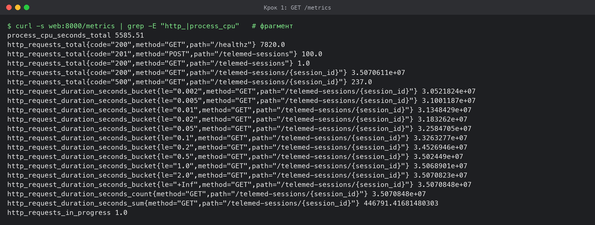

# Крок 2. /livez, X-Pod, розмір пулу

* `GET /livez` повертає `{"status": "alive", …}` і до бази не звертається; `GET /healthz`, як і в ЛР 1, робить `SELECT 1`.
* `INSTANCE = os.environ.get("POD_NAME") or socket.gethostname()`; значення йде в заголовок `X-Pod` кожної відповіді (у Compose `POD_NAME` не задано, тому це hostname контейнера).
* Пул asyncpg: `min_size = min(2, DB_POOL_SIZE)`, `max_size = DB_POOL_SIZE = 10`; понад 10 зʼєднань екземпляр не відкриває. У Compose `DB_POOL_SIZE: "10"`.

*Лістинг 3 – Перевірка /livez, X-Pod і розміру пулу*

```
$ curl -s localhost:8088/livez
{"status":"alive","instance":"7a6f292849e2"}
$ for i in 1 2 3 4 5 6; do curl -s -D - -o /dev/null localhost:8088/telemed-sessions/1 | grep -i x-pod; done
x-pod: 7a6f292849e2
x-pod: 7a6f292849e2
x-pod: 7a6f292849e2
x-pod: 7a6f292849e2
x-pod: 7a6f292849e2
x-pod: 7a6f292849e2
$ docker compose exec web env | grep DB_POOL_SIZE
DB_POOL_SIZE=10
$ docker compose exec db psql -U telemed -c "SELECT client_addr, count(*) FROM pg_stat_activity WHERE datname='telemed' GROUP BY 1"
 client_addr | count 
-------------+-------
 172.21.0.3  |    10
 172.21.0.4  |    10
 172.21.0.5  |    10
 172.21.0.6  |    10
(4 rows)
```

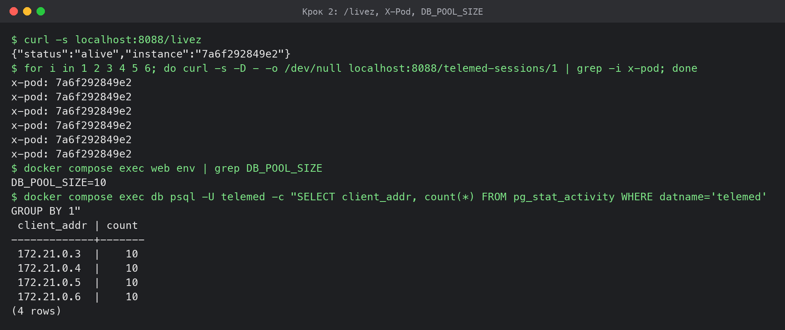

# Крок 3. Коректна зупинка

uvicorn запущено в exec-формі `CMD ["uvicorn", …, "--timeout-graceful-shutdown", "8"]`, тож він є PID 1 і сам отримує SIGTERM. Після сигналу uvicorn перестає приймати зʼєднання, дочікується запитів в обробці, викликає завершення lifespan, де закривається пул (рядок `graceful shutdown complete, pool closed` у журналі), і виходить з кодом 0. `stop_grace_period` = 10 с більший за 8 с очікування, тож SIGKILL не надходить. nginx повторює запит на іншому екземплярі (`proxy_next_upstream error timeout http_502 http_503`, `proxy_connect_timeout 500ms`), тому запит, що потрапив на зʼєднання, яке закривається, клієнт не бачить як помилку.

Перевірка (`scripts/graceful.sh`, додаток Б): два екземпляри, генератор 40 с тримає 1000 запитів/с, на 22-й секунді `docker stop` зупиняє `telemed2-web-2`.

*Лістинг 4 – Коректна зупинка під навантаженням, results/step3_graceful.log*

```
web: 2 екземпляри healthy, у Prometheus 2 цілей UP, lb перезапущено
$ docker compose ps web
telemed2-web-1 Up 6 hours (healthy)
telemed2-web-2 Up About a minute (healthy)
$ docker stop telemed2-web-2      # unix 1793221209
telemed2-web-2
зупинка зайняла 1 с
$ docker inspect --format '{{.State.ExitCode}}' telemed2-web-2
0
graceful: 1 сходинок, зупинка: кінець профілю; X = 1000.1 ± 0.8 на сходинці 1 (задано 1000), p99 = 501.2 мс
$ docker logs telemed2-web-2 | tail -6
2026-10-28 20:58:03,266 INFO connected to database, instance=9282e28ed181 pool=10
INFO:     Shutting down
INFO:     Waiting for application shutdown.
2026-10-28 21:00:09,930 INFO graceful shutdown complete, pool closed, instance=9282e28ed181
INFO:     Application shutdown complete.
INFO:     Finished server process [1]
# генератор, 10 с навколо зупинки (±5 с від docker stop):
unix        sent  2xx  non2xx  conn_err  p99_ms
1793221204  1001 1000       0         0   1.702
1793221205  1000 1001       0         0   1.786
1793221206  1000  999       0         0   2.096
1793221207  1000 1000       0         0   1.791
1793221208  1000 1001       0         0   1.908
1793221209  1000  995       0         0   2.121
1793221210  1000  755       0         0  506.982
1793221211  1000 1000       0         0  502.042
1793221212   999  999       0         0  502.104
1793221213  1001 1001       0         0  502.198
за 10 с: відповідей 2xx = 9751, не 2xx і помилок зʼєднання = 0
```

Код завершення **0**, за 10 секунд навколо зупинки (±5 с від `docker stop`) генератор отримав 9 751 відповідей 2xx і **жодної** відповіді не 2xx чи помилки зʼєднання. За весь 40-секундний прогін надіслано 40 000 запитів і отримано 40 000 відповідей 2xx. У вікні їх 9 751, а не 10 000, бо після зупинки p99 зростає до ≈ 502 мс: nginx (з `max_fails=0`) і далі пробує зупинений екземпляр, чекає `proxy_connect_timeout` 500 мс і повторює запит на живому. Частина запитів останніх секунд вікна тому завершилась уже після нього. Ціна відсутності помилок — +0.5 с до затримки частини запитів, поки балансувальник не перезапущено з новим переліком екземплярів (крок 4).

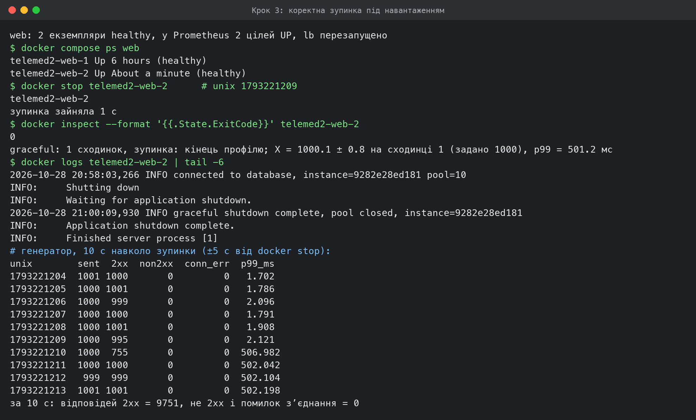

# Крок 4. Prometheus у стенді

*Лістинг 5 – Конфігурація збору, prometheus/prometheus.yml*

```yaml
global:
  scrape_interval: 5s
  evaluation_interval: 5s

scrape_configs:
  # Екземпляри web знаходяться через DNS Compose: A-запит за іменем сервісу
  # повертає адреси всіх його контейнерів, список оновлюється кожні 5 с.
  - job_name: web
    metrics_path: /metrics
    dns_sd_configs:
      - names: [web]
        type: A
        port: 8000
        refresh_interval: 5s

  - job_name: prometheus
    static_configs:
      - targets: ["localhost:9090"]
```

*Лістинг 6 – docker-compose.yml*

```yaml
name: telemed2

services:
  db:
    image: postgres:16-alpine
    environment:
      POSTGRES_USER: ${POSTGRES_USER:-telemed}
      POSTGRES_DB: ${POSTGRES_DB:-telemed}
      POSTGRES_PASSWORD: ${POSTGRES_PASSWORD:?set POSTGRES_PASSWORD in .env}
    # 4 екземпляри × пул 10 = 40 зʼєднань, запас до стандартних 100.
    command: ["postgres", "-c", "max_connections=100"]
    volumes:
      - pgdata:/var/lib/postgresql/data
      - ./db/schema.sql:/docker-entrypoint-initdb.d/01-schema.sql:ro
    healthcheck:
      test: ["CMD-SHELL", "pg_isready -h 127.0.0.1 -U $${POSTGRES_USER} -d $${POSTGRES_DB}"]
      interval: 1s
      timeout: 2s
      retries: 30
    # Як у ЛР 1 (варіант 26): база лише у внутрішній мережі, порт на хост не публікується.
    networks: [backend]

  web:
    build: .
    image: telemed2-web:latest
    environment:
      DB_HOST: db
      DB_PORT: "5432"
      DB_USER: ${POSTGRES_USER:-telemed}
      DB_NAME: ${POSTGRES_DB:-telemed}
      DB_PASSWORD: ${POSTGRES_PASSWORD:?set POSTGRES_PASSWORD in .env}
      DB_POOL_SIZE: "10"            # варіант 26
      PROMETHEUS_DISABLE_CREATED_SERIES: "True"
    depends_on:
      db:
        condition: service_healthy
    stop_grace_period: 10s
    deploy:
      replicas: ${WEB_REPLICAS:-1}
      resources:
        limits:                     # з варіанта ЛР 1, не змінюються
          cpus: "1"
          memory: 512M
    networks: [backend, frontend]

  lb:
    image: nginx:1.27-alpine
    volumes:
      - ./nginx/nginx.conf:/etc/nginx/nginx.conf:ro
    ports:
      # 8080 на хості зайнятий іншим процесом (llama-server), тому балансувальник — на 8088.
      - "8088:80"
    depends_on:
      web:
        condition: service_healthy
    networks: [frontend]

  prometheus:
    image: prom/prometheus:v3.1.0
    command:
      - --config.file=/etc/prometheus/prometheus.yml
      - --storage.tsdb.path=/prometheus
    volumes:
      - ./prometheus/prometheus.yml:/etc/prometheus/prometheus.yml:ro
      - promdata:/prometheus
    ports:
      - "9090:9090"
    networks: [frontend]

  # Генератор (Go): запускається окремо, у мережі frontend поряд із балансувальником.
  loadgen:
    build: ./loadgen
    image: telemed2-loadgen:latest
    profiles: [tools]
    volumes:
      - ./results:/results
    networks: [frontend]

networks:
  backend:
    internal: true
  frontend: {}

volumes:
  pgdata: {}
  promdata: {}
```

*Лістинг 7 – Конфігурація балансувальника, nginx/nginx.conf*

```nginx
worker_processes auto;
events { worker_connections 16384; }

http {
    log_format lb '$remote_addr "$request" $status upstream=$upstream_addr rt=$request_time';
    access_log off;

    # nginx резолвить імʼя web при старті й отримує всі IP реплік; тому після
    # зміни кількості екземплярів балансувальник перезапускається (docker compose restart lb).
    upstream web {
        # max_fails=0: екземпляр ніколи не позначається недоступним. З max_fails=1 при
        # перевантаженні одна невдала спроба вимикала екземпляр на 5 с, і nginx віддавав 502 на все.
        server web:8000 max_fails=0;
        keepalive 256;
    }

    server {
        listen 80;

        # Відповідь без звернення до web: межа генератора G (крок 6).
        location = /noop {
            return 204;
        }

        location / {
            proxy_pass http://web;
            proxy_http_version 1.1;
            proxy_set_header Connection "";
            proxy_set_header Host $host;
            # Коректна зупинка: якщо екземпляр закрив зʼєднання або вже не приймає нових,
            # GET повторюється на іншому екземплярі, а клієнт помилки не бачить.
            proxy_connect_timeout 500ms;
            proxy_next_upstream error timeout http_502 http_503;
            proxy_next_upstream_tries 3;
            proxy_read_timeout 30s;
        }
    }
}
```

* `scrape_interval: 5s`; екземпляри web знаходяться через `dns_sd_configs` (`names: [web]`, `type: A`, порт 8000, `refresh_interval: 5s`): DNS Compose повертає адреси всіх контейнерів сервісу.
* Дані Prometheus — в іменованому томі `promdata`, порт 9090 опубліковано на хост.
* Додаткова метрика М4 рахується з гістограми сервісу, окремий експортер не потрібен.
* Після кожної зміни кількості екземплярів `scripts/scale.sh` перезапускає балансувальник (`docker compose restart lb`) і чекає, поки всі N екземплярів будуть healthy і в стані UP у Prometheus.

Перевірка після `--scale web=4` (наприкінці серії, на тому самому стенді):

*Лістинг 8 – Цілі Prometheus при 4 екземплярах, results/step4_targets.log*

```
$ docker compose ps
telemed2-db-1 Up 8 hours (healthy)
telemed2-lb-1 Up Less than a second
telemed2-prometheus-1 Up 8 hours
telemed2-web-1 Up 8 hours (healthy)
telemed2-web-2 Up About an hour (healthy)
telemed2-web-3 Up About an hour (healthy)
telemed2-web-4 Up 31 minutes (healthy)
$ curl -s localhost:9090/api/v1/targets   # job="web"
http://172.22.0.6:8000/metrics up interval 5s via dns web
http://172.22.0.7:8000/metrics up interval 5s via dns web
http://172.22.0.3:8000/metrics up interval 5s via dns web
http://172.22.0.5:8000/metrics up interval 5s via dns web
```

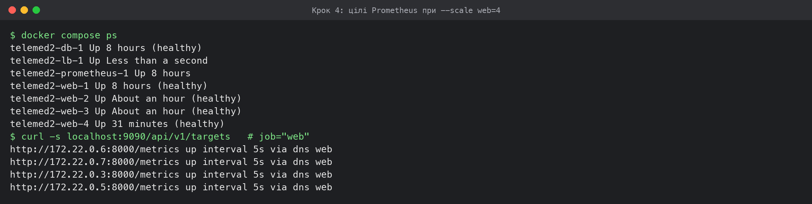

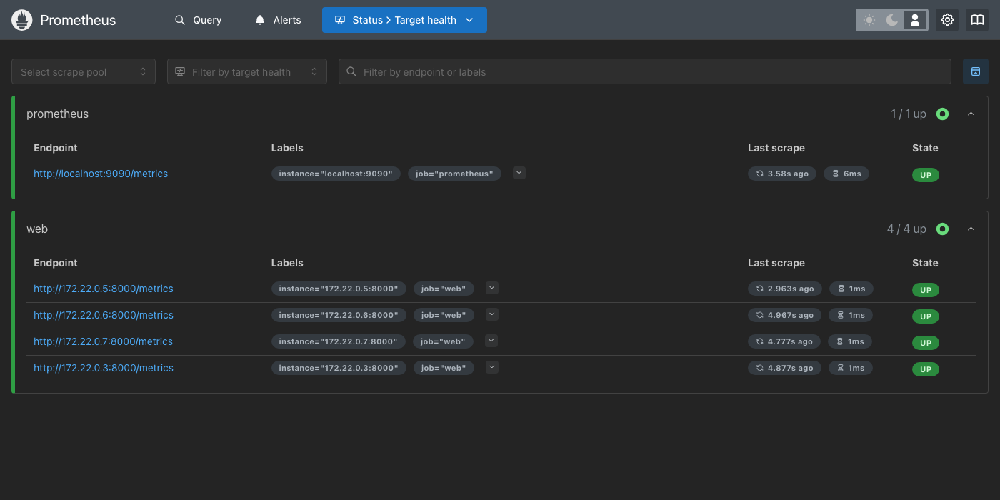

# Крок 5. Генератор зі ступінчастим профілем

Генератор написано на Go (`loadgen/main.go`, додаток Б), він збирається в окремий образ і запускається контейнером у мережі `frontend`.

* **Відкритий контур.** Момент надсилання k-го запиту відрізка обчислюється наперед: `start + k/rate`. Кожен запит виконується в окремій горутині, тож планувальник не чекає відповіді, а кількість одночасних запитів не обмежена пулом: фактична інтенсивність надсилання дорівнює заданій (колонка `sent` у CSV).
* **Затримка** рахується від запланованого моменту надсилання. **Тайм-аут 5 с**; запит, що перевищив його, рахується як відповідь не 2xx (колонки `non2xx` і `timeouts`).
* **Посекундний запис** (`results/<прогін>.seconds.csv`): задана, надіслано, досягнута (кількість 2xx, завершених у цю секунду), не 2xx, помилки зʼєднання, p50, p95, p99 клієнта.
* **Профіль:** прогрів 10 с на 200 запитах/с, далі сходинки по 20 с від 200 з кроком 200. Досягнута інтенсивність сходинки — середнє за останні 15 с (перші 5 с перехідні), розкид — стандартне відхилення посекундних значень за ті самі 15 с.
* **Зупинка:** дві сходинки поспіль з досягнутою < 0.9 заданої або сходинка із заданою ≥ G (`-G`).
* **Сценарій:** `GET /telemed-sessions/{id}`, id випадковий з 1..100, перед серією — засів 100 записів (`scripts/seed.sh`).

*Лістинг 9 – Планування відкритого контуру, loadgen/main.go*

```go
	// Надсилає відрізок з постійною інтенсивністю; моменти — від початку відрізка.
	runSegment := func(segStart time.Time, dur int, rate float64) {
		mu.Lock()
		for i := 0; i < dur; i++ {
			sec(segStart.Add(time.Duration(i)*time.Second + time.Millisecond)).Target = rate
		}
		mu.Unlock()
		n := int(math.Floor(rate * float64(dur)))
		for k := 0; k < n; k++ {
			sched := segStart.Add(time.Duration(float64(k) / rate * float64(time.Second)))
			if d := time.Until(sched); d > 0 {
				time.Sleep(d)
			}
			mu.Lock()
			sec(time.Now()).Sent++
			mu.Unlock()
			inflight.Add(1)
			go fire(sched)
		}
		if d := time.Until(segStart.Add(time.Duration(dur) * time.Second)); d > 0 {
			time.Sleep(d)
		}
	}
```

*Лістинг 10 – Засів даних, scripts/seed.sh*

```bash
#!/usr/bin/env bash
# Заносить 100 записів перед серією; id у сценарії беруться з діапазону 1-100.
set -eu
ch=(video audio chat); st=(scheduled in_progress completed cancelled)
for i in $(seq 1 100); do
  curl -s -o /dev/null -X POST http://localhost:8088/telemed-sessions -H 'Content-Type: application/json' \
    -d "{\"patient_code\":\"P-$(printf %06d $i)\",\"doctor\":\"Лікар $((i%7+1))\",\"channel\":\"${ch[$((i%3))]}\",\"started_at\":\"2026-10-0$((i%9+1))T09:00:00+03:00\",\"duration_min\":$(( (i%18+1)*5 )),\"status\":\"${st[$((i%4))]}\"}"
done
curl -s "http://localhost:8088/telemed-sessions?limit=1" | python3 -c 'import sys,json;d=json.load(sys.stdin);print("seeded, total =",d["total"],"first id =",d["items"][0]["id"])'
```

Вивід засіву — у журналі серії: `seeded, total = 100 first id = 1`.

Перші секунди посекундного запису прогону на одному екземплярі (прогрів 200/с і перша сходинка):

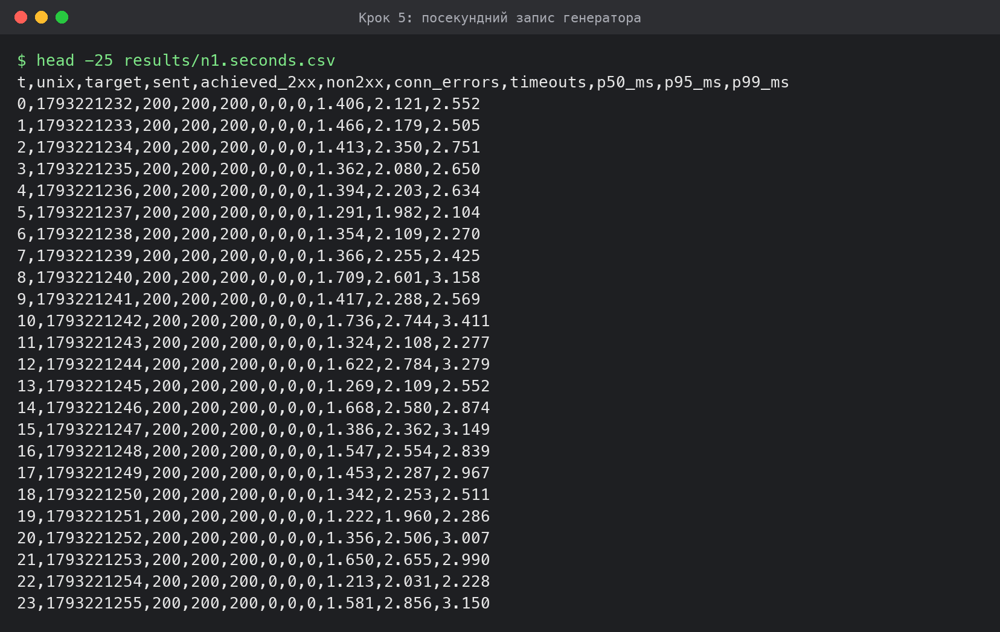

# Крок 6. Межа генератора G

У `nginx.conf` додано `location = /noop { return 204; }` — відповідь без звернення до web. Ступінчастий прогін на `/noop` через той самий балансувальник, без обмеження G.

| Сходинка | Задана, запитів/с | Досягнута, запитів/с | Розкид | p99 клієнта, мс |
|---|---|---|---|---|
| 197 | 39 400 | 39 400.1 | 2.2 | 1.51 |
| 198 | 39 600 | 39 600.0 | 19.9 | 1.53 |
| 199 | 39 800 | 39 799.9 | 23.8 | 1.52 |
| 200 | 40 000 | 40 000.1 | 10.2 | 1.54 |

**G = 40 000.1 запитів/с** (сходинка 200, задано 40 000); усього сходинок 200, зупинка: max-steps.

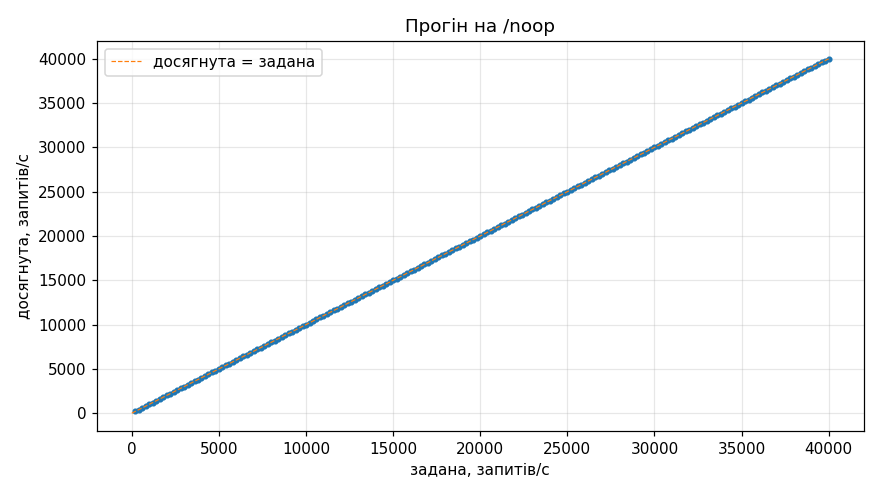

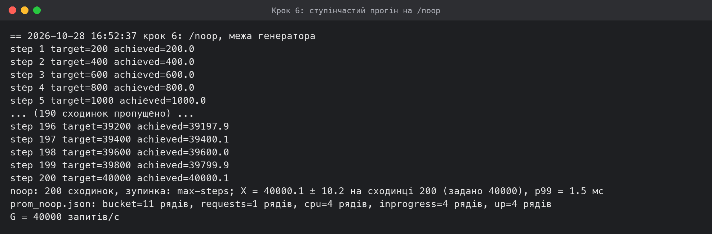

На всіх 200 сходинках, аж до 40 000 запитів/с, досягнута інтенсивність дорівнює заданій, а p99 клієнта лишається в межах 1.5–5.3 мс: nginx віддає 204 сам, тож це межа ланцюжка «генератор → мережа Docker → nginx», а не сервісу.

**Чому прогін на `/noop` зупинився на 200-й сходинці.** Правило зупинки з умови (дві сходинки поспіль < 0.9 заданої) за 200 сходинок не спрацювало жодного разу: на кожній сходинці досягнута дорівнювала заданій. Прогін завершив запобіжник генератора `-max-steps`, який в образі, зібраному на момент запуску, дорівнював 200 (40 000 запитів/с; пізніше його піднято до 400). Отже, межа генератора **G ≥ 40 000 запитів/с** — це нижня оцінка, а не точне значення. Для класифікації точок цього достатньо: точка N обмежена генератором, якщо X(N) ≥ 0.9 · G, а 0.9 · 40 000 = 36 000 запитів/с набагато більше за будь-яке виміряне X(N). Повторювати прогін ще на годину заради точного G сенсу немає.

# Крок 7. Ступінчасті прогони на 1, 2, 3 і 4 екземплярах

Ресурси, виділені Docker: **8 CPU, 8 ГБ** (ВМ Colima). Ліміт кожного web — 1 CPU, 512 МБ (`deploy.resources.limits`).

Журнал серії і те, як його зібрано, — у розділі «Журнал серії». Нижче для кожної кількості екземплярів X(N), розкид і сходинка, на якій X(N) досягнуто; для цієї сходинки — p99 клієнта (генератор), p99 сервера (гістограма, сума по екземплярах, формула з умови), частка не 2xx, середнє використання CPU одного екземпляра (`process_cpu_seconds_total`) і середня кількість запитів в обробці на екземпляр.

| N | X(N), запитів/с | Розкид | Сходинка (задано) | p99 клієнта, мс | p99 сервера, мс | Не-2xx | CPU одного екземпляра, ядер | Запитів в обробці на екземпляр | Обмежена генератором |
|---|---|---|---|---|---|---|---|---|---|
| 1 | 7 254.8 | 712.5 | 37 (7 400) | 281.0 | 429.2 | 1.19% | 0.91 | 373.25 | ні |
| 2 | 13 058.5 | 375.7 | 65 (13 000) | 289.6 | 451.4 | 0.00% | 0.89 | 343.75 | ні |
| 3 | 18 571.6 | 1 591.2 | 93 (18 600) | 446.9 | 496.4 | 0.95% | 0.91 | 288.75 | ні |
| 4 | 16 600.4 | 94.5 | 83 (16 600) | 56.4 | 43.3 | 0.00% | 0.68 | 5.56 | ні |

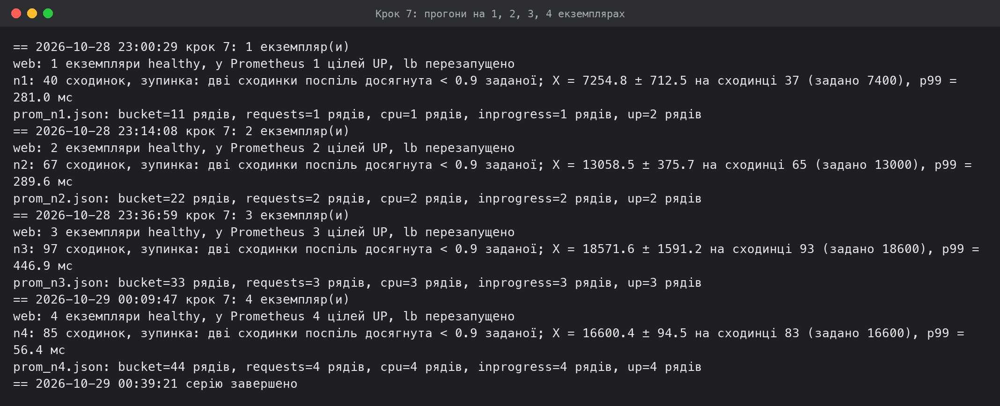

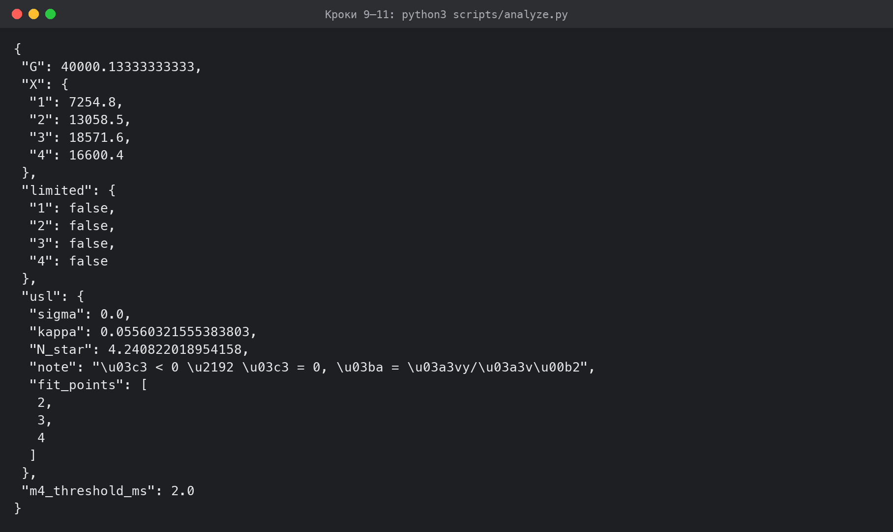

**N = 1, 2, 3.** X(N) зростає майже лінійно: 7 255 → 13 059 → 18 572 запитів/с, C(2) = 1.80, C(3) = 2.56. На сходинці X(N) кожен екземпляр використовує 0.88–0.92 ядра при ліміті 1 CPU, а в обробці в середньому 290–370 запитів на екземпляр: запити стоять у черзі всередині екземпляра. Отже, при N ≤ 3 межу задає **процесор самого екземпляра** (один процес Python на одному ядрі, квота CFS 1 CPU), і кожен новий екземпляр додає майже повну порцію пропускної здатності.

**N = 4.** X(4) = 16 600 запитів/с, **менше**, ніж X(3). На цій сходинці кожен екземпляр використовує лише 0.67–0.69 ядра, запитів в обробці в середньому 5.6 на екземпляр, p99 клієнта 56 мс: екземпляри **не насичені**. Проте вже на наступній сходинці (16 800) система обвалюється за дві секунди: p99 стрибає з 50 до 600 мс, досягнута падає до нуля, а генератор перестає встигати навіть **надсилати** запити (колонка `sent` у CSV падає з 16 800 до 0). Обмежує вже не екземпляр, а спільний ресурс — крок 11.

Частка відповідей не 2xx на сходинках X(N) — 0–1.2 % (тайм-аути 5 с у черзі перевантаженого екземпляра при N = 1 і 3).

# Крок 8. Діаграми прогонів на 1 і 4 екземплярах

Побудовано з посекундного CSV генератора і рядів Prometheus, збережених до видалення томів (`results/prom_n1.json`, `results/prom_n4.json`). p99 сервера — за вікно 15 с з оновленням кожні 5 с (прирости бакетів між точками збору).

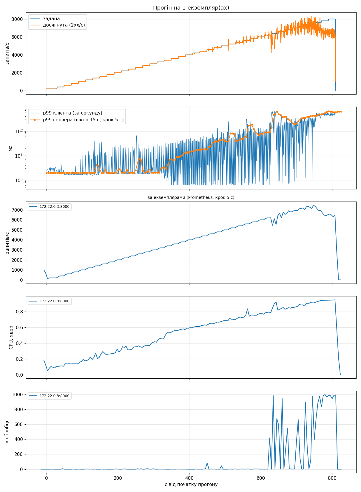

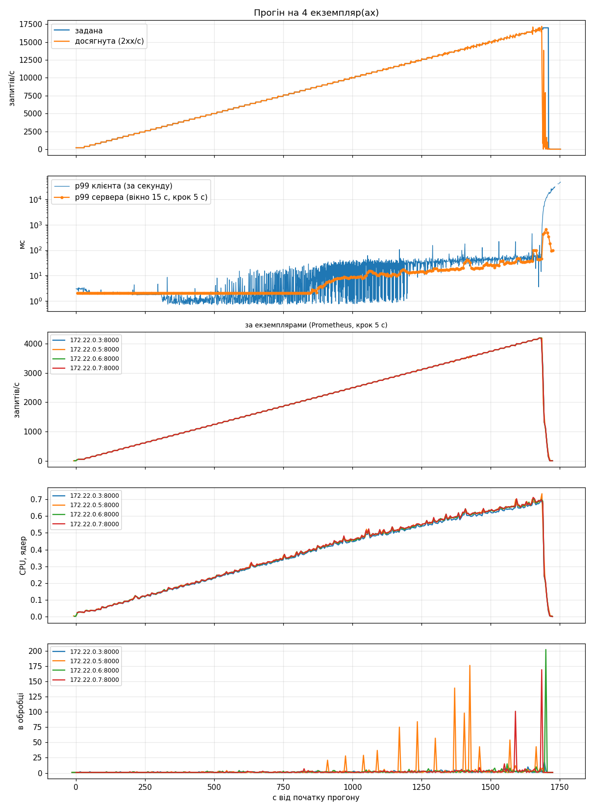

Той самий прогін на 4 екземплярах у Prometheus (запити за секунду по екземплярах):

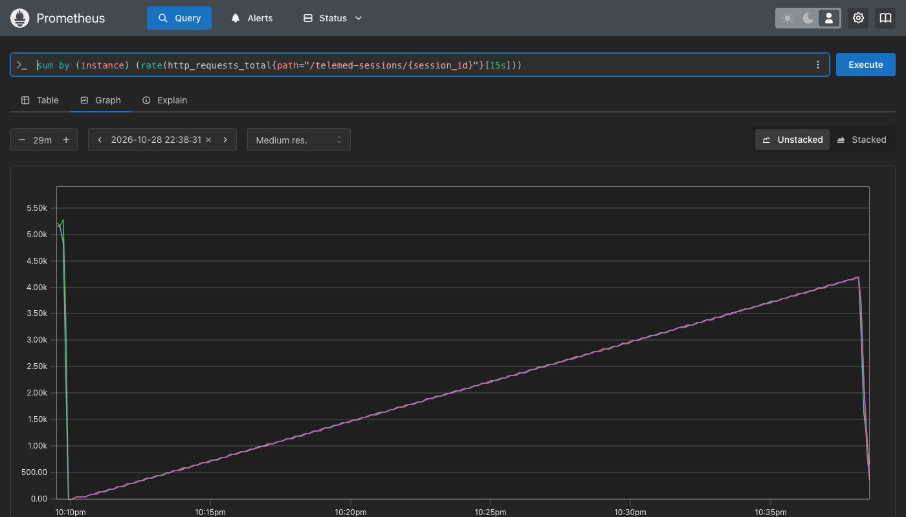

**N = 1.** Досягнута йде за заданою до ≈ 7 000 запитів/с. p99 сервера виходить з першого бакета (2 мс) біля 3 200 запитів/с і далі росте сходинками бакетів до сотень мілісекунд; CPU екземпляра доходить до ≈ 0.9 ядра, кількість запитів в обробці — до сотень. Після межі досягнута коливається, а p99 клієнта росте з кожною сходинкою: черга накопичується.

**N = 4.** Запити розподілені між екземплярами рівно (≈ 4 150 запитів/с на кожен при X(4)), CPU усіх чотирьох росте синхронно до ≈ 0.7 ядра, кількість запитів в обробці лишається одиничною з поодинокими сплесками. Обвал на 16 800 відбувається одночасно на всіх екземплярах — ознака спільного, а не «свого» ресурсу. На графіку Prometheus нижче видно той самий рівномірний розподіл.

# Крок 9. p99 клієнта і p99 сервера на одному екземплярі

Для кожної сходинки прогону на одному екземплярі: p99 клієнта (від запланованого моменту, разом із мережею, nginx і чергою) і p99 сервера за гістограмою. Похибка оцінки не перевищує ширини бакета b(i) − b(i−1).

| Сходинка | Задана | Досягнута | p99 клієнта, мс | p99 сервера, мс | Бакет, мс | Макс. похибка, мс |
|---|---|---|---|---|---|---|
| 1 | 200 | 200.0 | 2.99 | 2.0 | (0; 2] | 2 |
| 2 | 400 | 400.0 | 2.32 | 2.0 | (0; 2] | 2 |
| 3 | 600 | 600.0 | 1.71 | 2.0 | (0; 2] | 2 |
| 4 | 800 | 799.9 | 1.69 | 2.0 | (0; 2] | 2 |
| 5 | 1 000 | 1 000.0 | 2.56 | 2.0 | (0; 2] | 2 |
| 6 | 1 200 | 1 199.9 | 2.04 | 2.0 | (0; 2] | 2 |
| 7 | 1 400 | 1 399.9 | 7.86 | 2.5 | (2; 5] | 3 |
| 8 | 1 600 | 1 600.0 | 2.90 | 2.0 | (0; 2] | 2 |
| 9 | 1 800 | 1 800.0 | 1.96 | 2.0 | (0; 2] | 2 |
| 10 | 2 000 | 1 999.9 | 3.67 | 2.0 | (0; 2] | 2 |
| 11 | 2 200 | 2 200.1 | 6.64 | 2.0 | (0; 2] | 2 |
| 12 | 2 400 | 2 399.9 | 5.95 | 2.5 | (2; 5] | 3 |
| 13 | 2 600 | 2 600.1 | 2.41 | 2.4 | (2; 5] | 3 |
| 14 | 2 800 | 2 799.9 | 4.20 | 2.8 | (2; 5] | 3 |
| 15 | 3 000 | 3 000.0 | 2.63 | 2.0 | (0; 2] | 2 |
| 16 | 3 200 | 3 200.2 | 12.69 | 3.4 | (2; 5] | 3 |
| 17 | 3 400 | 3 400.0 | 15.34 | 7.2 | (5; 10] | 5 |
| 18 | 3 600 | 3 599.9 | 23.92 | 8.9 | (5; 10] | 5 |
| 19 | 3 800 | 3 799.9 | 28.06 | 12.6 | (10; 20] | 10 |
| 20 | 4 000 | 3 999.9 | 32.91 | 15.4 | (10; 20] | 10 |
| 21 | 4 200 | 4 200.0 | 34.59 | 17.6 | (10; 20] | 10 |
| 22 | 4 400 | 4 399.9 | 40.58 | 18.1 | (10; 20] | 10 |
| 23 | 4 600 | 4 607.0 | 49.54 | 35.8 | (20; 50] | 30 |
| 24 | 4 800 | 4 800.0 | 52.07 | 42.8 | (20; 50] | 30 |
| 25 | 5 000 | 4 964.9 | 54.46 | 41.0 | (20; 50] | 30 |
| 26 | 5 200 | 5 200.0 | 49.54 | 40.4 | (20; 50] | 30 |
| 27 | 5 400 | 5 399.9 | 67.49 | 49.7 | (20; 50] | 30 |
| 28 | 5 600 | 5 600.1 | 170.66 | 176.6 | (100; 200] | 100 |
| 29 | 5 800 | 5 800.1 | 73.46 | 79.4 | (50; 100] | 50 |
| 30 | 6 000 | 6 000.0 | 89.68 | 87.9 | (50; 100] | 50 |
| 31 | 6 200 | 6 101.0 | 177.60 | 138.8 | (100; 200] | 100 |
| 32 | 6 400 | 6 158.1 | 412.59 | 499.1 | (200; 500] | 300 |
| 33 | 6 600 | 6 528.8 | 316.75 | 389.1 | (200; 500] | 300 |
| 34 | 6 800 | 6 841.2 | 203.21 | 209.0 | (200; 500] | 300 |
| 35 | 7 000 | 6 999.8 | 229.05 | 296.6 | (200; 500] | 300 |
| 36 | 7 200 | 7 164.8 | 254.34 | 391.9 | (200; 500] | 300 |
| 37 | 7 400 | 7 254.8 | 281.02 | 429.2 | (200; 500] | 300 |
| 38 | 7 600 | 6 893.3 | 458.15 | 495.0 | (200; 500] | 300 |
| 39 | 7 800 | 6 497.1 | 526.81 | 644.5 | (500; 1000] | 500 |
| 40 | 8 000 | 6 379.2 | 521.58 | 604.9 | (500; 1000] | 500 |

* **Мале навантаження (до ≈ 3 000 запитів/с).** p99 сервера лежить у першому бакеті (0; 2] мс з похибкою до 2 мс, p99 клієнта — 2.3–3 мс. Різниця — це мережа Docker, nginx і сам генератор, яких гістограма сервісу не бачить.
* **Зростання навантаження.** p99 сервера переходить у бакети (2; 5], (5; 10], (10; 20], (20; 50] мс (сходинки 3 200–4 600), далі (100; 200] і (200; 500] мс. Що ширший бакет, то більша похибка: на сходинках 32–38 вона сягає 300 мс.
* **Біля межі** оцінка сервера буває вища за p99 клієнта (сходинка 37: 429 мс проти 281 мс). Це не суперечність: лінійна інтерполяція всередині бакета (200; 500] може помилитися на 300 мс, а вікна різні — генератор групує запити за моментом завершення у 15 с сходинки, Prometheus — між точками збору. За останню скінченну межу (2 с) p99 сервера в цьому прогоні не виходив.

# Крок 10. Універсальний закон масштабованості

| N | X(N) | C(N) = X(N)/X(1) | u = N−1 | v = N(N−1) | y = N/C(N) − 1 | У підборі |
|---|---|---|---|---|---|---|
| 1 | 7 254.8 | 1.000 | 0 | 0 | 0.0000 | ні |
| 2 | 13 058.5 | 1.800 | 1 | 2 | 0.1111 | так |
| 3 | 18 571.6 | 2.560 | 2 | 6 | 0.1719 | так |
| 4 | 16 600.4 | 2.288 | 3 | 12 | 0.7481 | так |

Суми по точках N = 2, 3, 4 (жодна не обмежена генератором): Σu² = 14, Σv² = 184, Σuv = 50, Σuy = 2.6993, Σvy = 10.2310.

σ = (Σv² · Σuy − Σuv · Σvy) / (Σu² · Σv² − (Σuv)²) = (184 · 2.6993 − 50 · 10.2310) / (14 · 184 − 50²) = −0.1958

κ = (Σu² · Σvy − Σuv · Σuy) / (Σu² · Σv² − (Σuv)²) = (14 · 10.2310 − 50 · 2.6993) / 76 = 0.1088

Оцінка σ відʼємна, тому за правилом умови **σ = 0**, а **κ = Σvy / Σv² = 10.2310 / 184 = 0.0556**.

N* = √((1 − σ) / κ) = √(1 / 0.0556) = **4.24**

Крива закону з цими параметрами: X(2) = 13 058, X(3) = 16 320, X(4) = 17 406 запитів/с (виміряно 13 059, 18 572, 16 600). σ = 0 означає, що послідовної частини, яка б не масштабувалась, при N ≤ 3 немає: другий і третій екземпляри додають майже по цілому X(1). κ > 0 описує падіння на N = 4. Екземпляри між собою стан не узгоджують (сервіс без стану), тож κ тут — не «узгодження» в буквальному сенсі, а витрати, що ростуть з кількістю екземплярів на спільній ВМ: з кожним екземпляром і кожною тисячею запитів/с більше працюють nginx, база, генератор і мережевий стек ядра, які ділять ті самі 8 vCPU (крок 11). Підбір по трьох точках чутливий до кожної з них, тож N* ≈ 4 варто читати як «на цьому стенді понад 3–4 екземпляри приросту не дають», а не як точне число.

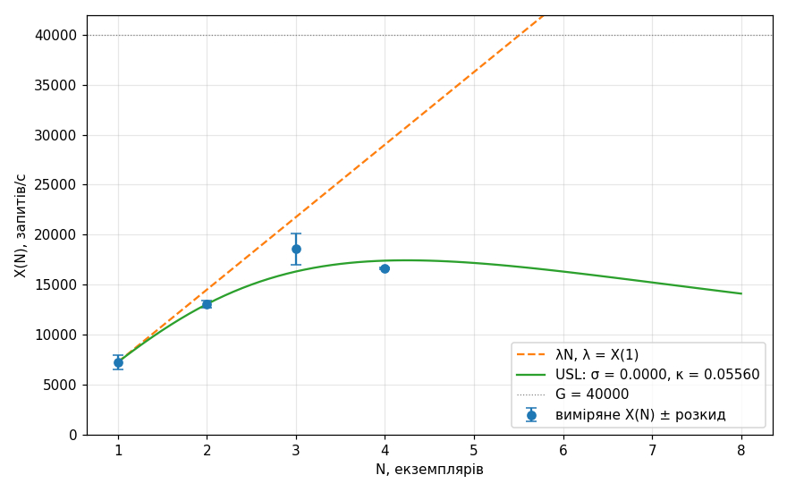

# Крок 11. Спільний ресурс

`docker stats --no-stream` знімався в циклі весь прогін (`results/stats_n4.jsonl`); нижче — середні за 15-секундне вікно сходинки, на якій досягнуто X(4).

| Контейнер | CPU, % (100% = 1 ядро) | Памʼять | Замірів у вікні |
|---|---|---|---|
| loadgen | 79.3 | 108.8MiB | 8 |
| telemed2-db-1 | 85.7 | 93.03MiB | 8 |
| telemed2-lb-1 | 68.7 | 69.04MiB | 8 |
| telemed2-prometheus-1 | 0.1 | 53.91MiB | 8 |
| telemed2-web-1 | 74.6 | 64.46MiB | 8 |
| telemed2-web-2 | 73.2 | 64.37MiB | 8 |
| telemed2-web-3 | 76.9 | 64.33MiB | 8 |
| telemed2-web-4 | 77.8 | 69MiB | 8 |
| **разом** | **536.3** | | |

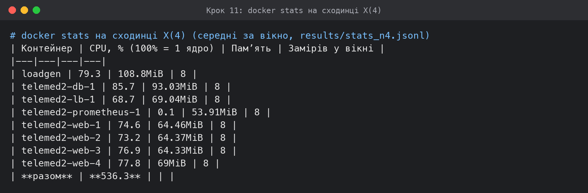

На сходинці X(4) контейнери разом використовують **≈ 5.4 ядра з 8**: чотири web по 0.73–0.78, база 0.86, nginx 0.69, генератор 0.79. `docker stats` не показує те, що не належить контейнерам: обробку мережевих пакетів у ядрі ВМ (кожен запит проходить міст Docker двічі — генератор → nginx → web, і ще web → база) і накладні витрати самої ВМ Colima.

Що **не** є обмежувачем:

* **екземпляри web** — 0.68 ядра з 1, в обробці 5.6 запиту, p99 сервера 43 мс;
* **пул зʼєднань** — по 10 на екземпляр, 40 разом (крок 2), черги в обробці немає;
* **база сама по собі** — 0.86 ядра без ліміту, тобто вона могла б узяти більше CPU, якби він був вільний;
* **генератор як такий** — на `/noop` він тримав 40 000 запитів/с.

Що вказує на **процесор ВМ (хоста)**. Обвал на 16 800 відбувається одночасно на всіх чотирьох екземплярах, і в ту саму мить генератор перестає встигати надсилати запити за розкладом. Генератор, nginx, база і web не мають між собою нічого спільного, крім процесора ВМ і її мережевого стека. Коли хвіст затримки зростає, генератор відкритого контуру відкриває нові зʼєднання для запитів, що накопичились, а це додатково навантажує ядро ВМ — і виникає лавина.

**Висновок: ріст X(N) обмежує процесор спільної ВМ на 8 vCPU.** При N ≤ 3 сумарне навантаження ще вміщується, і межу задає CPU кожного екземпляра. При N = 4 ресурс одного екземпляра вже не вичерпується, бо раніше закінчується спільний.

**Додаткова метрика М4.** Поріг — межа бакета, найближча до p99 сервера на першій сходинці прогону на одному екземплярі (1.98 мс, бакет (0; 2]), тобто **2 мс**. Частка = приріст `http_request_duration_seconds_bucket{le="поріг"}` / приріст `…_bucket{le="+Inf"}` за вікно сходинки, сума по екземплярах.

| Задана, запитів/с | Частка ≤ поріг, N = 1 | Частка ≤ поріг, N = 4 |
|---|---|---|
| 200 | 99.97% | 99.97% |
| 400 | 99.92% | 100.00% |
| 600 | 99.99% | 99.99% |
| 800 | 99.99% | 99.98% |
| 1 000 | 99.43% | 99.98% |
| 1 200 | 99.77% | 99.99% |
| 1 400 | 98.92% | 99.99% |
| 1 600 | 99.05% | 99.99% |
| 1 800 | 99.83% | 99.99% |
| 2 000 | 99.14% | 99.97% |
| 2 200 | 99.04% | 99.97% |
| 2 400 | 98.87% | 99.98% |
| 2 600 | 98.95% | 99.98% |
| 2 800 | 98.84% | 99.97% |
| 3 000 | 99.23% | 99.93% |
| 3 200 | 98.75% | 99.97% |
| 3 400 | 97.84% | 99.97% |
| 3 600 | 97.35% | 99.97% |
| 3 800 | 96.66% | 99.97% |
| 4 000 | 96.18% | 99.98% |
| 4 200 | 96.01% | 99.98% |
| 4 400 | 95.67% | 99.98% |
| 4 600 | 94.35% | 99.98% |
| 4 800 | 93.68% | 99.97% |
| 5 000 | 93.03% | 99.93% |
| 5 200 | 92.49% | 99.90% |
| 5 400 | 89.48% | 99.91% |
| 5 600 | 79.89% | 99.91% |
| 5 800 | 88.84% | 99.92% |
| 6 000 | 87.17% | 99.91% |
| 6 200 | 84.27% | 99.88% |
| 6 400 | 48.89% | 99.74% |
| 6 600 | 74.08% | 99.80% |
| 6 800 | 75.89% | 99.94% |
| 7 000 | 67.01% | 99.64% |
| 7 200 | 64.22% | 99.57% |
| 7 400 | 50.84% | 99.61% |
| 7 600 | 22.32% | 99.41% |
| 7 800 | 17.98% | 99.51% |
| 8 000 | 16.96% | 99.30% |
| 8 200 | — | 99.21% |
| 8 400 | — | 98.97% |
| 8 600 | — | 98.98% |
| 8 800 | — | 98.65% |
| 9 000 | — | 98.18% |
| 9 200 | — | 98.01% |
| 9 400 | — | 97.73% |
| 9 600 | — | 97.35% |
| 9 800 | — | 97.49% |
| 10 000 | — | 97.48% |
| 10 200 | — | 97.42% |
| 10 400 | — | 97.02% |
| 10 600 | — | 95.93% |
| 10 800 | — | 96.98% |
| 11 000 | — | 97.00% |
| 11 200 | — | 97.35% |
| 11 400 | — | 97.13% |
| 11 600 | — | 97.37% |
| 11 800 | — | 96.23% |
| 12 000 | — | 96.78% |
| 12 200 | — | 96.70% |
| 12 400 | — | 96.81% |
| 12 600 | — | 96.47% |
| 12 800 | — | 96.19% |
| 13 000 | — | 96.37% |
| 13 200 | — | 96.10% |
| 13 400 | — | 96.00% |
| 13 600 | — | 95.72% |
| 13 800 | — | 95.45% |
| 14 000 | — | 93.76% |
| 14 200 | — | 95.41% |
| 14 400 | — | 95.38% |
| 14 600 | — | 95.27% |
| 14 800 | — | 95.01% |
| 15 000 | — | 94.85% |
| 15 200 | — | 95.54% |
| 15 400 | — | 94.64% |
| 15 600 | — | 94.31% |
| 15 800 | — | 94.50% |
| 16 000 | — | 94.00% |
| 16 200 | — | 93.68% |
| 16 400 | — | 93.75% |
| 16 600 | — | 92.23% |
| 16 800 | — | 83.46% |
| 17 000 | — | 29.07% |

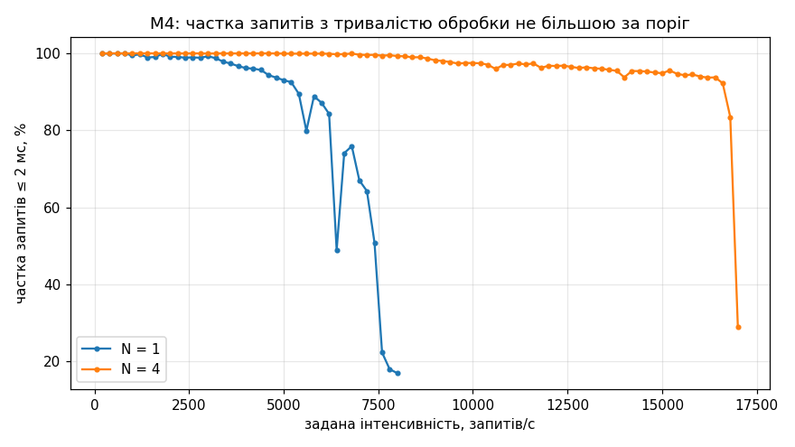

**N = 1.** Частка запитів, оброблених не довше за 2 мс, тримається ≈ 99–100 % до 3 000 запитів/с, потім помітно падає: 97.8 % на 3 400, 96.2 % на 4 000, 93.0 % на 5 000, 87.2 % на 6 000, а після межі — до 17 % на 8 000. Падіння починається задовго до того, як досягнута відстане від заданої (≈ 7 000), тож М4 — ранній індикатор насичення: екземпляр ще встигає, але дедалі частіше чекає процесор.

**N = 4.** Частка лишається ≈ 99.9 % до ≈ 6 000 запитів/с, 97.5 % на 10 000 і ≈ 94 % на 14 000–16 200. На сходинці X(4) це 92.2 %, далі 83.5 % на 16 800 і 29 % на 17 000. Повільне падіння від ≈ 10 000 запитів/с — це вже не черга в екземплярі (у обробці одиниці запитів), а затримки, коли процеси web не отримують процесорний час на спільній ВМ.

# Журнал серії

*Лістинг 11 – Повний журнал серії одним запуском, results/series.log*

```
== 2026-10-28 16:51:14 стенд з порожніми томами
telemed2-db-1 Up 7 seconds (healthy)
telemed2-lb-1 Up Less than a second
telemed2-prometheus-1 Up 7 seconds
telemed2-web-1 Up 6 seconds (healthy)
$ ./scripts/seed.sh
seeded, total = 100 first id = 1
$ docker info  # ресурси ВМ Docker (Colima)
CPU: 8, памʼять: 8307478528 байт, Docker 29.5.2
== 2026-10-28 16:51:27 крок 3: коректна зупинка
web: 2 екземпляри healthy, у Prometheus 2 цілей UP, lb перезапущено
$ docker compose ps web
telemed2-web-1 Up 22 seconds (healthy)
telemed2-web-2 Up 13 seconds (healthy)
$ docker stop telemed2-web-2      # unix 1793199124
telemed2-web-2
зупинка зайняла 0 с
$ docker inspect --format '{{.State.ExitCode}}' telemed2-web-2
0
graceful: 1 сходинок, зупинка: кінець профілю; X = 1000.0 ± 2.1 на сходинці 1 (задано 1000), p99 = 2.4 мс
$ docker logs telemed2-web-2 | tail -6
2026-10-28 14:51:29,485 INFO connected to database, instance=6bea3729638c pool=10
INFO:     Shutting down
INFO:     Waiting for application shutdown.
2026-10-28 14:52:04,528 INFO graceful shutdown complete, pool closed, instance=6bea3729638c
INFO:     Application shutdown complete.
INFO:     Finished server process [1]
# генератор, 10 с навколо зупинки (±5 с від docker stop):
unix        sent  2xx  non2xx  conn_err  p99_ms
1793199119  1000 1000       0         0   2.091
1793199120  1001 1000       0         0   1.925
1793199121   999 1000       0         0   2.083
1793199122  1001 1001       0         0   1.698
1793199123  1000  999       0         0   1.728
1793199124  1000  997       0         0   1.721
1793199125  1000 1003       0         0   1.738
1793199126   999 1000       0         0   5.588
1793199127  1001 1001       0         0   1.751
1793199128  1000  999       0         0   1.825
за 10 с: відповідей 2xx = 10000, не 2xx і помилок зʼєднання = 0
== 2026-10-28 16:52:23 крок 4: Targets при --scale web=4
web: 4 екземпляри healthy, у Prometheus 4 цілей UP, lb перезапущено
== 2026-10-28 16:52:37 крок 6: /noop, межа генератора
step 1 target=200 achieved=200.0
step 2 target=400 achieved=400.0
step 3 target=600 achieved=600.0
step 4 target=800 achieved=800.0
step 5 target=1000 achieved=1000.0
... (190 сходинок пропущено) ...
step 196 target=39200 achieved=39197.9
step 197 target=39400 achieved=39400.1
step 198 target=39600 achieved=39600.0
step 199 target=39800 achieved=39799.9
step 200 target=40000 achieved=40000.1
noop: 200 сходинок, зупинка: max-steps; X = 40000.1 ± 10.2 на сходинці 200 (задано 40000), p99 = 1.5 мс
prom_noop.json: bucket=11 рядів, requests=1 рядів, cpu=4 рядів, inprogress=4 рядів, up=4 рядів
G = 40000 запитів/с
#
# ---- запуск 1 завершено тут: далі його крок 7 недійсний (сон Mac, потім max_fails=1 у nginx),
# ---- див. results/interrupted/. Запуск 2: nginx з max_fails=0, повтор кроку 3 і весь крок 7
#
== 2026-10-28 22:59:23 запуск 2: nginx з max_fails=0; повтор кроку 3 і весь крок 7 (кроки 4 і 6 — із запуску 1)
web: 2 екземпляри healthy, у Prometheus 2 цілей UP, lb перезапущено
$ docker compose ps web
telemed2-web-1 Up 6 hours (healthy)
telemed2-web-2 Up About a minute (healthy)
$ docker stop telemed2-web-2      # unix 1793221209
telemed2-web-2
зупинка зайняла 1 с
$ docker inspect --format '{{.State.ExitCode}}' telemed2-web-2
0
graceful: 1 сходинок, зупинка: кінець профілю; X = 1000.1 ± 0.8 на сходинці 1 (задано 1000), p99 = 501.2 мс
$ docker logs telemed2-web-2 | tail -6
2026-10-28 20:58:03,266 INFO connected to database, instance=9282e28ed181 pool=10
INFO:     Shutting down
INFO:     Waiting for application shutdown.
2026-10-28 21:00:09,930 INFO graceful shutdown complete, pool closed, instance=9282e28ed181
INFO:     Application shutdown complete.
INFO:     Finished server process [1]
# генератор, 10 с навколо зупинки (±5 с від docker stop):
unix        sent  2xx  non2xx  conn_err  p99_ms
1793221204  1001 1000       0         0   1.702
1793221205  1000 1001       0         0   1.786
1793221206  1000  999       0         0   2.096
1793221207  1000 1000       0         0   1.791
1793221208  1000 1001       0         0   1.908
1793221209  1000  995       0         0   2.121
1793221210  1000  755       0         0  506.982
1793221211  1000 1000       0         0  502.042
1793221212   999  999       0         0  502.104
1793221213  1001 1001       0         0  502.198
за 10 с: відповідей 2xx = 9751, не 2xx і помилок зʼєднання = 0
== 2026-10-28 23:00:28 продовження серії: кроки 3, 4, 6 уже зняті (results/noop.json є)
G = 40000 запитів/с
== 2026-10-28 23:00:29 крок 7: 1 екземпляр(и)
web: 1 екземпляри healthy, у Prometheus 1 цілей UP, lb перезапущено
step 1 target=200 achieved=200.0
step 2 target=400 achieved=400.0
step 3 target=600 achieved=600.0
step 4 target=800 achieved=799.9
step 5 target=1000 achieved=1000.0
step 6 target=1200 achieved=1199.9
step 7 target=1400 achieved=1399.9
step 8 target=1600 achieved=1600.0
step 9 target=1800 achieved=1800.0
step 10 target=2000 achieved=1999.9
step 11 target=2200 achieved=2200.1
step 12 target=2400 achieved=2399.9
step 13 target=2600 achieved=2600.1
step 14 target=2800 achieved=2799.9
step 15 target=3000 achieved=3000.0
step 16 target=3200 achieved=3200.2
step 17 target=3400 achieved=3400.0
step 18 target=3600 achieved=3599.9
step 19 target=3800 achieved=3799.9
step 20 target=4000 achieved=3999.9
step 21 target=4200 achieved=4200.0
step 22 target=4400 achieved=4399.9
step 23 target=4600 achieved=4607.0
step 24 target=4800 achieved=4800.0
step 25 target=5000 achieved=4964.9
step 26 target=5200 achieved=5200.0
step 27 target=5400 achieved=5399.9
step 28 target=5600 achieved=5600.1
step 29 target=5800 achieved=5800.1
step 30 target=6000 achieved=6000.0
step 31 target=6200 achieved=6101.0
step 32 target=6400 achieved=6158.1
step 33 target=6600 achieved=6528.8
step 34 target=6800 achieved=6841.2
step 35 target=7000 achieved=6999.8
step 36 target=7200 achieved=7164.8
step 37 target=7400 achieved=7254.8
step 38 target=7600 achieved=6893.3
step 39 target=7800 achieved=6497.1
step 40 target=8000 achieved=6379.2
n1: 40 сходинок, зупинка: дві сходинки поспіль досягнута < 0.9 заданої; X = 7254.8 ± 712.5 на сходинці 37 (задано 7400), p99 = 281.0 мс
prom_n1.json: bucket=11 рядів, requests=1 рядів, cpu=1 рядів, inprogress=1 рядів, up=2 рядів
== 2026-10-28 23:14:08 крок 7: 2 екземпляр(и)
web: 2 екземпляри healthy, у Prometheus 2 цілей UP, lb перезапущено
step 1 target=200 achieved=200.0
step 2 target=400 achieved=400.0
step 3 target=600 achieved=600.0
step 4 target=800 achieved=800.0
step 5 target=1000 achieved=1000.1
step 6 target=1200 achieved=1200.0
step 7 target=1400 achieved=1399.9
step 8 target=1600 achieved=1600.1
step 9 target=1800 achieved=1800.0
step 10 target=2000 achieved=2000.1
step 11 target=2200 achieved=2200.1
step 12 target=2400 achieved=2400.1
step 13 target=2600 achieved=2599.8
step 14 target=2800 achieved=2800.1
step 15 target=3000 achieved=3000.1
step 16 target=3200 achieved=3200.0
step 17 target=3400 achieved=3400.0
step 18 target=3600 achieved=3600.0
step 19 target=3800 achieved=3800.0
step 20 target=4000 achieved=4000.0
step 21 target=4200 achieved=4200.0
step 22 target=4400 achieved=4400.0
step 23 target=4600 achieved=4600.0
step 24 target=4800 achieved=4800.1
step 25 target=5000 achieved=5000.0
step 26 target=5200 achieved=5199.9
step 27 target=5400 achieved=5400.1
step 28 target=5600 achieved=5599.9
step 29 target=5800 achieved=5799.9
step 30 target=6000 achieved=6000.1
step 31 target=6200 achieved=6199.9
step 32 target=6400 achieved=6363.1
step 33 target=6600 achieved=6600.0
step 34 target=6800 achieved=6799.9
step 35 target=7000 achieved=7000.2
step 36 target=7200 achieved=7200.0
step 37 target=7400 achieved=7400.1
step 38 target=7600 achieved=7600.0
step 39 target=7800 achieved=7799.9
step 40 target=8000 achieved=8000.0
step 41 target=8200 achieved=8200.1
step 42 target=8400 achieved=8400.1
step 43 target=8600 achieved=8600.1
step 44 target=8800 achieved=8800.3
step 45 target=9000 achieved=8999.9
step 46 target=9200 achieved=9187.1
step 47 target=9400 achieved=9399.9
step 48 target=9600 achieved=9600.0
step 49 target=9800 achieved=9800.0
step 50 target=10000 achieved=10000.1
step 51 target=10200 achieved=10200.1
step 52 target=10400 achieved=10400.1
step 53 target=10600 achieved=10600.0
step 54 target=10800 achieved=10800.0
step 55 target=11000 achieved=10972.5
step 56 target=11200 achieved=11199.9
step 57 target=11400 achieved=11400.0
step 58 target=11600 achieved=11599.9
step 59 target=11800 achieved=11856.0
step 60 target=12000 achieved=11976.3
step 61 target=12200 achieved=12033.2
step 62 target=12400 achieved=12173.9
step 63 target=12600 achieved=12424.3
step 64 target=12800 achieved=12558.2
step 65 target=13000 achieved=13058.5
step 66 target=13200 achieved=11664.5
step 67 target=13400 achieved=11374.3
n2: 67 сходинок, зупинка: дві сходинки поспіль досягнута < 0.9 заданої; X = 13058.5 ± 375.7 на сходинці 65 (задано 13000), p99 = 289.6 мс
prom_n2.json: bucket=22 рядів, requests=2 рядів, cpu=2 рядів, inprogress=2 рядів, up=2 рядів
== 2026-10-28 23:36:59 крок 7: 3 екземпляр(и)
web: 3 екземпляри healthy, у Prometheus 3 цілей UP, lb перезапущено
step 1 target=200 achieved=200.0
step 2 target=400 achieved=400.0
step 3 target=600 achieved=600.0
step 4 target=800 achieved=800.0
step 5 target=1000 achieved=999.9
step 6 target=1200 achieved=1200.0
step 7 target=1400 achieved=1400.1
step 8 target=1600 achieved=1599.9
step 9 target=1800 achieved=1800.0
step 10 target=2000 achieved=2000.0
step 11 target=2200 achieved=2199.8
step 12 target=2400 achieved=2400.0
step 13 target=2600 achieved=2600.0
step 14 target=2800 achieved=2800.0
step 15 target=3000 achieved=3000.0
step 16 target=3200 achieved=3199.9
step 17 target=3400 achieved=3400.0
step 18 target=3600 achieved=3600.0
step 19 target=3800 achieved=3800.0
step 20 target=4000 achieved=3999.9
step 21 target=4200 achieved=4200.1
step 22 target=4400 achieved=4400.0
step 23 target=4600 achieved=4600.1
step 24 target=4800 achieved=4800.0
step 25 target=5000 achieved=4999.6
step 26 target=5200 achieved=5200.0
step 27 target=5400 achieved=5400.0
step 28 target=5600 achieved=5599.9
step 29 target=5800 achieved=5800.0
step 30 target=6000 achieved=5999.9
step 31 target=6200 achieved=6199.9
step 32 target=6400 achieved=6400.1
step 33 target=6600 achieved=6600.1
step 34 target=6800 achieved=6800.1
step 35 target=7000 achieved=6999.9
step 36 target=7200 achieved=7200.0
step 37 target=7400 achieved=7400.0
step 38 target=7600 achieved=7600.0
step 39 target=7800 achieved=7799.9
step 40 target=8000 achieved=8000.0
step 41 target=8200 achieved=8199.9
step 42 target=8400 achieved=8405.6
step 43 target=8600 achieved=8599.9
step 44 target=8800 achieved=8800.0
step 45 target=9000 achieved=9000.0
step 46 target=9200 achieved=9200.1
step 47 target=9400 achieved=9399.9
step 48 target=9600 achieved=9599.4
step 49 target=9800 achieved=9794.3
step 50 target=10000 achieved=9999.9
step 51 target=10200 achieved=10200.0
step 52 target=10400 achieved=10400.0
step 53 target=10600 achieved=10600.1
step 54 target=10800 achieved=10800.1
step 55 target=11000 achieved=10999.9
step 56 target=11200 achieved=11196.4
step 57 target=11400 achieved=11385.5
step 58 target=11600 achieved=11604.3
step 59 target=11800 achieved=11799.8
step 60 target=12000 achieved=11994.3
step 61 target=12200 achieved=12200.0
step 62 target=12400 achieved=12400.1
step 63 target=12600 achieved=12600.1
step 64 target=12800 achieved=12799.9
step 65 target=13000 achieved=13000.1
step 66 target=13200 achieved=13199.9
step 67 target=13400 achieved=13400.1
step 68 target=13600 achieved=13610.4
step 69 target=13800 achieved=13800.2
step 70 target=14000 achieved=14000.0
step 71 target=14200 achieved=14199.8
step 72 target=14400 achieved=14409.7
step 73 target=14600 achieved=14599.9
step 74 target=14800 achieved=14800.3
step 75 target=15000 achieved=15000.3
step 76 target=15200 achieved=15212.3
step 77 target=15400 achieved=15399.7
step 78 target=15600 achieved=15622.9
step 79 target=15800 achieved=15800.0
step 80 target=16000 achieved=15999.7
step 81 target=16200 achieved=16226.8
step 82 target=16400 achieved=16392.3
step 83 target=16600 achieved=16603.7
step 84 target=16800 achieved=16771.9
step 85 target=17000 achieved=16590.6
step 86 target=17200 achieved=17209.1
step 87 target=17400 achieved=17408.7
step 88 target=17600 achieved=17602.4
step 89 target=17800 achieved=17800.3
step 90 target=18000 achieved=17953.5
step 91 target=18200 achieved=17800.2
step 92 target=18400 achieved=18313.0
step 93 target=18600 achieved=18571.6
step 94 target=18800 achieved=17066.7
step 95 target=19000 achieved=17334.8
step 96 target=19200 achieved=15775.7
step 97 target=19400 achieved=15628.2
n3: 97 сходинок, зупинка: дві сходинки поспіль досягнута < 0.9 заданої; X = 18571.6 ± 1591.2 на сходинці 93 (задано 18600), p99 = 446.9 мс
prom_n3.json: bucket=33 рядів, requests=3 рядів, cpu=3 рядів, inprogress=3 рядів, up=3 рядів
== 2026-10-29 00:09:47 крок 7: 4 екземпляр(и)
web: 4 екземпляри healthy, у Prometheus 4 цілей UP, lb перезапущено
step 1 target=200 achieved=200.0
step 2 target=400 achieved=400.0
step 3 target=600 achieved=600.0
step 4 target=800 achieved=800.1
step 5 target=1000 achieved=1000.1
step 6 target=1200 achieved=1200.1
step 7 target=1400 achieved=1400.1
step 8 target=1600 achieved=1600.0
step 9 target=1800 achieved=1799.9
step 10 target=2000 achieved=2000.0
step 11 target=2200 achieved=2200.0
step 12 target=2400 achieved=2399.8
step 13 target=2600 achieved=2599.8
step 14 target=2800 achieved=2800.0
step 15 target=3000 achieved=3000.0
step 16 target=3200 achieved=3200.0
step 17 target=3400 achieved=3400.1
step 18 target=3600 achieved=3600.0
step 19 target=3800 achieved=3799.9
step 20 target=4000 achieved=3999.9
step 21 target=4200 achieved=4200.1
step 22 target=4400 achieved=4400.1
step 23 target=4600 achieved=4600.0
step 24 target=4800 achieved=4800.0
step 25 target=5000 achieved=5000.0
step 26 target=5200 achieved=5199.9
step 27 target=5400 achieved=5399.9
step 28 target=5600 achieved=5601.1
step 29 target=5800 achieved=5800.0
step 30 target=6000 achieved=6000.1
step 31 target=6200 achieved=6200.1
step 32 target=6400 achieved=6400.0
step 33 target=6600 achieved=6600.1
step 34 target=6800 achieved=6799.8
step 35 target=7000 achieved=6999.9
step 36 target=7200 achieved=7199.9
step 37 target=7400 achieved=7399.9
step 38 target=7600 achieved=7600.1
step 39 target=7800 achieved=7800.1
step 40 target=8000 achieved=8000.0
step 41 target=8200 achieved=8199.9
step 42 target=8400 achieved=8400.0
step 43 target=8600 achieved=8600.1
step 44 target=8800 achieved=8800.0
step 45 target=9000 achieved=9000.9
step 46 target=9200 achieved=9200.1
step 47 target=9400 achieved=9400.1
step 48 target=9600 achieved=9599.9
step 49 target=9800 achieved=9800.0
step 50 target=10000 achieved=9999.1
step 51 target=10200 achieved=10200.1
step 52 target=10400 achieved=10400.1
step 53 target=10600 achieved=10600.1
step 54 target=10800 achieved=10801.6
step 55 target=11000 achieved=10999.9
step 56 target=11200 achieved=11200.1
step 57 target=11400 achieved=11400.0
step 58 target=11600 achieved=11601.5
step 59 target=11800 achieved=11799.0
step 60 target=12000 achieved=12000.1
step 61 target=12200 achieved=12200.0
step 62 target=12400 achieved=12400.3
step 63 target=12600 achieved=12599.9
step 64 target=12800 achieved=12800.1
step 65 target=13000 achieved=12998.6
step 66 target=13200 achieved=13201.7
step 67 target=13400 achieved=13400.4
step 68 target=13600 achieved=13600.1
step 69 target=13800 achieved=13799.9
step 70 target=14000 achieved=13999.9
step 71 target=14200 achieved=14200.0
step 72 target=14400 achieved=14391.1
step 73 target=14600 achieved=14599.8
step 74 target=14800 achieved=14799.9
step 75 target=15000 achieved=15010.3
step 76 target=15200 achieved=15199.5
step 77 target=15400 achieved=15400.3
step 78 target=15600 achieved=15595.3
step 79 target=15800 achieved=15799.8
step 80 target=16000 achieved=16000.0
step 81 target=16200 achieved=16202.1
step 82 target=16400 achieved=16403.2
step 83 target=16600 achieved=16600.4
step 84 target=16800 achieved=13927.3
step 85 target=17000 achieved=1349.1
n4: 85 сходинок, зупинка: дві сходинки поспіль досягнута < 0.9 заданої; X = 16600.4 ± 94.5 на сходинці 83 (задано 16600), p99 = 56.4 мс
prom_n4.json: bucket=44 рядів, requests=4 рядів, cpu=4 рядів, inprogress=4 рядів, up=4 рядів
== 2026-10-29 00:39:21 серію завершено
```

**Як зібрано журнал.** Журнал складається з двох запусків, у лістингу стик позначено рядками `#`.

* **Запуск 1** (`results/interrupted/series_part1.log`, з 16:47): стенд з порожніми томами, засів, кроки 3, 4, 6 і початок кроку 7. З нього у звіт ідуть **кроки 4 і 6**. Крок 7 цього запуску недійсний з двох причин. О 18:05 Mac заснув через закриту кришку, і ВМ Docker зупинилась посеред прогону на одному екземплярі (`sent = 0` у CSV з 45-ї секунди сходинки 3400). Після продовження (21:13) прогони на 1–4 екземплярах пройшли, але аналіз посекундних даних показав артефакт балансувальника: на перевантаженні відповіді не 2xx приходили за 1.6 мс циклами «4 с усе не 2xx, 2 с частково». Це спрацьовував `max_fails=1 fail_timeout=5s` в upstream nginx: одна невдала спроба зʼєднання позначала екземпляр недоступним на 5 с, а коли так були позначені всі, nginx одразу віддавав 502. Виміряні X(2…4) показували момент спрацювання цього механізму, а не межу сервісу (наприклад, на 4 екземплярах досягнута впала з 19 977 до 191 запиту/с). Ці прогони збережено в `results/interrupted/nginx_max_fails/` і в розрахунки не включено.
* **Запуск 2** (`results/series.log`): у `nginx.conf` поставлено `max_fails=0` (екземпляр ніколи не вимикається, повтор на інший екземпляр при зупинці лишився), тому **крок 3 повторено** з новою конфігурацією і **крок 7 знято повністю** для 1, 2, 3 і 4 екземплярів на тому самому стенді, з тими самими даними (томи не видалялись). Кроки 4 і 6 від upstream не залежать (Targets — це Prometheus, а `/noop` nginx віддає сам), тому не повторювались.

Рядки `step N …` для `/noop` у лістингу скорочено до перших і останніх пʼяти.

# Відкинуті рішення

1. **Генератор на Python з ЛР 1.** Відкинуто: межа G має бути вищою за X(4), а Python-генератор у ЛР 1 тримав ≈ 8000 запитів/с. Go з горутиною на запит тримає понад 30 000 у тій самій ВМ і витрачає менше CPU, який конкурує з сервісом.
2. **`increase()`/`histogram_quantile()` у Prometheus для p99 сервера.** Відкинуто: `increase` екстраполює на краї вікна, а `histogram_quantile` інтерполює інакше, ніж формула з умови. Прирости бакетів беруться між точками збору всередині вікна сходинки і підставляються у формулу умови.
3. **Кілька воркерів uvicorn в одному контейнері.** Відкинуто умовою (один процес) і по суті: з лімітом 1 CPU другий процес не дає процесорного часу, а лічильники `prometheus_client` у кількох процесах потребують multiprocess-режиму.
4. **Перерахунок адрес у nginx через `resolver` без перезапуску.** Відкинуто: умова прямо вимагає перезапускати балансувальник після зміни кількості екземплярів, а з перезапуском кожен прогін стартує з однаковим розподілом.
5. **Обробник SIGTERM власноруч (`signal.signal`).** Відкинуто: uvicorn уже коректно обробляє SIGTERM; власний обробник перехопив би сигнал у uvicorn і зламав би послідовність «закрити слухач → дочекатися запитів → lifespan shutdown».

6. **`max_fails=1 fail_timeout=5s` в upstream nginx.** Спершу додано для коректної зупинки, щоб nginx швидше перестав слати запити на зупинений екземпляр. Відкинуто після першої серії: на перевантаженні одна невдала спроба зʼєднання вимикала екземпляр на 5 с, і nginx віддавав 502 на всі запити, що спотворювало X(N). Для зупинки достатньо `proxy_next_upstream error timeout` з коротким `proxy_connect_timeout`.

# Використання генеративних моделей

Під час роботи використовувався асистент Claude (Anthropic) у середовищі Claude Code. За його допомогою згенеровано: ASGI-обробник метрик, конфігурацію Prometheus і Compose, генератор на Go, скрипти серії й аналізу, чернетку звіту.

Перевірено після моделі:

* що мітка `path` — шаблон маршруту, а невідомий URL дає `unmatched` (вивід `/metrics`, крок 1);
* що зупинка справді коректна: код 0, рядок закриття пулу в журналі, 0 помилок у генераторі (крок 3);
* що генератор тримає задану інтенсивність: колонка `sent` дорівнює `target` у CSV, прогін на `/noop`;
* що p99 сервера рахується саме за формулою умови (власна реалізація, а не `histogram_quantile`);
* що всі чотири цілі Prometheus у стані UP при 4 екземплярах (сторінка Targets і API);
* модель запропонувала `max_fails=1` у nginx; посекундний аналіз першої серії показав циклічні 502 на перевантаженні, налаштування прибрано і крок 7 переміряно;
* модель запропонувала порт 8080 і `localhost`-перевірки з хоста; виявилось, що 8080 на хості тримає інша програма (`lsof`), і порт балансувальника змінено на 8088.

# Висновки

1. Сервіс доповнено метриками Prometheus (лічильник запитів з шаблоном шляху, гістограма з межами Г2, вимірювач запитів в обробці), `/livez`, заголовком `X-Pod`, пулом `DB_POOL_SIZE` = 10 і коректною зупинкою: `docker stop` під навантаженням 1 000 запитів/с дає код 0 і жодної помилки в генераторі.
2. Prometheus знаходить екземпляри через `dns_sd_configs` і збирає їх кожні 5 с; при `--scale web=4` усі чотири цілі в стані UP.
3. Межа генератора G ≥ 40 000 запитів/с (прогін завершив запобіжник генератора, правило зупинки не спрацювало); жодна точка не обмежена генератором.
4. X(1) = 7 255, X(2) = 13 059, X(3) = 18 572, X(4) = 16 600 запитів/с. До трьох екземплярів масштабування майже лінійне (C(3) = 2.56), межу задає CPU кожного екземпляра (0.9 ядра з 1). На чотирьох екземплярах пропускна здатність падає: екземпляри недовантажені (0.68 ядра), а вичерпується процесор спільної ВМ.
5. Параметри закону масштабованості: σ = 0, κ = 0.0556, N* ≈ 4.2. κ тут відображає витрати спільної ВМ, які ростуть з кількістю екземплярів, а не узгодження стану між ними.
6. p99 сервера за гістограмою на малому навантаженні менший за p99 клієнта на 0.3–1 мс (мережа і nginx); біля межі похибка оцінки визначається шириною бакета і сягає 300 мс.
7. М4 (частка запитів ≤ 2 мс) починає падати задовго до межі пропускної здатності і показує насичення раніше, ніж досягнута інтенсивність.
8. Перша версія конфігурації nginx з `max_fails=1` спотворювала вимірювання, циклічно вимикаючи всі екземпляри; це виявлено за посекундними даними генератора, налаштування прибрано, а крок 7 переміряно.

# Додаток А. Код сервісу

*Лістинг 12 – Код сервісу, app/main.py*

```python
"""CRUD-сервіс телемедичних консультацій (варіант 26, ресурс /telemed-sessions) з метриками Prometheus."""

import asyncio
import logging
import os
import socket
import time
from contextlib import asynccontextmanager
from datetime import datetime
from typing import Literal

import asyncpg
from fastapi import FastAPI, Path, Query, Request
from fastapi.exceptions import RequestValidationError
from fastapi.responses import JSONResponse, Response
from prometheus_client import CONTENT_TYPE_LATEST, Counter, Gauge, Histogram, generate_latest
from pydantic import BaseModel, ConfigDict, Field, field_validator

log = logging.getLogger("telemed")
logging.basicConfig(level=logging.INFO, format="%(asctime)s %(levelname)s %(message)s")

# Імʼя екземпляра: POD_NAME (у Kubernetes — через Downward API), інакше hostname контейнера.
INSTANCE = os.environ.get("POD_NAME") or socket.gethostname()
POOL_SIZE = int(os.environ.get("DB_POOL_SIZE", "10"))
LIMIT_DEFAULT = 20
LIMIT_MAX = 100
ID_MAX = 2**63 - 1

# Метрики реєструються один раз під час імпорту модуля, оновлюються в MetricsMiddleware.
# Межі бакетів — набір Г2 варіанта 26 (мс → с, за конвенцією Prometheus).
BUCKETS = (0.002, 0.005, 0.01, 0.02, 0.05, 0.1, 0.2, 0.5, 1.0, 2.0)
REQUESTS = Counter("http_requests_total", "Завершені HTTP-запити", ["method", "path", "code"])
DURATION = Histogram("http_request_duration_seconds", "Тривалість обробки запиту в сервісі",
                     ["method", "path"], buckets=BUCKETS)
IN_PROGRESS = Gauge("http_requests_in_progress", "Запити в обробці")

Channel = Literal["video", "audio", "chat"]
Status = Literal["scheduled", "in_progress", "completed", "cancelled"]

class SessionIn(BaseModel):
    """Тіло POST і PUT. PUT замінює запис повністю, тому всі поля обовʼязкові."""

    model_config = ConfigDict(extra="forbid")

    patient_code: str = Field(pattern=r"^[A-Za-z0-9-]{4,32}$")
    doctor: str = Field(min_length=1, max_length=100)
    channel: Channel
    started_at: datetime
    duration_min: int = Field(strict=True)
    status: Status

    @field_validator("doctor")
    @classmethod
    def doctor_not_blank(cls, v: str) -> str:
        if not v.strip():
            raise ValueError("must not be blank")
        return v.strip()

    @field_validator("started_at")
    @classmethod
    def started_at_has_tz(cls, v: datetime) -> datetime:
        if v.tzinfo is None:
            raise ValueError("must include a timezone offset, e.g. 2026-10-10T12:00:00+03:00")
        return v

    @field_validator("duration_min")
    @classmethod
    def duration_range(cls, v: int) -> int:
        # Правило варіанта 26: тривалість більша за нуль і не більша за 90 хвилин.
        if not 0 < v <= 90:
            raise ValueError("must be greater than 0 and not greater than 90 minutes")
        return v

COLUMNS = "id, patient_code, doctor, channel, started_at, duration_min, status, created_at, updated_at"

def row_to_dict(row: asyncpg.Record) -> dict:
    d = dict(row)
    for k in ("started_at", "created_at", "updated_at"):
        d[k] = d[k].isoformat()
    return d

async def connect_forever(app: FastAPI) -> None:
    """Підключається до бази з повторами; поки пулу немає, /healthz віддає 503."""
    delay = 0.2
    while True:
        try:
            app.state.pool = await asyncpg.create_pool(
                host=os.environ["DB_HOST"],
                port=int(os.environ.get("DB_PORT", "5432")),
                user=os.environ["DB_USER"],
                password=os.environ["DB_PASSWORD"],
                database=os.environ["DB_NAME"],
                # Розмір пулу — найбільша кількість зʼєднань екземпляра; понад пул зʼєднань немає.
                min_size=min(2, POOL_SIZE),
                max_size=POOL_SIZE,
            )
            log.info("connected to database, instance=%s pool=%d", INSTANCE, POOL_SIZE)
            return
        except (OSError, asyncpg.PostgresError) as e:
            log.warning("database not ready (%s), retry in %.1fs", e, delay)
            await asyncio.sleep(delay)
            delay = min(delay * 2, 2.0)

@asynccontextmanager
async def lifespan(app: FastAPI):
    app.state.pool = None
    task = asyncio.create_task(connect_forever(app))
    yield
    # Сюди uvicorn доходить після SIGTERM, коли запити в обробці вже завершені.
    task.cancel()
    if app.state.pool is not None:
        await app.state.pool.close()
    log.info("graceful shutdown complete, pool closed, instance=%s", INSTANCE)

app = FastAPI(title="Telemed sessions", lifespan=lifespan)

class MetricsMiddleware:
    """Чистий ASGI-обробник: метрики запиту і заголовок X-Pod без накладних витрат BaseHTTPMiddleware."""

    def __init__(self, app):
        self.app = app

    async def __call__(self, scope, receive, send):
        if scope["type"] != "http":
            return await self.app(scope, receive, send)
        code = [500]
        pod = INSTANCE.encode()

        async def send_wrapper(message):
            if message["type"] == "http.response.start":
                code[0] = message["status"]
                message["headers"] = list(message.get("headers", [])) + [(b"x-pod", pod)]
            await send(message)

        IN_PROGRESS.inc()
        t0 = time.perf_counter()
        try:
            await self.app(scope, receive, send_wrapper)
        finally:
            dt = time.perf_counter() - t0
            IN_PROGRESS.dec()
            # Шаблон маршруту (/telemed-sessions/{session_id}), а не конкретний id:
            # FastAPI кладе знайдений маршрут у scope["route"].
            route = scope.get("route")
            path = route.path if route is not None else "unmatched"
            method = scope["method"]
            REQUESTS.labels(method, path, str(code[0])).inc()
            DURATION.labels(method, path).observe(dt)

app.add_middleware(MetricsMiddleware)

def error(status: int, message: str, details: list | None = None) -> JSONResponse:
    body = {"error": message}
    if details:
        body["details"] = details
    return JSONResponse(status_code=status, content=body)

@app.exception_handler(RequestValidationError)
async def validation_handler(request: Request, exc: RequestValidationError):
    details = []
    for e in exc.errors():
        loc = [str(p) for p in e["loc"] if p not in ("body",)]
        details.append({"field": ".".join(loc) or "body", "problem": e["msg"]})
    return error(400, "validation failed", details)

@app.exception_handler(asyncpg.PostgresConnectionError)
@app.exception_handler(ConnectionError)
async def db_down_handler(request: Request, exc: Exception):
    return error(503, "database unavailable")

def pool(request: Request) -> asyncpg.Pool:
    p = request.app.state.pool
    if p is None:
        raise ConnectionError("pool not ready")
    return p

@app.get("/metrics")
async def metrics():
    return Response(generate_latest(), media_type=CONTENT_TYPE_LATEST)

@app.get("/livez")
async def livez():
    # Лише «процес живий»: база не перевіряється, щоб її збій не перезапускав сервіс.
    return {"status": "alive", "instance": INSTANCE}

@app.get("/healthz")
async def healthz(request: Request):
    p = request.app.state.pool
    if p is None:
        return error(503, "database not connected yet")
    try:
        await asyncio.wait_for(p.fetchval("SELECT 1"), timeout=1.0)
    except Exception as e:  # будь-яка помилка бази робить сервіс неготовим
        return error(503, f"database check failed: {type(e).__name__}")
    return {"status": "ok", "instance": INSTANCE}

@app.post("/telemed-sessions", status_code=201)
async def create_session(body: SessionIn, request: Request):
    row = await pool(request).fetchrow(
        f"""INSERT INTO telemed_sessions
              (patient_code, doctor, channel, started_at, duration_min, status)
            VALUES ($1, $2, $3, $4, $5, $6)
            RETURNING {COLUMNS}""",
        body.patient_code, body.doctor, body.channel, body.started_at, body.duration_min, body.status,
    )
    return row_to_dict(row)

@app.get("/telemed-sessions")
async def list_sessions(
    request: Request,
    limit: int = Query(LIMIT_DEFAULT, ge=1, le=LIMIT_MAX),
    offset: int = Query(0, ge=0, le=ID_MAX),
    channel: Channel | None = Query(None),
):
    p = pool(request)
    if channel is None:
        total = await p.fetchval("SELECT count(*) FROM telemed_sessions")
        rows = await p.fetch(
            f"SELECT {COLUMNS} FROM telemed_sessions ORDER BY id LIMIT $1 OFFSET $2", limit, offset
        )
    else:
        total = await p.fetchval("SELECT count(*) FROM telemed_sessions WHERE channel = $1", channel)
        rows = await p.fetch(
            f"SELECT {COLUMNS} FROM telemed_sessions WHERE channel = $1 ORDER BY id LIMIT $2 OFFSET $3",
            channel, limit, offset,
        )
    return {"items": [row_to_dict(r) for r in rows], "total": total, "limit": limit, "offset": offset}

@app.get("/telemed-sessions/{session_id}")
async def get_session(request: Request, session_id: int = Path(ge=1, le=ID_MAX)):
    row = await pool(request).fetchrow(f"SELECT {COLUMNS} FROM telemed_sessions WHERE id = $1", session_id)
    if row is None:
        return error(404, f"telemed session {session_id} not found")
    return row_to_dict(row)

@app.put("/telemed-sessions/{session_id}")
async def replace_session(body: SessionIn, request: Request, session_id: int = Path(ge=1, le=ID_MAX)):
    row = await pool(request).fetchrow(
        f"""UPDATE telemed_sessions
            SET patient_code = $2, doctor = $3, channel = $4, started_at = $5,
                duration_min = $6, status = $7, updated_at = now()
            WHERE id = $1
            RETURNING {COLUMNS}""",
        session_id, body.patient_code, body.doctor, body.channel, body.started_at, body.duration_min, body.status,
    )
    if row is None:
        return error(404, f"telemed session {session_id} not found")
    return row_to_dict(row)

@app.delete("/telemed-sessions/{session_id}", status_code=204)
async def delete_session(request: Request, session_id: int = Path(ge=1, le=ID_MAX)):
    deleted = await pool(request).fetchval(
        "DELETE FROM telemed_sessions WHERE id = $1 RETURNING id", session_id
    )
    if deleted is None:
        return error(404, f"telemed session {session_id} not found")
    return Response(status_code=204)
```

*Лістинг 13 – Dockerfile*

```dockerfile
# syntax=docker/dockerfile:1

# ---- Стадія 1: збірка залежностей ----
FROM python:3.12-slim AS builder
RUN apt-get update \
 && apt-get install -y --no-install-recommends build-essential \
 && rm -rf /var/lib/apt/lists/*
RUN python -m venv /opt/venv
ENV PATH="/opt/venv/bin:$PATH"
# Спершу лише requirements.txt: шар із залежностями перебудовується
# тільки коли змінюється перелік пакетів, а не при кожній правці коду.
COPY app/requirements.txt /tmp/requirements.txt
RUN pip install --no-cache-dir -r /tmp/requirements.txt

# ---- Стадія 2: фінальний образ без компіляторів ----
FROM python:3.12-slim
ENV PATH="/opt/venv/bin:$PATH" \
    PYTHONDONTWRITEBYTECODE=1 \
    PYTHONUNBUFFERED=1
RUN useradd --uid 10001 --no-create-home --shell /usr/sbin/nologin app
COPY --from=builder /opt/venv /opt/venv
WORKDIR /srv
COPY app/main.py app/healthcheck.py ./
USER 10001
EXPOSE 8000
HEALTHCHECK --interval=2s --timeout=2s --start-period=5s --retries=3 \
    CMD ["python", "/srv/healthcheck.py"]
# exec-форма: uvicorn — PID 1 і сам отримує SIGTERM від docker stop.
CMD ["uvicorn", "main:app", "--host", "0.0.0.0", "--port", "8000", "--workers", "1", "--no-access-log", "--timeout-graceful-shutdown", "8"]
```

*Лістинг 14 – Залежності, app/requirements.txt*

```
fastapi==0.115.6
uvicorn[standard]==0.34.0
asyncpg==0.30.0
pydantic==2.10.4
prometheus-client==0.21.1
```

# Додаток Б. Генератор і скрипти

*Лістинг 15 – Генератор навантаження, loadgen/main.go*

```go
// Генератор навантаження з фіксованою швидкістю надходження (відкритий контур).
//
// Момент надсилання k-го запиту відрізка обчислюється наперед: start + k/rate.
// Кожен запит виконується в окремій горутині, тож планувальник не чекає відповіді,
// а кількість одночасних запитів не обмежена пулом: фактична інтенсивність
// надсилання дорівнює заданій. Затримка рахується від запланованого моменту.
//
// Профілі:
//
//	-mode step     прогрів, далі сходинки start, start+inc, ... до правила зупинки
//	-mode profile  довільні відрізки "тривалість:інтенсивність,..." (напр. "30:300,60:900,90:300")
//
// Вихід: <out>.seconds.csv (посекундні величини), <out>.json (параметри і підсумок сходинок).
package main

import (
	"encoding/json"
	"errors"
	"flag"
	"fmt"
	"io"
	"math"
	"math/rand"
	"net"
	"net/http"
	"os"
	"sort"
	"strconv"
	"strings"
	"sync"
	"time"
)

type result struct {
	done    time.Time // момент отримання відповіді або помилки
	latency float64   // мс від запланованого моменту надсилання
	code    int       // HTTP-код; 0 — помилка зʼєднання; -1 — тайм-аут
}

type second struct {
	Target   float64   // задана інтенсивність у цю секунду
	Sent     int       // фактично надіслано в цю секунду
	OK       int       // відповіді 2xx, завершені в цю секунду (= досягнута інтенсивність)
	Non2xx   int       // відповіді не 2xx, включно з тайм-аутами
	ConnErr  int       // помилки зʼєднання
	Timeouts int       // з них тайм-аутів (уже пораховані в Non2xx)
	lat      []float64 // затримки запитів, завершених у цю секунду (до стиснення)
	hist     map[int32]int32
	p        [3]float64 // точні p50, p95, p99 секунди, обчислені перед стисненням
	packed   bool
}

// Логарифмічні бакети з кроком 0.5%: для довгих прогонів секунда стискається в гістограму,
// і перцентиль сходинки береться з об'єднаних гістограм з відносною похибкою < 0.25%.
const histBase = 1.005

func hb(ms float64) int32 {
	if ms < 0.001 {
		ms = 0.001
	}
	return int32(math.Floor(math.Log(ms) / math.Log(histBase)))
}

// Середина бакета в мс (геометрична).
func hv(b int32) float64 { return math.Pow(histBase, float64(b)+0.5) }

func (s *second) pack() {
	if s.packed {
		return
	}
	sort.Float64s(s.lat)
	s.p = [3]float64{pct(s.lat, .5), pct(s.lat, .95), pct(s.lat, .99)}
	s.hist = make(map[int32]int32)
	for _, x := range s.lat {
		s.hist[hb(x)]++
	}
	s.lat = nil
	s.packed = true
}

func histPct(h map[int32]int32, p float64) float64 {
	var n int64
	keys := make([]int32, 0, len(h))
	for k, c := range h {
		keys = append(keys, k)
		n += int64(c)
	}
	if n == 0 {
		return math.NaN()
	}
	sort.Slice(keys, func(i, j int) bool { return keys[i] < keys[j] })
	rank := int64(math.Ceil(p * float64(n)))
	var c int64
	for _, k := range keys {
		c += int64(h[k])
		if c >= rank {
			return hv(k)
		}
	}
	return hv(keys[len(keys)-1])
}

type segment struct {
	Name  string  `json:"name"`
	Dur   int     `json:"duration_s"`
	Rate  float64 `json:"rate"`
	Start int     `json:"start_s"` // секунда від початку прогону
}

// jf — число для JSON: NaN (сходинка без жодної відповіді) записується як null, а не ламає файл.
type jf float64

func (v jf) MarshalJSON() ([]byte, error) {
	if math.IsNaN(float64(v)) || math.IsInf(float64(v), 0) {
		return []byte("null"), nil
	}
	return json.Marshal(float64(v))
}

type stepSummary struct {
	Step        int     `json:"step"`
	Target      float64 `json:"target_rps"`
	StartUnix   float64 `json:"start_unix"`
	WindowFrom  float64 `json:"window_from_unix"` // останні 15 с сходинки
	WindowTo    float64 `json:"window_to_unix"`
	Achieved    jf      `json:"achieved_rps"` // середня досягнута за вікно
	AchievedStd jf      `json:"achieved_std"`
	SentRate    jf      `json:"sent_rps"`
	P50         jf      `json:"p50_ms"`
	P95         jf      `json:"p95_ms"`
	P99         jf      `json:"p99_ms"`
	Non2xxShare jf      `json:"non2xx_share"`
	ConnErr     int     `json:"conn_errors"`
}

var (
	mu      sync.Mutex
	seconds []*second
	t0      time.Time
)

func sec(t time.Time) *second {
	i := int(t.Sub(t0) / time.Second)
	if i < 0 {
		i = 0
	}
	for len(seconds) <= i {
		seconds = append(seconds, &second{})
	}
	return seconds[i]
}

func pct(sorted []float64, p float64) float64 {
	if len(sorted) == 0 {
		return math.NaN()
	}
	k := int(math.Ceil(p*float64(len(sorted)))) - 1
	if k < 0 {
		k = 0
	}
	return sorted[k]
}

func parseIDs(s string) []int {
	var ids []int
	for _, part := range strings.Split(s, ",") {
		if a, b, ok := strings.Cut(part, "-"); ok {
			lo, _ := strconv.Atoi(a)
			hi, _ := strconv.Atoi(b)
			for i := lo; i <= hi; i++ {
				ids = append(ids, i)
			}
		} else if part != "" {
			i, _ := strconv.Atoi(part)
			ids = append(ids, i)
		}
	}
	return ids
}

func main() {
	url := flag.String("url", "http://lb/telemed-sessions/{id}", "шаблон URL, {id} замінюється на випадковий id")
	idsArg := flag.String("ids", "1-100", "діапазон ідентифікаторів")
	mode := flag.String("mode", "step", "step | profile")
	warmRate := flag.Float64("warmup-rate", 200, "інтенсивність прогріву")
	warmDur := flag.Int("warmup", 10, "тривалість прогріву, с")
	startRate := flag.Float64("start", 200, "перша сходинка, запитів/с")
	inc := flag.Float64("inc", 200, "приріст сходинки, запитів/с")
	stepDur := flag.Int("step-dur", 20, "тривалість сходинки, с")
	maxRate := flag.Float64("G", 0, "межа генератора: зупинитись після сходинки з заданою >= G (0 — без межі)")
	maxSteps := flag.Int("max-steps", 400, "запобіжник кількості сходинок")
	profile := flag.String("profile", "", "відрізки тривалість:інтенсивність через кому (mode=profile)")
	timeout := flag.Duration("timeout", 5*time.Second, "тайм-аут запиту")
	out := flag.String("out", "/results/run", "префікс вихідних файлів")
	label := flag.String("label", "", "мітка прогону")
	flag.Parse()

	ids := parseIDs(*idsArg)
	tr := &http.Transport{
		DialContext:         (&net.Dialer{Timeout: *timeout, KeepAlive: 30 * time.Second}).DialContext,
		MaxIdleConns:        0,
		MaxIdleConnsPerHost: 20000,
		IdleConnTimeout:     60 * time.Second,
		DisableCompression:  true,
	}
	client := &http.Client{Transport: tr, Timeout: *timeout}

	results := make(chan result, 1<<16)
	var collector sync.WaitGroup
	collector.Add(1)
	go func() {
		defer collector.Done()
		for r := range results {
			mu.Lock()
			s := sec(r.done)
			switch {
			case r.code == 0:
				s.ConnErr++
			case r.code == -1:
				s.Non2xx++
				s.Timeouts++
			case r.code >= 200 && r.code < 300:
				s.OK++
			default:
				s.Non2xx++
			}
			s.lat = append(s.lat, r.latency)
			mu.Unlock()
		}
	}()

	// Секунди, старші за тайм-аут + 2 с, уже не отримають нових відповідей — стискаємо їх.
	stopPack := make(chan struct{})
	go func() {
		tk := time.NewTicker(time.Second)
		defer tk.Stop()
		for {
			select {
			case <-stopPack:
				return
			case now := <-tk.C:
				limit := int(now.Sub(t0)/time.Second) - int(timeout.Seconds()) - 2
				mu.Lock()
				for i := 0; i < limit && i < len(seconds); i++ {
					seconds[i].pack()
				}
				mu.Unlock()
			}
		}
	}()

	var inflight sync.WaitGroup
	fire := func(sched time.Time) {
		defer inflight.Done()
		u := strings.Replace(*url, "{id}", strconv.Itoa(ids[rand.Intn(len(ids))]), 1)
		code := 0
		resp, err := client.Get(u)
		if err == nil {
			io.Copy(io.Discard, resp.Body)
			resp.Body.Close()
			code = resp.StatusCode
		} else {
			var ne net.Error
			if errors.As(err, &ne) && ne.Timeout() {
				code = -1
			}
		}
		now := time.Now()
		results <- result{done: now, latency: float64(now.Sub(sched).Microseconds()) / 1000, code: code}
	}

	// Надсилає відрізок з постійною інтенсивністю; моменти — від початку відрізка.
	runSegment := func(segStart time.Time, dur int, rate float64) {
		mu.Lock()
		for i := 0; i < dur; i++ {
			sec(segStart.Add(time.Duration(i)*time.Second + time.Millisecond)).Target = rate
		}
		mu.Unlock()
		n := int(math.Floor(rate * float64(dur)))
		for k := 0; k < n; k++ {
			sched := segStart.Add(time.Duration(float64(k) / rate * float64(time.Second)))
			if d := time.Until(sched); d > 0 {
				time.Sleep(d)
			}
			mu.Lock()
			sec(time.Now()).Sent++
			mu.Unlock()
			inflight.Add(1)
			go fire(sched)
		}
		if d := time.Until(segStart.Add(time.Duration(dur) * time.Second)); d > 0 {
			time.Sleep(d)
		}
	}

	// Середня досягнута і розкид за останні 15 с сходинки (перші 5 с перехідні).
	window := func(seg segment) (float64, float64, int, int) {
		mu.Lock()
		defer mu.Unlock()
		var v []float64
		from := seg.Start + seg.Dur - 15
		if from < seg.Start {
			from = seg.Start
		}
		for i := from; i < seg.Start+seg.Dur; i++ {
			v = append(v, float64(sec(t0.Add(time.Duration(i)*time.Second)).OK))
		}
		var m float64
		for _, x := range v {
			m += x
		}
		m /= float64(len(v))
		var sd float64
		for _, x := range v {
			sd += (x - m) * (x - m)
		}
		if len(v) > 1 {
			sd = math.Sqrt(sd / float64(len(v)-1))
		}
		return m, sd, from, seg.Start + seg.Dur
	}

	t0 = time.Now().Truncate(time.Second).Add(time.Second)
	time.Sleep(time.Until(t0))
	var segs []segment
	cur := 0
	add := func(name string, dur int, rate float64) segment {
		s := segment{Name: name, Dur: dur, Rate: rate, Start: cur}
		runSegment(t0.Add(time.Duration(cur)*time.Second), dur, rate)
		cur += dur
		segs = append(segs, s)
		return s
	}

	stopReason := ""
	switch *mode {
	case "step":
		if *warmDur > 0 {
			add("warmup", *warmDur, *warmRate)
		}
		below := 0
		for i := 0; i < *maxSteps; i++ {
			rate := *startRate + float64(i)*(*inc)
			s := add(fmt.Sprintf("step%d", i+1), *stepDur, rate)
			m, _, _, _ := window(s)
			fmt.Fprintf(os.Stderr, "step %d target=%.0f achieved=%.1f\n", i+1, rate, m)
			if m < 0.9*rate {
				below++
			} else {
				below = 0
			}
			if below >= 2 {
				stopReason = "дві сходинки поспіль досягнута < 0.9 заданої"
				break
			}
			if *maxRate > 0 && rate >= *maxRate {
				stopReason = "сходинка досягла межі генератора G"
				break
			}
		}
		if stopReason == "" {
			stopReason = "max-steps"
		}
	case "profile":
		for i, part := range strings.Split(*profile, ",") {
			d, r, _ := strings.Cut(part, ":")
			dur, _ := strconv.Atoi(d)
			rate, _ := strconv.ParseFloat(r, 64)
			add(fmt.Sprintf("seg%d", i+1), dur, rate)
		}
		stopReason = "кінець профілю"
	}
	inflight.Wait()
	close(results)
	collector.Wait()
	close(stopPack)
	for _, s := range seconds {
		s.pack()
	}

	// ---- Посекундний CSV ----
	f, _ := os.Create(*out + ".seconds.csv")
	fmt.Fprintln(f, "t,unix,target,sent,achieved_2xx,non2xx,conn_errors,timeouts,p50_ms,p95_ms,p99_ms")
	for i, s := range seconds {
		fmt.Fprintf(f, "%d,%d,%.0f,%d,%d,%d,%d,%d,%.3f,%.3f,%.3f\n", i, t0.Unix()+int64(i), s.Target, s.Sent,
			s.OK, s.Non2xx, s.ConnErr, s.Timeouts, s.p[0], s.p[1], s.p[2])
	}
	f.Close()

	// ---- Підсумок сходинок ----
	var steps []stepSummary
	for _, sg := range segs {
		if sg.Name == "warmup" {
			continue
		}
		m, sd, from, to := window(sg)
		lat := map[int32]int32{}
		sent, ok, bad, ce := 0, 0, 0, 0
		for i := from; i < to && i < len(seconds); i++ {
			s := seconds[i]
			for k, c := range s.hist {
				lat[k] += c
			}
			sent += s.Sent
			ok += s.OK
			bad += s.Non2xx
			ce += s.ConnErr
		}
		share := 0.0
		if ok+bad+ce > 0 {
			share = float64(bad+ce) / float64(ok+bad+ce)
		}
		steps = append(steps, stepSummary{
			Step: len(steps) + 1, Target: sg.Rate,
			StartUnix:  float64(t0.Unix() + int64(sg.Start)),
			WindowFrom: float64(t0.Unix() + int64(from)), WindowTo: float64(t0.Unix() + int64(to)),
			Achieved: jf(m), AchievedStd: jf(sd), SentRate: jf(float64(sent) / float64(to-from)),
			P50: jf(histPct(lat, .5)), P95: jf(histPct(lat, .95)), P99: jf(histPct(lat, .99)), Non2xxShare: jf(share), ConnErr: ce,
		})
	}
	summary := map[string]any{
		"label": *label, "mode": *mode, "url": *url, "timeout_s": timeout.Seconds(),
		"t0_unix": t0.Unix(), "end_unix": t0.Unix() + int64(cur), "segments": segs,
		"stop_reason": stopReason, "steps": steps,
	}
	jfile, _ := os.Create(*out + ".json")
	enc := json.NewEncoder(jfile)
	enc.SetIndent("", " ")
	enc.Encode(summary)
	jfile.Close()

	best := stepSummary{}
	for _, s := range steps {
		if s.Achieved > best.Achieved {
			best = s
		}
	}
	fmt.Printf("%s: %d сходинок, зупинка: %s; X = %.1f ± %.1f на сходинці %d (задано %.0f), p99 = %.1f мс\n",
		*label, len(steps), stopReason, best.Achieved, best.AchievedStd, best.Step, best.Target, best.P99)
}
```

*Лістинг 16 – Серія вимірювань, scripts/series.sh*

```bash
#!/usr/bin/env bash
# Уся серія ЛР 2 одним запуском, з порожніми томами:
#   крок 3 — коректна зупинка, крок 4 — Targets на 4 екземплярах,
#   крок 6 — ступінчастий прогін на /noop (межа генератора G),
#   крок 7 — ступінчасті прогони на 1, 2, 3, 4 екземплярах з межею G.
set -eu
cd "$(dirname "$0")/.."
# Повторний запуск пропускає вже зняті частини (за файлами results/), а стенд з порожніми томами
# піднімає лише на самому початку серії. FRESH=1 — почати все заново.
if [ "${FRESH:-0}" = 1 ] || [ ! -f results/noop.json ]; then
echo "== $(date '+%F %T') стенд з порожніми томами"
docker compose down -v >/dev/null 2>&1 || true
docker compose up -d --build >/dev/null 2>&1
until [ "$(curl -s -o /dev/null -w '%{http_code}' localhost:8088/healthz)" = 200 ]; do sleep 0.5; done
docker compose ps --format '{{.Name}} {{.Status}}'
echo "\$ ./scripts/seed.sh"
./scripts/seed.sh
echo "\$ docker info  # ресурси ВМ Docker (Colima)"
docker info --format 'CPU: {{.NCPU}}, памʼять: {{.MemTotal}} байт, Docker {{.ServerVersion}}'

echo "== $(date '+%F %T') крок 3: коректна зупинка"
./scripts/graceful.sh | tee results/step3_graceful.log

echo "== $(date '+%F %T') крок 4: Targets при --scale web=4"
./scripts/scale.sh 4 | tee results/step4_targets.log

echo "== $(date '+%F %T') крок 6: /noop, межа генератора"
./scripts/steprun.sh noop -url http://lb/noop
else
echo "== $(date '+%F %T') продовження серії: кроки 3, 4, 6 уже зняті (results/noop.json є)"
docker compose up -d >/dev/null 2>&1
until [ "$(curl -s -o /dev/null -w '%{http_code}' localhost:8088/healthz)" = 200 ]; do sleep 0.5; done
fi
G=$(python3 -c "import json;print(round(max(s['achieved_rps'] for s in json.load(open('results/noop.json'))['steps'])))")
echo "G = $G запитів/с"

for N in 1 2 3 4; do
  [ -f "results/prom_n$N.json" ] && { echo "== крок 7: $N — уже знято, пропущено"; continue; }
  echo "== $(date '+%F %T') крок 7: $N екземпляр(и)"
  ./scripts/scale.sh "$N"
  ./scripts/steprun.sh "n$N" -url 'http://lb/telemed-sessions/{id}' -ids 1-100 -G "$G"
done
echo "== $(date '+%F %T') серію завершено"
```

*Лістинг 17 – Зміна кількості екземплярів, scripts/scale.sh*

```bash
#!/usr/bin/env bash
# Встановлює N екземплярів web, перезапускає балансувальник (щоб він отримав нові адреси)
# і чекає, поки всі N будуть healthy і в стані UP у Prometheus.
set -eu
N=$1
docker compose up -d --scale web="$N" --no-recreate web >/dev/null 2>&1
until [ "$(docker compose ps web --format '{{.Health}}' | grep -c '^healthy$')" = "$N" ]; do sleep 1; done
docker compose restart lb >/dev/null 2>&1
until [ "$(curl -s -o /dev/null -w '%{http_code}' localhost:8088/healthz)" = 200 ]; do sleep 0.5; done
until [ "$(python3 scripts/promq.py 'sum(up{job="web"})')" = "$N" ] \
   && [ "$(python3 scripts/promq.py 'count(up{job="web"})')" = "$N" ]; do sleep 1; done
echo "web: $N екземпляри healthy, у Prometheus $N цілей UP, lb перезапущено"
```

*Лістинг 18 – Коректна зупинка, scripts/graceful.sh*

```bash
#!/usr/bin/env bash
# Крок 3: коректна зупинка під навантаженням на двох екземплярах.
# Генератор 40 с тримає 1000 запитів/с; на ~20-й секунді docker stop зупиняє один екземпляр.
set -eu
./scripts/scale.sh 2
victim=$(docker compose ps web --format '{{.Name}}' | sort | tail -1)
echo "\$ docker compose ps web"; docker compose ps web --format '{{.Name}} {{.Status}}'
./scripts/lg.sh -mode profile -profile 40:1000 -out /results/graceful -label graceful >/tmp/graceful_lg.txt 2>&1 & lg=$!
sleep 22
t_stop=$(date +%s)
echo "\$ docker stop $victim      # unix $t_stop"
docker stop "$victim"
t_done=$(date +%s)
echo "зупинка зайняла $((t_done - t_stop)) с"
echo "\$ docker inspect --format '{{.State.ExitCode}}' $victim"
docker inspect --format '{{.State.ExitCode}}' "$victim"
wait $lg; cat /tmp/graceful_lg.txt | grep -v Container
echo "\$ docker logs $victim | tail -6"
docker logs "$victim" 2>&1 | tail -6
echo "# генератор, 10 с навколо зупинки (±5 с від docker stop):"
python3 - "$t_stop" <<'PY'
import csv, sys
t = int(sys.argv[1])
rows = [r for r in csv.DictReader(open("results/graceful.seconds.csv")) if t - 5 <= int(r["unix"]) < t + 5]
print("unix        sent  2xx  non2xx  conn_err  p99_ms")
for r in rows:
    print(f'{r["unix"]}  {r["sent"]:>4} {r["achieved_2xx"]:>4}  {r["non2xx"]:>6}  {r["conn_errors"]:>8}  {r["p99_ms"]:>6}')
bad = sum(int(r["non2xx"]) + int(r["conn_errors"]) for r in rows)
print(f"за 10 с: відповідей 2xx = {sum(int(r['achieved_2xx']) for r in rows)}, не 2xx і помилок зʼєднання = {bad}")
PY
```

*Лістинг 19 – Дамп рядів Prometheus, scripts/promdump.py*

```python
"""Зберігає ряди Prometheus за час прогону в results/prom_<прогін>.json,
щоб усі розрахунки й діаграми робились офлайн, без залежності від тому Prometheus.
python3 scripts/promdump.py <прогін>   (бере t0/end з results/<прогін>.json)"""
import json
import sys
import urllib.parse
import urllib.request

PROM = "http://localhost:9090"
ROUTE = 'path="/telemed-sessions/{session_id}"'
QUERIES = {
    # накопичені лічильники бакетів по екземплярах — для p99 сервера і М4
    "bucket": f"sum by (instance, le) (http_request_duration_seconds_bucket{{{ROUTE}}})",
    "requests": f"sum by (instance) (http_requests_total{{{ROUTE}}})",
    "cpu": "process_cpu_seconds_total{job=\"web\"}",
    "inprogress": "http_requests_in_progress{job=\"web\"}",
    "up": "up{job=\"web\"}",
}

run = sys.argv[1]
meta = json.load(open(f"results/{run}.json"))
start, end = meta["t0_unix"] - 15, meta["end_unix"] + 15
out = {"run": run, "start": start, "end": end, "step_s": 5, "series": {}}
for name, q in QUERIES.items():
    url = f"{PROM}/api/v1/query_range?" + urllib.parse.urlencode(
        {"query": q, "start": start, "end": end, "step": "5s"})
    data = json.load(urllib.request.urlopen(url))
    assert data["status"] == "success", data
    out["series"][name] = data["data"]["result"]
# Сирі зразки з точними часовими мітками збору (range-вектор): швидкості рахуються по них,
# бо значення query_range прив'язані до сітки 5 с і можуть бути «старшими» за точку сітки до 5 с.
out["raw"] = {}
for name in ("cpu", "requests"):
    url = f"{PROM}/api/v1/query?" + urllib.parse.urlencode(
        {"query": f"{QUERIES[name]}[{end - start}s]" if name == "cpu" else
                  f"http_requests_total{{{ROUTE}}}[{end - start}s]", "time": end})
    data = json.load(urllib.request.urlopen(url))
    assert data["status"] == "success", data
    out["raw"][name] = data["data"]["result"]
json.dump(out, open(f"results/prom_{run}.json", "w"))
print(f"prom_{run}.json: " + ", ".join(f"{k}={len(v)} рядів" for k, v in out["series"].items()))
```

