# Вихідні дані варіанта

| Параметр | Значення |
|---|---|
| Сервіс | `/telemed-sessions` з ЛР 3 (FastAPI, asyncpg, PostgreSQL 16) у кластері kind |
| Сутність | телемедична консультація, таблиця `telemed_sessions` |
| R (з ЛР 3: 3 + 26 mod 3) | 5 воркерів |
| Розмір зрізу S | 256 × 256 = 65 536 пікселів |
| q_lo / q_hi | 0,05 / 0,95 |
| T_poll | 50 мс |
| Lease L | 10 с, heartbeat кожні L / 3 ≈ 3,33 с |
| max_attempts | 3 |
| Сценарій відмови | Ф5: L дорівнює половині t_cpu, прогін без heartbeat, далі з heartbeat |
| Додаткова вимога | Д1: поле `priority` від 1 до 3, захоплення в порядку `priority DESC, created_at` |

**Стенд.** MacBook з Apple M5 Pro (15 ядер, 24 ГБ), macOS. Docker 29.5 у ВМ Colima: **4 vCPU і 6 ГБ памʼяті** (`colima.yaml`: `cpu: 4`, `memory: 6`; `docker info`: 4 CPU, 6,2 ГБ). Три вузли kind, база, Prometheus, поди web і worker, а також генератор задач працюють в одній ВМ і ділять ці 4 vCPU. Генератор — контейнер у мережі хоста ВМ, він звертається до `localhost:8080`, тобто проходить перенаправлення порту kind і kube-proxy. Кластер лишився з ЛР 3: після `colima start` той самий кластер `telemed` з тими самими 100 записами, а `./scripts/deploy.sh` доклав до нього нові обʼєкти (лістинг виводу нижче).

**Звідки параметри, які задає генератор, а не система.** Кількість задач і інтенсивність кроків 3–5 (300 задач на 100 за секунду; 100 задач), тривалості й множники кроків 7–9 (0,7 і 1,3 від X(R), 180, 120 і 300 с) взято з умови. Кількість задач у черзі на кроці 6 (2000 на кожен воркер замість 400) обрано так, щоб існувало вікно 30 с до спорожнення черги; пояснення — у розділі кроку 6. Записи для задач — ті самі 100 засіяних записів з id 1…100, генератор бере id випадково і рівномірно.

# Проєктування (до коду)

Первинний проєкт зафіксовано в `README.md` до написання коду; нижче — його зміст і окремо те, що змінилося під час реалізації.

**Схема.** Нова міграція `db/tasks.sql`, яку виконує окремий Job `migrate-tasks` тим самим способом, що Job `migrate` у ЛР 3 (чекає `pg_isready`, виконує файл з ConfigMap через `psql`).

- `tasks`: `id`, `record_id` із зовнішнім ключем на `telemed_sessions`, `status` (`queued`, `running`, `done`, `failed`), `seed`, `priority` (для Д1, за замовчуванням 2), `attempts`, `max_attempts = 3`, `token = 0`, `lease_until`, `worker_id`, `created_at`, `started_at`, `finished_at`; індекс `(status, created_at)` за умовою і `(status, priority DESC, created_at)` для Д1.
- `task_results`: `task_id` — первинний ключ, `token`, `worker_id`, `result jsonb`, `created_at`. На кроці 3 ключ тимчасово замінюється звичайним індексом (`db/step3_drop_pk.sql`), на кроці 4 повертається (`db/step4_restore_pk.sql`).

**Сервіс web.** До коду ЛР 3 додаються три ендпоінти задач і два вимірювачі `tasks_queued`, `tasks_running`, які фонова корутина оновлює одним запитом до бази кожні 5 с.

**Воркер.** Окремий процес на Python з власним образом, одна задача за раз, синхронний драйвер psycopg. Обробка — цикли Python без NumPy. Усі варіанти захоплення лишаються в коді й перемикаються змінними середовища, щоб кожен крок повторювався тим самим образом: `CLAIM_MODE` (`naive`, `for_update`, `skip_locked`), `STORE_MODE` (`plain`, `idempotent`), `LEASE_ENABLED`, `HEARTBEAT`, `CLAIM_ORDER` (`created` або `priority`). Задачі зі спливлим lease повертає в чергу кожен воркер перед захопленням: на кроці 9 lease дорівнює кільком мілісекундам, і повернення раз на 5 с у web було б на три порядки рідшим за сам lease. Heartbeat — окремий потік з власним зʼєднанням до бази.

**Kubernetes.** Deployment `worker` без поля `replicas`, `requests.cpu 250m`, `limits.cpu 500m`, `limits.memory 512Mi`, `terminationGracePeriodSeconds 30`, `WORKER_ID` з імені пода через Downward API, PodMonitor з інтервалом 5 с.

**Генератор.** Go-генератор з ЛР 3 з новим режимом `-mode tasks`: POST `/telemed-sessions/{id}/tasks` у відкритому контурі із заданою інтенсивністю, ідентифікатори створених задач записуються в `gen.tasks.csv`.

**Вимірювання.** Після кожного прогону в `results/<прогін>/` зберігаються: таблиці `tasks` і `task_results` (CSV), журнали всіх воркерів, знімки `/metrics` кожного воркера до і після прогону, посекундний запис стану бази (`db_seconds.csv`: рядки `pg_stat_activity` з `wait_event_type = 'Lock'`, рядки `pg_locks` з `granted = false`, лічильник транзакцій, кількість задач за статусами), ряди Prometheus і вивід генератора. Усі числа таблиць звіту рахує `scripts/analyze.py` з цих файлів.

**Що змінилося під час реалізації.**

| Було в проєкті | Стало | Чому |
|---|---|---|
| зупинка воркера на кроці 5 командою `kubectl exec … -- kill -STOP 1` | той самий сигнал STOP надсилається процесу воркера з вузла kind (`docker exec <вузол> kill -STOP <pid>`) | процес воркера — PID 1 у своєму просторі PID; ядро не доставляє йому сигнали без встановленого обробника, надіслані з цього самого простору. Команда з умови виконалась, але процес лишився в стані `S` (видно в журналі кроку 5) |
| журнал воркера лише в stdout (`kubectl logs`) | копія журналу у файлі на томі `emptyDir` | `kubectl logs` зберігає лише поточний і попередній екземпляри контейнера; на кроці 9 контейнери перезапускаються десятки разів, і рядки про «0 оновлених рядків» губилися б |
| 400 задач у черзі перед прогоном кроку 6 | 2000 · W задач | за X(1) ≈ 43 задач/с 400 задач закінчуються за 9 с, на 5 воркерах — за 3 с; вікна «останні 30 с до спорожнення» не існує |
| стандартний інтервал перемикання потоків Python (5 мс) | `sys.setswitchinterval(0.0005)`, коли увімкнено heartbeat | на кроці 9 lease ≈ 6 мс; потік heartbeat чекав би на GIL, поки головний потік рахує зріз |
| `wait` після фонового генератора в скрипті кроку | очікування конкретного процесу | `wait` без аргументу чекав і на посекундний запис стану бази, який сам не завершується; перший запуск кроку 5 через це завис і був перерваний, крок 5 знято повторно (див. розділ кроку 5) |

# Засів даних

Задачі створюються для ста записів з id 1…100. Записи засіяно в ЛР 3 і вони збереглися в томі бази, тому скрипт засіву нічого не вставляє і лише перевіряє наявність записів; на чистому кластері той самий скрипт вставляє їх через POST.

*Лістинг 1 – Засів, scripts/seed.sh*

```bash
#!/usr/bin/env bash
# Засів: 100 записів через POST localhost:8080/telemed-sessions (NodePort web); id у сценарії — 1..100.
# Якщо записи 1..100 уже є (кластер лишився з ЛР 3), нічого не вставляє і лише показує їх.
set -eu
cd "$(dirname "$0")/.."
q() { kubectl exec db-0 -- psql -U telemed -d telemed -X -tA -c "$1"; }
have=$(q "SELECT count(*) FROM telemed_sessions WHERE id BETWEEN 1 AND 100")
echo "записів з id 1..100 до засіву: $have"
if [ "$have" != 100 ]; then
./scripts/vmsh.sh '
ch="video audio chat"; st="scheduled in_progress completed cancelled"
i=1
while [ $i -le 100 ]; do
  c=$(echo $ch | cut -d" " -f$((i%3+1))); s=$(echo $st | cut -d" " -f$((i%4+1)))
  curl -s -o /dev/null -X POST http://localhost:8080/telemed-sessions -H "Content-Type: application/json" \
    -d "{\"patient_code\":\"P-$(printf %06d $i)\",\"doctor\":\"Лікар $((i%7+1))\",\"channel\":\"$c\",\"started_at\":\"2026-10-0$((i%9+1))T09:00:00+03:00\",\"duration_min\":$(( (i%18+1)*5 )),\"status\":\"$s\"}"
  i=$((i+1))
done'
fi
echo '$ psql: SELECT count(*), min(id), max(id) FROM telemed_sessions WHERE id BETWEEN 1 AND 100'
q "SELECT count(*), min(id), max(id) FROM telemed_sessions WHERE id BETWEEN 1 AND 100"
echo '$ psql: SELECT channel, count(*) FROM telemed_sessions WHERE id BETWEEN 1 AND 100 GROUP BY channel ORDER BY channel'
q "SELECT channel, count(*) FROM telemed_sessions WHERE id BETWEEN 1 AND 100 GROUP BY channel ORDER BY channel"
echo '$ curl "localhost:8080/telemed-sessions?limit=2"'
./scripts/vmsh.sh 'curl -s "http://localhost:8080/telemed-sessions?limit=2"; echo'
```

*Лістинг 2 – Вивід засіву, results/seed.log*

```text
записів з id 1..100 до засіву: 100
$ psql: SELECT count(*), min(id), max(id) FROM telemed_sessions WHERE id BETWEEN 1 AND 100
100|1|100
$ psql: SELECT channel, count(*) FROM telemed_sessions WHERE id BETWEEN 1 AND 100 GROUP BY channel ORDER BY channel
audio|34
chat|33
video|33
$ curl "localhost:8080/telemed-sessions?limit=2"
{"items":[{"id":1,"patient_code":"P-000001","doctor":"Лікар 2","channel":"audio","started_at":"2026-10-02T06:00:00+00:00","duration_min":10,"status":"in_progress","created_at":"2026-10-29T09:28:46.915864+00:00","updated_at":"2026-10-29T09:28:46.915864+00:00"},{"id":2,"patient_code":"P-000002","doctor":"Лікар 3","channel":"chat","started_at":"2026-10-03T06:00:00+00:00","duration_min":15,"status":"completed","created_at":"2026-10-29T09:28:46.923283+00:00","updated_at":"2026-10-29T09:28:46.923283+00:00"}],"total":100,"limit":2,"offset":0}
```

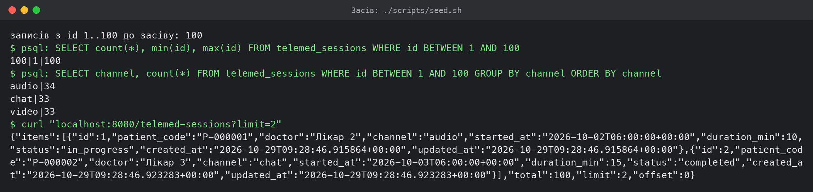

# Розгортання

*Лістинг 3 – Команда розгортання, scripts/deploy.sh*

```bash
#!/usr/bin/env bash
# Повне розгортання з нуля: кластер kind, мітка role=infra, образи, база, міграції, моніторинг, web, worker.
# Повторний запуск безпечний: наявний кластер і вже застосовані обʼєкти лишаються.
set -eu
cd "$(dirname "$0")/.."
[ -f .env ] || { echo "немає .env: cp .env.example .env і задайте POSTGRES_PASSWORD"; exit 1; }
PASS=$(grep '^POSTGRES_PASSWORD=' .env | cut -d= -f2-)

echo "== кластер"
if kind get clusters 2>/dev/null | grep -qx telemed; then
  echo "кластер telemed уже існує — продовжуємо з наступних кроків"
else
  kind create cluster --config k8s/kind-config.yaml --wait 120s
fi
kubectl label node telemed-control-plane role=infra --overwrite
kubectl get nodes -L role

echo "== образи сервісу, воркера і генератора"
docker build -q -t telemed4-loadgen:lab4 loadgen
docker build -q -t telemed4-web:lab4 .
docker build -q -t telemed4-worker:lab4 worker
kind load docker-image telemed4-web:lab4 telemed4-worker:lab4 --name telemed
docker images --format '{{.Repository}}:{{.Tag}}  {{.Size}}' | grep '^telemed4-'

echo "== база і міграції"
kubectl create secret generic db-secret --from-literal=POSTGRES_PASSWORD="$PASS" \
  --dry-run=client -o yaml | kubectl apply -f -
kubectl create configmap schema --from-file=schema.sql=db/schema.sql --dry-run=client -o yaml | kubectl apply -f -
kubectl create configmap schema-tasks --from-file=tasks.sql=db/tasks.sql --dry-run=client -o yaml | kubectl apply -f -
kubectl apply -f k8s/db.yaml
kubectl rollout status statefulset/db --timeout=180s
kubectl get job migrate >/dev/null 2>&1 || kubectl apply -f k8s/migrate-job.yaml
kubectl wait --for=condition=complete job/migrate --timeout=180s
kubectl get job migrate-tasks >/dev/null 2>&1 || kubectl apply -f k8s/migrate-tasks-job.yaml
kubectl wait --for=condition=complete job/migrate-tasks --timeout=180s
echo '$ kubectl logs job/migrate-tasks'; kubectl logs job/migrate-tasks

echo "== моніторинг"
helm repo add prometheus-community https://prometheus-community.github.io/helm-charts >/dev/null 2>&1 || true
helm repo add metrics-server https://kubernetes-sigs.github.io/metrics-server/ >/dev/null 2>&1 || true
if helm status mon >/dev/null 2>&1 && helm status pgexp >/dev/null 2>&1 && helm status metrics-server -n kube-system >/dev/null 2>&1; then
  echo "kube-prometheus-stack, postgres-exporter і metrics-server уже встановлені"
else
  helm repo update >/dev/null
  helm upgrade --install mon prometheus-community/kube-prometheus-stack -f helm/kube-prometheus-stack.yaml --wait --timeout 10m
  helm upgrade --install pgexp prometheus-community/prometheus-postgres-exporter -f helm/postgres-exporter.yaml --wait
  helm upgrade --install metrics-server metrics-server/metrics-server -n kube-system -f helm/metrics-server.yaml --wait
fi

echo "== web і worker"
kubectl apply -f k8s/web.yaml -f k8s/worker.yaml -f k8s/podmonitor.yaml
kubectl scale deployment/web --replicas=1
# Образи мають сталий тег: перезапуск гарантує, що поди працюють на щойно зібраному образі.
kubectl rollout restart deployment/web deployment/worker
kubectl rollout status deployment/web --timeout=180s
kubectl rollout status deployment/worker --timeout=180s
kubectl get pods -o wide
```

*Лістинг 4 – Вивід ./scripts/deploy.sh, results/deploy.log*

```text
== кластер
кластер telemed уже існує — продовжуємо з наступних кроків
node/telemed-control-plane not labeled
NAME                    STATUS   ROLES           AGE   VERSION   ROLE
telemed-control-plane   Ready    control-plane   12d   v1.37.0   infra
telemed-worker          Ready    <none>          12d   v1.37.0   
telemed-worker2         Ready    <none>          12d   v1.37.0   
== образи сервісу, воркера і генератора
sha256:f1bbb455a0accc328e4eb58a7c8abcb7eaba1535e511edec4c61f3a4daa849cc
sha256:c5720115ca63b27e59779548eca8bc0bede88de4c00b26d7da9faf71798e64cd
sha256:075e16b4ce660f135fbd808e7ae45be6a772fa335a4653689b20f7cc55b405dc
Image: "telemed4-web:lab4" with ID "sha256:c5720115ca63b27e59779548eca8bc0bede88de4c00b26d7da9faf71798e64cd" not yet present on node "telemed-worker2", loading...
Image: "telemed4-web:lab4" with ID "sha256:c5720115ca63b27e59779548eca8bc0bede88de4c00b26d7da9faf71798e64cd" not yet present on node "telemed-worker", loading...
Image: "telemed4-web:lab4" with ID "sha256:c5720115ca63b27e59779548eca8bc0bede88de4c00b26d7da9faf71798e64cd" not yet present on node "telemed-control-plane", loading...
Image: "telemed4-worker:lab4" with ID "sha256:075e16b4ce660f135fbd808e7ae45be6a772fa335a4653689b20f7cc55b405dc" not yet present on node "telemed-worker2", loading...
Image: "telemed4-worker:lab4" with ID "sha256:075e16b4ce660f135fbd808e7ae45be6a772fa335a4653689b20f7cc55b405dc" not yet present on node "telemed-worker", loading...
Image: "telemed4-worker:lab4" with ID "sha256:075e16b4ce660f135fbd808e7ae45be6a772fa335a4653689b20f7cc55b405dc" not yet present on node "telemed-control-plane", loading...
telemed4-worker:lab4  241MB
telemed4-web:lab4  292MB
telemed4-loadgen:lab4  7.62MB
== база і міграції
secret/db-secret unchanged
configmap/schema unchanged
configmap/schema-tasks created
service/db unchanged
statefulset.apps/db configured
partitioned roll out complete: 1 new pods have been updated...
job.batch/migrate condition met
job.batch/migrate-tasks created
job.batch/migrate-tasks condition met
$ kubectl logs job/migrate-tasks
db:5432 - accepting connections
CREATE TABLE
CREATE INDEX
CREATE INDEX
CREATE TABLE
== моніторинг
kube-prometheus-stack, postgres-exporter і metrics-server уже встановлені
== web і worker
configmap/web-config unchanged
deployment.apps/web configured
service/web unchanged
configmap/worker-config created
deployment.apps/worker created
podmonitor.monitoring.coreos.com/web configured
podmonitor.monitoring.coreos.com/worker created
deployment.apps/web scaled
deployment.apps/web restarted
deployment.apps/worker restarted
Waiting for deployment "web" rollout to finish: 0 out of 1 new replicas have been updated...
Waiting for deployment "web" rollout to finish: 0 out of 1 new replicas have been updated...
Waiting for deployment "web" rollout to finish: 0 out of 1 new replicas have been updated...
Waiting for deployment "web" rollout to finish: 1 old replicas are pending termination...
Waiting for deployment "web" rollout to finish: 1 old replicas are pending termination...
deployment "web" successfully rolled out
deployment "worker" successfully rolled out
NAME                                                  READY   STATUS        RESTARTS        AGE   IP            NODE                    NOMINATED NODE   READINESS GATES
db-0                                                  1/1     Running       2 (9m34s ago)   12d   10.244.0.9    telemed-control-plane   <none>           <none>
migrate-glpnq                                         0/1     Completed     0               12d   <none>        telemed-control-plane   <none>           <none>
migrate-tasks-ttg5w                                   0/1     Completed     0               6s    10.244.0.11   telemed-control-plane   <none>           <none>
mon-kube-prometheus-stack-operator-6b98fc8d95-28ng7   1/1     Running       4 (9m3s ago)    12d   10.244.0.7    telemed-control-plane   <none>           <none>
mon-kube-state-metrics-5f7d6d8856-ndgdx               1/1     Running       4 (9m1s ago)    12d   10.244.0.8    telemed-control-plane   <none>           <none>
pgexp-prometheus-postgres-exporter-56455894c9-tk8ls   1/1     Running       2 (9m34s ago)   12d   10.244.0.2    telemed-control-plane   <none>           <none>
prometheus-mon-kube-prometheus-stack-prometheus-0     2/2     Running       4 (9m34s ago)   12d   10.244.0.10   telemed-control-plane   <none>           <none>
web-595c59f959-cl768                                  1/1     Running       0               2s    10.244.1.4    telemed-worker2         <none>           <none>
web-5f98bd4fb9-n2v4j                                  1/1     Terminating   2 (9m34s ago)   12d   10.244.2.2    telemed-worker          <none>           <none>
web-7856584475-jvkgw                                  1/1     Terminating   0               3s    10.244.1.2    telemed-worker2         <none>           <none>
worker-7d6fcb6f79-tw4zp                               1/1     Running       0               2s    10.244.1.3    telemed-worker2         <none>           <none>
```

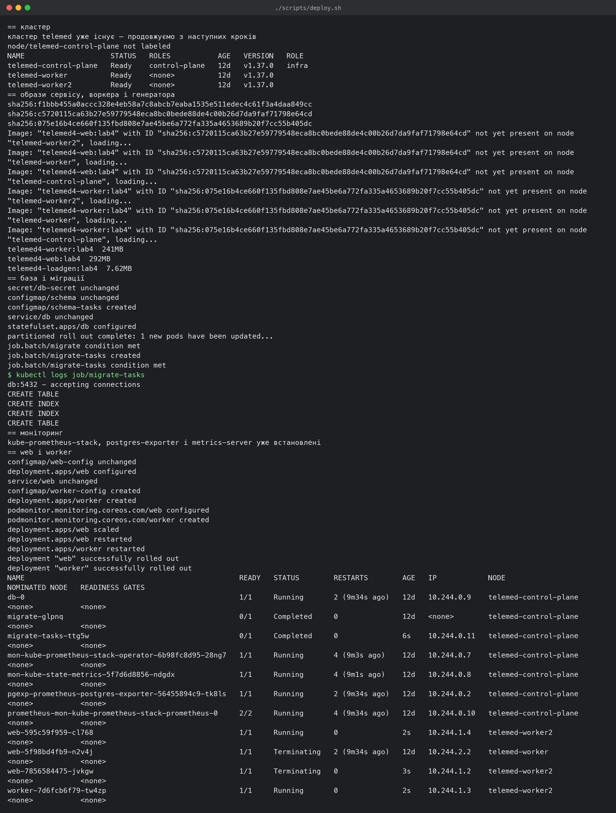

# Крок 1. Таблиці задач і ендпоінти

*Лістинг 5 – Міграція, db/tasks.sql*

```sql
-- Міграція ЛР 4: черга задач обробки і таблиця результатів.
-- Накочується Job migrate-tasks (k8s/migrate-tasks-job.yaml); IF NOT EXISTS робить повторний запуск безпечним.

CREATE TABLE IF NOT EXISTS tasks (
    id            BIGINT GENERATED ALWAYS AS IDENTITY PRIMARY KEY,
    record_id     BIGINT       NOT NULL REFERENCES telemed_sessions (id) ON DELETE CASCADE,
    status        VARCHAR(16)  NOT NULL DEFAULT 'queued'
                  CHECK (status IN ('queued', 'running', 'done', 'failed')),
    seed          BIGINT       NOT NULL,
    -- Д1: пріоритет 1…3, більший береться раніше; у кроках 1–9 усі задачі мають 2.
    priority      SMALLINT     NOT NULL DEFAULT 2 CHECK (priority BETWEEN 1 AND 3),
    attempts      INTEGER      NOT NULL DEFAULT 0,
    max_attempts  INTEGER      NOT NULL DEFAULT 3,
    token         BIGINT       NOT NULL DEFAULT 0,
    lease_until   TIMESTAMPTZ,
    worker_id     TEXT,
    created_at    TIMESTAMPTZ  NOT NULL DEFAULT now(),
    started_at    TIMESTAMPTZ,
    finished_at   TIMESTAMPTZ
);

-- Захоплення шукає найстаршу задачу в статусі queued: WHERE status = 'queued' ORDER BY created_at LIMIT 1.
CREATE INDEX IF NOT EXISTS idx_tasks_status_created ON tasks (status, created_at);
-- Д1: той самий пошук у порядку priority DESC, created_at.
CREATE INDEX IF NOT EXISTS idx_tasks_status_priority_created ON tasks (status, priority DESC, created_at);

CREATE TABLE IF NOT EXISTS task_results (
    task_id     BIGINT      NOT NULL REFERENCES tasks (id) ON DELETE CASCADE,
    token       BIGINT      NOT NULL,
    worker_id   TEXT        NOT NULL,
    result      JSONB       NOT NULL,
    created_at  TIMESTAMPTZ NOT NULL DEFAULT now(),
    CONSTRAINT task_results_pkey PRIMARY KEY (task_id)
);
```

*Лістинг 6 – Job міграції, k8s/migrate-tasks-job.yaml*

```yaml
# Міграція ЛР 4: таблиці tasks і task_results з db/tasks.sql (ConfigMap schema-tasks).
# Той самий спосіб, що Job migrate у ЛР 3: чекає готовності бази і виконує файл через psql.
apiVersion: batch/v1
kind: Job
metadata:
  name: migrate-tasks
spec:
  backoffLimit: 6
  template:
    spec:
      restartPolicy: OnFailure
      nodeSelector:
        role: infra
      tolerations:
        - key: node-role.kubernetes.io/control-plane
          operator: Exists
          effect: NoSchedule
      containers:
        - name: migrate
          image: postgres:16-alpine
          command: ["sh", "-c"]
          args:
            - until pg_isready -h db -U telemed -d telemed; do sleep 1; done;
              psql -v ON_ERROR_STOP=1 -h db -U telemed -d telemed -f /schema/tasks.sql
          env:
            - name: PGPASSWORD
              valueFrom:
                secretKeyRef: {name: db-secret, key: POSTGRES_PASSWORD}
          volumeMounts:
            - name: schema
              mountPath: /schema
      volumes:
        - name: schema
          configMap:
            name: schema-tasks
```

Ендпоінти й вимірювачі додано в `app/main.py` (повний файл — у додатку А). `POST /telemed-sessions/{id}/tasks` вставляє задачу командою `INSERT … SELECT … FROM telemed_sessions WHERE id = $1`, тому для неіснуючого запису не вставляється жодного рядка, і сервіс відповідає 404 одним запитом до бази. `seed` генерує сервіс (`random.randint(1, 2^31 − 1)`). Необовʼязкове тіло `{"priority": 1…3}` потрібне для Д1. `GET /tasks/{id}` повертає задачу разом із результатом (`LEFT JOIN task_results`), `GET /tasks` — перелік з фільтром `status` і пагінацією.

Перевірку виконує скрипт нижче. Запити йдуть через `localhost:8080`, кожна відповідь має заголовок `X-Pod`.

*Лістинг 7 – Перевірка кроку 1, scripts/step1.sh*

```bash
#!/usr/bin/env bash
# Крок 1: міграція tasks і task_results, ендпоінти задач, вимірювачі tasks_queued і tasks_running.
. "$(dirname "$0")/lib.sh"
workers 0 >/dev/null; clean
echo '$ kubectl get job migrate migrate-tasks'; kubectl get job migrate migrate-tasks
echo '$ kubectl logs job/migrate-tasks'; kubectl logs job/migrate-tasks
echo '$ psql: \d tasks'; kubectl exec db-0 -- psql -U telemed -d telemed -X -c '\d tasks'
echo '$ psql: \d task_results'; kubectl exec db-0 -- psql -U telemed -d telemed -X -c '\d task_results'
./scripts/vmsh.sh '
B=http://localhost:8080
show() { echo "$1"; grep -i -E "^HTTP/|^x-pod" /tmp/h | tr -d "\r"; cat /tmp/b; echo; echo; }
curl -s -D /tmp/h -o /tmp/b -X POST $B/telemed-sessions/7/tasks;        show "> POST $B/telemed-sessions/7/tasks"
ID=$(sed -E "s/^\{\"id\":([0-9]+).*/\1/" /tmp/b)
curl -s -D /tmp/h -o /tmp/b -X POST $B/telemed-sessions/999999/tasks;   show "> POST $B/telemed-sessions/999999/tasks"
curl -s -D /tmp/h -o /tmp/b -X POST $B/telemed-sessions/8/tasks -H "Content-Type: application/json" -d "{\"priority\":3}"
show "> POST $B/telemed-sessions/8/tasks  {\"priority\":3}"
curl -s -D /tmp/h -o /tmp/b -X POST $B/telemed-sessions/8/tasks -H "Content-Type: application/json" -d "{\"priority\":7}"
show "> POST $B/telemed-sessions/8/tasks  {\"priority\":7}"
curl -s -D /tmp/h -o /tmp/b $B/tasks/$ID;                               show "> GET $B/tasks/$ID"
curl -s -D /tmp/h -o /tmp/b $B/tasks/999999999;                         show "> GET $B/tasks/999999999"
curl -s -D /tmp/h -o /tmp/b "$B/tasks?status=queued&limit=1&offset=1";  show "> GET $B/tasks?status=queued&limit=1&offset=1"
curl -s -D /tmp/h -o /tmp/b "$B/tasks?status=bogus";                    show "> GET $B/tasks?status=bogus"
sleep 6
echo "> GET $B/metrics | grep ^tasks_   # через 6 с після створення: вимірювачі оновлюються раз на 5 с"
curl -s $B/metrics | grep "^tasks_"
'
```

*Лістинг 8 – Вивід перевірки кроку 1, results/step1.log*

```text
NOTICE:  truncate cascades to table "task_results"
$ kubectl get job migrate migrate-tasks
NAME            STATUS     COMPLETIONS   DURATION   AGE
migrate         Complete   1/1           3s         12d
migrate-tasks   Complete   1/1           3s         4m23s
$ kubectl logs job/migrate-tasks
db:5432 - accepting connections
CREATE TABLE
CREATE INDEX
CREATE INDEX
CREATE TABLE
$ psql: \d tasks
                                     Table "public.tasks"
    Column    |           Type           | Collation | Nullable |           Default            
--------------+--------------------------+-----------+----------+------------------------------
 id           | bigint                   |           | not null | generated always as identity
 record_id    | bigint                   |           | not null | 
 status       | character varying(16)    |           | not null | 'queued'::character varying
 seed         | bigint                   |           | not null | 
 priority     | smallint                 |           | not null | 2
 attempts     | integer                  |           | not null | 0
 max_attempts | integer                  |           | not null | 3
 token        | bigint                   |           | not null | 0
 lease_until  | timestamp with time zone |           |          | 
 worker_id    | text                     |           |          | 
 created_at   | timestamp with time zone |           | not null | now()
 started_at   | timestamp with time zone |           |          | 
 finished_at  | timestamp with time zone |           |          | 
Indexes:
    "tasks_pkey" PRIMARY KEY, btree (id)
    "idx_tasks_status_created" btree (status, created_at)
    "idx_tasks_status_priority_created" btree (status, priority DESC, created_at)
Check constraints:
    "tasks_priority_check" CHECK (priority >= 1 AND priority <= 3)
    "tasks_status_check" CHECK (status::text = ANY (ARRAY['queued'::character varying, 'running'::character varying, 'done'::character varying, 'failed'::character varying]::text[]))
Foreign-key constraints:
    "tasks_record_id_fkey" FOREIGN KEY (record_id) REFERENCES telemed_sessions(id) ON DELETE CASCADE
Referenced by:
    TABLE "task_results" CONSTRAINT "task_results_task_id_fkey" FOREIGN KEY (task_id) REFERENCES tasks(id) ON DELETE CASCADE

$ psql: \d task_results
                      Table "public.task_results"
   Column   |           Type           | Collation | Nullable | Default 
------------+--------------------------+-----------+----------+---------
 task_id    | bigint                   |           | not null | 
 token      | bigint                   |           | not null | 
 worker_id  | text                     |           | not null | 
 result     | jsonb                    |           | not null | 
 created_at | timestamp with time zone |           | not null | now()
Indexes:
    "task_results_pkey" PRIMARY KEY, btree (task_id)
Foreign-key constraints:
    "task_results_task_id_fkey" FOREIGN KEY (task_id) REFERENCES tasks(id) ON DELETE CASCADE

> POST http://localhost:8080/telemed-sessions/7/tasks
HTTP/1.1 202 Accepted
x-pod: web-595c59f959-cl768
{"id":201,"record_id":7,"status":"queued","seed":1181368125,"priority":2,"attempts":0,"max_attempts":3,"token":0,"lease_until":null,"worker_id":null,"created_at":"2026-11-10T18:15:05.939920+00:00","started_at":null,"finished_at":null}

> POST http://localhost:8080/telemed-sessions/999999/tasks
HTTP/1.1 404 Not Found
x-pod: web-595c59f959-cl768
{"error":"telemed session 999999 not found"}

> POST http://localhost:8080/telemed-sessions/8/tasks  {"priority":3}
HTTP/1.1 202 Accepted
x-pod: web-595c59f959-cl768
{"id":202,"record_id":8,"status":"queued","seed":1409840487,"priority":3,"attempts":0,"max_attempts":3,"token":0,"lease_until":null,"worker_id":null,"created_at":"2026-11-10T18:15:05.947103+00:00","started_at":null,"finished_at":null}

> POST http://localhost:8080/telemed-sessions/8/tasks  {"priority":7}
HTTP/1.1 400 Bad Request
x-pod: web-595c59f959-cl768
{"error":"validation failed","details":[{"field":"priority","problem":"Input should be less than or equal to 3"}]}

> GET http://localhost:8080/tasks/201
HTTP/1.1 200 OK
x-pod: web-595c59f959-cl768
{"id":201,"record_id":7,"status":"queued","seed":1181368125,"priority":2,"attempts":0,"max_attempts":3,"token":0,"lease_until":null,"worker_id":null,"created_at":"2026-11-10T18:15:05.939920+00:00","started_at":null,"finished_at":null,"result":null}

> GET http://localhost:8080/tasks/999999999
HTTP/1.1 404 Not Found
x-pod: web-595c59f959-cl768
{"error":"task 999999999 not found"}

> GET http://localhost:8080/tasks?status=queued&limit=1&offset=1
HTTP/1.1 200 OK
x-pod: web-595c59f959-cl768
{"items":[{"id":202,"record_id":8,"status":"queued","seed":1409840487,"priority":3,"attempts":0,"max_attempts":3,"token":0,"lease_until":null,"worker_id":null,"created_at":"2026-11-10T18:15:05.947103+00:00","started_at":null,"finished_at":null}],"total":2,"limit":1,"offset":1}

> GET http://localhost:8080/tasks?status=bogus
HTTP/1.1 400 Bad Request
x-pod: web-595c59f959-cl768
{"error":"validation failed","details":[{"field":"query.status","problem":"Input should be 'queued', 'running', 'done' or 'failed'"}]}

> GET http://localhost:8080/metrics | grep ^tasks_   # через 6 с після створення: вимірювачі оновлюються раз на 5 с
tasks_queued 2.0
tasks_running 0.0
```

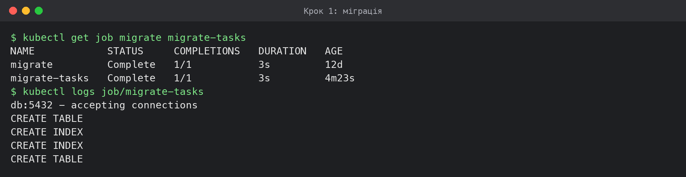

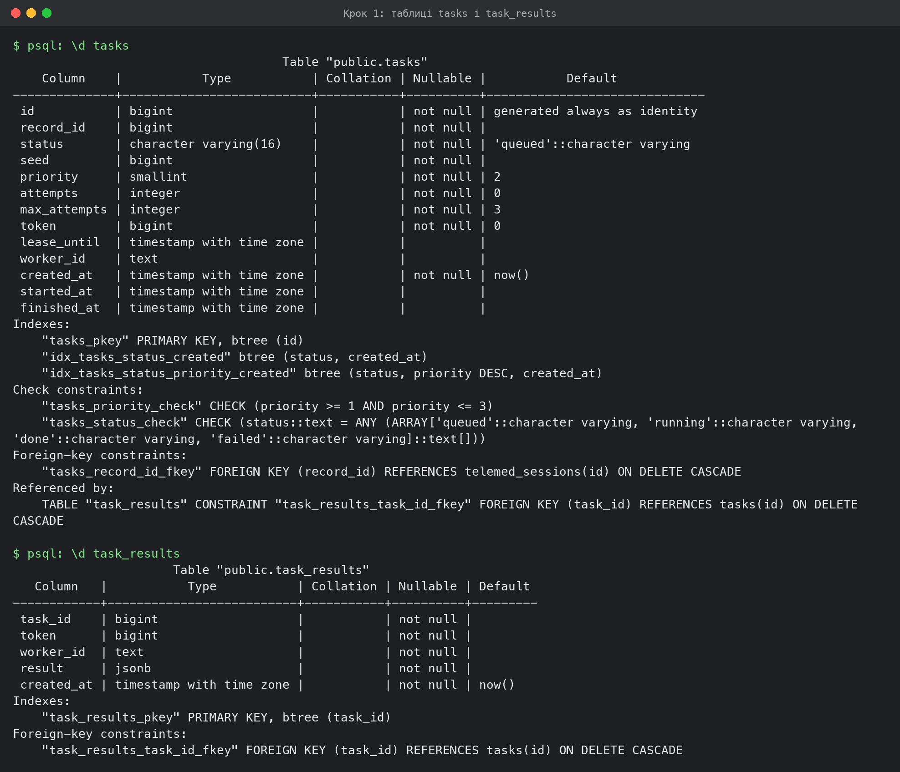

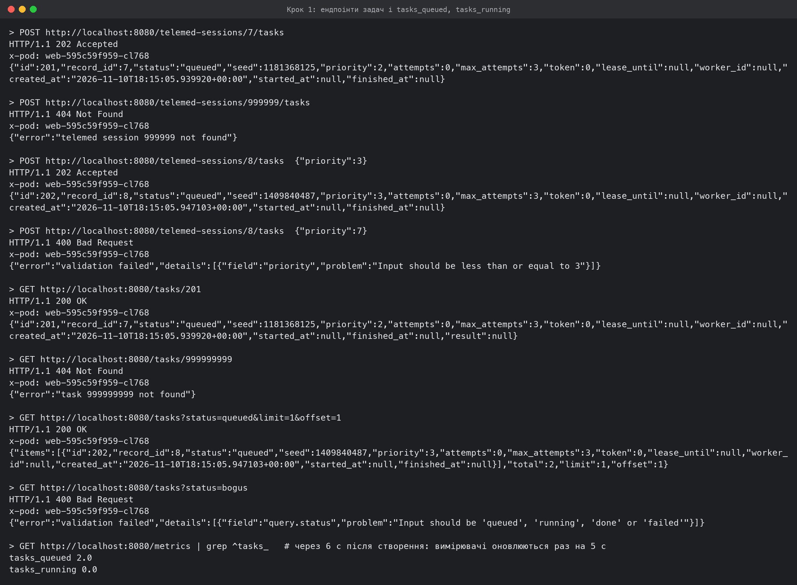

# Крок 2. Воркер

*Лістинг 9 – Воркер, worker/worker.py*

```python
"""Воркер черги задач (ЛР 4, варіант 26).

Цикл: повернути в чергу задачі зі спливлим lease → захопити задачу → отримати запис від web →
обробити синтетичний зріз → записати результат. Одна задача за раз; паралелізм дає кількість воркерів.

Варіанти захоплення і запису лишені в коді й перемикаються змінними середовища:
  CLAIM_MODE   naive | for_update | skip_locked
  STORE_MODE   plain | idempotent
  LEASE_ENABLED, HEARTBEAT   повернення задач зі спливлим lease і продовження lease
"""
import http.client
import json
import logging
import math
import os
import random
import signal
import socket
import sys
import threading
import time

import psycopg
from prometheus_client import Counter, Gauge, Histogram, start_http_server

WORKER_ID = os.environ.get("WORKER_ID") or socket.gethostname()
DSN = "host={h} port={p} user={u} password={pw} dbname={d} connect_timeout=3".format(
    h=os.environ["DB_HOST"], p=os.environ.get("DB_PORT", "5432"), u=os.environ["DB_USER"],
    pw=os.environ["DB_PASSWORD"], d=os.environ["DB_NAME"])
WEB_HOST = os.environ.get("WEB_HOST", "web")
WEB_PORT = int(os.environ.get("WEB_PORT", "8000"))
RESOURCE = os.environ.get("RESOURCE", "/telemed-sessions")

LEASE_S = float(os.environ.get("LEASE_SECONDS", "10"))        # L
POLL_S = float(os.environ.get("POLL_MS", "50")) / 1000        # T_poll
FAIL_RATE = float(os.environ.get("FAIL_RATE", "0"))
CLAIM_MODE = os.environ.get("CLAIM_MODE", "skip_locked")
STORE_MODE = os.environ.get("STORE_MODE", "idempotent")
CLAIM_ORDER = os.environ.get("CLAIM_ORDER", "created")        # created | priority (Д1)
LEASE_ENABLED = os.environ.get("LEASE_ENABLED", "1") == "1"
HEARTBEAT = os.environ.get("HEARTBEAT", "1") == "1"
GRACE_S = float(os.environ.get("GRACE_SECONDS", "25"))        # менше за terminationGracePeriodSeconds = 30
METRICS_PORT = int(os.environ.get("METRICS_PORT", "9000"))
LOG_FILE = os.environ.get("LOG_FILE", "")

S = 256                                                       # зріз S × S
Q_LO = float(os.environ.get("Q_LO", "0.05"))
Q_HI = float(os.environ.get("Q_HI", "0.95"))
LEVELS = 4096

handlers = [logging.StreamHandler(sys.stdout)]
if LOG_FILE:
    # Копія журналу у файлі на томі emptyDir: вона переживає перезапуск контейнера,
    # а kubectl logs зберігає лише поточний і попередній екземпляри.
    handlers.append(logging.FileHandler(LOG_FILE, encoding="utf-8"))
logging.basicConfig(level=logging.INFO, format="%(asctime)s.%(msecs)03d %(message)s",
                    datefmt="%H:%M:%S", handlers=handlers)
log = logging.getLogger("worker")

BUCKETS = (0.0005, 0.001, 0.002, 0.003, 0.005, 0.0075, 0.01, 0.015, 0.02, 0.03, 0.05, 0.075,
           0.1, 0.15, 0.2, 0.3, 0.5, 0.75, 1.0, 2.0, 5.0)
TASKS = Counter("worker_tasks_total", "Задачі за результатом", ["result"])           # done | failed | lost
CLAIMS = Counter("worker_claims_total", "Спроби захоплення за результатом", ["result"])  # task | empty
# step: claim — команда захоплення, що повернула задачу; claim_empty — порожнє захоплення;
# reap — повернення задач зі спливлим lease; fetch, process, store — три кроки задачі.
DURATION = Histogram("worker_task_duration_seconds", "Тривалість кроків", ["step"], buckets=BUCKETS)
IN_FLIGHT = Gauge("worker_tasks_in_flight", "Задачі в обробці цим воркером")
for r in ("done", "failed", "lost"):
    TASKS.labels(r)
for r in ("task", "empty"):
    CLAIMS.labels(r)

ORDER = "priority DESC, created_at" if CLAIM_ORDER == "priority" else "created_at"

# Наївне захоплення (крок 3): дві окремі команди без транзакції і без блокувань.
SQL_NAIVE_SELECT = f"SELECT id FROM tasks WHERE status = 'queued' ORDER BY {ORDER} LIMIT 1"
SQL_NAIVE_UPDATE = """
UPDATE tasks SET status = 'running', worker_id = %s, token = token + 1,
       attempts = attempts + 1, started_at = now()
 WHERE id = %s
RETURNING id, record_id, seed, token, attempts"""

# Захоплення однією командою (крок 4). FOR UPDATE блокує знайдений рядок до кінця команди;
# SKIP LOCKED пропускає рядки, які вже заблокував інший воркер.
SQL_CLAIM = """
UPDATE tasks SET status = 'running', worker_id = %s, token = token + 1,
       lease_until = now() + %s * interval '1 second', attempts = attempts + 1, started_at = now()
 WHERE id = (SELECT id FROM tasks WHERE status = 'queued'
              ORDER BY {order} LIMIT 1 FOR UPDATE{skip})
RETURNING id, record_id, seed, token, attempts"""
SQL_CLAIM_SKIP = SQL_CLAIM.format(order=ORDER, skip=" SKIP LOCKED")
SQL_CLAIM_WAIT = SQL_CLAIM.format(order=ORDER, skip="")

# Повернення задач зі спливлим lease (крок 5); після max_attempts захоплень — failed.
SQL_REAP = """
UPDATE tasks
   SET status = CASE WHEN attempts >= max_attempts THEN 'failed' ELSE 'queued' END,
       finished_at = CASE WHEN attempts >= max_attempts THEN now() END,
       worker_id = NULL
 WHERE status = 'running' AND lease_until < now()
RETURNING id, status, attempts, token"""

SQL_HEARTBEAT = "UPDATE tasks SET lease_until = now() + %s * interval '1 second' WHERE id = %s AND token = %s"
# failed — кінцевий стан: воркер із чинним токеном не повертає таку задачу в done.
SQL_DONE = "UPDATE tasks SET status = 'done', finished_at = now() WHERE id = %s AND token = %s AND status <> 'failed'"
SQL_RESULT = """INSERT INTO task_results (task_id, token, worker_id, result) VALUES (%s, %s, %s, %s)
ON CONFLICT (task_id) DO NOTHING"""
SQL_DONE_PLAIN = "UPDATE tasks SET status = 'done', finished_at = now() WHERE id = %s"
SQL_RESULT_PLAIN = "INSERT INTO task_results (task_id, token, worker_id, result) VALUES (%s, %s, %s, %s)"
# Повернення задачі в чергу після SIGTERM. Умова status = 'running' потрібна понад умову за токеном:
# головний потік може встигнути завершити задачу (done) між рішенням сторожа і цією командою, і без неї
# done знову ставав би queued, а задача виконувалась би вдруге.
SQL_RELEASE = "UPDATE tasks SET status = 'queued', worker_id = NULL WHERE id = %s AND token = %s AND status = 'running'"

stopping = False                # отримано SIGTERM: нових задач не брати. Простий прапорець, а не Event:
                                # обробник сигналу виконується в головному потоці й не має брати блокувань.
finished = threading.Event()    # головний цикл завершився
current = None                  # (id, token) задачі в обробці; читають heartbeat і сторож зупинки
# Перевірка прапорця зупинки, захоплення і запис current виконуються під цим блокуванням; сторож бере його
# перед читанням current. Інакше SIGTERM між перевіркою і захопленням дає задачу, про яку сторож не знає.
claim_lock = threading.Lock()


class Lost(Exception):
    """Команда з токеном воркера оновила нуль рядків: задача вже не його."""


def connect(role):
    """Зʼєднання в режимі autocommit; повторює спроби, поки база недоступна."""
    delay, first = 0.2, True
    while True:
        try:
            conn = psycopg.connect(DSN, autocommit=True, application_name=f"{WORKER_ID}/{role}")
            if not first:
                log.info("зʼєднання з базою відновлено (%s)", role)
            return conn
        except psycopg.OperationalError as e:
            first = False
            log.warning("база недоступна (%s): %s; повтор через %.1f с", role, str(e).strip(), delay)
            time.sleep(delay)
            delay = min(delay * 2, 2.0)


def process(seed):
    """Точкова операція за гістограмою зрізу S × S; цикли Python без бібліотек поза інтерпретатором."""
    n = S * S
    pixels = [0] * n
    hist = [0] * LEVELS
    x = seed
    for i in range(n):
        x = (1103515245 * x + 12345) % 2147483648      # x(i+1) = (a · x(i) + c) mod 2^31
        p = x >> 19                                    # 12 старших бітів із 31
        pixels[i] = p
        hist[p] += 1
    # Квантиль рівня q — найменший рівень яскравості, на якому накопичена частка пікселів >= q.
    lo_rank, hi_rank = Q_LO * n, Q_HI * n
    p_lo = p_hi = None
    cum = 0
    for level in range(LEVELS):
        cum += hist[level]
        if p_lo is None and cum >= lo_rank:
            p_lo = level
        if cum >= hi_rank:
            p_hi = level
            break
    width = p_hi - p_lo
    if width <= 0:
        raise ValueError(f"вироджене вікно яскравості: p_lo={p_lo}, p_hi={p_hi}")
    removed = 0
    total = 0
    total_sq = 0
    for p in pixels:
        if p < p_lo or p > p_hi:
            removed += 1                               # p' = 0, піксель вилучено
        else:
            v = (2 * 4095 * (p - p_lo) + width) // (2 * width)   # округлення до найближчого цілого
            total += v
            total_sq += v * v
    kept = n - removed
    mean = total / kept
    std = math.sqrt(max(total_sq / kept - mean * mean, 0.0))
    return {"p_lo": p_lo, "p_hi": p_hi, "removed": removed, "mean": round(mean, 3), "std": round(std, 3)}


class Web:
    """Постійне HTTP-зʼєднання до сервісу web."""

    def __init__(self):
        self.conn = None

    def get_record(self, record_id):
        for attempt in (1, 2):
            try:
                if self.conn is None:
                    self.conn = http.client.HTTPConnection(WEB_HOST, WEB_PORT, timeout=5)
                self.conn.request("GET", f"{RESOURCE}/{record_id}")
                resp = self.conn.getresponse()
                body = resp.read()
                if resp.status != 200:
                    raise RuntimeError(f"GET {RESOURCE}/{record_id} -> {resp.status}")
                return json.loads(body)
            except (OSError, http.client.HTTPException):
                self.conn = None                      # зʼєднання закрив сервер: одна повторна спроба
                if attempt == 2:
                    raise


def heartbeat_loop():
    """Кожні L / 3 продовжує lease поточної задачі; умова за токеном."""
    conn = connect("heartbeat")
    while not finished.is_set():
        time.sleep(LEASE_S / 3)
        cur = current
        if cur is None:
            continue
        try:
            n = conn.execute(SQL_HEARTBEAT, (LEASE_S, cur[0], cur[1])).rowcount
        except psycopg.OperationalError as e:
            log.warning("heartbeat: зʼєднання з базою втрачено: %s", str(e).strip())
            conn = connect("heartbeat")
            continue
        if n == 0 and current == cur:
            log.warning("task=%d token=%d heartbeat оновив 0 рядків: lease втрачено, задачу забрав інший воркер",
                        cur[0], cur[1])


def shutdown_guard():
    """Після SIGTERM чекає завершення поточної задачі; якщо не встигла за GRACE_S — повертає її в чергу."""
    while not stopping:
        time.sleep(0.002)
    cur = current
    log.info("SIGTERM: нових задач не беру, задача в обробці: %s, чекаю до %.1f с",
             f"task={cur[0]}" if cur else "немає", GRACE_S)
    if finished.wait(GRACE_S):
        return
    with claim_lock:            # після цього головний цикл уже не захопить нової задачі
        cur = current
    if cur is not None:
        try:
            n = connect("shutdown").execute(SQL_RELEASE, cur).rowcount
            log.warning("task=%d token=%d не завершилась за %.1f с: повернуто в чергу (оновлено рядків: %d)",
                        cur[0], cur[1], GRACE_S, n)
        except psycopg.Error as e:
            log.error("task=%d: не вдалося повернути в чергу: %s", cur[0], e)
    log.info("вихід з кодом 0")
    logging.shutdown()
    os._exit(0)


def reap(conn):
    for tid, status, attempts, token in conn.execute(SQL_REAP).fetchall():
        log.info("task=%d lease сплив: статус %s (attempts=%d, token=%d)", tid, status, attempts, token)


def claim(conn):
    if CLAIM_MODE == "naive":
        row = conn.execute(SQL_NAIVE_SELECT).fetchone()
        if row is None:
            return None
        return conn.execute(SQL_NAIVE_UPDATE, (WORKER_ID, row[0])).fetchone()
    sql = SQL_CLAIM_SKIP if CLAIM_MODE == "skip_locked" else SQL_CLAIM_WAIT
    return conn.execute(sql, (WORKER_ID, LEASE_S)).fetchone()


def store(conn, tid, token, result):
    payload = json.dumps(result)
    if STORE_MODE == "plain":
        conn.execute(SQL_RESULT_PLAIN, (tid, token, WORKER_ID, payload))
        conn.execute(SQL_DONE_PLAIN, (tid,))
        return
    # Завершення задачі і запис результату — одна транзакція; чужий токен відкочує її цілком.
    with conn.transaction():
        if conn.execute(SQL_DONE, (tid, token)).rowcount == 0:
            raise Lost()
        conn.execute(SQL_RESULT, (tid, token, WORKER_ID, payload))


def run_task(conn, web, task):
    global current
    tid, record_id, seed, token, attempts = task
    IN_FLIGHT.set(1)
    try:
        t0 = time.perf_counter()
        record = web.get_record(record_id)
        t1 = time.perf_counter()
        result = process(seed)
        t2 = time.perf_counter()
        result["record_id"] = record["id"]
        if FAIL_RATE > 0 and random.random() < FAIL_RATE:
            log.error("task=%d token=%d вбудоване падіння після обробки (FAIL_RATE=%.2f): os._exit(1)",
                      tid, token, FAIL_RATE)
            logging.shutdown()
            os._exit(1)                                # без обробки сигналів і без закриття зʼєднань
        store(conn, tid, token, result)
        t3 = time.perf_counter()
        DURATION.labels("fetch").observe(t1 - t0)
        DURATION.labels("process").observe(t2 - t1)
        DURATION.labels("store").observe(t3 - t2)
        TASKS.labels("done").inc()
        log.info("task=%d done token=%d attempts=%d fetch=%.1fms process=%.1fms store=%.1fms",
                 tid, token, attempts, (t1 - t0) * 1e3, (t2 - t1) * 1e3, (t3 - t2) * 1e3)
    except Lost:
        TASKS.labels("lost").inc()
        log.warning("task=%d token=%d завершення оновило 0 рядків: задача вже не належить воркеру, "
                    "результат відкинуто", tid, token)
    except psycopg.OperationalError:
        raise                                          # перепідключення в головному циклі
    except Exception as e:  # помилка кроку: задача лишається running і повернеться після спливання lease
        TASKS.labels("failed").inc()
        log.error("task=%d token=%d помилка обробки: %s: %s", tid, token, type(e).__name__, e)
    finally:
        current = None
        IN_FLIGHT.set(0)


def on_signal(signum, frame):
    global stopping
    stopping = True


def main():
    global current
    signal.signal(signal.SIGTERM, on_signal)
    signal.signal(signal.SIGINT, on_signal)
    start_http_server(METRICS_PORT)
    log.info("старт worker=%s claim=%s store=%s order=%s lease=%s L=%gс heartbeat=%s T_poll=%gмс FAIL_RATE=%g",
             WORKER_ID, CLAIM_MODE, STORE_MODE, CLAIM_ORDER, LEASE_ENABLED, LEASE_S,
             HEARTBEAT and LEASE_ENABLED, POLL_S * 1e3, FAIL_RATE)
    threading.Thread(target=shutdown_guard, daemon=True).start()
    if LEASE_ENABLED and HEARTBEAT:
        # Обробка — цикл Python, що тримає GIL; типовий інтервал перемикання потоків 5 мс
        # затримував би heartbeat на короткому lease, тому його зменшено до 0,5 мс.
        sys.setswitchinterval(0.0005)
        threading.Thread(target=heartbeat_loop, daemon=True).start()
    conn = connect("main")
    web = Web()
    while not stopping:
        try:
            if LEASE_ENABLED:
                t0 = time.perf_counter()
                reap(conn)
                DURATION.labels("reap").observe(time.perf_counter() - t0)
            with claim_lock:
                if stopping:
                    break
                t0 = time.perf_counter()
                task = claim(conn)
                dt = time.perf_counter() - t0
                if task is not None:
                    current = (task[0], task[3])
            if task is None:
                CLAIMS.labels("empty").inc()
                DURATION.labels("claim_empty").observe(dt)
                time.sleep(POLL_S)
                continue
            CLAIMS.labels("task").inc()
            DURATION.labels("claim").observe(dt)
            run_task(conn, web, task)
        except psycopg.OperationalError as e:
            log.warning("зʼєднання з базою втрачено: %s; перепідключення", str(e).strip())
            try:
                conn.close()
            except Exception:
                pass
            time.sleep(0.2)
            conn = connect("main")
    finished.set()
    conn.close()
    log.info("вихід з кодом 0")
    sys.exit(0)


if __name__ == "__main__":
    main()
```

*Лістинг 10 – Образ воркера, worker/Dockerfile*

```dockerfile
# syntax=docker/dockerfile:1
# Образ воркера: окремий від web, без FastAPI і uvicorn.

# ---- Стадія 1: залежності у віртуальному середовищі ----
FROM python:3.12-slim AS builder
RUN python -m venv /opt/venv
ENV PATH="/opt/venv/bin:$PATH"
COPY requirements.txt /tmp/requirements.txt
RUN pip install --no-cache-dir -r /tmp/requirements.txt

# ---- Стадія 2: фінальний образ ----
FROM python:3.12-slim
ENV PATH="/opt/venv/bin:$PATH" \
    PYTHONDONTWRITEBYTECODE=1 \
    PYTHONUNBUFFERED=1
RUN useradd --uid 10001 --no-create-home --shell /usr/sbin/nologin app
COPY --from=builder /opt/venv /opt/venv
WORKDIR /srv
COPY worker.py ./
USER 10001
EXPOSE 9000
# exec-форма: python — PID 1 і сам отримує SIGTERM від kubelet.
CMD ["python", "/srv/worker.py"]
```

*Лістинг 11 – Залежності воркера, worker/requirements.txt*

```text
psycopg[binary]==3.2.3
prometheus-client==0.21.1
```

*Лістинг 12 – Deployment worker, k8s/worker.yaml*

```yaml
apiVersion: v1
kind: ConfigMap
metadata:
  name: worker-config
data:
  DB_HOST: db
  DB_PORT: "5432"
  DB_USER: telemed
  DB_NAME: telemed
  WEB_HOST: web
  WEB_PORT: "8000"
  RESOURCE: /telemed-sessions
  Q_LO: "0.05"                            # варіант 26
  Q_HI: "0.95"
  LOG_FILE: /logs/worker.log
  PROMETHEUS_DISABLE_CREATED_SERIES: "True"
---
apiVersion: apps/v1
kind: Deployment
metadata:
  name: worker
  labels: {app: worker}
spec:
  # Поля replicas немає: кількість воркерів задає kubectl scale.
  selector:
    matchLabels: {app: worker}
  template:
    metadata:
      labels: {app: worker}
    spec:
      terminationGracePeriodSeconds: 30
      containers:
        - name: worker
          image: telemed4-worker:lab4
          imagePullPolicy: IfNotPresent
          envFrom:
            - configMapRef: {name: worker-config}
          env:
            - name: DB_PASSWORD
              valueFrom:
                secretKeyRef: {name: db-secret, key: POSTGRES_PASSWORD}
            - name: WORKER_ID                 # імʼя пода через Downward API
              valueFrom:
                fieldRef: {fieldPath: metadata.name}
            # Параметри варіанта 26 і остаточний режим; серія змінює їх через kubectl set env.
            - {name: POLL_MS, value: "50"}
            - {name: LEASE_SECONDS, value: "10"}
            - {name: FAIL_RATE, value: "0"}
            - {name: CLAIM_MODE, value: skip_locked}
            - {name: STORE_MODE, value: idempotent}
            - {name: LEASE_ENABLED, value: "1"}
            - {name: HEARTBEAT, value: "1"}
            - {name: CLAIM_ORDER, value: created}
            - {name: GRACE_SECONDS, value: "25"}
          ports:
            - name: metrics
              containerPort: 9000
          resources:
            requests: {cpu: 250m}
            limits: {cpu: 500m, memory: 512Mi}
          volumeMounts:
            - name: logs
              mountPath: /logs
      volumes:
        # Копія журналу воркера: том живе, поки існує под, і переживає перезапуски контейнера.
        - name: logs
          emptyDir: {}
```

*Лістинг 13 – Збір метрик web і worker, k8s/podmonitor.yaml*

```yaml
# Prometheus знаходить поди web і worker і збирає /metrics кожні 5 с; мітки pod і node — з метаданих пода.
apiVersion: monitoring.coreos.com/v1
kind: PodMonitor
metadata:
  name: web
spec:
  selector:
    matchLabels: {app: web}
  podMetricsEndpoints:
    - port: http
      path: /metrics
      interval: 5s
      relabelings:
        - sourceLabels: [__meta_kubernetes_pod_name]
          targetLabel: pod
        - sourceLabels: [__meta_kubernetes_pod_node_name]
          targetLabel: node
---
apiVersion: monitoring.coreos.com/v1
kind: PodMonitor
metadata:
  name: worker
spec:
  selector:
    matchLabels: {app: worker}
  podMetricsEndpoints:
    - port: metrics
      path: /metrics
      interval: 5s
      relabelings:
        - sourceLabels: [__meta_kubernetes_pod_name]
          targetLabel: pod
        - sourceLabels: [__meta_kubernetes_pod_node_name]
          targetLabel: node
```

**Обробка зрізу.** Генератор `x(i+1) = (1103515245 · x(i) + 12345) mod 2^31`, `p(i) = x(i+1) >> 19`. Квантиль рівня q — найменший рівень яскравості, на якому накопичена частка пікселів не менша за q. Округлення ⌊4095 · (p − p_lo) / (p_hi − p_lo)⌉ виконується в цілих числах: `(2 · 4095 · (p − p_lo) + w) // (2w)`. Для seed = 1 результат такий: p_lo = 201, p_hi = 3889, вилучено 6534 пікселі з 65 536 (10,0 %, як і має бути для вікна 0,05…0,95), середнє 2058,1, стандартне відхилення 1181,1.

**Режим створення задач у генераторі.** Новий файл `loadgen/tasks.go` (повний текст генератора — у додатку Б).

*Лістинг 14 – Режим створення задач генератора, loadgen/tasks.go*

```go
// Режим створення задач (ЛР 4): -mode tasks.
//
// Генератор надсилає POST /<ресурс>/{id}/tasks у відкритому контурі з постійною інтенсивністю:
// момент k-го запиту start + k/rate обчислюється наперед, кожен запит іде в окремій горутині.
// id запису — випадковий з -ids (сто попередньо занесених записів). Ідентифікатор кожної створеної
// задачі береться з тіла відповіді 202 і записується у <out>.tasks.csv.
//
//	-count N        створити рівно N задач (крок 3: 300 задач на 100 за секунду)
//	-dur T          або створювати задачі T секунд
//	-priorities     Д1: пріоритети через кому, призначаються по колу (1,2,3 — порівну)
//
// Вихід: <out>.tasks.csv (кожен запит), <out>.seconds.csv (посекундно), <out>.json (підсумок).
package main

import (
	"encoding/json"
	"errors"
	"fmt"
	"io"
	"math"
	"math/rand"
	"net"
	"net/http"
	"os"
	"sort"
	"strconv"
	"strings"
	"sync"
	"time"
)

type taskReq struct {
	sched    time.Time
	done     time.Time
	recordID int
	priority int // 0 — тіло не надсилалось, сервіс ставить пріоритет за замовчуванням
	code     int // 0 — помилка зʼєднання, -1 — тайм-аут
	taskID   int64
}

func runTasks(urlTpl string, ids []int, rate float64, count, dur int, prioArg string,
	timeout time.Duration, out, label string) {
	var prios []int
	for _, p := range strings.Split(prioArg, ",") {
		if v, err := strconv.Atoi(strings.TrimSpace(p)); err == nil {
			prios = append(prios, v)
		}
	}
	n := count
	if n <= 0 {
		n = int(math.Floor(rate * float64(dur)))
	}
	client := &http.Client{Timeout: timeout, Transport: &http.Transport{
		DialContext:         (&net.Dialer{Timeout: timeout, KeepAlive: 30 * time.Second}).DialContext,
		MaxIdleConnsPerHost: 1024,
		IdleConnTimeout:     60 * time.Second,
		DisableCompression:  true,
	}}

	reqs := make([]taskReq, n)
	var wg sync.WaitGroup
	start := time.Now().Truncate(time.Second).Add(time.Second)
	time.Sleep(time.Until(start))
	for k := 0; k < n; k++ {
		r := &reqs[k]
		r.sched = start.Add(time.Duration(float64(k) / rate * float64(time.Second)))
		r.recordID = ids[rand.Intn(len(ids))]
		if len(prios) > 0 {
			r.priority = prios[k%len(prios)]
		}
		if d := time.Until(r.sched); d > 0 {
			time.Sleep(d)
		}
		wg.Add(1)
		go func() {
			defer wg.Done()
			u := strings.Replace(urlTpl, "{id}", strconv.Itoa(r.recordID), 1)
			var body io.Reader
			if r.priority > 0 {
				body = strings.NewReader(fmt.Sprintf(`{"priority":%d}`, r.priority))
			}
			req, _ := http.NewRequest(http.MethodPost, u, body)
			if body != nil {
				req.Header.Set("Content-Type", "application/json")
			}
			resp, err := client.Do(req)
			r.done = time.Now()
			if err != nil {
				var ne net.Error
				if errors.As(err, &ne) && ne.Timeout() {
					r.code = -1
				}
				return
			}
			defer resp.Body.Close()
			r.code = resp.StatusCode
			var t struct {
				ID int64 `json:"id"`
			}
			if b, e := io.ReadAll(resp.Body); e == nil && resp.StatusCode == http.StatusAccepted {
				json.Unmarshal(b, &t)
				r.taskID = t.ID
			}
		}()
	}
	wg.Wait()
	end := time.Now()

	// ---- кожен запит ----
	f, _ := os.Create(out + ".tasks.csv")
	fmt.Fprintln(f, "n,sent_unix,record_id,priority,code,task_id,latency_ms")
	type sec struct{ sent, created, non2xx, connErr int }
	secs := map[int64]*sec{}
	at := func(t time.Time) *sec {
		k := t.Unix()
		if secs[k] == nil {
			secs[k] = &sec{}
		}
		return secs[k]
	}
	var lat []float64
	created, non2xx, connErr := 0, 0, 0
	for k, r := range reqs {
		l := float64(r.done.Sub(r.sched).Microseconds()) / 1000
		fmt.Fprintf(f, "%d,%.3f,%d,%d,%d,%d,%.3f\n", k, float64(r.sched.UnixMicro())/1e6, r.recordID,
			r.priority, r.code, r.taskID, l)
		at(r.sched).sent++
		switch {
		case r.code == http.StatusAccepted:
			created++
			at(r.done).created++
			lat = append(lat, l)
		case r.code == 0:
			connErr++
			at(r.done).connErr++
		default:
			non2xx++
			at(r.done).non2xx++
		}
	}
	f.Close()

	// ---- посекундно ----
	f, _ = os.Create(out + ".seconds.csv")
	fmt.Fprintln(f, "t,unix,sent,created_202,non2xx,conn_errors")
	for u := start.Unix(); u <= end.Unix(); u++ {
		s := secs[u]
		if s == nil {
			s = &sec{}
		}
		fmt.Fprintf(f, "%d,%d,%d,%d,%d,%d\n", u-start.Unix(), u, s.sent, s.created, s.non2xx, s.connErr)
	}
	f.Close()

	sort.Float64s(lat)
	span := reqs[n-1].sched.Sub(reqs[0].sched).Seconds()
	actual := math.NaN()
	if span > 0 {
		actual = float64(n-1) / span
	}
	summary := map[string]any{
		"label": label, "mode": "tasks", "url": urlTpl, "rate": rate, "requested": n,
		"priorities": prios, "t0_unix": float64(start.UnixMicro()) / 1e6,
		"last_sent_unix": float64(reqs[n-1].sched.UnixMicro()) / 1e6,
		"end_unix":       float64(end.UnixMicro()) / 1e6,
		"created":        created, "non2xx": non2xx, "conn_errors": connErr,
		"sent_rate": jf(actual), "p50_ms": jf(pct(lat, .5)), "p99_ms": jf(pct(lat, .99)),
	}
	jfile, _ := os.Create(out + ".json")
	enc := json.NewEncoder(jfile)
	enc.SetIndent("", " ")
	enc.Encode(summary)
	jfile.Close()
	fmt.Printf("%s: надіслано %d POST за %.1f с (%.1f за секунду), створено задач (202): %d, не 2xx: %d, "+
		"помилок зʼєднання: %d, p99 відповіді %.1f мс\n", label, n, span, actual, created, non2xx, connErr, pct(lat, .99))
}
```

Скрипт кроку запускає один воркер і виконує 20 задач (20 за секунду). t_io і t_cpu — середні з гістограми `worker_task_duration_seconds` (`_sum / _count`, різниця знімків `/metrics` до і після прогону).

*Лістинг 15 – Крок 2, scripts/step2.sh*

```bash
#!/usr/bin/env bash
# Крок 2: воркер у Deployment, метрики, збір Prometheus, 20 задач на одному воркері, t_io і t_cpu.
. "$(dirname "$0")/lib.sh"
RUN=step2; rm -rf results/$RUN; mkdir -p results/$RUN
clean; workers 1
P=$(wpods)
echo '$ kubectl get deployment worker -o jsonpath (replicas у маніфесті, ресурси, terminationGracePeriodSeconds)'
kubectl get deployment worker -o jsonpath='{"resources: "}{.spec.template.spec.containers[0].resources}{"\nterminationGracePeriodSeconds: "}{.spec.template.spec.terminationGracePeriodSeconds}{"\n"}'
grep -c 'replicas' k8s/worker.yaml | sed 's/^/рядків з полем replicas у k8s\/worker.yaml (лише коментар): /'
echo "\$ kubectl exec $P -- env | grep ...   # WORKER_ID з імені пода; пароль не друкується"
kubectl exec "$P" -- env | grep -E '^(WORKER_ID|DB_HOST|WEB_HOST|RESOURCE|POLL_MS|LEASE_SECONDS|FAIL_RATE|CLAIM_MODE|STORE_MODE|LEASE_ENABLED|HEARTBEAT|Q_LO|Q_HI)=' | sort
sleep 12
echo '$ curl localhost:9090/api/v1/targets   # ціль worker у Prometheus'
curl -s localhost:9090/api/v1/targets | python3 -c '
import sys, json
for t in json.load(sys.stdin)["data"]["activeTargets"]:
    if t["labels"].get("pod", "").startswith(("worker-", "web-")):
        print("  ", t["labels"]["pod"], t["scrapeUrl"], t["health"], "scrapeInterval", t["scrapeInterval"])'
snap $RUN before; T0=$(date +%s)
echo '$ генератор: 20 задач, 20 за секунду'
gen $RUN -count 20 -rate 20
wait_empty 60
collect $RUN "$T0"
echo "\$ curl $P:9000/metrics | grep -E 'worker_(tasks|claims)_total|in_flight|_(sum|count)'"
grep -E '^worker_(tasks_total|claims_total|tasks_in_flight)|_(sum|count)\{' results/$RUN/metrics_after_$P.txt
echo '$ python3 scripts/calc.py timing step2'; python3 scripts/calc.py timing $RUN
echo "\$ журнал воркера (останні 6 рядків)"; tail -6 results/$RUN/log_$P.log
echo '$ head -4 results/step2/gen.tasks.csv   # ідентифікатори створених задач'; head -4 results/$RUN/gen.tasks.csv
ID=$(sed -n 2p results/$RUN/gen.tasks.csv | cut -d, -f6)
echo "\$ curl localhost:8080/tasks/$ID   # задача з результатом"
./scripts/vmsh.sh "curl -s http://localhost:8080/tasks/$ID; echo"
```

*Лістинг 16 – Вивід кроку 2, results/step2.log*

```text
NOTICE:  truncate cascades to table "task_results"
$ kubectl set env deployment/worker POLL_MS=50 LEASE_SECONDS=10 FAIL_RATE=0 CLAIM_MODE=skip_locked STORE_MODE=idempotent LEASE_ENABLED=1 HEARTBEAT=1 CLAIM_ORDER=created GRACE_SECONDS=25
$ kubectl scale deployment/worker --replicas=1
worker-7d6fcb6f79-df7hm   telemed-worker   Running   0
$ kubectl get deployment worker -o jsonpath (replicas у маніфесті, ресурси, terminationGracePeriodSeconds)
resources: {"limits":{"cpu":"500m","memory":"512Mi"},"requests":{"cpu":"250m"}}
terminationGracePeriodSeconds: 30
рядків з полем replicas у k8s/worker.yaml (лише коментар): 1
$ kubectl exec worker-7d6fcb6f79-df7hm -- env | grep ...   # WORKER_ID з імені пода; пароль не друкується
CLAIM_MODE=skip_locked
DB_HOST=db
FAIL_RATE=0
HEARTBEAT=1
LEASE_ENABLED=1
LEASE_SECONDS=10
POLL_MS=50
Q_HI=0.95
Q_LO=0.05
RESOURCE=/telemed-sessions
STORE_MODE=idempotent
WEB_HOST=web
WORKER_ID=worker-7d6fcb6f79-df7hm
$ curl localhost:9090/api/v1/targets   # ціль worker у Prometheus
   web-595c59f959-cl768 http://10.244.1.4:8000/metrics up scrapeInterval 5s
   worker-7d6fcb6f79-df7hm http://10.244.2.4:9000/metrics up scrapeInterval 5s
$ генератор: 20 задач, 20 за секунду
step2: надіслано 20 POST за 0.9 с (20.0 за секунду), створено задач (202): 20, не 2xx: 0, помилок зʼєднання: 0, p99 відповіді 2.6 мс
черга порожня: queued = 0, running = 0 (чекали 1 с)
results/step2/prom.json: tasks_queued=1, tasks_running=1, worker_tasks=3, worker_claims=2, done_rate=1, in_flight=1, db_cpu=1, worker_cpu=1, worker_throttled=1, worker_periods=1, restarts=1, db_xacts=1, up=1
$ curl worker-7d6fcb6f79-df7hm:9000/metrics | grep -E 'worker_(tasks|claims)_total|in_flight|_(sum|count)'
worker_tasks_total{result="done"} 20.0
worker_tasks_total{result="failed"} 0.0
worker_tasks_total{result="lost"} 0.0
worker_claims_total{result="task"} 20.0
worker_claims_total{result="empty"} 264.0
worker_task_duration_seconds_count{step="reap"} 284.0
worker_task_duration_seconds_sum{step="reap"} 0.1650876459995061
worker_task_duration_seconds_count{step="claim_empty"} 264.0
worker_task_duration_seconds_sum{step="claim_empty"} 0.07364593399972819
worker_task_duration_seconds_count{step="claim"} 20.0
worker_task_duration_seconds_sum{step="claim"} 0.007198986000503282
worker_task_duration_seconds_count{step="fetch"} 20.0
worker_task_duration_seconds_sum{step="fetch"} 0.012692532999835748
worker_task_duration_seconds_count{step="process"} 20.0
worker_task_duration_seconds_sum{step="process"} 0.25498604100016564
worker_task_duration_seconds_count{step="store"} 20.0
worker_task_duration_seconds_sum{step="store"} 0.016397858999880555
worker_tasks_in_flight 0.0
$ python3 scripts/calc.py timing step2
задач: 20; t_io = fetch + store = 0.63 + 0.82 = 1.45 мс; t_cpu = 12.75 мс
$ журнал воркера (останні 6 рядків)
18:15:26.749 task=217 done token=1 attempts=1 fetch=0.5ms process=13.0ms store=0.6ms
18:15:26.816 task=218 done token=1 attempts=1 fetch=1.1ms process=13.3ms store=0.5ms
18:15:26.830 task=219 done token=1 attempts=1 fetch=0.5ms process=12.4ms store=0.5ms
18:15:26.894 task=220 done token=1 attempts=1 fetch=0.8ms process=11.4ms store=0.6ms
18:15:26.963 task=221 done token=1 attempts=1 fetch=0.6ms process=13.3ms store=2.8ms
18:15:26.979 task=222 done token=1 attempts=1 fetch=1.0ms process=12.0ms store=2.1ms
$ head -4 results/step2/gen.tasks.csv   # ідентифікатори створених задач
n,sent_unix,record_id,priority,code,task_id,latency_ms
0,1794334526.000,27,0,202,203,2.606
1,1794334526.050,35,0,202,204,2.234
2,1794334526.100,68,0,202,205,1.332
$ curl localhost:8080/tasks/203   # задача з результатом
{"id":203,"record_id":27,"status":"done","seed":125956493,"priority":2,"attempts":1,"max_attempts":3,"token":1,"lease_until":"2026-11-10T18:15:36.022119+00:00","worker_id":"worker-7d6fcb6f79-df7hm","created_at":"2026-11-10T18:15:26.001634+00:00","started_at":"2026-11-10T18:15:26.022119+00:00","finished_at":"2026-11-10T18:15:26.037582+00:00","result":{"token":1,"worker_id":"worker-7d6fcb6f79-df7hm","result":{"std":1182.978,"mean":2048.744,"p_hi":3890,"p_lo":204,"removed":6536,"record_id":27},"created_at":"2026-11-10T18:15:26.037582+00:00"}}
```

| Величина | Значення, мс | Звідки |
|---|---|---|
| задач | 20 | `worker_task_duration_seconds_count{step="process"}` |
| fetch (GET запису від web) | 0.63 | `_sum / _count`, step="fetch" |
| store (завершення і запис результату) | 0.82 | step="store" |
| **t_io** = fetch + store | **1.45** |  |
| **t_cpu** = process | **12.75** | step="process" |
| захоплення з задачею (claim) | 0.36 | step="claim" |
| порожні захоплення за прогін | 19 | `worker_claims_total{result="empty"}` |

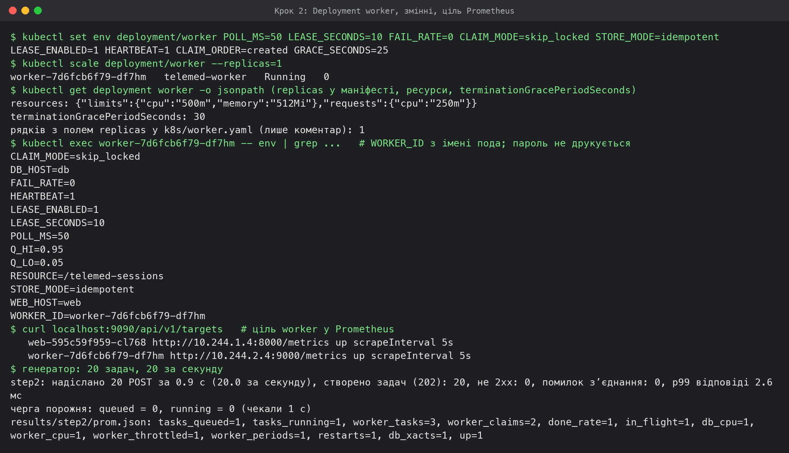

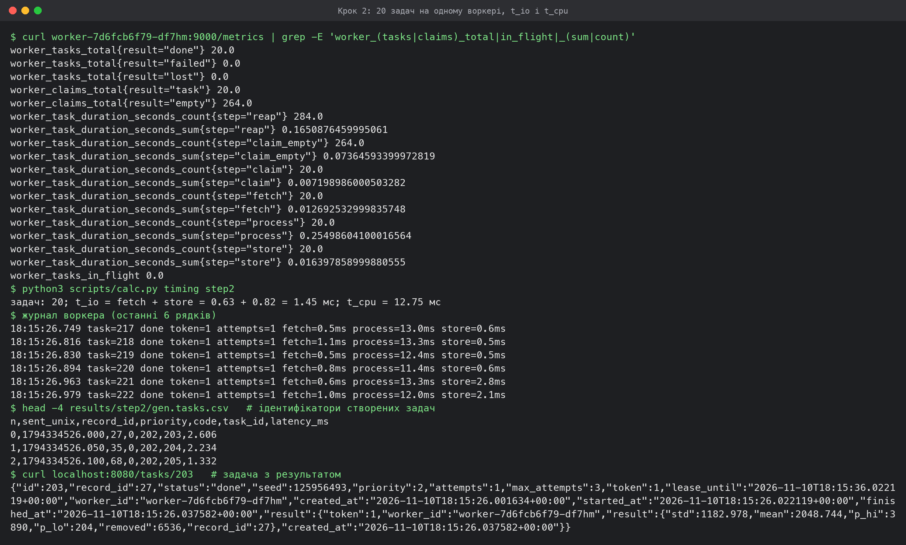

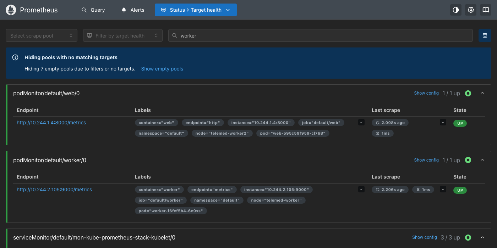

На одному воркері 20 задач: t_io = 1,45 мс (GET запису від web 0,63 мс і запис результату 0,82 мс), t_cpu = 12,75 мс. Обробка зрізу займає 90 % часу задачі. Порожніх захоплень 264 за 20 задач: між задачами (раз на 50 мс за 20 задач/с) воркер опитує чергу з інтервалом T_poll = 50 мс.

Ці t_io і t_cpu виміряно за низького навантаження: генератор дає одну задачу на 50 мс, а воркер зайнятий 15 мс з них, тож обмеження `limits.cpu: 500m` майже не діє. На кроці 6 з непорожньою чергою той самий крок обробки займає 20–22 мс (стовпчик `process` у таблиці кроку 6): воркер витрачає всю квоту CFS (50 мс CPU на 100 мс) і далі чекає. Пояснення розбіжності X(1) з оцінкою — у розділі кроку 6.

# Спільні функції серії

Кроки 3–10 використовують однакові функції: перемикання режиму воркерів, знімки метрик, посекундний запис стану бази, вивантаження таблиць і журналів.

*Лістинг 17 – Спільні функції, scripts/lib.sh*

```bash
# Спільні функції кроків серії ЛР 4. Підключається через `. scripts/lib.sh`.
set -euo pipefail
cd "$(dirname "${BASH_SOURCE[0]}")/.."
R=5                                   # найбільша кількість воркерів (R з ЛР 3)
URL='http://localhost:8080/telemed-sessions/{id}/tasks'
# Остаточний режим воркера і параметри варіанта 26; workers() задає всі змінні явно.
DEFAULTS="POLL_MS=50 LEASE_SECONDS=10 FAIL_RATE=0 CLAIM_MODE=skip_locked STORE_MODE=idempotent LEASE_ENABLED=1 HEARTBEAT=1 CLAIM_ORDER=created GRACE_SECONDS=25"

ts()  { date '+%F %T'; }
say() { echo "== $(ts) $*"; }
q()   { kubectl exec db-0 -- psql -U telemed -d telemed -X -tA -c "$1"; }       # одне значення
qt()  { echo "psql> $1"; kubectl exec db-0 -- psql -U telemed -d telemed -X -c "$1"; }   # таблицею, з текстом запиту
qf()  { kubectl exec -i db-0 -- psql -U telemed -d telemed -X -v ON_ERROR_STOP=1 -f - < "$1"; }
wpods()    { kubectl get pods -l app=worker --field-selector=status.phase=Running -o jsonpath='{.items[*].metadata.name}'; }
wmetrics() { kubectl get --raw "/api/v1/namespaces/default/pods/$1:9000/proxy/metrics" 2>/dev/null; }

# workers <W> [KEY=VALUE ...] — зупинити пул, задати режим, запустити W воркерів і дочекатися їх.
workers() {
  local w=$1; shift
  local merged=() d k v o pod
  for d in $DEFAULTS; do
    k=${d%%=*}; v=$d
    for o in "$@"; do [ "${o%%=*}" = "$k" ] && v=$o; done
    merged+=("$v")
  done
  kubectl scale deployment/worker --replicas=0 >/dev/null
  kubectl wait --for=delete pod -l app=worker --timeout=120s >/dev/null 2>&1 || true
  kubectl set env deployment/worker "${merged[@]}" >/dev/null
  echo "\$ kubectl set env deployment/worker ${merged[*]}"
  echo "\$ kubectl scale deployment/worker --replicas=$w"
  [ "$w" = 0 ] && return 0
  kubectl scale deployment/worker --replicas="$w" >/dev/null
  kubectl rollout status deployment/worker --timeout=180s >/dev/null
  until [ "$(wpods | wc -w | tr -d ' ')" = "$w" ]; do sleep 0.5; done
  for pod in $(wpods); do
    until wmetrics "$pod" | grep -Eq '^worker_claims_total\{result="(empty|task)"\} [1-9]'; do sleep 0.3; done
  done
  kubectl get pods -l app=worker -o custom-columns=POD:.metadata.name,NODE:.spec.nodeName,STATUS:.status.phase,RESTARTS:.status.containerStatuses[0].restartCount --no-headers
}

# snap <прогін> <before|after> — знімок /metrics кожного воркера (лише ряди worker_*).
snap() {
  local pod; mkdir -p "results/$1"
  for pod in $(wpods); do wmetrics "$pod" | grep '^worker_' > "results/$1/metrics_$2_$pod.txt" || true; done
}

# Посекундний запис стану бази в results/<прогін>/db_seconds.csv.
sampler_start() {
  mkdir -p "results/$1"
  echo "unix,lock_waiters,locks_not_granted,xacts,queued,running,done,failed" > "results/$1/db_seconds.csv"
  kubectl exec db-0 -- sh -c "$(cat scripts/db_sampler.sh)" >> "results/$1/db_seconds.csv" 2>/dev/null &
  SAMPLER=$!
}
# Чекати лише процес запису: інші фонові процеси кроку (генератор, kubectl logs -f) мають свій час.
sampler_stop() { kubectl exec db-0 -- rm -f /tmp/sampler.run; wait "$SAMPLER" 2>/dev/null || true; }

# gen <прогін> <параметри генератора> — генератор у контейнері з мережею хоста ВМ (як у ЛР 3).
gen() {
  local run=$1; shift; mkdir -p "results/$run"
  docker run --rm --network host -v "$PWD/results":/results telemed4-loadgen:lab4 \
    -mode tasks -url "$URL" -ids 1-100 -out "/results/$run/gen" -label "$run" "$@"
}

# wait_empty [тайм-аут, с] — чекати, поки не лишиться задач у queued і running.
wait_empty() {
  local limit=${1:-300} t0=$SECONDS n
  while :; do
    n=$(q "SELECT count(*) FROM tasks WHERE status IN ('queued', 'running')")
    [ "$n" = 0 ] && { echo "черга порожня: queued = 0, running = 0 (чекали $((SECONDS - t0)) с)"; return 0; }
    [ $((SECONDS - t0)) -ge "$limit" ] && { echo "за $limit с черга не спорожніла: лишилось $n задач у queued і running"; return 0; }
    sleep 0.5
  done
}

# dump <прогін> — таблиці tasks і task_results у CSV (час — секунди епохи). Стовпчик result (jsonb)
# вивантажується окремо для перших 20 задач, щоб файли довгих прогонів не розросталися.
dump() {
  mkdir -p "results/$1"
  kubectl exec db-0 -- psql -U telemed -d telemed -X -c "\\copy (SELECT id, record_id, status, seed, priority, attempts, max_attempts, token, worker_id, round(extract(epoch FROM created_at)::numeric, 6) AS created, round(extract(epoch FROM started_at)::numeric, 6) AS started, round(extract(epoch FROM finished_at)::numeric, 6) AS finished FROM tasks ORDER BY id) TO STDOUT WITH CSV HEADER" > "results/$1/tasks.csv"
  kubectl exec db-0 -- psql -U telemed -d telemed -X -c "\\copy (SELECT task_id, token, worker_id, round(extract(epoch FROM created_at)::numeric, 6) AS created FROM task_results ORDER BY task_id, created_at) TO STDOUT WITH CSV HEADER" > "results/$1/task_results.csv"
  kubectl exec db-0 -- psql -U telemed -d telemed -X -c "\\copy (SELECT task_id, token, worker_id, result FROM task_results ORDER BY task_id, created_at LIMIT 20) TO STDOUT WITH CSV HEADER" > "results/$1/task_results_sample.csv"
}

# wlogs <прогін> — журнал кожного пода worker з тому emptyDir на вузлі: файл містить рядки всіх
# екземплярів контейнера, тоді як kubectl logs віддає лише поточний і попередній.
wlogs() {
  local pod uid node; mkdir -p "results/$1"
  kubectl get pods -l app=worker -o jsonpath='{range .items[*]}{.metadata.name} {.metadata.uid} {.spec.nodeName}{"\n"}{end}' |
  while read -r pod uid node; do
    [ -n "$node" ] || continue
    docker exec "$node" cat "/var/lib/kubelet/pods/$uid/volumes/kubernetes.io~empty-dir/logs/worker.log" \
      > "results/$1/log_$pod.log" 2>/dev/null || true
  done
  # журнали довгих прогонів стискаються; аналіз читає і .log, і .log.gz
  find "results/$1" -name 'log_*.log' -size +1024k -exec gzip -f {} +
}

# stop_proc <под> <STOP|CONT> — сигнал процесу воркера з простору PID вузла (див. крок 5).
stop_proc() {
  local node cid pid
  node=$(kubectl get pod "$1" -o jsonpath='{.spec.nodeName}')
  cid=$(kubectl get pod "$1" -o jsonpath='{.status.containerStatuses[0].containerID}' | sed 's|containerd://||')
  pid=$(docker exec "$node" crictl inspect -o go-template --template '{{.info.pid}}' "$cid")
  echo "\$ docker exec $node kill -$2 $pid   # PID процесу воркера $1 на вузлі"
  docker exec "$node" kill "-$2" "$pid"
}

# rate <множник> — множник · X(R) з прогону кроку 6, задач за секунду
rate() { python3 scripts/calc.py rate "$1"; }

# collect <прогін> <unix початку> — усе, з чого рахується прогін.
collect() {
  snap "$1" after
  kubectl get pods -l app=worker -o wide > "results/$1/pods.txt"
  wlogs "$1"
  dump "$1"
  python3 scripts/promdump.py "$1" "$2" "$(date +%s)"
}

clean() { q "TRUNCATE tasks CASCADE" >/dev/null; }
```

*Лістинг 18 – Посекундний запис стану бази, scripts/db_sampler.sh*

```bash
# Виконується в поді бази (kubectl exec db-0 -- sh -c "$(cat scripts/db_sampler.sh)"):
# раз на секунду один рядок CSV, поки існує /tmp/sampler.run.
#   unix, рядки pg_stat_activity з wait_event_type = 'Lock', рядки pg_locks з granted = false,
#   лічильник транзакцій бази (commit + rollback), задачі за статусами.
touch /tmp/sampler.run
while [ -f /tmp/sampler.run ]; do
  psql -U telemed -d telemed -X -tA -F, -c "
    SELECT round(extract(epoch FROM clock_timestamp())::numeric, 3),
           (SELECT count(*) FROM pg_stat_activity WHERE wait_event_type = 'Lock'),
           (SELECT count(*) FROM pg_locks WHERE NOT granted),
           (SELECT xact_commit + xact_rollback FROM pg_stat_database WHERE datname = 'telemed'),
           (SELECT count(*) FROM tasks WHERE status = 'queued'),
           (SELECT count(*) FROM tasks WHERE status = 'running'),
           (SELECT count(*) FROM tasks WHERE status = 'done'),
           (SELECT count(*) FROM tasks WHERE status = 'failed')"
  sleep 1
done
```

# Крок 3. Наївне захоплення

Захоплення двома командами без транзакції (`CLAIM_MODE=naive`): `SELECT id … WHERE status = 'queued' ORDER BY created_at LIMIT 1`, далі `UPDATE … WHERE id = $1` без перевірки статусу. Результат пишеться `INSERT` без `ON CONFLICT`, первинний ключ `task_results` замінено звичайним індексом. 5 воркерів, 300 задач на 100 за секунду.

*Лістинг 19 – Тимчасова заміна ключа, db/step3_drop_pk.sql*

```sql
-- Крок 3: первинний ключ task_results тимчасово замінено звичайним індексом,
-- щоб другий результат тієї самої задачі записався і дубль було видно в таблиці.
TRUNCATE tasks CASCADE;
ALTER TABLE task_results DROP CONSTRAINT IF EXISTS task_results_pkey;
CREATE INDEX IF NOT EXISTS idx_task_results_task_id ON task_results (task_id);
```

*Лістинг 20 – Крок 3, scripts/step3.sh*

```bash
#!/usr/bin/env bash
# Крок 3: наївне захоплення (SELECT і окремий UPDATE), INSERT без ON CONFLICT, R воркерів,
# 300 задач на 100 за секунду; D для T_poll = 50 мс і 1 мс.
. "$(dirname "$0")/lib.sh"
workers 0 >/dev/null
echo '$ psql -f db/step3_drop_pk.sql'; qf db/step3_drop_pk.sql
for POLL in 50 1; do
  RUN=step3_poll$POLL; rm -rf results/$RUN; mkdir -p results/$RUN
  say "наївне захоплення, T_poll = $POLL мс, $R воркерів"
  clean; workers $R CLAIM_MODE=naive STORE_MODE=plain LEASE_ENABLED=0 HEARTBEAT=0 POLL_MS=$POLL
  snap $RUN before; sampler_start $RUN; T0=$(date +%s)
  gen $RUN -count 300 -rate 100
  wait_empty 120; sampler_stop
  collect $RUN "$T0"
  qt "SELECT count(*) AS n FROM tasks"
  qt "SELECT count(*) AS result_rows, count(DISTINCT task_id) AS tasks_with_result FROM task_results"
  qt "SELECT count(*) AS n_dup FROM (SELECT task_id FROM task_results GROUP BY task_id HAVING count(*) > 1) d"
  qt "SELECT task_id, count(*) AS results, array_agg(DISTINCT worker_id) AS workers FROM task_results GROUP BY task_id HAVING count(*) > 1 ORDER BY task_id LIMIT 3"
  echo "\$ cat results/$RUN/log_*.log | grep -o 'task=[0-9]* done' | sort | uniq -d | wc -l   # задачі з більше ніж одним рядком done"
  cat results/$RUN/log_*.log | grep -o 'task=[0-9]* done' | sort | uniq -d | wc -l
  echo "\$ python3 scripts/calc.py dup $RUN"; python3 scripts/calc.py dup $RUN
done
```

*Лістинг 21 – Вивід кроку 3, results/step3.log*

```text
$ psql -f db/step3_drop_pk.sql
psql:<stdin>:3: NOTICE:  truncate cascades to table "task_results"
TRUNCATE TABLE
ALTER TABLE
CREATE INDEX
== 2026-11-10 20:15:45 наївне захоплення, T_poll = 50 мс, 5 воркерів
NOTICE:  truncate cascades to table "task_results"
$ kubectl set env deployment/worker POLL_MS=50 LEASE_SECONDS=10 FAIL_RATE=0 CLAIM_MODE=naive STORE_MODE=plain LEASE_ENABLED=0 HEARTBEAT=0 CLAIM_ORDER=created GRACE_SECONDS=25
$ kubectl scale deployment/worker --replicas=5
worker-7b4fc774c7-65vnl   telemed-worker2   Running   0
worker-7b4fc774c7-8lg4z   telemed-worker    Running   0
worker-7b4fc774c7-cn74p   telemed-worker    Running   0
worker-7b4fc774c7-dtzlb   telemed-worker2   Running   0
worker-7b4fc774c7-szpsv   telemed-worker    Running   0
step3_poll50: надіслано 300 POST за 3.0 с (100.0 за секунду), створено задач (202): 300, не 2xx: 0, помилок зʼєднання: 0, p99 відповіді 5.3 мс
черга порожня: queued = 0, running = 0 (чекали 0 с)
results/step3_poll50/prom.json: tasks_queued=1, tasks_running=1, worker_tasks=3, worker_claims=2, done_rate=1, in_flight=1, db_cpu=1, worker_cpu=6, worker_throttled=6, worker_periods=6, restarts=6, db_xacts=1, up=1
psql> SELECT count(*) AS n FROM tasks
  n  
-----
 300
(1 row)

psql> SELECT count(*) AS result_rows, count(DISTINCT task_id) AS tasks_with_result FROM task_results
 result_rows | tasks_with_result 
-------------+-------------------
         322 |               300
(1 row)

psql> SELECT count(*) AS n_dup FROM (SELECT task_id FROM task_results GROUP BY task_id HAVING count(*) > 1) d
 n_dup 
-------
    21
(1 row)

psql> SELECT task_id, count(*) AS results, array_agg(DISTINCT worker_id) AS workers FROM task_results GROUP BY task_id HAVING count(*) > 1 ORDER BY task_id LIMIT 3
 task_id | results |                      workers                      
---------+---------+---------------------------------------------------
     275 |       2 | {worker-7b4fc774c7-65vnl,worker-7b4fc774c7-8lg4z}
     282 |       2 | {worker-7b4fc774c7-8lg4z,worker-7b4fc774c7-cn74p}
     283 |       2 | {worker-7b4fc774c7-65vnl,worker-7b4fc774c7-szpsv}
(3 rows)

$ cat results/step3_poll50/log_*.log | grep -o 'task=[0-9]* done' | sort | uniq -d | wc -l   # задачі з більше ніж одним рядком done
      21
$ python3 scripts/calc.py dup step3_poll50
n = 300; рядків у task_results: 322; n_dup за таблицею = 21, D = 0.0700; рядків done у журналах: 322; n_dup за журналами = 21, D = 0.0700
найбільше рядків pg_stat_activity з wait_event_type = 'Lock' за прогін: 0
== 2026-11-10 20:15:52 наївне захоплення, T_poll = 1 мс, 5 воркерів
NOTICE:  truncate cascades to table "task_results"
$ kubectl set env deployment/worker POLL_MS=1 LEASE_SECONDS=10 FAIL_RATE=0 CLAIM_MODE=naive STORE_MODE=plain LEASE_ENABLED=0 HEARTBEAT=0 CLAIM_ORDER=created GRACE_SECONDS=25
$ kubectl scale deployment/worker --replicas=5
worker-59f7d5d467-6s87h   telemed-worker2   Running   0
worker-59f7d5d467-cck9x   telemed-worker    Running   0
worker-59f7d5d467-l9tpj   telemed-worker    Running   0
worker-59f7d5d467-lkghd   telemed-worker    Running   0
worker-59f7d5d467-ndz6c   telemed-worker2   Running   0
step3_poll1: надіслано 300 POST за 3.0 с (100.0 за секунду), створено задач (202): 300, не 2xx: 0, помилок зʼєднання: 0, p99 відповіді 4.7 мс
черга порожня: queued = 0, running = 0 (чекали 0 с)
results/step3_poll1/prom.json: tasks_queued=1, tasks_running=1, worker_tasks=18, worker_claims=12, done_rate=1, in_flight=1, db_cpu=1, worker_cpu=11, worker_throttled=11, worker_periods=11, restarts=11, db_xacts=1, up=10
psql> SELECT count(*) AS n FROM tasks
  n  
-----
 300
(1 row)

psql> SELECT count(*) AS result_rows, count(DISTINCT task_id) AS tasks_with_result FROM task_results
 result_rows | tasks_with_result 
-------------+-------------------
         578 |               300
(1 row)

psql> SELECT count(*) AS n_dup FROM (SELECT task_id FROM task_results GROUP BY task_id HAVING count(*) > 1) d
 n_dup 
-------
   175
(1 row)

psql> SELECT task_id, count(*) AS results, array_agg(DISTINCT worker_id) AS workers FROM task_results GROUP BY task_id HAVING count(*) > 1 ORDER BY task_id LIMIT 3
 task_id | results |                                              workers                                              
---------+---------+---------------------------------------------------------------------------------------------------
     524 |       4 | {worker-59f7d5d467-6s87h,worker-59f7d5d467-cck9x,worker-59f7d5d467-l9tpj,worker-59f7d5d467-ndz6c}
     529 |       4 | {worker-59f7d5d467-cck9x,worker-59f7d5d467-l9tpj,worker-59f7d5d467-lkghd,worker-59f7d5d467-ndz6c}
     531 |       2 | {worker-59f7d5d467-lkghd,worker-59f7d5d467-ndz6c}
(3 rows)

$ cat results/step3_poll1/log_*.log | grep -o 'task=[0-9]* done' | sort | uniq -d | wc -l   # задачі з більше ніж одним рядком done
     175
$ python3 scripts/calc.py dup step3_poll1
n = 300; рядків у task_results: 578; n_dup за таблицею = 175, D = 0.5833; рядків done у журналах: 578; n_dup за журналами = 175, D = 0.5833
найбільше рядків pg_stat_activity з wait_event_type = 'Lock' за прогін: 0
```

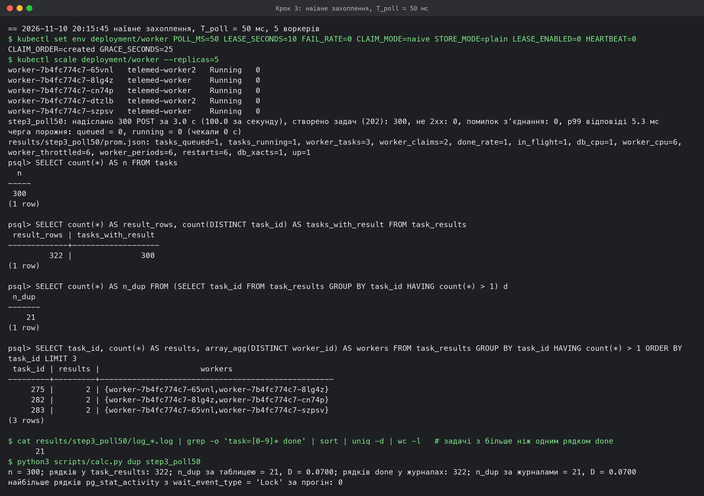

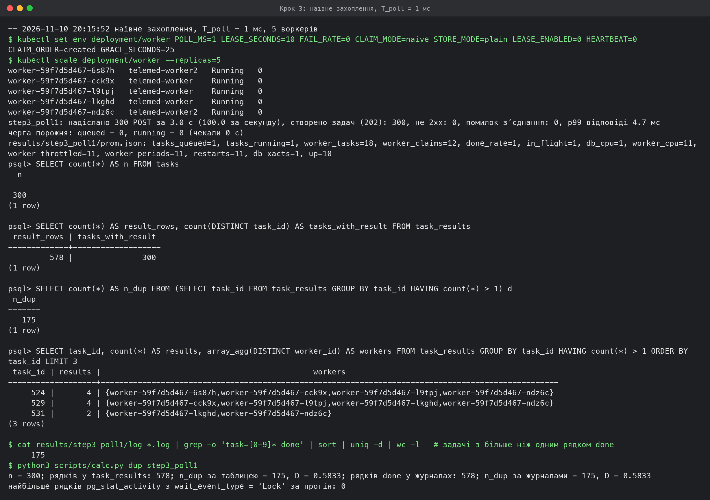

# Крок 4. Блокування рядка

Захоплення однією командою `UPDATE … WHERE id = (SELECT … FOR UPDATE [SKIP LOCKED]) RETURNING …`. Первинний ключ `task_results` повернуто. Серія кроку 3 з T_poll = 1 мс — спершу з SKIP LOCKED, далі з FOR UPDATE без SKIP LOCKED. Запис результату лишився тим самим, що на кроці 3 (`STORE_MODE=plain`), тож зміна між кроками — лише в захопленні.

*Лістинг 22 – Повернення ключа, db/step4_restore_pk.sql*

```sql
-- Крок 4: первинний ключ task_results повернуто (таблиці перед цим очищено від дублів кроку 3).
TRUNCATE tasks CASCADE;
DROP INDEX IF EXISTS idx_task_results_task_id;
ALTER TABLE task_results DROP CONSTRAINT IF EXISTS task_results_pkey;
ALTER TABLE task_results ADD CONSTRAINT task_results_pkey PRIMARY KEY (task_id);
```

*Лістинг 23 – Крок 4, scripts/step4.sh*

```bash
#!/usr/bin/env bash
# Крок 4: захоплення однією командою. Спершу FOR UPDATE SKIP LOCKED, далі FOR UPDATE без SKIP LOCKED;
# серія кроку 3 з T_poll = 1 мс. Первинний ключ task_results повернуто.
. "$(dirname "$0")/lib.sh"
workers 0 >/dev/null
echo '$ psql -f db/step4_restore_pk.sql'; qf db/step4_restore_pk.sql
for MODE in skip_locked for_update; do
  RUN=step4_$MODE; rm -rf results/$RUN; mkdir -p results/$RUN
  say "захоплення $MODE, T_poll = 1 мс, $R воркерів"
  clean; workers $R CLAIM_MODE=$MODE STORE_MODE=plain LEASE_ENABLED=0 HEARTBEAT=0 POLL_MS=1
  snap $RUN before; sampler_start $RUN; T0=$(date +%s)
  gen $RUN -count 300 -rate 100
  wait_empty 120; sampler_stop
  collect $RUN "$T0"
  qt "SELECT count(*) AS n, count(*) FILTER (WHERE status = 'done') AS done FROM tasks"
  qt "SELECT count(*) AS result_rows, (SELECT count(*) FROM (SELECT task_id FROM task_results GROUP BY task_id HAVING count(*) > 1) d) AS n_dup FROM task_results"
  echo "\$ python3 scripts/calc.py dup $RUN"; python3 scripts/calc.py dup $RUN
  echo "\$ python3 scripts/calc.py stat $RUN"; python3 scripts/calc.py stat $RUN
  echo "\$ sort -t, -k2 -nr results/$RUN/db_seconds.csv | head -3   # unix, Lock у pg_stat_activity, granted = false у pg_locks, …"
  sed 1d results/$RUN/db_seconds.csv | sort -t, -k2 -nr | head -3
done
```

*Лістинг 24 – Вивід кроку 4, results/step4.log*

```text
$ psql -f db/step4_restore_pk.sql
psql:<stdin>:2: NOTICE:  truncate cascades to table "task_results"
TRUNCATE TABLE
DROP INDEX
psql:<stdin>:4: NOTICE:  constraint "task_results_pkey" of relation "task_results" does not exist, skipping
ALTER TABLE
ALTER TABLE
== 2026-11-10 20:16:01 захоплення skip_locked, T_poll = 1 мс, 5 воркерів
NOTICE:  truncate cascades to table "task_results"
$ kubectl set env deployment/worker POLL_MS=1 LEASE_SECONDS=10 FAIL_RATE=0 CLAIM_MODE=skip_locked STORE_MODE=plain LEASE_ENABLED=0 HEARTBEAT=0 CLAIM_ORDER=created GRACE_SECONDS=25
$ kubectl scale deployment/worker --replicas=5
worker-5ffd67d4d4-44px8   telemed-worker    Running   0
worker-5ffd67d4d4-drjxg   telemed-worker    Running   0
worker-5ffd67d4d4-mp9mh   telemed-worker2   Running   0
worker-5ffd67d4d4-tt46m   telemed-worker2   Running   0
worker-5ffd67d4d4-zzjvr   telemed-worker    Running   0
step4_skip_locked: надіслано 300 POST за 3.0 с (100.0 за секунду), створено задач (202): 300, не 2xx: 0, помилок зʼєднання: 0, p99 відповіді 4.0 мс
черга порожня: queued = 0, running = 0 (чекали 0 с)
results/step4_skip_locked/prom.json: tasks_queued=1, tasks_running=1, worker_tasks=24, worker_claims=16, done_rate=1, in_flight=1, db_cpu=1, worker_cpu=16, worker_throttled=16, worker_periods=16, restarts=15, db_xacts=1, up=13
psql> SELECT count(*) AS n, count(*) FILTER (WHERE status = 'done') AS done FROM tasks
  n  | done 
-----+------
 300 |  300
(1 row)

psql> SELECT count(*) AS result_rows, (SELECT count(*) FROM (SELECT task_id FROM task_results GROUP BY task_id HAVING count(*) > 1) d) AS n_dup FROM task_results
 result_rows | n_dup 
-------------+-------
         300 |     0
(1 row)

$ python3 scripts/calc.py dup step4_skip_locked
n = 300; рядків у task_results: 300; n_dup за таблицею = 0, D = 0.0000; рядків done у журналах: 300; n_dup за журналами = 0, D = 0.0000
найбільше рядків pg_stat_activity з wait_event_type = 'Lock' за прогін: 0
$ python3 scripts/calc.py stat step4_skip_locked
worker_tasks_total:  done = 300, failed = 0, lost = 0
worker_claims_total: task = 300, empty = 13780
  claim        n =    300  середнє =    0.320 мс  p99 =    2.000 мс
  claim_empty  n =  13780  середнє =    0.144 мс  p99 =    0.918 мс
  fetch        n =    300  середнє =    0.472 мс  p99 =    1.818 мс
  process      n =    300  середнє =   11.286 мс  p99 =   14.983 мс
  store        n =    300  середнє =    0.567 мс  p99 =    2.000 мс
  claim_all    n =  14080  середнє =    0.148 мс  p99 =    0.931 мс
$ sort -t, -k2 -nr results/step4_skip_locked/db_seconds.csv | head -3   # unix, Lock у pg_stat_activity, granted = false у pg_locks, …
1794334566.527,0,0,109226158,0,1,252,0
1794334565.520,0,0,109222078,0,1,151,0
1794334564.514,0,0,109218286,0,1,51,0
== 2026-11-10 20:16:08 захоплення for_update, T_poll = 1 мс, 5 воркерів
NOTICE:  truncate cascades to table "task_results"
$ kubectl set env deployment/worker POLL_MS=1 LEASE_SECONDS=10 FAIL_RATE=0 CLAIM_MODE=for_update STORE_MODE=plain LEASE_ENABLED=0 HEARTBEAT=0 CLAIM_ORDER=created GRACE_SECONDS=25
$ kubectl scale deployment/worker --replicas=5
worker-5c5868df67-d8ts7   telemed-worker2   Running   0
worker-5c5868df67-g5n5m   telemed-worker2   Running   0
worker-5c5868df67-p2fzd   telemed-worker    Running   0
worker-5c5868df67-v4bdk   telemed-worker    Running   0
worker-5c5868df67-x6prj   telemed-worker    Running   0
step4_for_update: надіслано 300 POST за 3.0 с (100.0 за секунду), створено задач (202): 300, не 2xx: 0, помилок зʼєднання: 0, p99 відповіді 8.2 мс
черга порожня: queued = 0, running = 0 (чекали 0 с)
results/step4_for_update/prom.json: tasks_queued=1, tasks_running=1, worker_tasks=30, worker_claims=20, done_rate=0, in_flight=1, db_cpu=1, worker_cpu=15, worker_throttled=15, worker_periods=15, restarts=20, db_xacts=1, up=17
psql> SELECT count(*) AS n, count(*) FILTER (WHERE status = 'done') AS done FROM tasks
  n  | done 
-----+------
 300 |  300
(1 row)

psql> SELECT count(*) AS result_rows, (SELECT count(*) FROM (SELECT task_id FROM task_results GROUP BY task_id HAVING count(*) > 1) d) AS n_dup FROM task_results
 result_rows | n_dup 
-------------+-------
         300 |     0
(1 row)

$ python3 scripts/calc.py dup step4_for_update
n = 300; рядків у task_results: 300; n_dup за таблицею = 0, D = 0.0000; рядків done у журналах: 300; n_dup за журналами = 0, D = 0.0000
найбільше рядків pg_stat_activity з wait_event_type = 'Lock' за прогін: 0
$ python3 scripts/calc.py stat step4_for_update
worker_tasks_total:  done = 300, failed = 0, lost = 0
worker_claims_total: task = 300, empty = 13366
  claim        n =    300  середнє =    0.431 мс  p99 =    3.000 мс
  claim_empty  n =  13366  середнє =    0.153 мс  p99 =    0.966 мс
  fetch        n =    300  середнє =    0.648 мс  p99 =    2.833 мс
  process      n =    300  середнє =   12.087 мс  p99 =   26.667 мс
  store        n =    300  середнє =    0.807 мс  p99 =    6.250 мс
  claim_all    n =  13666  середнє =    0.159 мс  p99 =    0.993 мс
$ sort -t, -k2 -nr results/step4_for_update/db_seconds.csv | head -3   # unix, Lock у pg_stat_activity, granted = false у pg_locks, …
1794334574.259,0,0,109246419,0,1,225,0
1794334573.253,0,0,109242790,0,2,124,0
1794334572.248,0,0,109238906,0,1,24,0
```

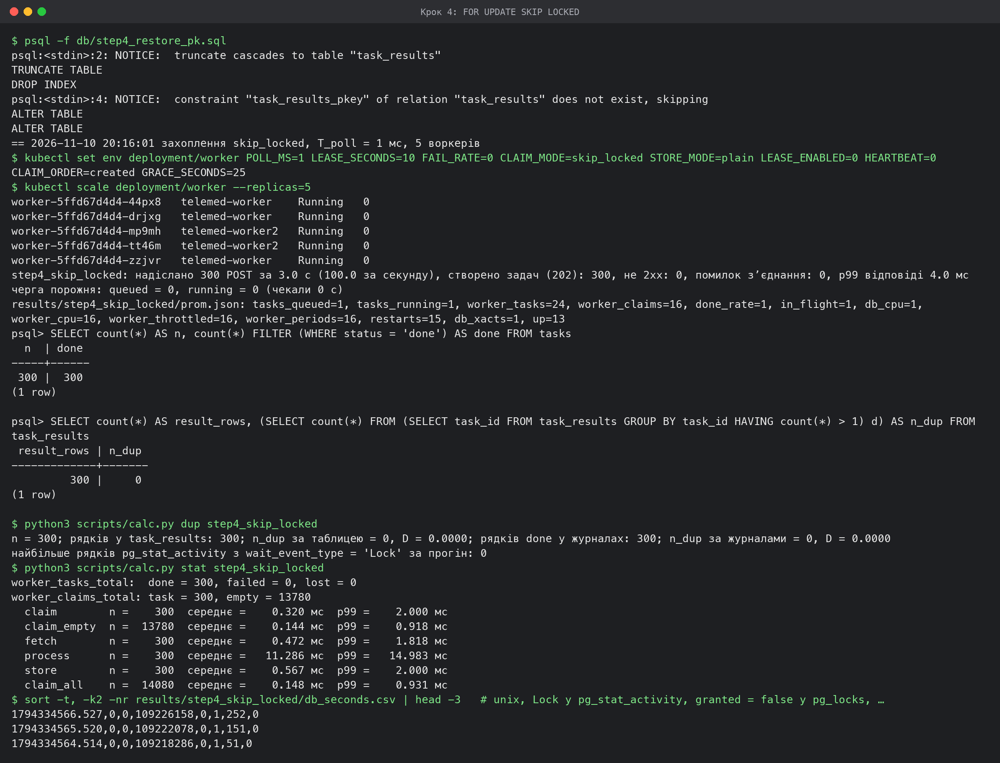

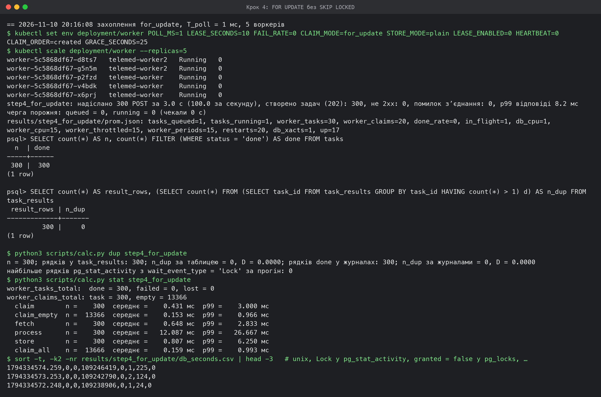

Підсумок кроків 3–4. D за таблицею — частка задач з більше ніж одним рядком у `task_results`, D за журналами — частка задач з більше ніж одним рядком `task=… done` у журналах усіх воркерів. p99 захоплення — з гістограми `worker_task_duration_seconds{step="claim"}` (лише команди, що повернули задачу), порожні захоплення — `worker_claims_total{result="empty"}`, найбільша кількість рядків `Lock` — з посекундного запису `db_seconds.csv`.

| Захоплення | n | Рядків у task_results | n_dup (таблиця) | D (таблиця) | Рядків done у журналах | n_dup (журнали) | D (журнали) | p99 захоплення, мс | Порожніх захоплень | Найбільше Lock у pg_stat_activity | Найбільше granted = false |
|---|---|---|---|---|---|---|---|---|---|---|---|
| наївне, T_poll = 50 мс | 300 | 322 | 21 | 0.0700 | 322 | 21 | 0.0700 | 1.69 | 330 | 0 | 0 |
| наївне, T_poll = 1 мс | 300 | 578 | 175 | 0.5833 | 578 | 175 | 0.5833 | 4.48 | 10575 | 0 | 0 |
| FOR UPDATE SKIP LOCKED, 1 мс | 300 | 300 | 0 | 0.0000 | 300 | 0 | 0.0000 | 2.00 | 13780 | 0 | 0 |
| FOR UPDATE, 1 мс | 300 | 300 | 0 | 0.0000 | 300 | 0 | 0.0000 | 3.00 | 13366 | 0 | 0 |

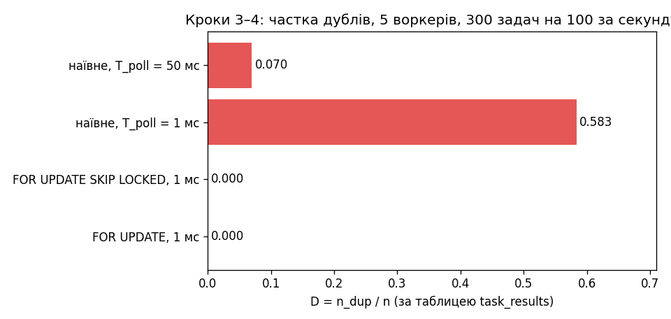

**Наївне захоплення дублює задачі, і тим частіше, чим частіше воркери опитують чергу.** За T_poll = 50 мс 21 задача з 300 оброблена двічі або більше (D = 0,07), за T_poll = 1 мс — 175 задач (D = 0,58), деякі задачі виконали 4 воркери з 5. Між SELECT і UPDATE проходить десята частка мілісекунди. Задача з'являється раз на 10 мс, і кожен воркер, який виконав SELECT у цьому проміжку, бере ту саму найстаршу задачу. За T_poll = 1 мс п'ять воркерів роблять приблизно 5000 опитувань за секунду (10 575 порожніх захоплень за 3 с) і майже завжди хоча б двоє опиняються в цьому проміжку разом. За 50 мс опитувань у 50 разів менше, і збіги рідші. D за таблицею результатів і за журналами збігається, бо в цьому режимі кожен рядок `done` у журналі супроводжується своїм `INSERT`: це два способи підрахунку тих самих подій, а не незалежна перевірка.

**Блокування рядка усуває дублі повністю:** з FOR UPDATE SKIP LOCKED і з FOR UPDATE без SKIP LOCKED D = 0 (300 рядків у `task_results` на 300 задач). Запис результату на кроці 4 той самий, що на кроці 3 (INSERT без ON CONFLICT), але первинний ключ повернуто. Отже, дублі зникли саме через захоплення: дубль з'явився б як помилка первинного ключа у воркері, а `worker_tasks_total{result="failed"}` дорівнює 0.

**Очікування блокувань у цій серії не видно.** p99 захоплення без SKIP LOCKED трохи більший (3,0 мс проти 2,0 мс; межі бакетів гістограми 2, 3 і 5 мс, тож точніше ця величина не визначається), порожніх захоплень приблизно стільки ж (13 366 проти 13 780), а в посекундних знімках `pg_stat_activity` не потрапило жодного рядка з `wait_event_type = 'Lock'`. Причина: за 100 задач/с і можливих приблизно 200 задач/с черга майже весь час порожня (стовпчик `queued` у `db_seconds.csv` дорівнює 0 або 1), тож за рядок воркери змагаються рідко, а саме блокування триває одну команду UPDATE (~0,3 мс).

**Контрольний прогін з непорожньою чергою.** Ті самі два режими, але перед стартом воркерів у черзі 3000 задач, тож усі 5 воркерів постійно йдуть до найстаршого рядка. Цей прогін умова не вимагає; він показує ефект, якого не видно за 100 задач/с.

*Лістинг 25 – Контрольний прогін, scripts/step4b.sh*

```bash
#!/usr/bin/env bash
# Крок 4, додатковий прогін: ті самі два режими захоплення з непорожньою чергою.
# За 100 задач/с серії кроку 3 черга майже весь час порожня, і воркери рідко змагаються за той самий рядок.
# Тут перед стартом воркерів у черзі 3000 задач: усі 5 воркерів щоразу йдуть до найстаршого рядка.
. "$(dirname "$0")/lib.sh"
for MODE in skip_locked for_update; do
  RUN=step4b_$MODE; rm -rf results/$RUN; mkdir -p results/$RUN
  say "захоплення $MODE, T_poll = 1 мс, $R воркерів, 3000 задач у черзі до старту"
  clean; workers 0 >/dev/null
  kubectl set env deployment/worker CLAIM_MODE=$MODE STORE_MODE=plain LEASE_ENABLED=0 HEARTBEAT=0 POLL_MS=1 >/dev/null
  echo "\$ kubectl set env deployment/worker CLAIM_MODE=$MODE STORE_MODE=plain LEASE_ENABLED=0 HEARTBEAT=0 POLL_MS=1"
  gen $RUN -count 3000 -rate 500
  sampler_start $RUN; T0=$(date +%s)
  echo "\$ kubectl scale deployment/worker --replicas=$R"
  kubectl scale deployment/worker --replicas=$R >/dev/null
  kubectl rollout status deployment/worker --timeout=180s >/dev/null
  wait_empty 300; sampler_stop
  collect $RUN "$T0"
  qt "SELECT count(*) AS result_rows, (SELECT count(*) FROM (SELECT task_id FROM task_results GROUP BY task_id HAVING count(*) > 1) d) AS n_dup FROM task_results"
  echo "\$ python3 scripts/calc.py dup $RUN"; python3 scripts/calc.py dup $RUN
  echo "\$ python3 scripts/calc.py x $RUN"; python3 scripts/calc.py x $RUN
  echo "\$ python3 scripts/calc.py stat $RUN"; python3 scripts/calc.py stat $RUN
  echo "\$ sort -t, -k2 -nr results/$RUN/db_seconds.csv | head -3   # unix, Lock у pg_stat_activity, granted = false у pg_locks, …"
  sed 1d results/$RUN/db_seconds.csv | sort -t, -k2 -nr | head -3
done
```

*Лістинг 26 – Вивід контрольного прогону, results/step4b.log*

```text
== 2026-11-10 20:55:59 захоплення skip_locked, T_poll = 1 мс, 5 воркерів, 3000 задач у черзі до старту
NOTICE:  truncate cascades to table "task_results"
$ kubectl set env deployment/worker CLAIM_MODE=skip_locked STORE_MODE=plain LEASE_ENABLED=0 HEARTBEAT=0 POLL_MS=1
step4b_skip_locked: надіслано 3000 POST за 6.0 с (500.0 за секунду), створено задач (202): 3000, не 2xx: 0, помилок зʼєднання: 0, p99 відповіді 2.1 мс
$ kubectl scale deployment/worker --replicas=5
черга порожня: queued = 0, running = 0 (чекали 15 с)
results/step4b_skip_locked/prom.json: tasks_queued=1, tasks_running=1, worker_tasks=18, worker_claims=12, done_rate=1, in_flight=1, db_cpu=1, worker_cpu=6, worker_throttled=6, worker_periods=6, restarts=6, db_xacts=1, up=6
psql> SELECT count(*) AS result_rows, (SELECT count(*) FROM (SELECT task_id FROM task_results GROUP BY task_id HAVING count(*) > 1) d) AS n_dup FROM task_results
 result_rows | n_dup 
-------------+-------
        3000 |     0
(1 row)

$ python3 scripts/calc.py dup step4b_skip_locked
n = 3000; рядків у task_results: 3000; n_dup за таблицею = 0, D = 0.0000; рядків done у журналах: 3000; n_dup за журналами = 0, D = 0.0000
найбільше рядків pg_stat_activity з wait_event_type = 'Lock' за прогін: 0
$ python3 scripts/calc.py x step4b_skip_locked
X = 222.7 задач/с за останні 13.5 с (розкид 4.2); черга спорожніла за 13.5 с, завершено 3000
$ python3 scripts/calc.py stat step4b_skip_locked
worker_tasks_total:  done = 3000, failed = 0, lost = 0
worker_claims_total: task = 3000, empty = 2898
  claim        n =   3000  середнє =    0.442 мс  p99 =    2.959 мс
  claim_empty  n =   2898  середнє =    0.127 мс  p99 =    0.497 мс
  fetch        n =   3000  середнє =    0.866 мс  p99 =    4.667 мс
  process      n =   3000  середнє =   19.552 мс  p99 =   67.500 мс
  store        n =   3000  середнє =    1.411 мс  p99 =   25.000 мс
  claim_all    n =   5898  середнє =    0.287 мс  p99 =    2.380 мс
$ sort -t, -k2 -nr results/step4b_skip_locked/db_seconds.csv | head -3   # unix, Lock у pg_stat_activity, granted = false у pg_locks, …
1794336980.386,0,0,110340132,87,5,2908,0
1794336979.377,0,0,110339064,300,5,2695,0
1794336978.370,0,0,110338000,519,5,2476,0
== 2026-11-10 20:56:22 захоплення for_update, T_poll = 1 мс, 5 воркерів, 3000 задач у черзі до старту
NOTICE:  truncate cascades to table "task_results"
$ kubectl set env deployment/worker CLAIM_MODE=for_update STORE_MODE=plain LEASE_ENABLED=0 HEARTBEAT=0 POLL_MS=1
step4b_for_update: надіслано 3000 POST за 6.0 с (500.0 за секунду), створено задач (202): 3000, не 2xx: 0, помилок зʼєднання: 0, p99 відповіді 2.7 мс
$ kubectl scale deployment/worker --replicas=5
черга порожня: queued = 0, running = 0 (чекали 15 с)
results/step4b_for_update/prom.json: tasks_queued=1, tasks_running=1, worker_tasks=30, worker_claims=20, done_rate=1, in_flight=1, db_cpu=1, worker_cpu=10, worker_throttled=10, worker_periods=10, restarts=10, db_xacts=1, up=10
psql> SELECT count(*) AS result_rows, (SELECT count(*) FROM (SELECT task_id FROM task_results GROUP BY task_id HAVING count(*) > 1) d) AS n_dup FROM task_results
 result_rows | n_dup 
-------------+-------
        3000 |     0
(1 row)

$ python3 scripts/calc.py dup step4b_for_update
n = 3000; рядків у task_results: 3000; n_dup за таблицею = 0, D = 0.0000; рядків done у журналах: 3000; n_dup за журналами = 0, D = 0.0000
найбільше рядків pg_stat_activity з wait_event_type = 'Lock' за прогін: 0
$ python3 scripts/calc.py x step4b_for_update
X = 216.0 задач/с за останні 13.9 с (розкид 8.8); черга спорожніла за 13.9 с, завершено 3000
$ python3 scripts/calc.py stat step4b_for_update
worker_tasks_total:  done = 3000, failed = 0, lost = 0
worker_claims_total: task = 3000, empty = 1566
  claim        n =   3000  середнє =    0.378 мс  p99 =    2.417 мс
  claim_empty  n =   1566  середнє =    0.131 мс  p99 =    0.498 мс
  fetch        n =   3000  середнє =    0.828 мс  p99 =    4.556 мс
  process      n =   3000  середнє =   20.497 мс  p99 =   72.794 мс
  store        n =   3000  середнє =    1.160 мс  p99 =   13.750 мс
  claim_all    n =   4566  середнє =    0.293 мс  p99 =    1.931 мс
$ sort -t, -k2 -nr results/step4b_for_update/db_seconds.csv | head -3   # unix, Lock у pg_stat_activity, granted = false у pg_locks, …
1794337004.397,0,0,110367086,153,4,2843,0
1794337003.389,0,0,110366128,370,5,2625,0
1794337002.378,0,0,110365175,589,4,2407,0
```

| Захоплення (3000 задач у черзі) | n | D | X, задач/с | Захоплення: середнє, мс | p99 захоплення, мс | Порожніх захоплень | Найбільше Lock у pg_stat_activity | Секунд з Lock > 0 |
|---|---|---|---|---|---|---|---|---|
| FOR UPDATE SKIP LOCKED | 3000 | 0.0000 | 222.7 | 0.44 | 2.96 | 2898 | 0 | 0 з 15 |
| FOR UPDATE | 3000 | 0.0000 | 216.0 | 0.38 | 2.42 | 1566 | 0 | 0 з 15 |

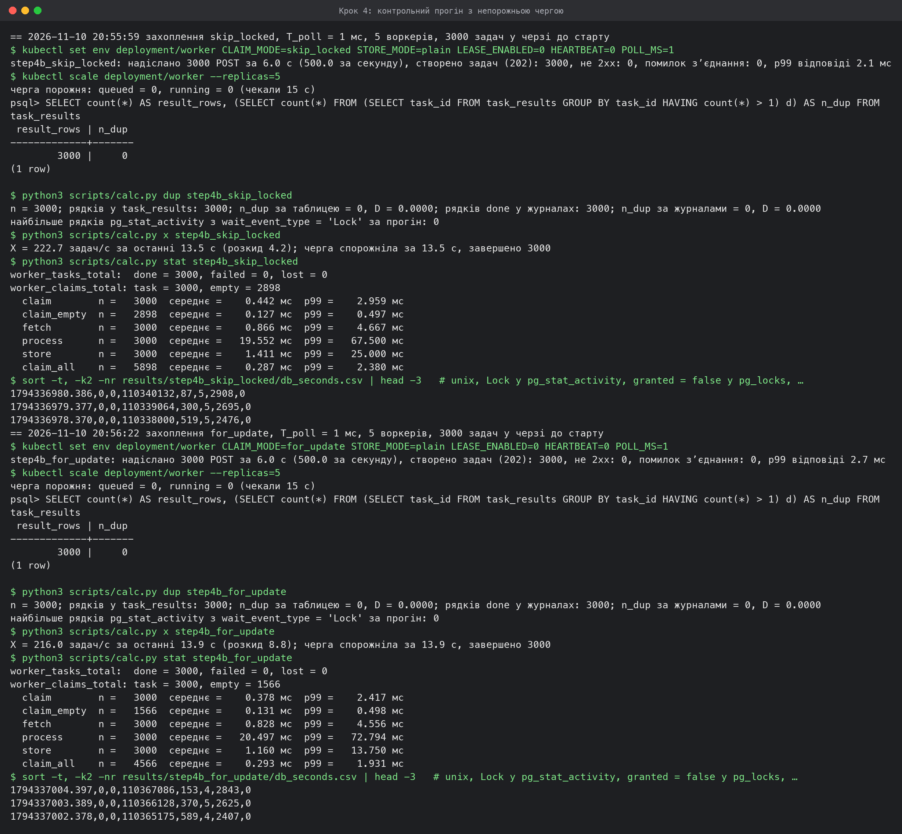

І з повною чергою жоден із 15 посекундних знімків не впіймав рядка з `Lock`, і порожніх захоплень без SKIP LOCKED не більше, а менше (1566 проти 2898; майже всі вони — опитування порожньої черги в останні секунди прогону, коли воркери вже доробили свої задачі). Обидва ефекти пояснюються поведінкою PostgreSQL. Блокування рядка тримається одну команду UPDATE в autocommit, середня тривалість захоплення 0,38–0,44 мс. Отже, рядок заблоковано менше ніж 10 % часу, а очікування триває частки мілісекунди, і знімок раз на секунду майже ніколи не застає його. Транзакція, що чекала на FOR UPDATE, після звільнення рядка перевіряє його повторно (EvalPlanQual). Рядок уже в статусі `running` і не проходить умову `status = 'queued'`, тож він відкидається, а `LIMIT 1` бере наступний рядок. У цій версії PostgreSQL (16) чекання на один рядок не дає порожнього результату, якщо в черзі є інші задачі, — описаний в умові ефект «решта отримує рядок уже зі статусом running і повертає порожній результат» тут не проявився. X обох режимів у межах розкиду (222,7 і 216,0 задач/с). Вищий за X(5) кроку 6 він тому, що в цьому прогоні вимкнено lease і повернення спливлих задач перед кожним захопленням.

# Крок 5. Lease, heartbeat і fencing token

Остаточний режим воркера: `CLAIM_MODE=skip_locked`, `STORE_MODE=idempotent`, lease L = 10 с, heartbeat кожні L / 3 з умовою `AND token = $3`, повернення задач зі спливлим lease кожним воркером перед захопленням, перехід у `failed` після `max_attempts`, завершення задачі й `INSERT … ON CONFLICT (task_id) DO NOTHING` в одній транзакції. Якщо `UPDATE … AND token = $2` оновив нуль рядків, транзакція відкочується, і результат не записується.

2 воркери, 100 задач. Коли завершено 10 задач, один воркер зупиняється на 2 · L = 20 с і відновлюється.

*Лістинг 27 – Крок 5, scripts/step5.sh*

```bash
#!/usr/bin/env bash
# Крок 5: lease, heartbeat, fencing token, ідемпотентний запис. 2 воркери, 100 задач;
# один воркер зупинено сигналом STOP на 2 · L = 20 с і відновлено сигналом CONT.
. "$(dirname "$0")/lib.sh"
RUN=step5; rm -rf results/$RUN; mkdir -p results/$RUN
L=10
clean; workers 2
V=$(wpods | cut -d' ' -f1)
echo "зупинятиметься воркер $V"
echo "\$ kubectl exec $V -- sh -c 'kill -STOP 1; sleep 1; grep State /proc/1/status; kill -CONT 1'"
kubectl exec "$V" -- sh -c 'kill -STOP 1; sleep 1; grep State /proc/1/status; kill -CONT 1'
echo "# процес лишився в стані S: ядро не доставляє STOP процесу з PID 1 зсередини його простору PID."
echo "# Той самий сигнал надсилається з вузла, де воркер не є PID 1."
snap $RUN before; sampler_start $RUN; T0=$(date +%s)
gen $RUN -count 100 -rate 100 > results/$RUN/gen.out &
GEN=$!
until [ "$(q "SELECT count(*) FROM tasks WHERE status = 'done'")" -ge 10 ]; do sleep 0.1; done
stop_proc "$V" STOP
TSTOP=$(date +%s.%N)
say "воркер зупинено; задача, яка була в нього в обробці (до)"
kubectl exec "$V" -- grep State /proc/1/status
qt "SELECT id, status, attempts, token, worker_id, lease_until FROM tasks WHERE status = 'running' AND worker_id = '$V'"
TID=$(q "SELECT id FROM tasks WHERE status = 'running' AND worker_id = '$V' LIMIT 1")
wait "$GEN"; cat results/$RUN/gen.out
[ -n "$TID" ] || { echo "на момент зупинки у воркера не було задачі в обробці: повторіть крок"; stop_proc "$V" CONT; sampler_stop; exit 1; }
sleep $((L + 5))
say "через $((L + 5)) с після зупинки: lease сплив, задачу повернуто в чергу і забрано"
qt "SELECT id, status, attempts, token, worker_id FROM tasks WHERE id = $TID"
# до відновлення рівно 2 · L від моменту зупинки
sleep "$(python3 -c "import time; print(max(0, $TSTOP + 2 * $L - time.time()))")"
stop_proc "$V" CONT
echo "воркер був зупинений $(python3 -c "import time; print(round(time.time() - $TSTOP, 1))") с"
sleep 3
say "через 3 с після відновлення (після)"
kubectl exec "$V" -- grep State /proc/1/status
qt "SELECT id, status, attempts, token, worker_id, round(extract(epoch FROM finished_at - created_at)::numeric, 2) AS seconds_to_done FROM tasks WHERE id = $TID"
qt "SELECT task_id, token, worker_id, result FROM task_results WHERE task_id = $TID"
qt "SELECT count(*) AS result_rows_for_task FROM task_results WHERE task_id = $TID"
wait_empty 60; sampler_stop
collect $RUN "$T0"
echo "\$ grep 'task=$TID ' results/$RUN/log_*.log   # журнали обох воркерів про цю задачу"
grep -H "task=$TID " results/$RUN/log_*.log | sed "s|results/$RUN/log_||"
qt "SELECT status, count(*), max(attempts) AS max_attempts_used FROM tasks GROUP BY status"
qt "SELECT count(*) AS result_rows, count(DISTINCT task_id) AS tasks FROM task_results"
echo "$TID $V" > results/$RUN/victim.txt
echo "\$ python3 scripts/calc.py stat $RUN"; python3 scripts/calc.py stat $RUN
```

*Лістинг 28 – Вивід кроку 5, results/step5.log*

```text
NOTICE:  truncate cascades to table "task_results"
$ kubectl set env deployment/worker POLL_MS=50 LEASE_SECONDS=10 FAIL_RATE=0 CLAIM_MODE=skip_locked STORE_MODE=idempotent LEASE_ENABLED=1 HEARTBEAT=1 CLAIM_ORDER=created GRACE_SECONDS=25
$ kubectl scale deployment/worker --replicas=2
worker-7d6fcb6f79-ftqzt   telemed-worker    Running   0
worker-7d6fcb6f79-jnhkc   telemed-worker2   Running   0
зупинятиметься воркер worker-7d6fcb6f79-ftqzt
$ kubectl exec worker-7d6fcb6f79-ftqzt -- sh -c 'kill -STOP 1; sleep 1; grep State /proc/1/status; kill -CONT 1'
State:	S (sleeping)
# процес лишився в стані S: ядро не доставляє STOP процесу з PID 1 зсередини його простору PID.
# Той самий сигнал надсилається з вузла, де воркер не є PID 1.
$ docker exec telemed-worker kill -STOP 5792   # PID процесу воркера worker-7d6fcb6f79-ftqzt на вузлі
== 2026-11-10 20:22:43 воркер зупинено; задача, яка була в нього в обробці (до)
State:	T (stopped)
psql> SELECT id, status, attempts, token, worker_id, lease_until FROM tasks WHERE status = 'running' AND worker_id = 'worker-7d6fcb6f79-ftqzt'
  id  | status  | attempts | token |        worker_id        |          lease_until          
------+---------+----------+-------+-------------------------+-------------------------------
 1655 | running |        1 |     1 | worker-7d6fcb6f79-ftqzt | 2026-11-10 18:22:53.449316+00
(1 row)

step5: надіслано 100 POST за 1.0 с (100.0 за секунду), створено задач (202): 100, не 2xx: 0, помилок зʼєднання: 0, p99 відповіді 40.2 мс
== 2026-11-10 20:22:59 через 15 с після зупинки: lease сплив, задачу повернуто в чергу і забрано
psql> SELECT id, status, attempts, token, worker_id FROM tasks WHERE id = 1655
  id  | status | attempts | token |        worker_id        
------+--------+----------+-------+-------------------------
 1655 | done   |        2 |     2 | worker-7d6fcb6f79-jnhkc
(1 row)

$ docker exec telemed-worker kill -CONT 5792   # PID процесу воркера worker-7d6fcb6f79-ftqzt на вузлі
воркер був зупинений 20.2 с
== 2026-11-10 20:23:06 через 3 с після відновлення (після)
State:	S (sleeping)
psql> SELECT id, status, attempts, token, worker_id, round(extract(epoch FROM finished_at - created_at)::numeric, 2) AS seconds_to_done FROM tasks WHERE id = 1655
  id  | status | attempts | token |        worker_id        | seconds_to_done 
------+--------+----------+-------+-------------------------+-----------------
 1655 | done   |        2 |     2 | worker-7d6fcb6f79-jnhkc |           10.16
(1 row)

psql> SELECT task_id, token, worker_id, result FROM task_results WHERE task_id = 1655
 task_id | token |        worker_id        |                                              result                                              
---------+-------+-------------------------+--------------------------------------------------------------------------------------------------
    1655 |     2 | worker-7d6fcb6f79-jnhkc | {"std": 1183.297, "mean": 2040.306, "p_hi": 3892, "p_lo": 199, "removed": 6535, "record_id": 63}
(1 row)

psql> SELECT count(*) AS result_rows_for_task FROM task_results WHERE task_id = 1655
 result_rows_for_task 
----------------------
                    1
(1 row)

черга порожня: queued = 0, running = 0 (чекали 0 с)
results/step5/prom.json: tasks_queued=1, tasks_running=1, worker_tasks=12, worker_claims=8, done_rate=1, in_flight=1, db_cpu=1, worker_cpu=4, worker_throttled=4, worker_periods=4, restarts=4, db_xacts=1, up=4
$ grep 'task=1655 ' results/step5/log_*.log   # журнали обох воркерів про цю задачу
worker-7d6fcb6f79-ftqzt.log:18:23:03.644 task=1655 token=1 heartbeat оновив 0 рядків: lease втрачено, задачу забрав інший воркер
worker-7d6fcb6f79-ftqzt.log:18:23:03.652 task=1655 token=1 завершення оновило 0 рядків: задача вже не належить воркеру, результат відкинуто
worker-7d6fcb6f79-jnhkc.log:18:22:53.467 task=1655 lease сплив: статус queued (attempts=1, token=1)
worker-7d6fcb6f79-jnhkc.log:18:22:53.487 task=1655 done token=2 attempts=2 fetch=2.6ms process=14.8ms store=1.0ms
psql> SELECT status, count(*), max(attempts) AS max_attempts_used FROM tasks GROUP BY status
 status | count | max_attempts_used 
--------+-------+-------------------
 done   |   100 |                 2
(1 row)

psql> SELECT count(*) AS result_rows, count(DISTINCT task_id) AS tasks FROM task_results
 result_rows | tasks 
-------------+-------
         100 |   100
(1 row)

$ python3 scripts/calc.py stat step5
worker_tasks_total:  done = 100, failed = 0, lost = 1
worker_claims_total: task = 101, empty = 548
  reap         n =    649  середнє =    0.437 мс  p99 =    1.695 мс
  claim        n =    101  середнє =    1.024 мс  p99 =   24.950 мс
  claim_empty  n =    548  середнє =    0.251 мс  p99 =    0.959 мс
  fetch        n =    100  середнє =    1.613 мс  p99 =   30.000 мс
  process      n =    100  середнє =   20.271 мс  p99 =   49.259 мс
  store        n =    100  середнє =    2.360 мс  p99 =   43.333 мс
  claim_all    n =    649  середнє =    0.372 мс  p99 =    1.939 мс
```

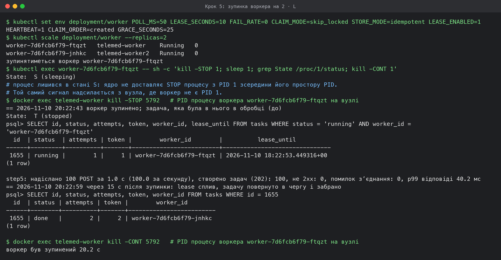

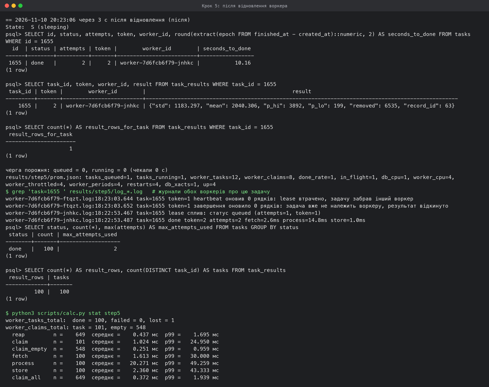

**Як знято.** Перший запуск кроку 5 завис після зупинки воркера: скрипт чекав командою `wait` на всі фонові процеси, зокрема на посекундний запис стану бази, який сам не завершується. Запуск перервано, воркер відновлено сигналом CONT, скрипт виправлено (очікування лише генератора). Крок 5 знято повторно від початку. Лістинг вище — увесь вивід цього другого запуску, `results/step5/` — його файли.

Команда з умови `kubectl exec … -- kill -STOP 1` виконалась, але процес лишився в стані `S (sleeping)`: процес воркера — PID 1 у своєму просторі PID, а ядро не доставляє такому процесу сигнали без обробника, надіслані з того самого простору (для SIGSTOP обробника не буває). Той самий сигнал надіслано процесу з вузла kind, де він має звичайний PID, і стан став `T (stopped)`.

| Що записати | Значення |
|---|---|
| задача в обробці на момент зупинки | 1655 (у воркера `worker-7d6fcb6f79-ftqzt`) |
| attempts і token до | 1 і 1, `lease_until` = момент захоплення + 10 с |
| attempts і token після | 2 і 2 |
| хто завершив | `worker-7d6fcb6f79-jnhkc` (другий воркер), через 10,16 с після створення задачі |
| рядки журналу зупиненого воркера | `task=1655 token=1 heartbeat оновив 0 рядків: lease втрачено…` і `task=1655 token=1 завершення оновило 0 рядків: задача вже не належить воркеру, результат відкинуто` |
| рядків у `task_results` для задачі | 1 (token 2, worker `…jnhkc`) |

Хронологія за журналами: о 18:22:43 воркер зупинено із задачею 1655 в обробці; о 18:22:53,467 (через 10 с, коли сплив lease) другий воркер перед захопленням повернув її в чергу і за 20 мс захопив і завершив з token 2. Зупинений воркер простояв 20,2 с. Після відновлення його heartbeat (`UPDATE … WHERE id = 1655 AND token = 1`) і завершення (`UPDATE … SET status = 'done' WHERE id = 1655 AND token = 1`) оновили нуль рядків. Транзакцію завершення відкочено разом з INSERT результату, тож у таблиці лишився один результат, а лічильник `worker_tasks_total{result="lost"}` дорівнює 1. Решта 99 задач завершились з першої спроби.

# Крок 6. Пропускна здатність пулу

Перед кожним прогоном воркери зупинені, генератор кладе в чергу 2000 · W задач (500 за секунду), далі `kubectl scale deployment/worker --replicas=W`. X(W) — кількість задач, завершених за останні 30 с до завершення останньої задачі (за `finished_at` з таблиці `tasks`), поділена на 30. Розкид — стандартне відхилення посекундної кількості завершених задач у тому самому вікні. p99 захоплення — з гістограми воркерів, транзакції бази — приріст `xact_commit + xact_rollback` з посекундного запису, CPU пода бази і воркерів — приріст `container_cpu_usage_seconds_total` (cAdvisor) за вікно.

**Чому 2000 · W, а не 400 задач.** Умова задає 400 задач перед прогоном і X(W) за останні 30 с до спорожнення черги. За виміряним X(1) = 43 задач/с 400 задач закінчуються за 9 с, на 5 воркерах — за 2 с, тобто 30-секундного вікна з непорожньою чергою не існує. 2000 задач на воркер дають приблизно 46–52 с роботи з непорожньою чергою (стовпчик «Спорожнення черги»).

*Лістинг 29 – Крок 6, scripts/step6.sh*

```bash
#!/usr/bin/env bash
# Крок 6: пропускна здатність пулу на W = 1, 2 і R воркерах з непорожньою чергою.
# Черга заповнюється при зупинених воркерах, далі kubectl scale до W; X(W) — за останні 30 с до спорожнення.
# NQ задач на воркер: за 400 задач за умовою черга спорожніє за 3–10 с, і вікна 30 с не існує.
. "$(dirname "$0")/lib.sh"
NQ=${NQ:-2000}
for W in 1 2 $R; do
  RUN=step6_w$W; rm -rf results/$RUN; mkdir -p results/$RUN
  say "W = $W: у черзі $((NQ * W)) задач"
  clean; workers 0 >/dev/null
  gen $RUN -count $((NQ * W)) -rate 500
  qt "SELECT status, count(*) FROM tasks GROUP BY status"
  sampler_start $RUN; T0=$(date +%s)
  echo "\$ kubectl scale deployment/worker --replicas=$W"
  kubectl scale deployment/worker --replicas=$W >/dev/null
  kubectl rollout status deployment/worker --timeout=180s >/dev/null
  wait_empty 600
  sleep 20                      # cAdvisor оновлює лічильники CPU раз на 10–15 с
  sampler_stop
  collect $RUN "$T0"
  echo "\$ python3 scripts/calc.py x $RUN"; python3 scripts/calc.py x $RUN
  echo "\$ python3 scripts/calc.py stat $RUN"; python3 scripts/calc.py stat $RUN
done
```

*Лістинг 30 – Вивід кроку 6, results/step6.log*

```text
== 2026-11-10 20:23:33 W = 1: у черзі 2000 задач
NOTICE:  truncate cascades to table "task_results"
step6_w1: надіслано 2000 POST за 4.0 с (500.0 за секунду), створено задач (202): 2000, не 2xx: 0, помилок зʼєднання: 0, p99 відповіді 2.1 мс
psql> SELECT status, count(*) FROM tasks GROUP BY status
 status | count 
--------+-------
 queued |  2000
(1 row)

$ kubectl scale deployment/worker --replicas=1
черга порожня: queued = 0, running = 0 (чекали 48 с)
results/step6_w1/prom.json: tasks_queued=1, tasks_running=1, worker_tasks=6, worker_claims=4, done_rate=1, in_flight=1, db_cpu=1, worker_cpu=2, worker_throttled=2, worker_periods=2, restarts=2, db_xacts=1, up=2
$ python3 scripts/calc.py x step6_w1
X = 43.3 задач/с за останні 30.0 с (розкид 1.5); черга спорожніла за 47.0 с, завершено 2000
$ python3 scripts/calc.py stat step6_w1
worker_tasks_total:  done = 2000, failed = 0, lost = 0
worker_claims_total: task = 2000, empty = 403
  reap         n =   2403  середнє =    0.269 мс  p99 =    1.729 мс
  claim        n =   2000  середнє =    0.347 мс  p99 =    1.533 мс
  claim_empty  n =    403  середнє =    0.300 мс  p99 =    1.194 мс
  fetch        n =   2000  середнє =    0.780 мс  p99 =    2.692 мс
  process      n =   2000  середнє =   20.614 мс  p99 =   49.809 мс
  store        n =   2000  середнє =    1.466 мс  p99 =   35.714 мс
  claim_all    n =   2403  середнє =    0.339 мс  p99 =    1.448 мс
== 2026-11-10 20:24:48 W = 2: у черзі 4000 задач
NOTICE:  truncate cascades to table "task_results"
step6_w2: надіслано 4000 POST за 8.0 с (500.0 за секунду), створено задач (202): 4000, не 2xx: 0, помилок зʼєднання: 0, p99 відповіді 2.6 мс
psql> SELECT status, count(*) FROM tasks GROUP BY status
 status | count 
--------+-------
 queued |  4000
(1 row)

$ kubectl scale deployment/worker --replicas=2
черга порожня: queued = 0, running = 0 (чекали 47 с)
results/step6_w2/prom.json: tasks_queued=1, tasks_running=1, worker_tasks=9, worker_claims=6, done_rate=1, in_flight=1, db_cpu=1, worker_cpu=3, worker_throttled=3, worker_periods=3, restarts=3, db_xacts=1, up=3
$ python3 scripts/calc.py x step6_w2
X = 86.1 задач/с за останні 30.0 с (розкид 5.0); черга спорожніла за 46.0 с, завершено 4000
$ python3 scripts/calc.py stat step6_w2
worker_tasks_total:  done = 4000, failed = 0, lost = 0
worker_claims_total: task = 4000, empty = 806
  reap         n =   4806  середнє =    0.271 мс  p99 =    1.440 мс
  claim        n =   4000  середнє =    0.309 мс  p99 =    1.250 мс
  claim_empty  n =    806  середнє =    0.274 мс  p99 =    0.984 мс
  fetch        n =   4000  середнє =    0.656 мс  p99 =    2.222 мс
  process      n =   4000  середнє =   20.360 мс  p99 =   73.054 мс
  store        n =   4000  середнє =    1.385 мс  p99 =   33.673 мс
  claim_all    n =   4806  середнє =    0.303 мс  p99 =    1.131 мс
== 2026-11-10 20:26:05 W = 5: у черзі 10000 задач
NOTICE:  truncate cascades to table "task_results"
step6_w5: надіслано 10000 POST за 20.0 с (500.0 за секунду), створено задач (202): 10000, не 2xx: 0, помилок зʼєднання: 0, p99 відповіді 38.6 мс
psql> SELECT status, count(*) FROM tasks GROUP BY status
 status | count 
--------+-------
 queued | 10000
(1 row)

$ kubectl scale deployment/worker --replicas=5
черга порожня: queued = 0, running = 0 (чекали 52 с)
results/step6_w5/prom.json: tasks_queued=1, tasks_running=1, worker_tasks=15, worker_claims=10, done_rate=1, in_flight=1, db_cpu=1, worker_cpu=5, worker_throttled=5, worker_periods=5, restarts=5, db_xacts=1, up=5
$ python3 scripts/calc.py x step6_w5
X = 191.3 задач/с за останні 30.0 с (розкид 12.3); черга спорожніла за 51.6 с, завершено 10000
$ python3 scripts/calc.py stat step6_w5
worker_tasks_total:  done = 10000, failed = 0, lost = 0
worker_claims_total: task = 10000, empty = 2084
  reap         n =  12084  середнє =    0.266 мс  p99 =    1.906 мс
  claim        n =  10000  середнє =    0.493 мс  p99 =    4.025 мс
  claim_empty  n =   2084  середнє =    0.224 мс  p99 =    0.952 мс
  fetch        n =  10000  середнє =    1.146 мс  p99 =    6.976 мс
  process      n =  10000  середнє =   22.145 мс  p99 =   71.815 мс
  store        n =  10000  середнє =    1.628 мс  p99 =   24.746 мс
  claim_all    n =  12084  середнє =    0.447 мс  p99 =    3.504 мс
```

| W | X(W), задач/с | Розкид (σ посекундної кількості) | Вікно, с | Спорожнення черги, с | p99 захоплення, мс | Транзакцій бази за секунду | CPU пода бази, ядер | CPU воркерів разом, ядер | Дроселювання воркерів | process, мс |
|---|---|---|---|---|---|---|---|---|---|---|
| 1 | 43.3 | 1.5 | 30.0 | 47.0 | 1.53 | 225 | 0.073 | 0.48 | 99.7% | 20.6 |
| 2 | 86.1 | 5.0 | 30.0 | 46.0 | 1.25 | 439 | 0.051 | 1.01 | 100.0% | 20.4 |
| 5 | 191.3 | 12.3 | 30.0 | 51.6 | 4.03 | 972 | 0.142 | 2.17 | 96.5% | 22.1 |

| W | X(W) | C(W) | u = W − 1 | v = W(W − 1) | y = W/C − 1 | У підборі |
|---|---|---|---|---|---|---|
| 1 | 43.3 | 1.000 | 0 | 0 | 0.0000 | ні |
| 2 | 86.1 | 1.988 | 1 | 2 | 0.0062 | так |
| 5 | 191.3 | 4.418 | 4 | 20 | 0.1317 | так |

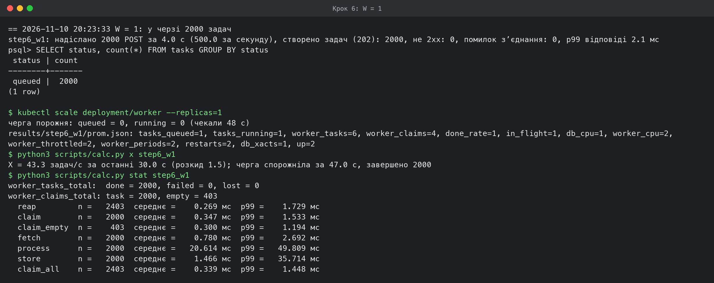

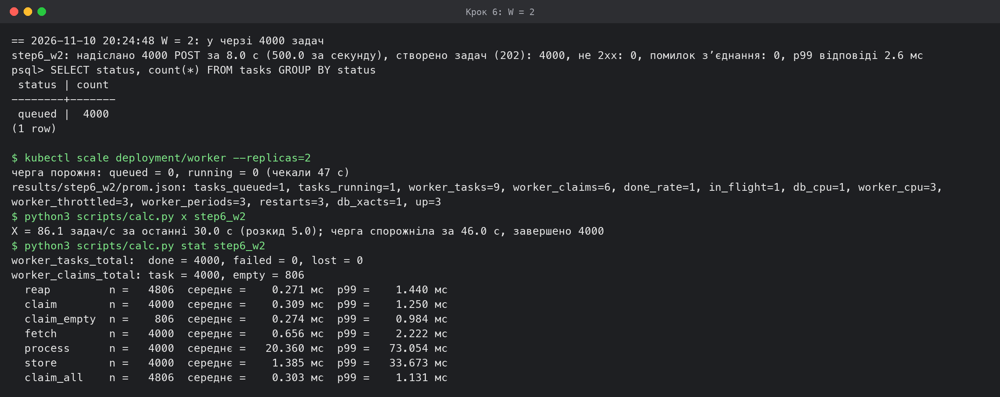

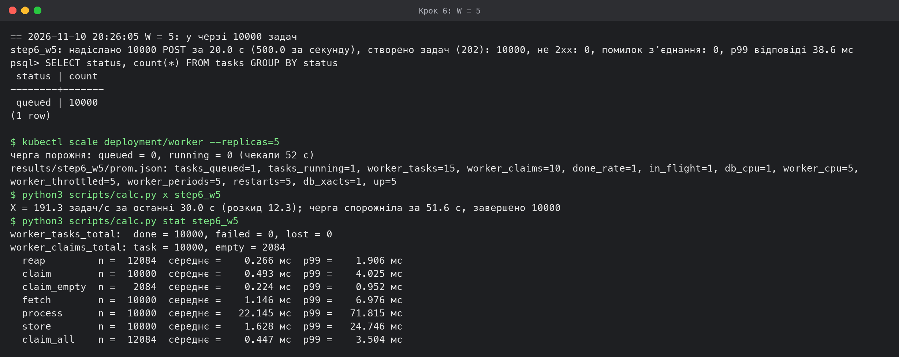

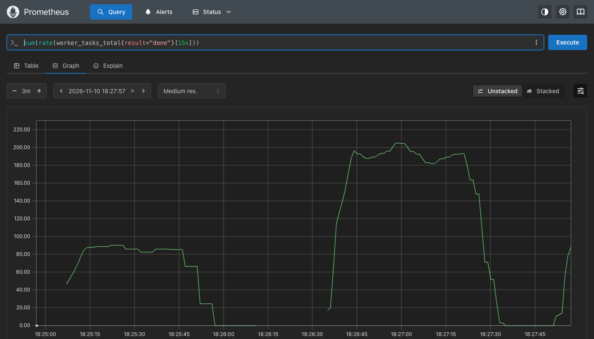

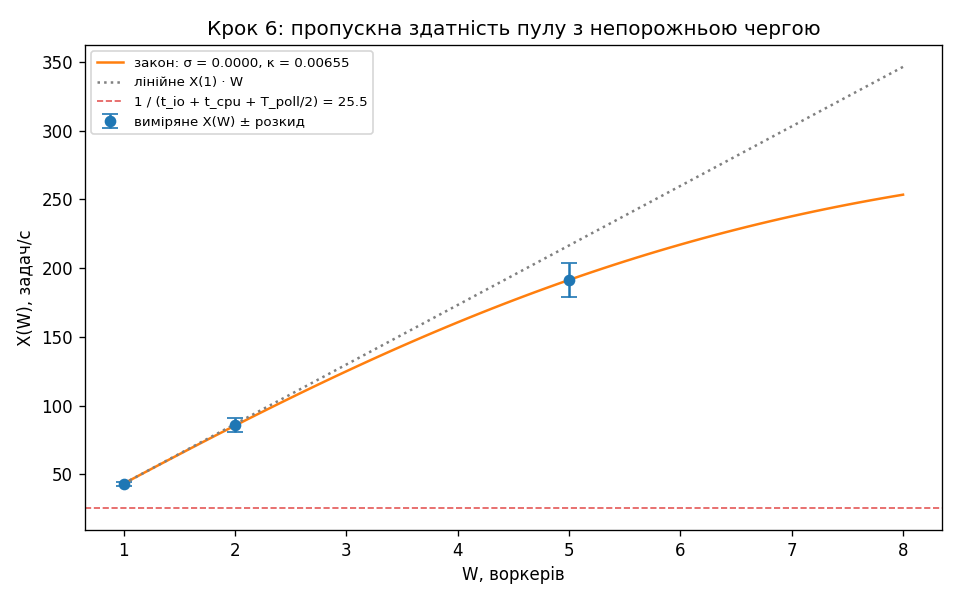

**X(W) майже лінійне до W = 2 і трохи відстає на W = 5.** C(2) = 1,99, C(5) = 4,42. Розв'язок за двома точками дає σ < 0 (σ = −0,012, κ = 0,0089), тому, як і в ЛР 2, σ прирівняно до нуля і κ = Σvy/Σv² = 0,0066. Звідси W* = √((1 − σ)/κ) ≈ 12. За трьома точками, одна з яких визначає X(1), підбір чутливий, і W* тут — грубе наближення.

**Що обмежує пул.** Не черга: найбільший p99 захоплення — 4 мс, база використовує 0,05–0,14 ядра і виконує до 972 транзакцій за секунду (приблизно 5 транзакцій на задачу: повернення спливлих, захоплення, завершення з результатом, heartbeat, вимірювачі web). Обмежує CPU воркерів: кожен воркер використовує свою квоту 0,5 ядра, дроселювання 96,5–100 % періодів CFS. На W = 5 воркери разом споживають 2,17 ядра з 4 vCPU ВМ, у якій працюють також web, база, Prometheus, генератор і три вузли kind. Відставання C(5) від 5 (κ > 0) — це спільний CPU ВМ: крок обробки на W = 5 займає 22,1 мс проти 20,6 мс на W = 1.

**X(1) і оцінка 1 / (t_io + t_cpu + T_poll / 2).** За t_io і t_cpu кроку 2 оцінка дає 1 / (1,45 + 12,75 + 25) мс = 25,5 задач/с, а виміряне X(1) = 43,3 задач/с — на 70 % більше. Оцінка не відповідає цьому режиму з двох причин, що діють у протилежні боки:

1. З непорожньою чергою воркер не чекає T_poll: після завершення задачі наступне захоплення одразу повертає задачу (порожніх захоплень за 47 с роботи W = 1 — лише кілька, на самому кінці). Член T_poll / 2 тут дорівнює нулю, і оцінка без нього — 1 / 14,2 мс = 70,4 задач/с.
2. t_cpu = 12,75 мс виміряно без обмеження квоти. За безперервної роботи воркер вичерпує квоту 50 мс CPU на кожні 100 мс, тож крок обробки займає 20,6 мс (стовпчик `process`). З цим t_cpu оцінка 1 / (1,45 + 20,6) мс = 45 задач/с близька до виміряного 43,3.

Член T_poll / 2 описує режим, коли задача приходить у порожню чергу і чекає наступного опитування; саме це видно на кроці 7 (W_q = 7 мс < T_poll / 2 = 25 мс, бо там опитує не один воркер, а п'ять).

# Крок 7. Закон Літтла для черги

*Лістинг 31 – Крок 7, scripts/step7.sh*

```bash
#!/usr/bin/env bash
# Крок 7: закон Літтла для черги. R воркерів; 0,7 · X(R) протягом 180 с, далі 1,3 · X(R) протягом 120 с.
. "$(dirname "$0")/lib.sh"
for CASE in "07 0.7 180" "13 1.3 120"; do
  set -- $CASE; RUN=step7_$1; RATE=$(rate "$2"); DUR=$3
  rm -rf results/$RUN; mkdir -p results/$RUN
  say "λ = $2 · X($R) = $RATE задач/с, $DUR с"
  clean; workers $R
  snap $RUN before; sampler_start $RUN; T0=$(date +%s)
  gen $RUN -rate "$RATE" -dur "$DUR"
  qt "SELECT status, count(*) FROM tasks GROUP BY status ORDER BY status"
  wait_empty 600; sampler_stop
  collect $RUN "$T0"
  echo "\$ python3 scripts/calc.py stat $RUN"; python3 scripts/calc.py stat $RUN
done
```

*Лістинг 32 – Вивід кроку 7, results/step7.log*

```text
== 2026-11-10 20:27:42 λ = 0.7 · X(5) = 133.9 задач/с, 180 с
NOTICE:  truncate cascades to table "task_results"
$ kubectl set env deployment/worker POLL_MS=50 LEASE_SECONDS=10 FAIL_RATE=0 CLAIM_MODE=skip_locked STORE_MODE=idempotent LEASE_ENABLED=1 HEARTBEAT=1 CLAIM_ORDER=created GRACE_SECONDS=25
$ kubectl scale deployment/worker --replicas=5
worker-7d6fcb6f79-8sz6w   telemed-worker    Running   0
worker-7d6fcb6f79-dvwsc   telemed-worker    Running   0
worker-7d6fcb6f79-dz8c7   telemed-worker2   Running   0
worker-7d6fcb6f79-thnmx   telemed-worker    Running   0
worker-7d6fcb6f79-v2mbr   telemed-worker2   Running   0
step7_07: надіслано 24102 POST за 180.0 с (133.9 за секунду), створено задач (202): 24102, не 2xx: 0, помилок зʼєднання: 0, p99 відповіді 6.2 мс
psql> SELECT status, count(*) FROM tasks GROUP BY status ORDER BY status
 status | count 
--------+-------
 done   | 24102
(1 row)

черга порожня: queued = 0, running = 0 (чекали 0 с)
results/step7_07/prom.json: tasks_queued=1, tasks_running=1, worker_tasks=30, worker_claims=20, done_rate=1, in_flight=1, db_cpu=1, worker_cpu=10, worker_throttled=10, worker_periods=10, restarts=10, db_xacts=1, up=10
$ python3 scripts/calc.py stat step7_07
worker_tasks_total:  done = 24102, failed = 0, lost = 0
worker_claims_total: task = 24102, empty = 9408
  reap         n =  33510  середнє =    0.224 мс  p99 =    1.927 мс
  claim        n =  24102  середнє =    0.366 мс  p99 =    2.375 мс
  claim_empty  n =   9408  середнє =    0.154 мс  p99 =    1.885 мс
  fetch        n =  24102  середнє =    0.691 мс  p99 =    3.979 мс
  process      n =  24102  середнє =   15.729 мс  p99 =   68.993 мс
  store        n =  24102  середнє =    1.053 мс  p99 =    7.328 мс
  claim_all    n =  33510  середнє =    0.306 мс  p99 =    2.226 мс
== 2026-11-10 20:30:48 λ = 1.3 · X(5) = 248.7 задач/с, 120 с
NOTICE:  truncate cascades to table "task_results"
$ kubectl set env deployment/worker POLL_MS=50 LEASE_SECONDS=10 FAIL_RATE=0 CLAIM_MODE=skip_locked STORE_MODE=idempotent LEASE_ENABLED=1 HEARTBEAT=1 CLAIM_ORDER=created GRACE_SECONDS=25
$ kubectl scale deployment/worker --replicas=5
worker-7d6fcb6f79-5lzc2   telemed-worker2   Running   0
worker-7d6fcb6f79-5zgjh   telemed-worker2   Running   0
worker-7d6fcb6f79-j4hvx   telemed-worker    Running   0
worker-7d6fcb6f79-jz59l   telemed-worker    Running   0
worker-7d6fcb6f79-x6mfv   telemed-worker    Running   0
step7_13: надіслано 29844 POST за 120.0 с (248.7 за секунду), створено задач (202): 29844, не 2xx: 0, помилок зʼєднання: 0, p99 відповіді 8.8 мс
psql> SELECT status, count(*) FROM tasks GROUP BY status ORDER BY status
 status  | count 
---------+-------
 done    | 23248
 queued  |  6591
 running |     5
(3 rows)

черга порожня: queued = 0, running = 0 (чекали 35 с)
results/step7_13/prom.json: tasks_queued=1, tasks_running=1, worker_tasks=30, worker_claims=20, done_rate=1, in_flight=1, db_cpu=1, worker_cpu=10, worker_throttled=10, worker_periods=10, restarts=10, db_xacts=1, up=10
$ python3 scripts/calc.py stat step7_13
worker_tasks_total:  done = 29844, failed = 0, lost = 0
worker_claims_total: task = 29844, empty = 184
  reap         n =  30028  середнє =    0.266 мс  p99 =    2.356 мс
  claim        n =  29844  середнє =    0.524 мс  p99 =    3.887 мс
  claim_empty  n =    184  середнє =    0.161 мс  p99 =    0.495 мс
  fetch        n =  29844  середнє =    1.210 мс  p99 =    6.957 мс
  process      n =  29844  середнє =   22.623 мс  p99 =   49.695 мс
  store        n =  29844  середнє =    1.587 мс  p99 =   22.095 мс
  claim_all    n =  30028  середнє =    0.522 мс  p99 =    3.873 мс
```

| Величина | Значення | Звідки |
|---|---|---|
| X(R), задач/с | 191.3 | крок 6, W = 5 |
| задана інтенсивність 0,7 · X(R) | 133.9 | параметр генератора |
| λ, задач/с | 133.90 | задачі з created_at в останніх 120 с / 120 |
| W_q, с | 0.0071 | середнє started_at − created_at цих задач |
| **λ · W_q** | **0.956** |  |
| **L_q виміряне** | **0.833** | середнє tasks_queued у Prometheus, 24 точок по 5 с |
| розбіжність (L_q − λW_q) / λW_q | -12.8% |  |
| L_q за посекундним записом бази | 0.975 | `count(*) WHERE status = 'queued'`, 118 точок |
| розбіжність для нього | 2.0% |  |
| p99 W_q, с | 0.0266 |  |

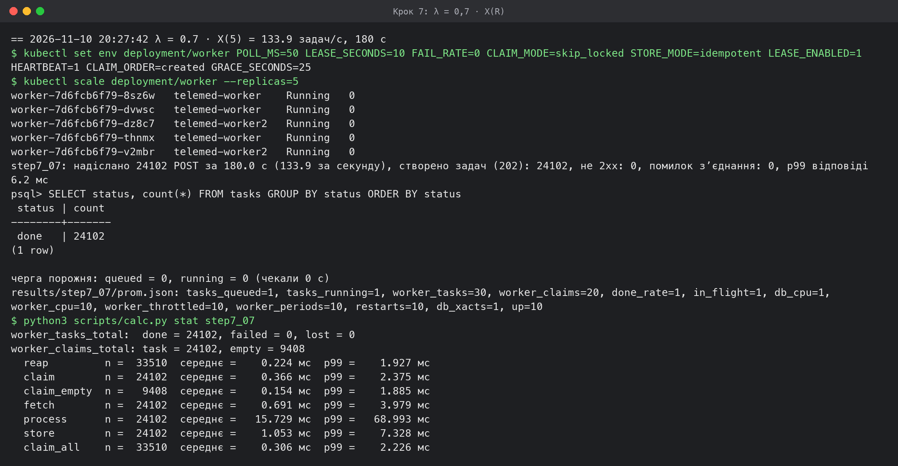

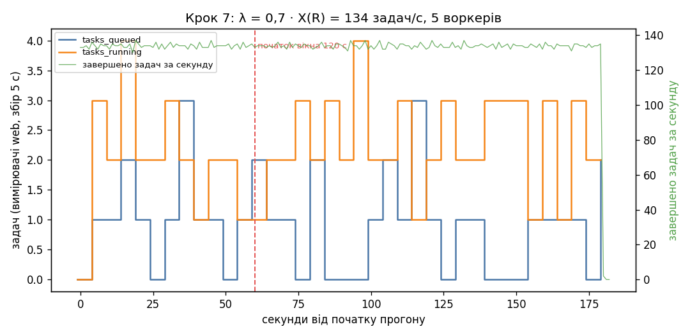

λ · W_q = 133,9 · 0,0071 = 0,956 задачі. Середнє `tasks_queued` у Prometheus — 0,833 (розбіжність −12,8 %), середнє за посекундним записом бази — 0,975 (+2,0 %). Обидва L_q виміряно незалежно від W_q: W_q рахується з `started_at − created_at` кожної задачі, L_q — з кількості рядків `queued` у моменти знімків. Рівність виконується з розбіжністю 2 % за 118 посекундними знімками. Розбіжність −12,8 % для `tasks_queued` — похибка вибірки: вимірювач оновлюється раз на 5 с, Prometheus збирає його теж раз на 5 с, і за 120 с маємо лише 24 значення величини, яка за секунду змінюється від 0 до 5.

W_q = 7,1 мс менше за T_poll / 2 = 25 мс. Формула T_poll / 2 стосується одного воркера, що опитує чергу; тут чергу незалежно опитують 5 воркерів зі зсунутими фазами, і нова задача чекає найближчого з п'яти опитувань (у середньому приблизно T_poll / 6 ≈ 8 мс), якщо котрийсь із воркерів вільний.

**Перевантаження 1,3 · X(R).**

| Величина | Значення |
|---|---|
| задана інтенсивність 1,3 · X(R), задач/с | 248.7 |
| створено задач за 120 с | 29844 |
| X під час прогону (без перших 30 с), задач/с | 189.5 |
| довжина черги на кінець генерації (посекундний запис бази) | 7 030 |
| те саме, tasks_queued (оновлюється раз на 5 с) | 6 782 |
| W_q перших 100 задач, с | 0.062 |
| W_q останніх 100 задач, с | 37.377 |

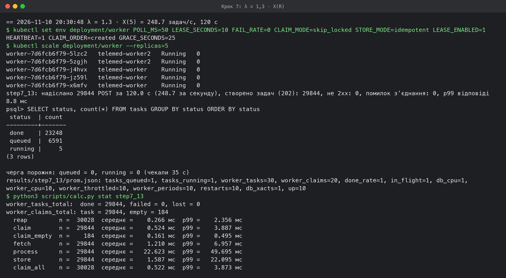

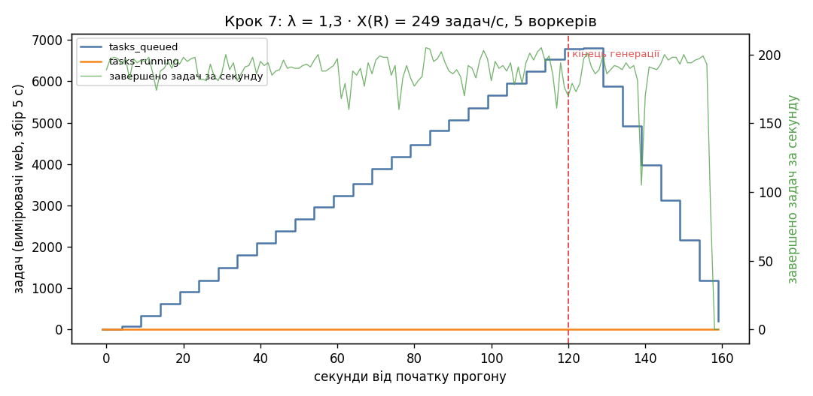

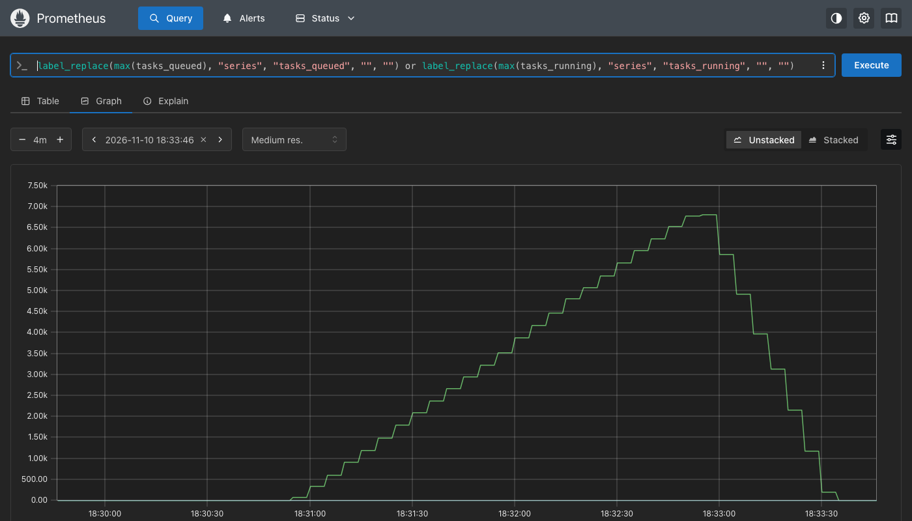

За 1,3 · X(R) = 248,7 задач/с при пропускній здатності 189,5 задач/с черга зростає на 59 задач за секунду: 7030 задач на кінець 120 с (за моделлю (248,7 − 189,5) · 120 ≈ 7100). W_q зростає від 62 мс для перших 100 задач до 37,4 с для останніх 100. Сталого режиму немає, і закон Літтла до цього прогону не застосовний: L_q і W_q зростають увесь прогін. Після кінця генерації черга спорожніла за 35 с (див. лістинг кроку 7).

# Крок 8. Коректна зупинка воркера

Після SIGTERM обробник сигналу лише ставить прапорець; головний цикл перестає захоплювати задачі, дороблює поточну, закриває зʼєднання і виходить з кодом 0. Окремий потік-сторож чекає завершення циклу `GRACE_SECONDS = 25` с (менше за `terminationGracePeriodSeconds = 30`, щоб встигнути до SIGKILL). Якщо задача не завершилась, сторож повертає її в чергу командою `UPDATE tasks SET status = 'queued' WHERE id = $1 AND token = $2` і виходить з кодом 0.

Задача обробляється приблизно 20 мс, тому за 25 с вона завжди встигає завершитись, і гілка повернення в чергу не спрацьовує. Щоб показати цю гілку, прогін повторено з `GRACE_SECONDS = 0`: сторож не чекає і повертає задачу в обробці відразу після SIGTERM.

*Лістинг 33 – Крок 8, scripts/step8.sh*

```bash
#!/usr/bin/env bash
# Крок 8: коректна зупинка за SIGTERM. Під прогоном 0,7 · X(R) — kubectl rollout restart deployment/worker.
# Другий прогін з GRACE_SECONDS=0 показує гілку повернення задачі в чергу: воркер не чекає завершення.
. "$(dirname "$0")/lib.sh"
RATE=$(rate 0.7)
for CASE in "step8 25" "step8_grace0 0"; do
  set -- $CASE; RUN=$1; GRACE=$2
  rm -rf results/$RUN; mkdir -p results/$RUN
  say "λ = 0,7 · X($R) = $RATE задач/с, 60 с; GRACE_SECONDS = $GRACE; на 20-й секунді rollout restart"
  clean; workers $R GRACE_SECONDS=$GRACE
  OLD=$(wpods)
  for P in $OLD; do kubectl logs -f "$P" > "results/$RUN/exit_$P.log" 2>/dev/null & done
  kubectl get pods -l app=worker -w --no-headers -o custom-columns='POD:.metadata.name,PHASE:.status.phase,EXIT:.status.containerStatuses[0].state.terminated.exitCode,REASON:.status.containerStatuses[0].state.terminated.reason' > results/$RUN/watch.txt 2>/dev/null &
  WATCH=$!
  snap $RUN before; sampler_start $RUN; T0=$(date +%s)
  gen $RUN -rate "$RATE" -dur 60 > results/$RUN/gen.out &
  GEN=$!
  sleep 21
  echo "\$ kubectl rollout restart deployment/worker   # $(ts)"
  kubectl rollout restart deployment/worker
  date +%s > results/$RUN/restart_unix.txt
  kubectl rollout status deployment/worker --timeout=180s | tail -1
  wait $GEN; cat results/$RUN/gen.out
  wait_empty 300; sampler_stop
  kill $WATCH 2>/dev/null || true; sleep 1
  collect $RUN "$T0"
  echo '$ kubectl get pods -l app=worker -w -o custom-columns=POD,PHASE,EXIT,REASON | grep -v "<none>"   # коди завершення старих подів'
  grep -v '<none> *<none>' results/$RUN/watch.txt | sort -u
  echo '$ tail -n 2 журналів старих подів (kubectl logs -f, запущений до перезапуску)'
  for P in $OLD; do echo "--- $P"; grep -E 'SIGTERM|повернуто в чергу|вихід з кодом' "results/$RUN/exit_$P.log" | tail -3; done
  echo "\$ grep -c 'повернуто в чергу' results/$RUN/exit_*.log"
  cat results/$RUN/exit_*.log | grep -c 'повернуто в чергу' || true
  qt "SELECT count(*) AS tasks, count(*) FILTER (WHERE status = 'done') AS done, count(*) FILTER (WHERE status = 'failed') AS failed, count(*) FILTER (WHERE attempts > 1) AS attempts_gt_1 FROM tasks"
  qt "SELECT count(*) AS result_rows, (SELECT count(*) FROM (SELECT task_id FROM task_results GROUP BY task_id HAVING count(*) > 1) d) AS tasks_with_more_than_one_result FROM task_results"
  qt "SELECT id, status, attempts, token, worker_id FROM tasks WHERE attempts > 1 ORDER BY id LIMIT 10"
done
```

*Лістинг 34 – Вивід кроку 8, results/step8.log*

```text
== 2026-11-10 21:17:31 λ = 0,7 · X(5) = 133.9 задач/с, 60 с; GRACE_SECONDS = 25; на 20-й секунді rollout restart
NOTICE:  truncate cascades to table "task_results"
$ kubectl set env deployment/worker POLL_MS=50 LEASE_SECONDS=10 FAIL_RATE=0 CLAIM_MODE=skip_locked STORE_MODE=idempotent LEASE_ENABLED=1 HEARTBEAT=1 CLAIM_ORDER=created GRACE_SECONDS=25
$ kubectl scale deployment/worker --replicas=5
worker-6779d59cff-6vwm5   telemed-worker2   Running   0
worker-6779d59cff-8cg5j   telemed-worker    Running   0
worker-6779d59cff-982cx   telemed-worker    Running   0
worker-6779d59cff-bxq4v   telemed-worker    Running   0
worker-6779d59cff-vvpdb   telemed-worker2   Running   0
$ kubectl rollout restart deployment/worker   # 2026-11-10 21:17:55
deployment.apps/worker restarted
deployment "worker" successfully rolled out
step8: надіслано 8034 POST за 60.0 с (133.9 за секунду), створено задач (202): 8034, не 2xx: 0, помилок зʼєднання: 0, p99 відповіді 4.6 мс
черга порожня: queued = 0, running = 0 (чекали 0 с)
results/step8/prom.json: tasks_queued=1, tasks_running=1, worker_tasks=33, worker_claims=22, done_rate=1, in_flight=1, db_cpu=1, worker_cpu=11, worker_throttled=11, worker_periods=11, restarts=11, db_xacts=1, up=11
$ kubectl get pods -l app=worker -w -o custom-columns=POD,PHASE,EXIT,REASON | grep -v "<none>"   # коди завершення старих подів
worker-6779d59cff-6vwm5   Succeeded   0        Completed
worker-6779d59cff-8cg5j   Running     0        Completed
worker-6779d59cff-8cg5j   Succeeded   0        Completed
worker-6779d59cff-982cx   Succeeded   0        Completed
worker-6779d59cff-bxq4v   Succeeded   0        Completed
worker-6779d59cff-vvpdb   Succeeded   0        Completed
$ tail -n 2 журналів старих подів (kubectl logs -f, запущений до перезапуску)
--- worker-6779d59cff-6vwm5
19:17:56.450 SIGTERM: нових задач не беру, задача в обробці: task=303150, чекаю до 25.0 с
19:17:56.477 вихід з кодом 0
--- worker-6779d59cff-8cg5j
19:17:56.098 SIGTERM: нових задач не беру, задача в обробці: task=303134, чекаю до 25.0 с
19:17:56.098 вихід з кодом 0
--- worker-6779d59cff-982cx
19:17:55.434 SIGTERM: нових задач не беру, задача в обробці: task=303061, чекаю до 25.0 с
19:17:55.443 вихід з кодом 0
--- worker-6779d59cff-bxq4v
19:17:55.925 SIGTERM: нових задач не беру, задача в обробці: немає, чекаю до 25.0 с
19:17:55.931 вихід з кодом 0
--- worker-6779d59cff-vvpdb
19:17:56.013 SIGTERM: нових задач не беру, задача в обробці: task=303132, чекаю до 25.0 с
19:17:56.035 вихід з кодом 0
$ grep -c 'повернуто в чергу' results/step8/exit_*.log
0
psql> SELECT count(*) AS tasks, count(*) FILTER (WHERE status = 'done') AS done, count(*) FILTER (WHERE status = 'failed') AS failed, count(*) FILTER (WHERE attempts > 1) AS attempts_gt_1 FROM tasks
 tasks | done | failed | attempts_gt_1 
-------+------+--------+---------------
  8034 | 8034 |      0 |             0
(1 row)

psql> SELECT count(*) AS result_rows, (SELECT count(*) FROM (SELECT task_id FROM task_results GROUP BY task_id HAVING count(*) > 1) d) AS tasks_with_more_than_one_result FROM task_results
 result_rows | tasks_with_more_than_one_result 
-------------+---------------------------------
        8034 |                               0
(1 row)

psql> SELECT id, status, attempts, token, worker_id FROM tasks WHERE attempts > 1 ORDER BY id LIMIT 10
 id | status | attempts | token | worker_id 
----+--------+----------+-------+-----------
(0 rows)

== 2026-11-10 21:18:37 λ = 0,7 · X(5) = 133.9 задач/с, 60 с; GRACE_SECONDS = 0; на 20-й секунді rollout restart
NOTICE:  truncate cascades to table "task_results"
$ kubectl set env deployment/worker POLL_MS=50 LEASE_SECONDS=10 FAIL_RATE=0 CLAIM_MODE=skip_locked STORE_MODE=idempotent LEASE_ENABLED=1 HEARTBEAT=1 CLAIM_ORDER=created GRACE_SECONDS=0
$ kubectl scale deployment/worker --replicas=5
worker-7bd64d8dcb-2jkxx   telemed-worker2   Running   0
worker-7bd64d8dcb-d7g4n   telemed-worker2   Running   0
worker-7bd64d8dcb-ggmvh   telemed-worker    Running   0
worker-7bd64d8dcb-plgmv   telemed-worker    Running   0
worker-7bd64d8dcb-sx8mv   telemed-worker    Running   0
$ kubectl rollout restart deployment/worker   # 2026-11-10 21:19:01
deployment.apps/worker restarted
deployment "worker" successfully rolled out
step8_grace0: надіслано 8034 POST за 60.0 с (133.9 за секунду), створено задач (202): 8034, не 2xx: 0, помилок зʼєднання: 0, p99 відповіді 9.6 мс
черга порожня: queued = 0, running = 0 (чекали 0 с)
results/step8_grace0/prom.json: tasks_queued=1, tasks_running=1, worker_tasks=45, worker_claims=30, done_rate=1, in_flight=1, db_cpu=1, worker_cpu=15, worker_throttled=15, worker_periods=15, restarts=15, db_xacts=1, up=15
$ kubectl get pods -l app=worker -w -o custom-columns=POD,PHASE,EXIT,REASON | grep -v "<none>"   # коди завершення старих подів
worker-7bd64d8dcb-2jkxx   Succeeded   0        Completed
worker-7bd64d8dcb-d7g4n   Succeeded   0        Completed
worker-7bd64d8dcb-ggmvh   Succeeded   0        Completed
worker-7bd64d8dcb-plgmv   Succeeded   0        Completed
worker-7bd64d8dcb-sx8mv   Succeeded   0        Completed
$ tail -n 2 журналів старих подів (kubectl logs -f, запущений до перезапуску)
--- worker-7bd64d8dcb-2jkxx
19:19:01.822 SIGTERM: нових задач не беру, задача в обробці: task=311134, чекаю до 0.0 с
19:19:01.846 вихід з кодом 0
19:19:01.847 task=311134 token=1 не завершилась за 0.0 с: повернуто в чергу (оновлено рядків: 0)
--- worker-7bd64d8dcb-d7g4n
19:19:02.301 SIGTERM: нових задач не беру, задача в обробці: task=311144, чекаю до 0.0 с
19:19:02.321 task=311144 token=1 не завершилась за 0.0 с: повернуто в чергу (оновлено рядків: 1)
19:19:02.321 вихід з кодом 0
--- worker-7bd64d8dcb-ggmvh
19:19:01.203 SIGTERM: нових задач не беру, задача в обробці: task=311064, чекаю до 0.0 с
19:19:01.214 вихід з кодом 0
--- worker-7bd64d8dcb-plgmv
19:19:01.933 SIGTERM: нових задач не беру, задача в обробці: task=311138, чекаю до 0.0 с
19:19:02.025 вихід з кодом 0
--- worker-7bd64d8dcb-sx8mv
19:19:01.699 SIGTERM: нових задач не беру, задача в обробці: task=311127, чекаю до 0.0 с
19:19:01.703 вихід з кодом 0
$ grep -c 'повернуто в чергу' results/step8_grace0/exit_*.log
2
psql> SELECT count(*) AS tasks, count(*) FILTER (WHERE status = 'done') AS done, count(*) FILTER (WHERE status = 'failed') AS failed, count(*) FILTER (WHERE attempts > 1) AS attempts_gt_1 FROM tasks
 tasks | done | failed | attempts_gt_1 
-------+------+--------+---------------
  8034 | 8034 |      0 |             1
(1 row)

psql> SELECT count(*) AS result_rows, (SELECT count(*) FROM (SELECT task_id FROM task_results GROUP BY task_id HAVING count(*) > 1) d) AS tasks_with_more_than_one_result FROM task_results
 result_rows | tasks_with_more_than_one_result 
-------------+---------------------------------
        8034 |                               0
(1 row)

psql> SELECT id, status, attempts, token, worker_id FROM tasks WHERE attempts > 1 ORDER BY id LIMIT 10
   id   | status | attempts | token |       worker_id        
--------+--------+----------+-------+------------------------
 311144 | done   |        2 |     2 | worker-6f698bb97-v5jjj
(1 row)
```

| Прогін | Коди завершення старих контейнерів | Повернуто в чергу воркерами (команда оновила 1 рядок) | failed | Задач з > 1 результатом | attempts > 1 | id задач з attempts > 1 | Виконано двічі (рядки done у журналах) | done / усього |
|---|---|---|---|---|---|---|---|---|
| до виправлення, GRACE_SECONDS = 25 | 0 (Completed) × 5 | 0 (+ 0 з 0 рядків) | 0 | 0 | 0 | — | 0 | 8034 / 8034 |
| до виправлення, GRACE_SECONDS = 0 | 0 (Completed) × 5 | 0 (+ 0 з 0 рядків) | 0 | 0 | 1 | 82506 | 0 | 8034 / 8034 |
| блокування захоплення, GRACE_SECONDS = 25 | 0 (Completed) × 5 | 0 (+ 0 з 0 рядків) | 0 | 0 | 0 | — | 0 | 8034 / 8034 |
| блокування захоплення, GRACE_SECONDS = 0 | 0 (Completed) × 5 | 1 (+ 0 з 0 рядків) | 0 | 0 | 2 | 214797, 214811 | 2 | 8034 / 8034 |
| остаточний код, GRACE_SECONDS = 25 | 0 (Completed) × 5 | 0 (+ 0 з 0 рядків) | 0 | 0 | 0 | — | 0 | 8034 / 8034 |
| остаточний код, GRACE_SECONDS = 0 | 0 (Completed) × 5 | 1 (+ 1 з 0 рядків) | 0 | 0 | 1 | 311144 | 0 | 8034 / 8034 |

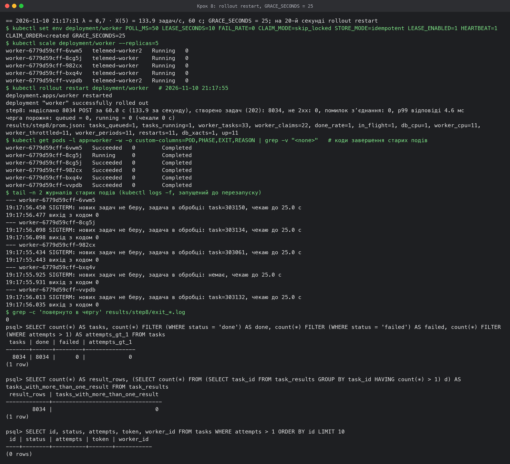

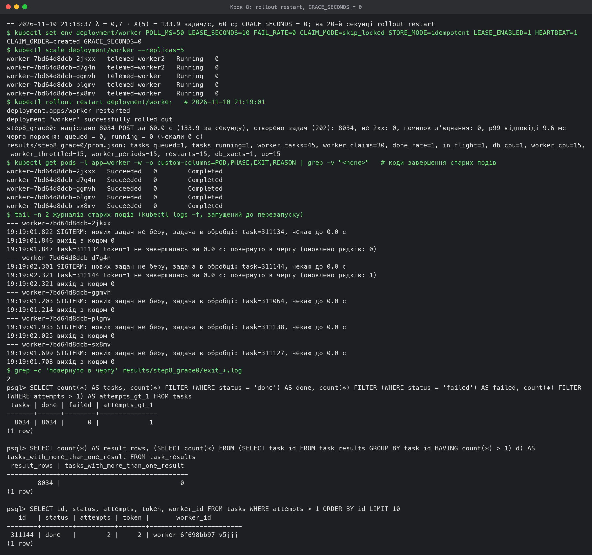

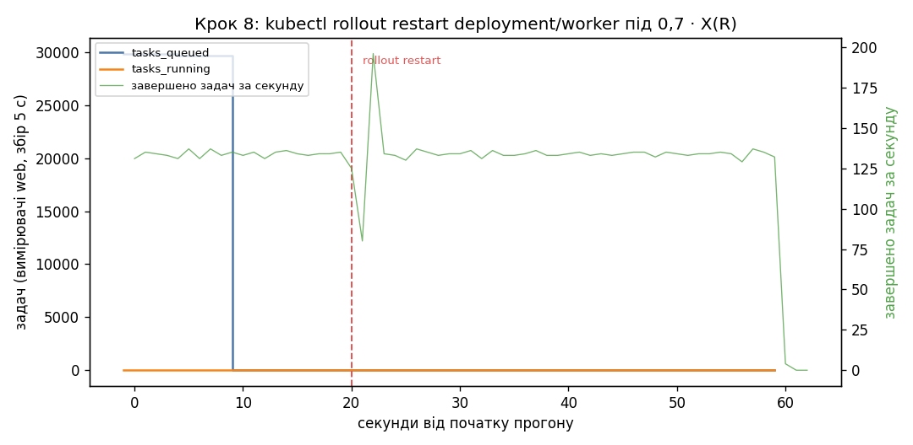

**Як знято.** Крок 8 знімався тричі, бо перші два запуски виявили дві помилки коду зупинки. Кожен запуск — окремий цілий вивід скрипта, вони збережені окремо: `results/step8_before_fix.log` і `results/step8_before_fix*/`, `results/step8_fix1.log` і `results/step8_fix1*/`, остаточний — `results/step8.log` і `results/step8*/` (лістинг вище). Перші два рядки таблиці — код до виправлень, третій і четвертий — після першого, останні два — остаточний код з додатку.

1. **Захоплення після SIGTERM.** Головний цикл перевіряв прапорець зупинки, а потім захоплював задачу. SIGTERM між цими двома діями давав задачу, про яку сторож не знав: він бачив «задачі немає» і завершував процес. Задача 82506 лишилась у `running` і повернулась у чергу лише через 10 с, коли сплив lease (рядок журналу `task=82506 lease сплив`). Виправлення: перевірка прапорця, захоплення і запис поточної задачі виконуються під одним блокуванням `claim_lock`, і сторож бере те саме блокування перед читанням поточної задачі.
2. **Повернення вже завершеної задачі.** Команда повернення з умови `UPDATE tasks SET status = 'queued' WHERE id = $1 AND token = $2` не перевіряє статус. Якщо головний потік встигав завершити задачу між рішенням сторожа і командою, `done` знову ставав `queued`. Задачі 214797 і 214811 виконано двічі (по два рядки `done` у журналах, лістинг нижче), а другий результат не записався лише завдяки `ON CONFLICT DO NOTHING`. Виправлення: до команди додано `AND status = 'running'`. В остаточному прогоні таке повернення задачі 311134 оновило 0 рядків, і вона більше не виконувалась.

*Лістинг 35 – Крок 8 до виправлення, GRACE_SECONDS = 0: задача 82506, results/step8_before_fix.log*

```text
# results/step8_before_fix.log (уривок, GRACE_SECONDS = 0)
$ kubectl get pods -l app=worker -w -o custom-columns=POD,PHASE,EXIT,REASON | grep -v "<none>"   # коди завершення старих подів
worker-649ccfcf48-ht9dx   Succeeded   0        Completed
worker-649ccfcf48-j27nt   Succeeded   0        Completed
worker-649ccfcf48-ntwst   Succeeded   0        Completed
worker-649ccfcf48-rxxj8   Succeeded   0        Completed
worker-649ccfcf48-t4rf7   Succeeded   0        Completed
$ tail -n 2 журналів старих подів (kubectl logs -f, запущений до перезапуску)
--- worker-649ccfcf48-ht9dx
18:35:03.703 SIGTERM: нових задач не беру, задача в обробці: task=82519, чекаю до 0.0 с
18:35:03.707 вихід з кодом 0
--- worker-649ccfcf48-j27nt
18:35:03.142 SIGTERM: нових задач не беру, задача в обробці: task=82507, чекаю до 0.0 с
18:35:03.272 вихід з кодом 0
--- worker-649ccfcf48-ntwst
18:35:03.026 SIGTERM: нових задач не беру, задача в обробці: немає, чекаю до 0.0 с
18:35:03.026 вихід з кодом 0
--- worker-649ccfcf48-rxxj8
18:35:02.422 вихід з кодом 0
--- worker-649ccfcf48-t4rf7
18:35:03.284 вихід з кодом 0
$ grep -c 'повернуто в чергу' results/step8_grace0/exit_*.log
0
psql> SELECT count(*) AS tasks, count(*) FILTER (WHERE status = 'done') AS done, count(*) FILTER (WHERE status = 'failed') AS failed, count(*) FILTER (WHERE attempts > 1) AS attempts_gt_1 FROM tasks
 tasks | done | failed | attempts_gt_1 
-------+------+--------+---------------
  8034 | 8034 |      0 |             1
(1 row)
psql> SELECT count(*) AS result_rows, (SELECT count(*) FROM (SELECT task_id FROM task_results GROUP BY task_id HAVING count(*) > 1) d) AS tasks_with_more_than_one_result FROM task_results
 result_rows | tasks_with_more_than_one_result 
-------------+---------------------------------
        8034 |                               0
(1 row)
psql> SELECT id, status, attempts, token, worker_id FROM tasks WHERE attempts > 1 ORDER BY id LIMIT 10
  id   | status | attempts | token |        worker_id        
-------+--------+----------+-------+-------------------------
 82506 | done   |        2 |     2 | worker-7868b99489-s8hm9
(1 row)
$ grep -h "82506" results/step8_before_fix_grace0/*.log
18:35:13.107 task=82506 lease сплив: статус queued (attempts=1, token=1)
18:35:13.119 task=82506 done token=2 attempts=2 fetch=0.4ms process=10.9ms store=0.4ms
```

*Лістинг 36 – Крок 8 після першого виправлення, GRACE_SECONDS = 0: задачі 214797 і 214811, results/step8_fix1_grace0*

```text
# results/step8_fix1.log (уривок) і журнали подів results/step8_fix1_grace0/exit_*.log, log_*.log
psql> SELECT id, status, attempts, token, worker_id FROM tasks WHERE attempts > 1 ORDER BY id LIMIT 10
   id   | status | attempts | token |        worker_id        
--------+--------+----------+-------+-------------------------
 214797 | done   |        2 |     2 | worker-c7b5f4bc8-xdkxn
 214811 | done   |        2 |     2 | worker-5d8556494d-4k5z5
(2 rows)

$ grep -h "214797\|214811" results/step8_fix1_grace0/*.log
18:58:16.327 SIGTERM: нових задач не беру, задача в обробці: task=214797, чекаю до 0.0 с
18:58:16.359 task=214797 done token=1 attempts=1 fetch=11.7ms process=37.2ms store=1.0ms
18:58:16.429 SIGTERM: нових задач не беру, задача в обробці: task=214797, чекаю до 0.0 с
18:58:16.429 task=214797 done token=2 attempts=2 fetch=0.7ms process=36.2ms store=17.0ms
18:58:16.837 SIGTERM: нових задач не беру, задача в обробці: task=214811, чекаю до 0.0 с
18:58:16.905 task=214811 done token=1 attempts=1 fetch=3.8ms process=20.5ms store=44.8ms
18:58:16.906 task=214811 token=1 не завершилась за 0.0 с: повернуто в чергу (оновлено рядків: 1)
18:58:16.958 task=214811 done token=2 attempts=2 fetch=5.0ms process=25.6ms store=2.5ms
```

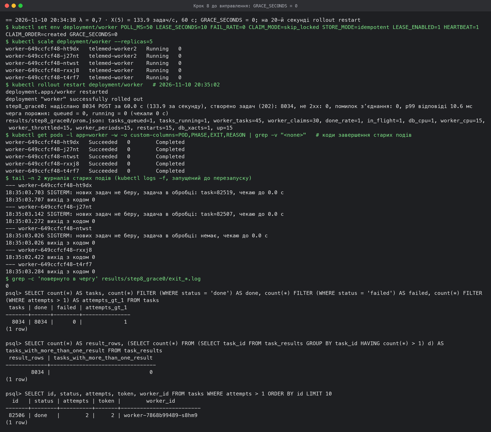

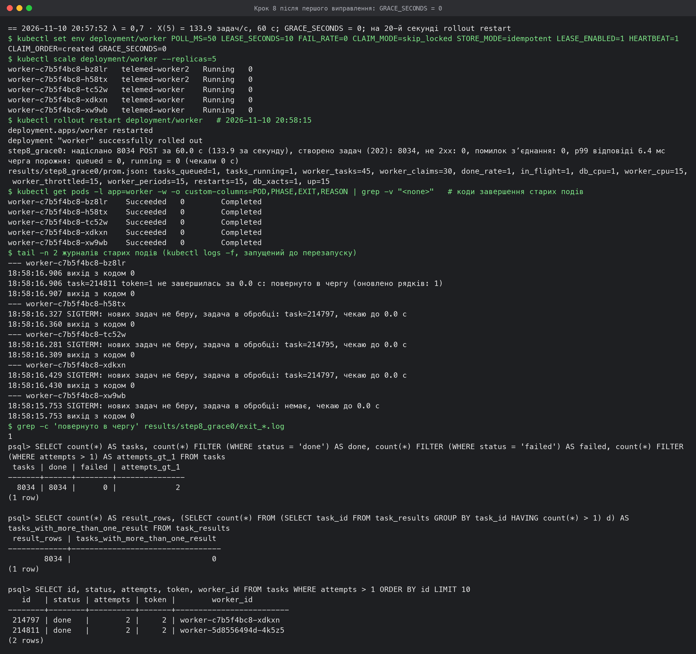

**Результат остаточного коду.** Під 0,7 · X(R) = 133,9 задач/с усі 5 старих контейнерів завершилися з кодом 0 (`Completed`), задач `failed` 0, задач з більше ніж одним результатом 0, усі 8034 задачі `done`. З `GRACE_SECONDS = 25` кожен воркер дороблював поточну задачу (~20 мс), тож повернень у чергу 0 і задач з attempts > 1 теж 0. З `GRACE_SECONDS = 0` одна задача (311144) повернута воркером у чергу і завершена іншим воркером з token 2 (attempts = 2), одна команда повернення оновила 0 рядків, бо задачу вже було завершено. Повернута задача виконана повторно, але результат записано один раз, тож дублем вона не є.

# Крок 9. Вбудоване падіння воркера і сценарій Ф5

`FAIL_RATE = 0,15`: після обробки і до запису результату воркер з імовірністю 0,15 виконує `os._exit(1)`. 5 воркерів, λ = 0,7 · X(R), 300 с. На 150-й секунді — сценарій Ф5: `kubectl set env deployment/worker LEASE_SECONDS=<t_cpu / 2> HEARTBEAT=<0 або 1>`. Ф5 вимагає двох прогонів, без heartbeat і з heartbeat, тому крок 9 виконано двічі, кожен прогін — на 300 с з тим самим FAIL_RATE. t_cpu = 12,75 мс (крок 2), тож L = 6,4 мс. Перша половина кожного прогону (L = 10 с, heartbeat) і є прогоном з FAIL_RATE без сценарію, з яким порівнюється друга половина.

Зміна змінних середовища перезапускає поди (rollout), тому журнали й стовпчик RESTARTS першої половини зібрано перед сценарієм (`results/<прогін>_phase1/`), другої — після прогону.

*Лістинг 37 – Крок 9, scripts/step9.sh*

```bash
#!/usr/bin/env bash
# Крок 9: FAIL_RATE = 0,15, R воркерів, 0,7 · X(R), 300 с; у середині прогону — сценарій Ф5:
# L = t_cpu / 2. Два прогони: Ф5 без heartbeat і Ф5 з heartbeat.
. "$(dirname "$0")/lib.sh"
RATE=$(rate 0.7); LF5=$(python3 scripts/calc.py lease)
for CASE in "step9_nohb 0" "step9_hb 1"; do
  set -- $CASE; RUN=$1; HB=$2
  rm -rf results/$RUN results/${RUN}_phase1; mkdir -p results/$RUN results/${RUN}_phase1
  say "FAIL_RATE = 0,15; λ = $RATE задач/с, 300 с; на 150-й секунді L = t_cpu / 2 = $LF5 с, HEARTBEAT = $HB"
  clean; workers $R FAIL_RATE=0.15
  sampler_start $RUN; T0=$(date +%s)
  gen $RUN -rate "$RATE" -dur 300 > results/$RUN/gen.out &
  GEN=$!
  sleep 148
  say "перед сценарієм: поди першої половини прогону (L = 10 с, heartbeat)"
  echo '$ kubectl get pods -l app=worker'; kubectl get pods -l app=worker | tee results/${RUN}_phase1/pods.txt
  wlogs ${RUN}_phase1
  date +%s > results/$RUN/scenario_unix.txt
  echo "\$ kubectl set env deployment/worker LEASE_SECONDS=$LF5 HEARTBEAT=$HB   # $(ts), сценарій Ф5"
  kubectl set env deployment/worker LEASE_SECONDS=$LF5 HEARTBEAT=$HB
  kubectl rollout status deployment/worker --timeout=120s | tail -1 || true
  date +%s > results/$RUN/scenario_done_unix.txt
  wait $GEN; cat results/$RUN/gen.out
  say "кінець генерації: поди другої половини прогону"
  echo '$ kubectl get pods -l app=worker'; kubectl get pods -l app=worker
  qt "SELECT status, count(*) FROM tasks GROUP BY status ORDER BY status"
  wait_empty 180; sampler_stop
  collect $RUN "$T0"
  qt "SELECT status, count(*) FROM tasks GROUP BY status ORDER BY status"
  qt "SELECT attempts, count(*) FROM tasks GROUP BY attempts ORDER BY attempts"
  qt "SELECT count(*) AS tasks_with_more_than_one_result FROM (SELECT task_id FROM task_results GROUP BY task_id HAVING count(*) > 1) d"
  echo "\$ рядки журналу про нуль оновлених рядків: перша половина / друга половина"
  echo "  перша:  $(cat results/${RUN}_phase1/log_*.log 2>/dev/null | grep -Ec 'онов(ив|ило) 0 рядків' || true)"
  echo "  друга:  $( (cat results/$RUN/log_*.log 2>/dev/null; gzip -dc results/$RUN/log_*.log.gz 2>/dev/null) | grep -Ec 'онов(ив|ило) 0 рядків' || true)"
done
```

*Лістинг 38 – Вивід кроку 9, results/step9.log*

```text
== 2026-11-10 20:58:58 FAIL_RATE = 0,15; λ = 133.9 задач/с, 300 с; на 150-й секунді L = t_cpu / 2 = 0.0064 с, HEARTBEAT = 0
NOTICE:  truncate cascades to table "task_results"
$ kubectl set env deployment/worker POLL_MS=50 LEASE_SECONDS=10 FAIL_RATE=0.15 CLAIM_MODE=skip_locked STORE_MODE=idempotent LEASE_ENABLED=1 HEARTBEAT=1 CLAIM_ORDER=created GRACE_SECONDS=25
$ kubectl scale deployment/worker --replicas=5
worker-85658dbd69-592hl   telemed-worker    Running   0
worker-85658dbd69-dxjtv   telemed-worker2   Running   0
worker-85658dbd69-ghvj6   telemed-worker    Running   0
worker-85658dbd69-gqjnf   telemed-worker2   Running   0
worker-85658dbd69-sff6r   telemed-worker    Running   0
== 2026-11-10 21:01:28 перед сценарієм: поди першої половини прогону (L = 10 с, heartbeat)
$ kubectl get pods -l app=worker
NAME                      READY   STATUS    RESTARTS      AGE
worker-85658dbd69-592hl   1/1     Running   64 (1s ago)   2m29s
worker-85658dbd69-dxjtv   1/1     Running   63 (1s ago)   2m29s
worker-85658dbd69-ghvj6   0/1     Error     62 (4s ago)   2m29s
worker-85658dbd69-gqjnf   0/1     Error     61 (2s ago)   2m29s
worker-85658dbd69-sff6r   0/1     Error     65 (2s ago)   2m29s
$ kubectl set env deployment/worker LEASE_SECONDS=0.0064 HEARTBEAT=0   # 2026-11-10 21:01:29, сценарій Ф5
deployment.apps/worker env updated
deployment "worker" successfully rolled out
step9_nohb: надіслано 40170 POST за 300.0 с (133.9 за секунду), створено задач (202): 40170, не 2xx: 0, помилок зʼєднання: 0, p99 відповіді 8.0 мс
== 2026-11-10 21:04:03 кінець генерації: поди другої половини прогону
$ kubectl get pods -l app=worker
NAME                      READY   STATUS    RESTARTS      AGE
worker-78cbbbb885-8t7bs   0/1     Error     64 (3s ago)   2m34s
worker-78cbbbb885-9594h   1/1     Running   64 (2s ago)   2m34s
worker-78cbbbb885-clzmk   0/1     Error     63 (3s ago)   2m34s
worker-78cbbbb885-thl9h   1/1     Running   62 (2s ago)   2m34s
worker-78cbbbb885-v5jvv   1/1     Running   63 (3s ago)   2m34s
psql> SELECT status, count(*) FROM tasks GROUP BY status ORDER BY status
 status  | count 
---------+-------
 done    |  3354
 failed  |    58
 queued  | 36757
 running |     1
(4 rows)

за 180 с черга не спорожніла: лишилось 34906 задач у queued і running
results/step9_nohb/prom.json: tasks_queued=1, tasks_running=1, worker_tasks=36, worker_claims=24, done_rate=1, in_flight=1, db_cpu=1, worker_cpu=14, worker_throttled=14, worker_periods=14, restarts=15, db_xacts=1, up=15
psql> SELECT status, count(*) FROM tasks GROUP BY status ORDER BY status
 status  | count 
---------+-------
 done    |  5155
 failed  |   109
 queued  | 34905
 running |     1
(4 rows)

psql> SELECT attempts, count(*) FROM tasks GROUP BY attempts ORDER BY attempts
 attempts | count 
----------+-------
        0 | 34905
        1 |  4042
        2 |   906
        3 |   317
(4 rows)

psql> SELECT count(*) AS tasks_with_more_than_one_result FROM (SELECT task_id FROM task_results GROUP BY task_id HAVING count(*) > 1) d
 tasks_with_more_than_one_result 
---------------------------------
                               0
(1 row)

$ рядки журналу про нуль оновлених рядків: перша половина / друга половина
  перша:  0
  друга:  0
== 2026-11-10 21:07:04 FAIL_RATE = 0,15; λ = 133.9 задач/с, 300 с; на 150-й секунді L = t_cpu / 2 = 0.0064 с, HEARTBEAT = 1
NOTICE:  truncate cascades to table "task_results"
$ kubectl set env deployment/worker POLL_MS=50 LEASE_SECONDS=10 FAIL_RATE=0.15 CLAIM_MODE=skip_locked STORE_MODE=idempotent LEASE_ENABLED=1 HEARTBEAT=1 CLAIM_ORDER=created GRACE_SECONDS=25
$ kubectl scale deployment/worker --replicas=5
worker-85658dbd69-6msqh   telemed-worker2   Running   0
worker-85658dbd69-dsn97   telemed-worker    Running   0
worker-85658dbd69-kmjbn   telemed-worker    Running   0
worker-85658dbd69-mvmf9   telemed-worker    Running   0
worker-85658dbd69-vtg9k   telemed-worker2   Running   0
== 2026-11-10 21:10:05 перед сценарієм: поди першої половини прогону (L = 10 с, heartbeat)
$ kubectl get pods -l app=worker
NAME                      READY   STATUS   RESTARTS      AGE
worker-85658dbd69-6msqh   0/1     Error    65 (4s ago)   2m30s
worker-85658dbd69-dsn97   0/1     Error    65 (4s ago)   2m30s
worker-85658dbd69-kmjbn   0/1     Error    64 (5s ago)   2m30s
worker-85658dbd69-mvmf9   0/1     Error    68 (4s ago)   2m30s
worker-85658dbd69-vtg9k   0/1     Error    64 (3s ago)   2m30s
$ kubectl set env deployment/worker LEASE_SECONDS=0.0064 HEARTBEAT=1   # 2026-11-10 21:10:05, сценарій Ф5
deployment.apps/worker env updated
deployment "worker" successfully rolled out
step9_hb: надіслано 40170 POST за 300.0 с (133.9 за секунду), створено задач (202): 40170, не 2xx: 0, помилок зʼєднання: 0, p99 відповіді 4.9 мс
== 2026-11-10 21:12:40 кінець генерації: поди другої половини прогону
$ kubectl get pods -l app=worker
NAME                      READY   STATUS    RESTARTS      AGE
worker-6466655694-bwls7   0/1     Error     62 (4s ago)   2m35s
worker-6466655694-bxthr   0/1     Error     63 (3s ago)   2m35s
worker-6466655694-slqq4   1/1     Running   64 (3s ago)   2m35s
worker-6466655694-xdhsg   1/1     Running   63 (3s ago)   2m35s
worker-6466655694-xhfjm   0/1     Error     62 (4s ago)   2m35s
psql> SELECT status, count(*) FROM tasks GROUP BY status ORDER BY status
 status  | count 
---------+-------
 done    |  3639
 failed  |    28
 queued  | 36502
 running |     1
(4 rows)

за 180 с черга не спорожніла: лишилось 34349 задач у queued і running
results/step9_hb/prom.json: tasks_queued=1, tasks_running=1, worker_tasks=24, worker_claims=16, done_rate=1, in_flight=1, db_cpu=1, worker_cpu=9, worker_throttled=9, worker_periods=9, restarts=11, db_xacts=1, up=11
psql> SELECT status, count(*) FROM tasks GROUP BY status ORDER BY status
 status  | count 
---------+-------
 done    |  5769
 failed  |    62
 queued  | 34338
 running |     1
(4 rows)

psql> SELECT attempts, count(*) FROM tasks GROUP BY attempts ORDER BY attempts
 attempts | count 
----------+-------
        0 | 34337
        1 |  4771
        2 |   836
        3 |   226
(4 rows)

psql> SELECT count(*) AS tasks_with_more_than_one_result FROM (SELECT task_id FROM task_results GROUP BY task_id HAVING count(*) > 1) d
 tasks_with_more_than_one_result 
---------------------------------
                               0
(1 row)

$ рядки журналу про нуль оновлених рядків: перша половина / друга половина
  перша:  0
  друга:  616
```

| Прогін (CrashLoopBackOff, Ф5) | Створено задач | Перезапусків (до + після сценарію) | attempts: задач (лише done і failed) | Статуси після прогону | attempts > 1: виміряне / f | failed: виміряне / f³ | Задач з > 1 результатом | X до сценарію, задач/с | X після сценарію, задач/с | X(R) без падінь, задач/с |
|---|---|---|---|---|---|---|---|---|---|---|
| пауза за замовчуванням, без heartbeat | 40170 | 20 + 25 | 1: 202, 2: 32, 3: 18 | done: 245, failed: 7, queued: 39917, running: 1 | 19.8% / 15% | 2.78% / 0.34% | 0 | 0.3 | 0.4 | 191.3 |
| пауза за замовчуванням, з heartbeat | 40170 | 20 + 25 | 1: 297, 2: 40, 3: 9 | done: 341, failed: 5, queued: 39823, running: 1 | 14.2% / 15% | 1.45% / 0.34% | 0 | 0.5 | 0.8 | 191.3 |
| пауза 1 с, без heartbeat | 40170 | 315 + 681 | 1: 4042, 2: 905, 3: 317 | done: 5155, failed: 109, queued: 34905, running: 1 | 23.2% / 15% | 2.07% / 0.34% | 0 | 12.6 | 10.3 | 191.3 |
| пауза 1 с, з heartbeat | 40170 | 326 + 690 | 1: 4765, 2: 834, 3: 226 | done: 5763, failed: 62, queued: 34344, running: 1 | 18.2% / 15% | 1.06% / 0.34% | 0 | 13.0 | 11.3 | 191.3 |

| Фаза прогону | Задач завершено (done або failed) | attempts > 1 | Очікувано за f | failed | Очікувано f³ | Вбудованих падінь | Повернень зі спливлим lease | Рядків «0 оновлених рядків» | Очікувано рядків «0 рядків» лише від FAIL_RATE |
|---|---|---|---|---|---|---|---|---|---|
| без heartbeat: до сценарію, L = 10 с, heartbeat | 1767 | 254 (14.4%) | 15% | 0.28% | 0.34% | 318 | 293 | 0 (0 heartbeat + 0 завершення) | 0 |
| без heartbeat: після, L = 6.4 мс, heartbeat немає | 3488 | 964 (27.6%) | 15% | 2.98% | 0.34% | 686 | 1387 | 642 (0 heartbeat + 642 завершення) | 0 |
| з heartbeat: до сценарію, L = 10 с, heartbeat | 1909 | 266 (13.9%) | 15% | 0.10% | 0.34% | 331 | 308 | 0 (0 heartbeat + 0 завершення) | 0 |
| з heartbeat: після, L = 6.4 мс, heartbeat є | 3916 | 794 (20.3%) | 15% | 1.53% | 0.34% | 693 | 1059 | 938 (616 heartbeat + 322 завершення) | 0 |

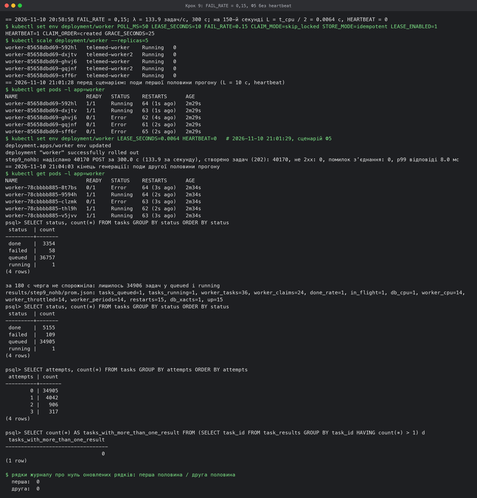

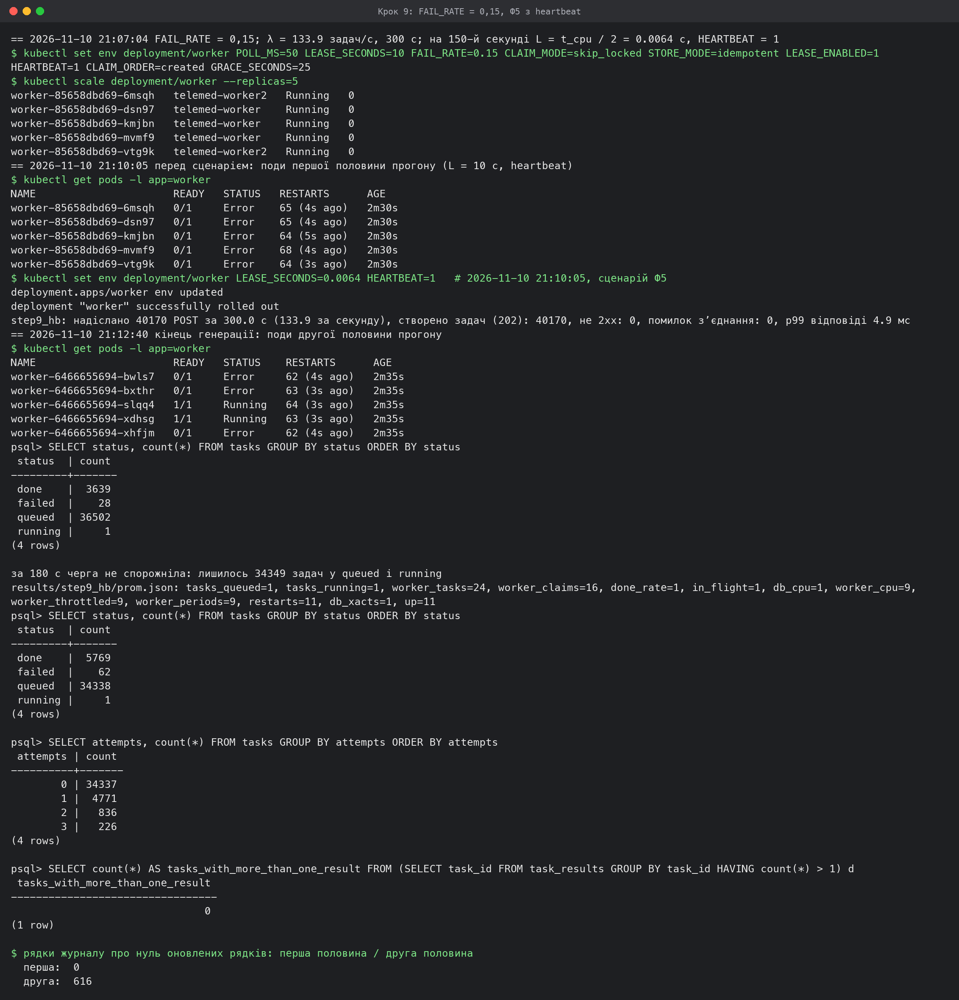

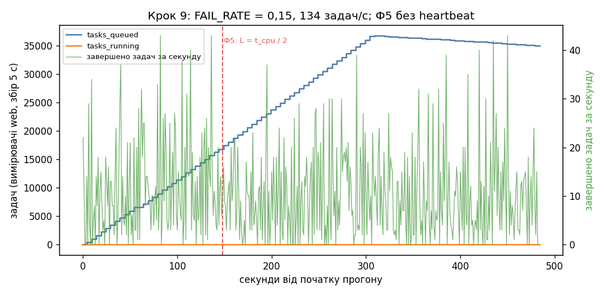

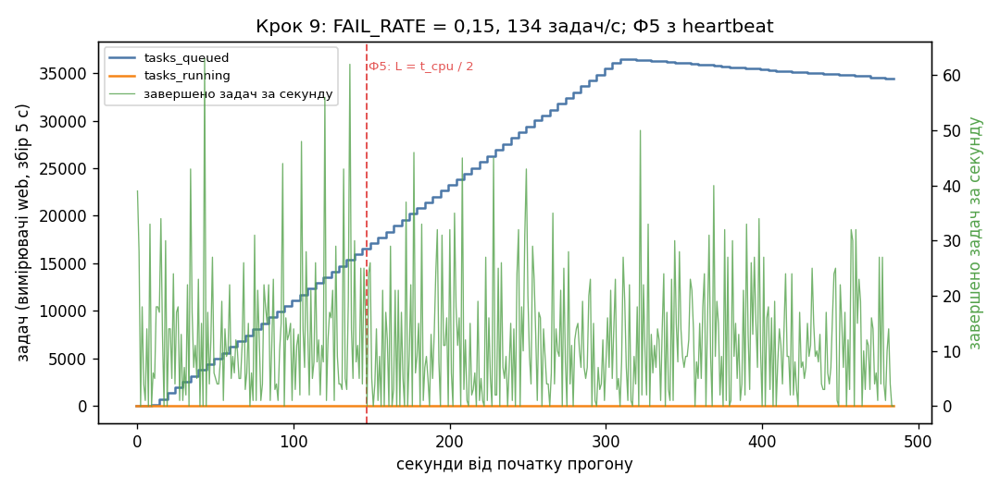

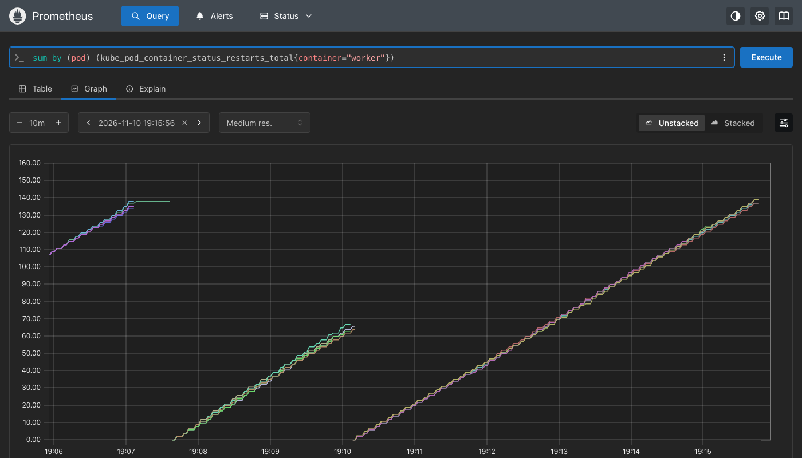

**Перший прогін: пауза перезапуску за замовчуванням.** Крок 9 спершу знято з типовими налаштуваннями kubelet (`results/step9default.log`, `results/step9default_*/`). З FAIL_RATE = 0,15 воркер падає в середньому після 1 / 0,15 ≈ 6,7 задач, тобто приблизно через 0,15 с роботи. Kubelet подвоює паузу перед кожним наступним перезапуском (10, 20, 40, 80 с…, до 300 с), і вже через 2 хвилини після старту всі 5 подів стоять у `Error` або `CrashLoopBackOff` з 4 перезапусками. За 300 с завершено 245 і 341 задач з 40 170 (X ≈ 0,3–0,8 задач/с проти 191,3). Цей прогін показує, що падіння процесу як спосіб відмови в Kubernetes зупиняє пул не на час перезапуску, а на паузу CrashLoopBackOff.

*Лістинг 39 – Перший прогін кроку 9: стан подів, results/step9default.log*

```text
# results/step9default.log (уривок: стан подів перед сценарієм і після прогону)
== 2026-11-10 20:35:45 FAIL_RATE = 0,15; λ = 133.9 задач/с, 300 с; на 150-й секунді L = t_cpu / 2 = 0.0064 с, HEARTBEAT = 0
$ kubectl set env deployment/worker POLL_MS=50 LEASE_SECONDS=10 FAIL_RATE=0.15 CLAIM_MODE=skip_locked STORE_MODE=idempotent LEASE_ENABLED=1 HEARTBEAT=1 CLAIM_ORDER=created GRACE_SECONDS=25
$ kubectl scale deployment/worker --replicas=5
worker-655756c4bd-59vwb   telemed-worker    Running   0
worker-655756c4bd-88pvk   telemed-worker2   Running   0
worker-655756c4bd-bnqnq   telemed-worker    Running   0
worker-655756c4bd-kssv9   telemed-worker    Running   0
worker-655756c4bd-zfx4b   telemed-worker2   Running   0
== 2026-11-10 20:38:15 перед сценарієм: поди першої половини прогону (L = 10 с, heartbeat)
$ kubectl get pods -l app=worker
NAME                      READY   STATUS   RESTARTS       AGE
worker-655756c4bd-59vwb   0/1     Error    4 (104s ago)   2m30s
worker-655756c4bd-88pvk   0/1     Error    4 (104s ago)   2m30s
worker-655756c4bd-bnqnq   0/1     Error    4 (107s ago)   2m30s
worker-655756c4bd-kssv9   0/1     Error    4 (105s ago)   2m29s
worker-655756c4bd-zfx4b   0/1     Error    4 (103s ago)   2m30s
$ kubectl set env deployment/worker LEASE_SECONDS=0.0064 HEARTBEAT=0   # 2026-11-10 20:38:15, сценарій Ф5
deployment.apps/worker env updated
deployment "worker" successfully rolled out
step9_nohb: надіслано 40170 POST за 300.0 с (133.9 за секунду), створено задач (202): 40170, не 2xx: 0, помилок зʼєднання: 0, p99 відповіді 4.3 мс
== 2026-11-10 20:40:50 кінець генерації: поди другої половини прогону
$ kubectl get pods -l app=worker
NAME                      READY   STATUS             RESTARTS       AGE
worker-854df8b988-2x4nd   0/1     Error              4 (116s ago)   2m35s
worker-854df8b988-ldj5v   0/1     Error              4 (116s ago)   2m35s
worker-854df8b988-lpqm6   0/1     Error              4 (112s ago)   2m35s
worker-854df8b988-msdhg   0/1     CrashLoopBackOff   4 (64s ago)    2m34s
worker-854df8b988-r7s8c   0/1     Error              4 (113s ago)   2m34s
psql> SELECT status, count(*) FROM tasks GROUP BY status ORDER BY status
 status  | count 
---------+-------
 done    |   193
 failed  |     7
 queued  | 39969
 running |     1
(4 rows)

за 180 с черга не спорожніла: лишилось 39918 задач у queued і running
results/step9_nohb/prom.json: tasks_queued=1, tasks_running=1, worker_tasks=15, worker_claims=10, done_rate=1, in_flight=1, db_cpu=1, worker_cpu=12, worker_throttled=12, worker_periods=12, restarts=15, db_xacts=1, up=15
psql> SELECT status, count(*) FROM tasks GROUP BY status ORDER BY status
 status  | count 
---------+-------
 done    |   245
 failed  |     7
 queued  | 39917
 running |     1
(4 rows)

psql> SELECT attempts, count(*) FROM tasks GROUP BY attempts ORDER BY attempts
```

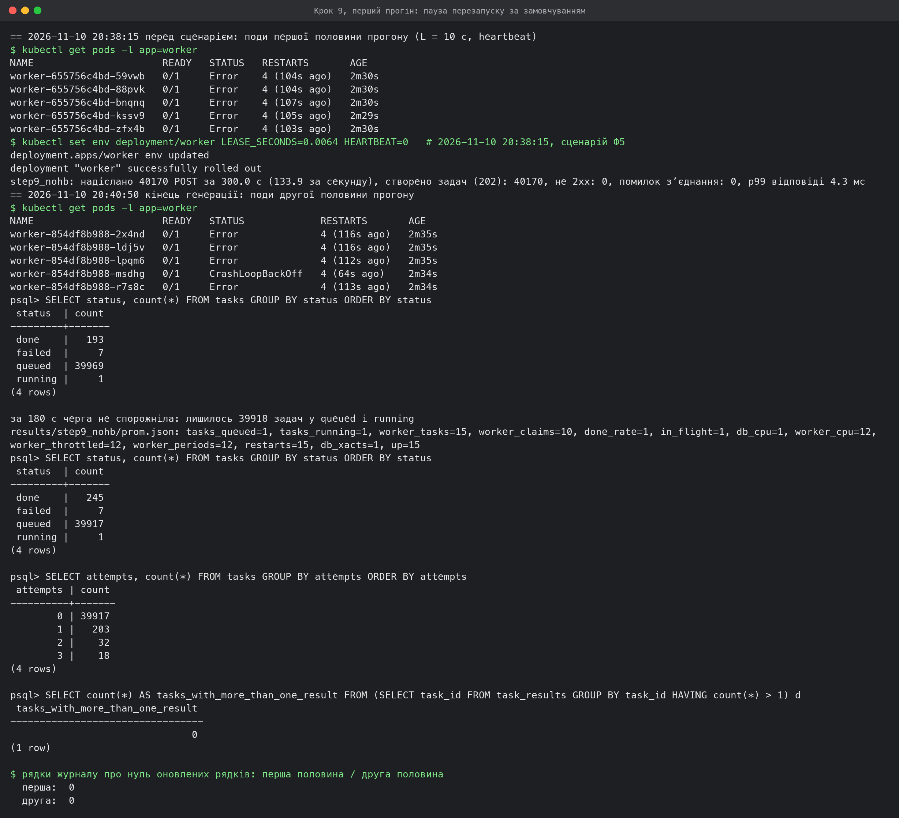

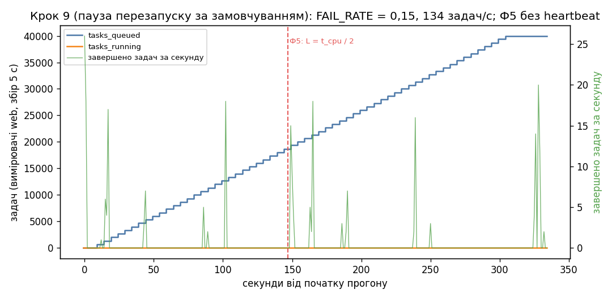

**Пауза перезапуску 1 с.** Щоб пул працював із падіннями, на обох вузлах worker найбільшу паузу перезапуску зменшено до 1 с (`crashLoopBackOff.maxContainerRestartPeriod` у KubeletConfiguration, функціональна можливість `KubeletCrashLoopBackOffMax`). Під час серії скрипт виконано вручну між двома прогонами кроку 9. У `scripts/series.sh` його виклик тепер стоїть перед кроком 9, щоб серія з клону відтворювала цей порядок. Дію перевірено подом, що одразу завершується з кодом 1: 20 перезапусків за 40 с.

*Лістинг 40 – Пауза перезапуску, scripts/kubelet_backoff.sh*

```bash
#!/usr/bin/env bash
# Крок 9: найбільша пауза між перезапусками контейнера (CrashLoopBackOff) на вузлах worker — 1 с замість 300 с.
# Без цього за FAIL_RATE = 0,15 пауза подвоюється з кожним падінням (10, 20, 40, 80 с, …), і пул за 2 хвилини
# стоїть у CrashLoopBackOff. Змінюється KubeletConfiguration (crashLoopBackOff.maxContainerRestartPeriod) і
# kubelet перезапускається; поди на вузлі при цьому не перезапускаються.
#   ./scripts/kubelet_backoff.sh 1s      задати
#   ./scripts/kubelet_backoff.sh off     повернути як було
set -eu
V=${1:-1s}
for N in telemed-worker telemed-worker2; do
  docker exec "$N" sh -c "
    cfg=/var/lib/kubelet/config.yaml
    [ -f \$cfg.orig ] || cp \$cfg \$cfg.orig
    cp \$cfg.orig \$cfg
    if [ '$V' != off ]; then
      sed -i 's/^crashLoopBackOff: {}\$/crashLoopBackOff:\n  maxContainerRestartPeriod: $V/' \$cfg
      grep -q '^featureGates:' \$cfg || printf 'featureGates:\n  KubeletCrashLoopBackOffMax: true\n' >> \$cfg
    fi
    systemctl restart kubelet"
  echo "\$ docker exec $N grep -A1 -E '^(crashLoopBackOff|featureGates)' /var/lib/kubelet/config.yaml"
  docker exec "$N" grep -A1 -E '^(crashLoopBackOff|featureGates)' /var/lib/kubelet/config.yaml
done
sleep 5
for N in telemed-worker telemed-worker2; do
  echo "\$ docker exec $N systemctl is-active kubelet: $(docker exec $N systemctl is-active kubelet)"
done
kubectl wait --for=condition=Ready node/telemed-worker node/telemed-worker2 --timeout=60s
```

*Лістинг 41 – Вивід налаштування і перевірки, results/kubelet_backoff_manual.log*

```text
$ docker exec telemed-worker grep -A1 -E '^(crashLoopBackOff|featureGates)' /var/lib/kubelet/config.yaml
crashLoopBackOff:
  maxContainerRestartPeriod: 1s
--
featureGates:
  KubeletCrashLoopBackOffMax: true
$ docker exec telemed-worker2 grep -A1 -E '^(crashLoopBackOff|featureGates)' /var/lib/kubelet/config.yaml
crashLoopBackOff:
  maxContainerRestartPeriod: 1s
--
featureGates:
  KubeletCrashLoopBackOffMax: true
$ docker exec telemed-worker systemctl is-active kubelet: active
$ docker exec telemed-worker2 systemctl is-active kubelet: active
node/telemed-worker condition met
node/telemed-worker2 condition met
$ kubectl run crashtest --image=telemed4-worker:lab4 --restart=Always -- python -c "import sys; sys.exit(1)"
$ kubectl get pod crashtest   # через 40 с
NAME        READY   STATUS    RESTARTS      AGE   IP            NODE             NOMINATED NODE   READINESS GATES
crashtest   1/1     Running   20 (3s ago)   40s   10.244.2.61   telemed-worker   <none>           <none>
$ kubectl get events --field-selector involvedObject.name=crashtest | grep -c Started
27s   Normal    Started     pod/crashtest   Container started
2s    Warning   BackOff     pod/crashtest   Back-off restarting failed container crashtest in pod crashtest_default(532f153a-6cbb-4698-8550-7142a71e84f6)
```

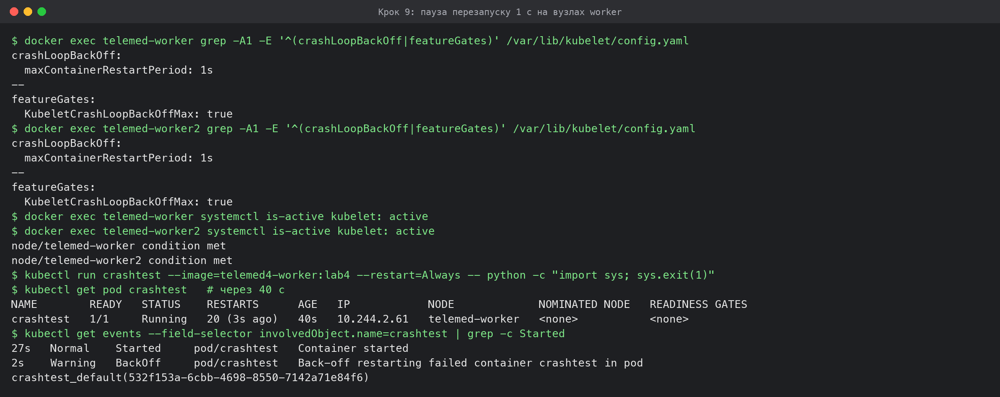

**Другий прогін (лістинг кроку 9 вище).** У журналі кроку підсумковий рядок «рядки журналу про нуль оновлених рядків» порахований з помилкою в регулярному виразі: `оновив\(ло\)\?` знаходить «оновив», але не «оновило», тож пропущено всі рядки «завершення оновило 0 рядків» (без heartbeat вийшов 0). Вираз у скрипті виправлено після прогону. Правильні кількості в таблицях нижче рахує `analyze.py` з тих самих файлів журналів.

| Прогін (CrashLoopBackOff, Ф5) | Створено задач | Перезапусків (до + після сценарію) | attempts: задач (лише done і failed) | Статуси після прогону | attempts > 1: виміряне / f | failed: виміряне / f³ | Задач з > 1 результатом | X до сценарію, задач/с | X після сценарію, задач/с | X(R) без падінь, задач/с |
|---|---|---|---|---|---|---|---|---|---|---|
| пауза за замовчуванням, без heartbeat | 40170 | 20 + 25 | 1: 202, 2: 32, 3: 18 | done: 245, failed: 7, queued: 39917, running: 1 | 19.8% / 15% | 2.78% / 0.34% | 0 | 0.3 | 0.4 | 191.3 |
| пауза за замовчуванням, з heartbeat | 40170 | 20 + 25 | 1: 297, 2: 40, 3: 9 | done: 341, failed: 5, queued: 39823, running: 1 | 14.2% / 15% | 1.45% / 0.34% | 0 | 0.5 | 0.8 | 191.3 |
| пауза 1 с, без heartbeat | 40170 | 315 + 681 | 1: 4042, 2: 905, 3: 317 | done: 5155, failed: 109, queued: 34905, running: 1 | 23.2% / 15% | 2.07% / 0.34% | 0 | 12.6 | 10.3 | 191.3 |
| пауза 1 с, з heartbeat | 40170 | 326 + 690 | 1: 4765, 2: 834, 3: 226 | done: 5763, failed: 62, queued: 34344, running: 1 | 18.2% / 15% | 1.06% / 0.34% | 0 | 13.0 | 11.3 | 191.3 |

Перезапуски — сума стовпчика RESTARTS подів першої половини (до сценарію) і другої (після сценарію: зміна змінних середовища створює нові поди). Розподіл attempts і частки — серед задач, що дійшли до `done` або `failed`. Решта лишилася в черзі: за падінь пул не встигає за λ (див. нижче).

**Частки attempts і f.** Пул ділиться на фази за моментом завершення задачі (`finished_at`), а не створення: черга росте весь прогін, і задачі, створені після сценарію, не встигають обробитися.

| Фаза прогону | Задач завершено (done або failed) | attempts > 1 | Очікувано за f | failed | Очікувано f³ | Вбудованих падінь | Повернень зі спливлим lease | Рядків «0 оновлених рядків» | Очікувано рядків «0 рядків» лише від FAIL_RATE |
|---|---|---|---|---|---|---|---|---|---|
| без heartbeat: до сценарію, L = 10 с, heartbeat | 1767 | 254 (14.4%) | 15% | 0.28% | 0.34% | 318 | 293 | 0 (0 heartbeat + 0 завершення) | 0 |
| без heartbeat: після, L = 6.4 мс, heartbeat немає | 3488 | 964 (27.6%) | 15% | 2.98% | 0.34% | 686 | 1387 | 642 (0 heartbeat + 642 завершення) | 0 |
| з heartbeat: до сценарію, L = 10 с, heartbeat | 1909 | 266 (13.9%) | 15% | 0.10% | 0.34% | 331 | 308 | 0 (0 heartbeat + 0 завершення) | 0 |
| з heartbeat: після, L = 6.4 мс, heartbeat є | 3916 | 794 (20.3%) | 15% | 1.53% | 0.34% | 693 | 1059 | 938 (616 heartbeat + 322 завершення) | 0 |

До сценарію (L = 10 с, heartbeat) частка задач з attempts > 1 — 14,4 % і 13,9 % при очікуваних f = 15 %, частка `failed` — 0,28 % і 0,10 % при очікуваних f³ = 0,34 %; рядків «0 оновлених рядків» немає. Падіння воркера не дає таких рядків: процес зникає і більше не звертається до бази, а задачу повертає інший воркер, коли спливе lease (кількість повернень 293 і 308 близька до кількості вбудованих падінь 318 і 331). Збіг з f і f³ тут — незалежна перевірка: attempts рахує база, а падіння відбуваються у воркерах за випадковим числом.

**Сценарій Ф5: L = t_cpu / 2 = 6,4 мс.**

- **Без heartbeat** lease спливає посеред кожної обробки (вона триває 20–22 мс). Будь-який воркер, що перед захопленням повертає спливлі задачі, забирає чужу задачу в обробці: повернень 1387 при 686 падіннях. Попередній власник завершує обробку, і його `UPDATE … AND token = $2` оновлює 0 рядків: 642 рядки «завершення оновило 0 рядків». Частка задач з attempts > 1 зростає до 27,6 %, `failed` — до 2,98 %, на порядок вище за f³. Результат кожної такої задачі записано один раз: fencing token відкидає застарілого власника.
- **З heartbeat** кожні L / 3 ≈ 2,1 мс ситуація краща, але не виправляється: повернень 1059, «0 рядків» 938 (616 від heartbeat і 322 від завершення), attempts > 1 — 20,3 %, `failed` — 1,53 %. Heartbeat не встигає, бо воркер обмежено квотою CFS 50 мс CPU на 100 мс: коли квоту вичерпано, процес не виконується до кінця періоду, і потік heartbeat стоїть разом з ним довше за 6,4 мс.

Очікувана за FAIL_RATE кількість рядків «0 рядків» — 0 в обох фазах, очікувана частка attempts > 1 — 15 %. Усе понад це в другій фазі спричинено замалим lease, а не падіннями.

**X проти X(R).** З FAIL_RATE = 0,15 пул завершує 12,6–13,0 задач/с до сценарію і 10,3–11,3 після, тобто приблизно 6–7 % від X(R) = 191,3 задач/с без падінь. Кожне падіння коштує перезапуску контейнера (пауза до 1 с, старт Python, імпорт psycopg, зʼєднання з базою — разом близько 2 с), а між падіннями воркер встигає приблизно 6,7 задачі. Черга за 0,7 · X(R) = 133,9 задач/с росте весь прогін (діаграми нижче). Задач з більше ніж одним результатом 0 в усіх чотирьох прогонах.

# Крок 10. Д1: пріоритети

Захоплення в порядку `priority DESC, created_at` (`CLAIM_ORDER=priority`), для нього є індекс `(status, priority DESC, created_at)`. Генератор призначає пріоритети 1, 2, 3 по колу, тобто порівну, з інтенсивністю 1,3 · X(R) протягом 120 с.

*Лістинг 42 – Крок 10, scripts/step10.sh*

```bash
#!/usr/bin/env bash
# Крок 10, Д1: захоплення в порядку priority DESC, created_at. Задачі трьох пріоритетів порівну,
# інтенсивність 1,3 · X(R), 120 с; W_q за кожним пріоритетом.
. "$(dirname "$0")/lib.sh"
RUN=step10_d1; RATE=$(rate 1.3)
rm -rf results/$RUN; mkdir -p results/$RUN
say "Д1: CLAIM_ORDER=priority, λ = 1,3 · X($R) = $RATE задач/с, 120 с, пріоритети 1, 2, 3 по колу"
clean; workers $R CLAIM_ORDER=priority
echo '$ psql: EXPLAIN підзапиту захоплення'
qt "EXPLAIN SELECT id FROM tasks WHERE status = 'queued' ORDER BY priority DESC, created_at LIMIT 1 FOR UPDATE SKIP LOCKED"
snap $RUN before; sampler_start $RUN; T0=$(date +%s)
gen $RUN -rate "$RATE" -dur 120 -priorities 1,2,3
say "кінець генерації: черга за пріоритетами"
qt "SELECT priority, count(*) FILTER (WHERE status = 'queued') AS queued, count(*) FILTER (WHERE status = 'done') AS done, count(*) AS total FROM tasks GROUP BY priority ORDER BY priority DESC"
wait_empty 600; sampler_stop
collect $RUN "$T0"
qt "SELECT priority, count(*) AS tasks, round(avg(extract(epoch FROM started_at - created_at))::numeric, 3) AS wq_avg_s, round((percentile_cont(0.5) WITHIN GROUP (ORDER BY extract(epoch FROM started_at - created_at)))::numeric, 3) AS wq_p50_s, round((percentile_cont(0.99) WITHIN GROUP (ORDER BY extract(epoch FROM started_at - created_at)))::numeric, 3) AS wq_p99_s FROM tasks GROUP BY priority ORDER BY priority DESC"
```

*Лістинг 43 – Вивід кроку 10, results/step10.log*

```text
== 2026-11-10 20:51:59 Д1: CLAIM_ORDER=priority, λ = 1,3 · X(5) = 248.7 задач/с, 120 с, пріоритети 1, 2, 3 по колу
NOTICE:  truncate cascades to table "task_results"
$ kubectl set env deployment/worker POLL_MS=50 LEASE_SECONDS=10 FAIL_RATE=0 CLAIM_MODE=skip_locked STORE_MODE=idempotent LEASE_ENABLED=1 HEARTBEAT=1 CLAIM_ORDER=priority GRACE_SECONDS=25
$ kubectl scale deployment/worker --replicas=5
worker-5c5756d6dd-2vzh4   telemed-worker    Running   0
worker-5c5756d6dd-46hrx   telemed-worker2   Running   0
worker-5c5756d6dd-h7cw4   telemed-worker2   Running   0
worker-5c5756d6dd-k9vgd   telemed-worker    Running   0
worker-5c5756d6dd-mpxhp   telemed-worker    Running   0
$ psql: EXPLAIN підзапиту захоплення
psql> EXPLAIN SELECT id FROM tasks WHERE status = 'queued' ORDER BY priority DESC, created_at LIMIT 1 FOR UPDATE SKIP LOCKED
                               QUERY PLAN                               
------------------------------------------------------------------------
 Limit  (cost=0.01..0.03 rows=1 width=24)
   ->  LockRows  (cost=0.01..0.03 rows=1 width=24)
         ->  Sort  (cost=0.01..0.02 rows=1 width=24)
               Sort Key: priority DESC, created_at
               ->  Seq Scan on tasks  (cost=0.00..0.00 rows=1 width=24)
                     Filter: ((status)::text = 'queued'::text)
(6 rows)

step10_d1: надіслано 29844 POST за 120.0 с (248.7 за секунду), створено задач (202): 29844, не 2xx: 0, помилок зʼєднання: 0, p99 відповіді 11.3 мс
== 2026-11-10 20:54:04 кінець генерації: черга за пріоритетами
psql> SELECT priority, count(*) FILTER (WHERE status = 'queued') AS queued, count(*) FILTER (WHERE status = 'done') AS done, count(*) AS total FROM tasks GROUP BY priority ORDER BY priority DESC
 priority | queued | done | total 
----------+--------+------+-------
        3 |      0 | 9948 |  9948
        2 |      0 | 9948 |  9948
        1 |   5477 | 4466 |  9948
(3 rows)

черга порожня: queued = 0, running = 0 (чекали 26 с)
results/step10_d1/prom.json: tasks_queued=1, tasks_running=1, worker_tasks=15, worker_claims=10, done_rate=1, in_flight=1, db_cpu=1, worker_cpu=5, worker_throttled=5, worker_periods=5, restarts=10, db_xacts=1, up=10
psql> SELECT priority, count(*) AS tasks, round(avg(extract(epoch FROM started_at - created_at))::numeric, 3) AS wq_avg_s, round((percentile_cont(0.5) WITHIN GROUP (ORDER BY extract(epoch FROM started_at - created_at)))::numeric, 3) AS wq_p50_s, round((percentile_cont(0.99) WITHIN GROUP (ORDER BY extract(epoch FROM started_at - created_at)))::numeric, 3) AS wq_p99_s FROM tasks GROUP BY priority ORDER BY priority DESC
 priority | tasks | wq_avg_s | wq_p50_s | wq_p99_s 
----------+-------+----------+----------+----------
        3 |  9948 |    0.007 |    0.004 |    0.031
        2 |  9948 |    0.038 |    0.009 |    0.980
        1 |  9948 |   43.836 |   47.637 |   69.402
(3 rows)
```

| priority | Задач | W_q середнє, с | W_q p50, с | W_q p99, с | W_q найбільше, с |
|---|---|---|---|---|---|
| 3 | 9948 | 0.007 | 0.004 | 0.031 | 0.501 |
| 2 | 9948 | 0.038 | 0.009 | 0.980 | 1.299 |
| 1 | 9948 | 43.836 | 47.637 | 69.405 | 69.816 |

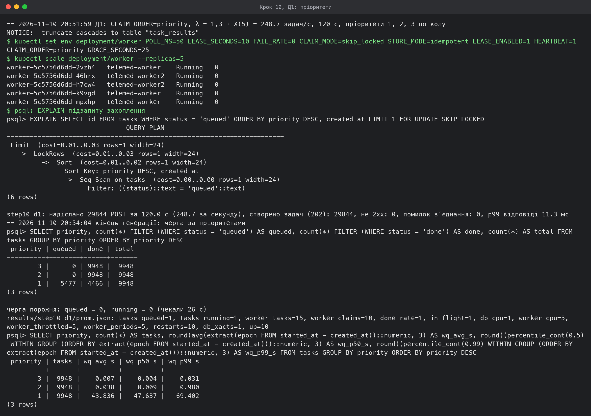

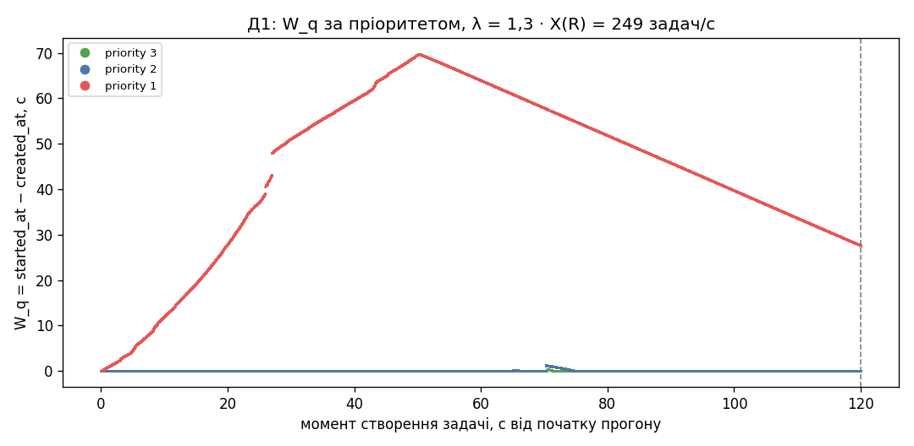

Задачі трьох пріоритетів створено порівну (по 9948), разом 1,3 · X(R) = 248,7 задач/с при пропускній здатності приблизно 190 задач/с. Пулу вистачає на пріоритети 3 і 2 разом (2/3 · 248,7 = 166 задач/с < 190), тому вони майже не чекають: W_q пріоритету 3 — 7 мс у середньому і 31 мс p99, пріоритету 2 — 38 мс у середньому і 0,98 с p99. Увесь надлишок черги припадає на пріоритет 1: на кінець генерації 5477 його задач чекали в черзі, а 4466 встигли виконатися, W_q у середньому 43,8 с, p99 — 69,4 с. Задачі пріоритету 1 беруться лише тоді, коли в черзі немає задач з вищим пріоритетом; на діаграмі видно, що їхній W_q лінійно зростає весь прогін і після кінця генерації спадає, поки воркери вибирають накопичений залишок. План `EXPLAIN` у лістингу знято на порожній таблиці перед прогоном, тому планувальник обрав послідовне сканування з сортуванням; використання індексу `idx_tasks_status_priority_created` на заповненій черзі цим лістингом не підтверджено.

# Аналіз

*Лістинг 44 – Вивід аналізу, results/analyze.log*

```text
Крок 2: t_io = 1.45 мс, t_cpu = 12.75 мс (20 задач)
step3_poll50       D(таблиця) = 0.0700  D(журнали) = 0.0700  p99 claim = 1.69 мс  порожніх = 330  Lock max = 0
step3_poll1        D(таблиця) = 0.5833  D(журнали) = 0.5833  p99 claim = 4.48 мс  порожніх = 10575  Lock max = 0
step4_skip_locked  D(таблиця) = 0.0000  D(журнали) = 0.0000  p99 claim = 2.00 мс  порожніх = 13780  Lock max = 0
step4_for_update   D(таблиця) = 0.0000  D(журнали) = 0.0000  p99 claim = 3.00 мс  порожніх = 13366  Lock max = 0
Крок 5: task=1655 → {'status': 'done', 'attempts': 2, 'token': 2, 'worker_id': 'worker-7d6fcb6f79-jnhkc'}, результатів 1, lost у воркерів = 1
Крок 6: W = 1: X = 43.3 ± 1.5, p99 claim = 1.53 мс, TPS = 225, CPU бази = 0.073, process = 20.6 мс
Крок 6: W = 2: X = 86.1 ± 5.0, p99 claim = 1.25 мс, TPS = 439, CPU бази = 0.051, process = 20.4 мс
Крок 6: W = 5: X = 191.3 ± 12.3, p99 claim = 4.03 мс, TPS = 972, CPU бази = 0.142, process = 22.1 мс
        C = 1: 1.000, 2: 1.988, 5: 4.418; σ = 0.0000, κ = 0.00655, W* = 12.354176687760035  σ < 0 → σ = 0, κ = Σvy/Σv²
        X(1) = 43.3 проти 1/(t_io + t_cpu + T_poll/2) = 25.5
Крок 7: λ = 133.90, W_q = 0.0071 с, λW_q = 0.956, L_q = 0.833 (-12.8%); за записом бази 0.975 (2.0%)
        1,3·X(R): черга на кінець 7030.0, W_q перші/останні 100: 0.062 / 37.377 с
Крок 8 step8_before_fix: коди {'0': 5}, повернуто 0, failed 0, >1 результату 0, attempts>1 0
Крок 8 step8_before_fix_grace0: коди {'0': 5}, повернуто 0, failed 0, >1 результату 0, attempts>1 1
Крок 8 step8_fix1: коди {'0': 5}, повернуто 0, failed 0, >1 результату 0, attempts>1 0
Крок 8 step8_fix1_grace0: коди {'0': 5}, повернуто 1, failed 0, >1 результату 0, attempts>1 2
Крок 8 step8: коди {'0': 5}, повернуто 0, failed 0, >1 результату 0, attempts>1 0
Крок 8 step8_grace0: коди {'0': 5}, повернуто 1, failed 0, >1 результату 0, attempts>1 1
Крок 9 step9_nohb: attempts {0: 34905, 1: 4042, 2: 906, 3: 317}, статуси {'done': 5155, 'failed': 109, 'running': 1, 'queued': 34905}, >1 результату 0, до: >1 14.4% failed 0.28%; після: >1 27.6% failed 2.98%; «0 рядків» 0 / 642; X 12.6 / 10.3
Крок 9 step9_hb: attempts {0: 34344, 1: 4766, 2: 834, 3: 226}, статуси {'done': 5763, 'failed': 62, 'running': 1, 'queued': 34344}, >1 результату 0, до: >1 13.9% failed 0.10%; після: >1 20.3% failed 1.53%; «0 рядків» 0 / 938; X 13.0 / 11.3
Крок 9 step9default_nohb: attempts {0: 39917, 1: 203, 2: 32, 3: 18}, статуси {'done': 245, 'failed': 7, 'running': 1, 'queued': 39917}, >1 результату 0, до: >1 16.5% failed 1.83%; після: >1 22.4% failed 3.50%; «0 рядків» 0 / 21; X 0.3 / 0.4
Крок 9 step9default_hb: attempts {0: 39823, 1: 298, 2: 40, 3: 9}, статуси {'done': 341, 'failed': 5, 'running': 1, 'queued': 39823}, >1 результату 0, до: >1 11.5% failed 1.54%; після: >1 15.7% failed 1.39%; «0 рядків» 0 / 28; X 0.5 / 0.8
Д1: priority 3: n = 9948, W_q середнє 0.007 с, p50 0.004, p99 0.031
Д1: priority 2: n = 9948, W_q середнє 0.038 с, p50 0.009, p99 0.980
Д1: priority 1: n = 9948, W_q середнє 43.836 с, p50 47.637, p99 69.405
```

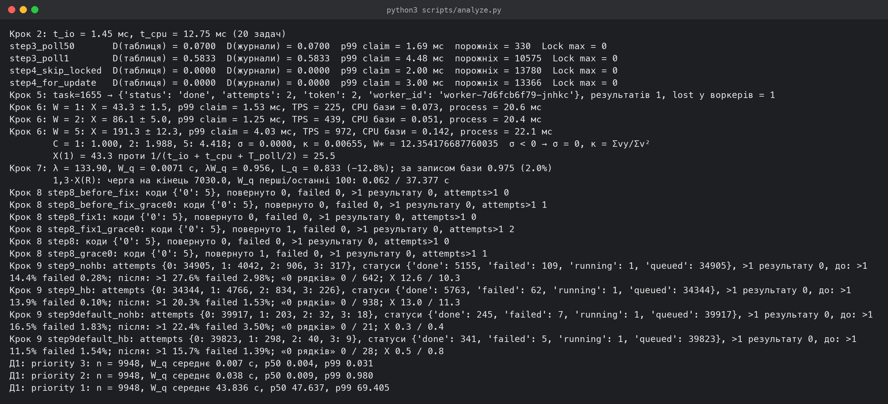

# Висновки

1. Наївне захоплення двома командами дублює задачі: D = 0,07 за T_poll = 50 мс і D = 0,58 за 1 мс на 5 воркерах. Чим частіше опитування, тим більше воркерів потрапляє в проміжок між SELECT і UPDATE.
2. Захоплення однією командою з FOR UPDATE (зі SKIP LOCKED і без) дає D = 0. Очікувань блокувань у знімках `pg_stat_activity` раз на секунду не видно навіть з повною чергою: блокування тримається частки мілісекунди, а PostgreSQL 16 після очікування бере наступний рядок, а не повертає порожній результат.
3. Lease, heartbeat і fencing token повертають задачу зниклого воркера через L і не дають застарілому власнику записати результат; ON CONFLICT DO NOTHING і завершення в одній транзакції гарантують один результат на задачу в усіх прогонах.
4. X(W) майже лінійне: 43,3 → 86,1 → 191,3 задач/с на 1, 2, 5 воркерах (σ = 0, κ = 0,0066, W* ≈ 12). Обмежує квота CPU воркерів і спільні 4 vCPU ВМ, а не черга в базі. Оцінка 1 / (t_io + t_cpu + T_poll / 2) не описує режим з непорожньою чергою: у ньому T_poll не витрачається, а t_cpu під квотою більший, ніж за низького навантаження.
5. Закон Літтла для черги виконується з розбіжністю 2 % за посекундними знімками і −13 % за вимірювачем `tasks_queued`, який оновлюється раз на 5 с.
6. Коректна зупинка потребувала двох виправлень, які показали вимірювання: блокування між перевіркою прапорця і захопленням та умови `status = 'running'` у команді повернення задачі.
7. Падіння процесу з FAIL_RATE = 0,15 за типових налаштувань kubelet зупиняє пул у CrashLoopBackOff; з паузою 1 с пул працює на 6–7 % від X(R). Частки attempts > 1 і failed збігаються з f і f³, поки lease достатній; за L = t_cpu / 2 lease спливає посеред обробки, і heartbeat під квотою CPU цього не виправляє.
8. Д1: за перевантаження 1,3 · X(R) пріоритети 3 і 2 чекають мілісекунди, а весь надлишок черги припадає на пріоритет 1 (W_q у середньому 43,8 с).

# Використання генеративних моделей

<!-- заповнює автор -->

# Додаток А. Сервіс web

*Лістинг 45 – Сервіс web, app/main.py*

```python
"""CRUD-сервіс телемедичних консультацій (варіант 26, ресурс /telemed-sessions) з метриками Prometheus
і чергою задач обробки (ЛР 4): створення задачі, стан задачі з результатом, перелік задач."""

import asyncio
import json
import logging
import os
import random
import socket
import time
from contextlib import asynccontextmanager
from datetime import datetime
from typing import Literal

import asyncpg
from fastapi import FastAPI, Path, Query, Request
from fastapi.exceptions import RequestValidationError
from fastapi.responses import JSONResponse, Response
from prometheus_client import CONTENT_TYPE_LATEST, Counter, Gauge, Histogram, generate_latest
from pydantic import BaseModel, ConfigDict, Field, field_validator

log = logging.getLogger("telemed")
logging.basicConfig(level=logging.INFO, format="%(asctime)s %(levelname)s %(message)s")

# Імʼя екземпляра: POD_NAME (у Kubernetes — через Downward API), інакше hostname контейнера.
INSTANCE = os.environ.get("POD_NAME") or socket.gethostname()
POOL_SIZE = int(os.environ.get("DB_POOL_SIZE", "10"))
LIMIT_DEFAULT = 20
LIMIT_MAX = 100
ID_MAX = 2**63 - 1

# Метрики реєструються один раз під час імпорту модуля, оновлюються в MetricsMiddleware.
# Межі бакетів — набір Г2 варіанта 26 (мс → с, за конвенцією Prometheus).
BUCKETS = (0.002, 0.005, 0.01, 0.02, 0.05, 0.1, 0.2, 0.5, 1.0, 2.0)
REQUESTS = Counter("http_requests_total", "Завершені HTTP-запити", ["method", "path", "code"])
DURATION = Histogram("http_request_duration_seconds", "Тривалість обробки запиту в сервісі",
                     ["method", "path"], buckets=BUCKETS)
IN_PROGRESS = Gauge("http_requests_in_progress", "Запити в обробці")
# ЛР 4: довжина черги і кількість задач в обробці; оновлюються запитом до бази кожні 5 с.
TASKS_QUEUED = Gauge("tasks_queued", "Задачі в статусі queued")
TASKS_RUNNING = Gauge("tasks_running", "Задачі в статусі running")
TASKS_REFRESH_S = 5.0

Channel = Literal["video", "audio", "chat"]
Status = Literal["scheduled", "in_progress", "completed", "cancelled"]
TaskStatus = Literal["queued", "running", "done", "failed"]


class SessionIn(BaseModel):
    """Тіло POST і PUT. PUT замінює запис повністю, тому всі поля обовʼязкові."""

    model_config = ConfigDict(extra="forbid")

    patient_code: str = Field(pattern=r"^[A-Za-z0-9-]{4,32}$")
    doctor: str = Field(min_length=1, max_length=100)
    channel: Channel
    started_at: datetime
    duration_min: int = Field(strict=True)
    status: Status

    @field_validator("doctor")
    @classmethod
    def doctor_not_blank(cls, v: str) -> str:
        if not v.strip():
            raise ValueError("must not be blank")
        return v.strip()

    @field_validator("started_at")
    @classmethod
    def started_at_has_tz(cls, v: datetime) -> datetime:
        if v.tzinfo is None:
            raise ValueError("must include a timezone offset, e.g. 2026-10-10T12:00:00+03:00")
        return v

    @field_validator("duration_min")
    @classmethod
    def duration_range(cls, v: int) -> int:
        # Правило варіанта 26: тривалість більша за нуль і не більша за 90 хвилин.
        if not 0 < v <= 90:
            raise ValueError("must be greater than 0 and not greater than 90 minutes")
        return v


class TaskIn(BaseModel):
    """Необовʼязкове тіло POST …/tasks. Д1: пріоритет 1…3, більший обробляється раніше."""

    model_config = ConfigDict(extra="forbid")

    priority: int = Field(2, ge=1, le=3, strict=True)


COLUMNS = "id, patient_code, doctor, channel, started_at, duration_min, status, created_at, updated_at"


TASK_COLUMNS = ("id, record_id, status, seed, priority, attempts, max_attempts, token, "
                "lease_until, worker_id, created_at, started_at, finished_at")


def row_to_dict(row: asyncpg.Record) -> dict:
    d = dict(row)
    for k in ("started_at", "created_at", "updated_at"):
        d[k] = d[k].isoformat()
    return d


def task_to_dict(row: asyncpg.Record) -> dict:
    d = {k: row[k] for k in TASK_COLUMNS.split(", ")}
    for k in ("lease_until", "created_at", "started_at", "finished_at"):
        d[k] = d[k].isoformat() if d[k] is not None else None
    return d


async def refresh_task_gauges(app: FastAPI) -> None:
    """Раз на 5 с одним запитом читає кількість задач у статусах queued і running."""
    while True:
        p = app.state.pool
        if p is not None:
            try:
                row = await p.fetchrow(
                    """SELECT count(*) FILTER (WHERE status = 'queued')  AS queued,
                              count(*) FILTER (WHERE status = 'running') AS running
                       FROM tasks WHERE status IN ('queued', 'running')""")
                TASKS_QUEUED.set(row["queued"])
                TASKS_RUNNING.set(row["running"])
            except (OSError, asyncpg.PostgresError) as e:
                log.warning("tasks gauges not refreshed: %s", e)
        await asyncio.sleep(TASKS_REFRESH_S)


async def connect_forever(app: FastAPI) -> None:
    """Підключається до бази з повторами; поки пулу немає, /healthz віддає 503."""
    delay = 0.2
    while True:
        try:
            app.state.pool = await asyncpg.create_pool(
                host=os.environ["DB_HOST"],
                port=int(os.environ.get("DB_PORT", "5432")),
                user=os.environ["DB_USER"],
                password=os.environ["DB_PASSWORD"],
                database=os.environ["DB_NAME"],
                # Розмір пулу — найбільша кількість зʼєднань екземпляра; понад пул зʼєднань немає.
                min_size=min(2, POOL_SIZE),
                max_size=POOL_SIZE,
            )
            log.info("connected to database, instance=%s pool=%d", INSTANCE, POOL_SIZE)
            return
        except (OSError, asyncpg.PostgresError) as e:
            log.warning("database not ready (%s), retry in %.1fs", e, delay)
            await asyncio.sleep(delay)
            delay = min(delay * 2, 2.0)


@asynccontextmanager
async def lifespan(app: FastAPI):
    app.state.pool = None
    task = asyncio.create_task(connect_forever(app))
    gauges = asyncio.create_task(refresh_task_gauges(app))
    yield
    # Сюди uvicorn доходить після SIGTERM, коли запити в обробці вже завершені.
    task.cancel()
    gauges.cancel()
    if app.state.pool is not None:
        await app.state.pool.close()
    log.info("graceful shutdown complete, pool closed, instance=%s", INSTANCE)


app = FastAPI(title="Telemed sessions", lifespan=lifespan)


class MetricsMiddleware:
    """Чистий ASGI-обробник: метрики запиту і заголовок X-Pod без накладних витрат BaseHTTPMiddleware."""

    def __init__(self, app):
        self.app = app

    async def __call__(self, scope, receive, send):
        if scope["type"] != "http":
            return await self.app(scope, receive, send)
        code = [500]
        pod = INSTANCE.encode()

        async def send_wrapper(message):
            if message["type"] == "http.response.start":
                code[0] = message["status"]
                message["headers"] = list(message.get("headers", [])) + [(b"x-pod", pod)]
            await send(message)

        IN_PROGRESS.inc()
        t0 = time.perf_counter()
        try:
            await self.app(scope, receive, send_wrapper)
        finally:
            dt = time.perf_counter() - t0
            IN_PROGRESS.dec()
            # Шаблон маршруту (/telemed-sessions/{session_id}), а не конкретний id:
            # FastAPI кладе знайдений маршрут у scope["route"].
            route = scope.get("route")
            path = route.path if route is not None else "unmatched"
            method = scope["method"]
            REQUESTS.labels(method, path, str(code[0])).inc()
            DURATION.labels(method, path).observe(dt)


app.add_middleware(MetricsMiddleware)


def error(status: int, message: str, details: list | None = None) -> JSONResponse:
    body = {"error": message}
    if details:
        body["details"] = details
    return JSONResponse(status_code=status, content=body)


@app.exception_handler(RequestValidationError)
async def validation_handler(request: Request, exc: RequestValidationError):
    details = []
    for e in exc.errors():
        loc = [str(p) for p in e["loc"] if p not in ("body",)]
        details.append({"field": ".".join(loc) or "body", "problem": e["msg"]})
    return error(400, "validation failed", details)


@app.exception_handler(asyncpg.PostgresConnectionError)
@app.exception_handler(ConnectionError)
async def db_down_handler(request: Request, exc: Exception):
    return error(503, "database unavailable")


def pool(request: Request) -> asyncpg.Pool:
    p = request.app.state.pool
    if p is None:
        raise ConnectionError("pool not ready")
    return p


@app.get("/metrics")
async def metrics():
    return Response(generate_latest(), media_type=CONTENT_TYPE_LATEST)


@app.get("/livez")
async def livez():
    # Лише «процес живий»: база не перевіряється, щоб її збій не перезапускав сервіс.
    return {"status": "alive", "instance": INSTANCE}


@app.get("/healthz")
async def healthz(request: Request):
    p = request.app.state.pool
    if p is None:
        return error(503, "database not connected yet")
    try:
        await asyncio.wait_for(p.fetchval("SELECT 1"), timeout=1.0)
    except Exception as e:  # будь-яка помилка бази робить сервіс неготовим
        return error(503, f"database check failed: {type(e).__name__}")
    return {"status": "ok", "instance": INSTANCE}


@app.post("/telemed-sessions", status_code=201)
async def create_session(body: SessionIn, request: Request):
    row = await pool(request).fetchrow(
        f"""INSERT INTO telemed_sessions
              (patient_code, doctor, channel, started_at, duration_min, status)
            VALUES ($1, $2, $3, $4, $5, $6)
            RETURNING {COLUMNS}""",
        body.patient_code, body.doctor, body.channel, body.started_at, body.duration_min, body.status,
    )
    return row_to_dict(row)


@app.get("/telemed-sessions")
async def list_sessions(
    request: Request,
    limit: int = Query(LIMIT_DEFAULT, ge=1, le=LIMIT_MAX),
    offset: int = Query(0, ge=0, le=ID_MAX),
    channel: Channel | None = Query(None),
):
    p = pool(request)
    if channel is None:
        total = await p.fetchval("SELECT count(*) FROM telemed_sessions")
        rows = await p.fetch(
            f"SELECT {COLUMNS} FROM telemed_sessions ORDER BY id LIMIT $1 OFFSET $2", limit, offset
        )
    else:
        total = await p.fetchval("SELECT count(*) FROM telemed_sessions WHERE channel = $1", channel)
        rows = await p.fetch(
            f"SELECT {COLUMNS} FROM telemed_sessions WHERE channel = $1 ORDER BY id LIMIT $2 OFFSET $3",
            channel, limit, offset,
        )
    return {"items": [row_to_dict(r) for r in rows], "total": total, "limit": limit, "offset": offset}


@app.get("/telemed-sessions/{session_id}")
async def get_session(request: Request, session_id: int = Path(ge=1, le=ID_MAX)):
    row = await pool(request).fetchrow(f"SELECT {COLUMNS} FROM telemed_sessions WHERE id = $1", session_id)
    if row is None:
        return error(404, f"telemed session {session_id} not found")
    return row_to_dict(row)


@app.put("/telemed-sessions/{session_id}")
async def replace_session(body: SessionIn, request: Request, session_id: int = Path(ge=1, le=ID_MAX)):
    row = await pool(request).fetchrow(
        f"""UPDATE telemed_sessions
            SET patient_code = $2, doctor = $3, channel = $4, started_at = $5,
                duration_min = $6, status = $7, updated_at = now()
            WHERE id = $1
            RETURNING {COLUMNS}""",
        session_id, body.patient_code, body.doctor, body.channel, body.started_at, body.duration_min, body.status,
    )
    if row is None:
        return error(404, f"telemed session {session_id} not found")
    return row_to_dict(row)


@app.delete("/telemed-sessions/{session_id}", status_code=204)
async def delete_session(request: Request, session_id: int = Path(ge=1, le=ID_MAX)):
    deleted = await pool(request).fetchval(
        "DELETE FROM telemed_sessions WHERE id = $1 RETURNING id", session_id
    )
    if deleted is None:
        return error(404, f"telemed session {session_id} not found")
    return Response(status_code=204)


# ---- ЛР 4: черга задач обробки ----

@app.post("/telemed-sessions/{session_id}/tasks", status_code=202)
async def create_task(request: Request, session_id: int = Path(ge=1, le=ID_MAX), body: TaskIn | None = None):
    # seed генерує сервіс: 1 … 2^31 − 1, початковий стан генератора зрізу.
    seed = random.randint(1, 2**31 - 1)
    priority = body.priority if body is not None else 2
    # INSERT … SELECT: якщо запису немає, не вставляється жодного рядка, і відповідь 404 —
    # одним запитом, без окремої перевірки існування.
    row = await pool(request).fetchrow(
        f"""INSERT INTO tasks (record_id, seed, priority)
            SELECT id, $2, $3 FROM telemed_sessions WHERE id = $1
            RETURNING {TASK_COLUMNS}""",
        session_id, seed, priority,
    )
    if row is None:
        return error(404, f"telemed session {session_id} not found")
    return task_to_dict(row)


@app.get("/tasks/{task_id}")
async def get_task(request: Request, task_id: int = Path(ge=1, le=ID_MAX)):
    cols = ", ".join("t." + c for c in TASK_COLUMNS.split(", "))
    row = await pool(request).fetchrow(
        f"""SELECT {cols}, r.task_id AS r_task_id, r.token AS r_token, r.worker_id AS r_worker_id,
                   r.result AS r_result, r.created_at AS r_created_at
            FROM tasks t LEFT JOIN task_results r ON r.task_id = t.id
            WHERE t.id = $1 LIMIT 1""",
        task_id,
    )
    if row is None:
        return error(404, f"task {task_id} not found")
    d = task_to_dict(row)
    d["result"] = None
    if row["r_task_id"] is not None:
        d["result"] = {"token": row["r_token"], "worker_id": row["r_worker_id"],
                       "result": json.loads(row["r_result"]), "created_at": row["r_created_at"].isoformat()}
    return d


@app.get("/tasks")
async def list_tasks(
    request: Request,
    limit: int = Query(LIMIT_DEFAULT, ge=1, le=LIMIT_MAX),
    offset: int = Query(0, ge=0, le=ID_MAX),
    status: TaskStatus | None = Query(None),
):
    p = pool(request)
    if status is None:
        total = await p.fetchval("SELECT count(*) FROM tasks")
        rows = await p.fetch(f"SELECT {TASK_COLUMNS} FROM tasks ORDER BY id LIMIT $1 OFFSET $2", limit, offset)
    else:
        total = await p.fetchval("SELECT count(*) FROM tasks WHERE status = $1", status)
        rows = await p.fetch(
            f"SELECT {TASK_COLUMNS} FROM tasks WHERE status = $1 ORDER BY id LIMIT $2 OFFSET $3",
            status, limit, offset,
        )
    return {"items": [task_to_dict(r) for r in rows], "total": total, "limit": limit, "offset": offset}
```

*Лістинг 46 – Образ web, Dockerfile*

```dockerfile
# syntax=docker/dockerfile:1

# ---- Стадія 1: збірка залежностей ----
FROM python:3.12-slim AS builder
RUN apt-get update \
 && apt-get install -y --no-install-recommends build-essential \
 && rm -rf /var/lib/apt/lists/*
RUN python -m venv /opt/venv
ENV PATH="/opt/venv/bin:$PATH"
# Спершу лише requirements.txt: шар із залежностями перебудовується
# тільки коли змінюється перелік пакетів, а не при кожній правці коду.
COPY app/requirements.txt /tmp/requirements.txt
RUN pip install --no-cache-dir -r /tmp/requirements.txt

# ---- Стадія 2: фінальний образ без компіляторів ----
FROM python:3.12-slim
ENV PATH="/opt/venv/bin:$PATH" \
    PYTHONDONTWRITEBYTECODE=1 \
    PYTHONUNBUFFERED=1
RUN useradd --uid 10001 --no-create-home --shell /usr/sbin/nologin app
COPY --from=builder /opt/venv /opt/venv
WORKDIR /srv
COPY app/main.py app/healthcheck.py ./
USER 10001
EXPOSE 8000
HEALTHCHECK --interval=2s --timeout=2s --start-period=5s --retries=3 \
    CMD ["python", "/srv/healthcheck.py"]
# exec-форма: uvicorn — PID 1 і сам отримує SIGTERM від docker stop.
CMD ["uvicorn", "main:app", "--host", "0.0.0.0", "--port", "8000", "--workers", "1", "--no-access-log", "--timeout-graceful-shutdown", "8"]
```

*Лістинг 47 – ConfigMap, Deployment і Service web, k8s/web.yaml*

```yaml
apiVersion: v1
kind: ConfigMap
metadata:
  name: web-config
data:
  DB_HOST: db
  DB_PORT: "5432"
  DB_USER: telemed
  DB_NAME: telemed
  DB_POOL_SIZE: "10"                      # варіант 26 у ЛР 2
  PROMETHEUS_DISABLE_CREATED_SERIES: "True"
---
apiVersion: apps/v1
kind: Deployment
metadata:
  name: web
  labels: {app: web}
spec:
  # Поля replicas немає: кількість задає kubectl scale або HPA,
  # і повторне застосування маніфесту її не скидає.
  selector:
    matchLabels: {app: web}
  template:
    metadata:
      labels: {app: web}
    spec:
      terminationGracePeriodSeconds: 15
      # ЛР 3, Д1: поди web порівну на двох worker (control-plane має taint і toleration у web немає).
      topologySpreadConstraints:
        - maxSkew: 1
          topologyKey: kubernetes.io/hostname
          whenUnsatisfiable: DoNotSchedule
          # Honor: вузол з taint, який под не толерує (control-plane), не рахується доменом.
          # Без цього control-plane з 0 подів рахувався б, і третій под порушував би maxSkew → Pending.
          nodeTaintsPolicy: Honor
          labelSelector:
            matchLabels: {app: web}
      containers:
        - name: web
          image: telemed4-web:lab4
          imagePullPolicy: IfNotPresent
          envFrom:
            - configMapRef: {name: web-config}
          env:
            - name: DB_PASSWORD
              valueFrom:
                secretKeyRef: {name: db-secret, key: POSTGRES_PASSWORD}
            - name: POD_NAME
              valueFrom:
                fieldRef: {fieldPath: metadata.name}
          ports:
            - name: http
              containerPort: 8000
          resources:
            requests: {cpu: 250m}
            limits: {cpu: 500m, memory: 512Mi}
          readinessProbe:
            httpGet: {path: /healthz, port: http}
            timeoutSeconds: 3
            periodSeconds: 5
            failureThreshold: 3
          livenessProbe:
            httpGet: {path: /livez, port: http}
            periodSeconds: 10
            timeoutSeconds: 3
          lifecycle:
            preStop:
              # пауза, поки kube-proxy вилучає под з кінцевих точок, і лише потім SIGTERM
              sleep: {seconds: 5}
---
apiVersion: v1
kind: Service
metadata:
  name: web
  labels: {app: web}
spec:
  type: NodePort
  selector: {app: web}
  ports:
    - name: http
      port: 8000
      targetPort: http
      nodePort: 30080
```

*Лістинг 48 – Схема з ЛР 3, db/schema.sql*

```sql
-- Схема накочується Job міграції (k8s/migrate-job.yaml); IF NOT EXISTS робить її повторний запуск безпечним.

CREATE TABLE IF NOT EXISTS telemed_sessions (
    id            BIGINT GENERATED ALWAYS AS IDENTITY PRIMARY KEY,
    patient_code  VARCHAR(32)  NOT NULL CHECK (patient_code ~ '^[A-Za-z0-9-]{4,32}$'),
    doctor        VARCHAR(100) NOT NULL CHECK (length(btrim(doctor)) > 0),
    channel       VARCHAR(16)  NOT NULL CHECK (channel IN ('video', 'audio', 'chat')),
    started_at    TIMESTAMPTZ  NOT NULL,
    duration_min  SMALLINT     NOT NULL CHECK (duration_min > 0 AND duration_min <= 90),
    status        VARCHAR(16)  NOT NULL CHECK (status IN ('scheduled', 'in_progress', 'completed', 'cancelled')),
    created_at    TIMESTAMPTZ  NOT NULL DEFAULT now(),
    updated_at    TIMESTAMPTZ  NOT NULL DEFAULT now()
);

-- Фільтр переліку йде за каналом, сортування за id: складений індекс
-- обслуговує і WHERE channel = $1, і ORDER BY id LIMIT/OFFSET без сортування.
CREATE INDEX IF NOT EXISTS idx_telemed_sessions_channel_id
    ON telemed_sessions (channel, id);
```

# Додаток Б. Генератор

*Лістинг 49 – Генератор, loadgen/main.go*

```go
// Генератор навантаження з фіксованою швидкістю надходження (відкритий контур).
//
// Момент надсилання k-го запиту відрізка обчислюється наперед: start + k/rate.
// Кожен запит виконується в окремій горутині, тож планувальник не чекає відповіді,
// а кількість одночасних запитів не обмежена пулом: фактична інтенсивність
// надсилання дорівнює заданій. Затримка рахується від запланованого моменту.
//
// Профілі:
//
//	-mode step     прогрів, далі сходинки start, start+inc, ... до правила зупинки
//	-mode profile  довільні відрізки "тривалість:інтенсивність,..." (напр. "30:300,60:900,90:300")
//	-mode tasks    ЛР 4: POST /<ресурс>/{id}/tasks з постійною інтенсивністю (tasks.go)
//
// Модель зʼєднань (ЛР 3): -conns K тримає K постійних keep-alive зʼєднань, кожне закривається
// після -per-conn запитів і замінюється новим. Запит, для якого немає вільного зʼєднання, чекає,
// і це очікування входить у затримку. -conns 0 — без обмеження (як у ЛР 2).
//
// Вихід: <out>.seconds.csv (посекундні величини), <out>.json (параметри і підсумок сходинок).
package main

import (
	"encoding/json"
	"errors"
	"flag"
	"fmt"
	"io"
	"math"
	"math/rand"
	"net"
	"net/http"
	"os"
	"sort"
	"strconv"
	"strings"
	"sync"
	"time"
)

type result struct {
	done    time.Time // момент отримання відповіді або помилки
	latency float64   // мс від запланованого моменту надсилання
	code    int       // HTTP-код; 0 — помилка зʼєднання; -1 — тайм-аут
}

type second struct {
	Target   float64   // задана інтенсивність у цю секунду
	Sent     int       // фактично надіслано в цю секунду
	OK       int       // відповіді 2xx, завершені в цю секунду (= досягнута інтенсивність)
	Non2xx   int       // відповіді не 2xx, включно з тайм-аутами
	ConnErr  int       // помилки зʼєднання
	Timeouts int       // з них тайм-аутів (уже пораховані в Non2xx)
	lat      []float64 // затримки запитів, завершених у цю секунду (до стиснення)
	hist     map[int32]int32
	p        [3]float64 // точні p50, p95, p99 секунди, обчислені перед стисненням
	packed   bool
}

// Логарифмічні бакети з кроком 0.5%: для довгих прогонів секунда стискається в гістограму,
// і перцентиль сходинки береться з об'єднаних гістограм з відносною похибкою < 0.25%.
const histBase = 1.005

func hb(ms float64) int32 {
	if ms < 0.001 {
		ms = 0.001
	}
	return int32(math.Floor(math.Log(ms) / math.Log(histBase)))
}

// Середина бакета в мс (геометрична).
func hv(b int32) float64 { return math.Pow(histBase, float64(b)+0.5) }

func (s *second) pack() {
	if s.packed {
		return
	}
	sort.Float64s(s.lat)
	s.p = [3]float64{pct(s.lat, .5), pct(s.lat, .95), pct(s.lat, .99)}
	s.hist = make(map[int32]int32)
	for _, x := range s.lat {
		s.hist[hb(x)]++
	}
	s.lat = nil
	s.packed = true
}

func histPct(h map[int32]int32, p float64) float64 {
	var n int64
	keys := make([]int32, 0, len(h))
	for k, c := range h {
		keys = append(keys, k)
		n += int64(c)
	}
	if n == 0 {
		return math.NaN()
	}
	sort.Slice(keys, func(i, j int) bool { return keys[i] < keys[j] })
	rank := int64(math.Ceil(p * float64(n)))
	var c int64
	for _, k := range keys {
		c += int64(h[k])
		if c >= rank {
			return hv(k)
		}
	}
	return hv(keys[len(keys)-1])
}

type segment struct {
	Name  string  `json:"name"`
	Dur   int     `json:"duration_s"`
	Rate  float64 `json:"rate"`
	Start int     `json:"start_s"` // секунда від початку прогону
}

// jf — число для JSON: NaN (сходинка без жодної відповіді) записується як null, а не ламає файл.
type jf float64

func (v jf) MarshalJSON() ([]byte, error) {
	if math.IsNaN(float64(v)) || math.IsInf(float64(v), 0) {
		return []byte("null"), nil
	}
	return json.Marshal(float64(v))
}

type stepSummary struct {
	Step        int     `json:"step"`
	Target      float64 `json:"target_rps"`
	StartUnix   float64 `json:"start_unix"`
	WindowFrom  float64 `json:"window_from_unix"` // останні 15 с сходинки
	WindowTo    float64 `json:"window_to_unix"`
	Achieved    jf      `json:"achieved_rps"` // середня досягнута за вікно
	AchievedStd jf      `json:"achieved_std"`
	SentRate    jf      `json:"sent_rps"`
	P50         jf      `json:"p50_ms"`
	P95         jf      `json:"p95_ms"`
	P99         jf      `json:"p99_ms"`
	Non2xxShare jf      `json:"non2xx_share"`
	ConnErr     int     `json:"conn_errors"`
}

var (
	mu      sync.Mutex
	seconds []*second
	t0      time.Time
)

func sec(t time.Time) *second {
	i := int(t.Sub(t0) / time.Second)
	if i < 0 {
		i = 0
	}
	for len(seconds) <= i {
		seconds = append(seconds, &second{})
	}
	return seconds[i]
}

func pct(sorted []float64, p float64) float64 {
	if len(sorted) == 0 {
		return math.NaN()
	}
	k := int(math.Ceil(p*float64(len(sorted)))) - 1
	if k < 0 {
		k = 0
	}
	return sorted[k]
}

func parseIDs(s string) []int {
	var ids []int
	for _, part := range strings.Split(s, ",") {
		if a, b, ok := strings.Cut(part, "-"); ok {
			lo, _ := strconv.Atoi(a)
			hi, _ := strconv.Atoi(b)
			for i := lo; i <= hi; i++ {
				ids = append(ids, i)
			}
		} else if part != "" {
			i, _ := strconv.Atoi(part)
			ids = append(ids, i)
		}
	}
	return ids
}

func main() {
	url := flag.String("url", "http://lb/telemed-sessions/{id}", "шаблон URL, {id} замінюється на випадковий id")
	idsArg := flag.String("ids", "1-100", "діапазон ідентифікаторів")
	mode := flag.String("mode", "step", "step | profile | tasks")
	rate := flag.Float64("rate", 100, "mode=tasks: задач за секунду")
	count := flag.Int("count", 0, "mode=tasks: кількість задач (0 — за тривалістю -dur)")
	dur := flag.Int("dur", 0, "mode=tasks: тривалість створення задач, с")
	priorities := flag.String("priorities", "", "mode=tasks, Д1: пріоритети через кому, по колу")
	warmRate := flag.Float64("warmup-rate", 200, "інтенсивність прогріву")
	warmDur := flag.Int("warmup", 10, "тривалість прогріву, с")
	startRate := flag.Float64("start", 200, "перша сходинка, запитів/с")
	inc := flag.Float64("inc", 200, "приріст сходинки, запитів/с")
	stepDur := flag.Int("step-dur", 20, "тривалість сходинки, с")
	maxRate := flag.Float64("G", 0, "межа генератора: зупинитись після сходинки з заданою >= G (0 — без межі)")
	maxSteps := flag.Int("max-steps", 400, "запобіжник кількості сходинок")
	profile := flag.String("profile", "", "відрізки тривалість:інтенсивність через кому (mode=profile)")
	timeout := flag.Duration("timeout", 5*time.Second, "тайм-аут запиту")
	out := flag.String("out", "/results/run", "префікс вихідних файлів")
	label := flag.String("label", "", "мітка прогону")
	conns := flag.Int("conns", 0, "кількість постійних зʼєднань (0 — без обмеження)")
	perConn := flag.Int("per-conn", 100, "запитів на одне зʼєднання до його заміни")
	win := flag.Int("window", 15, "останні секунди сходинки, за якими рахуються середні")
	flag.Parse()

	ids := parseIDs(*idsArg)
	if *mode == "tasks" {
		runTasks(*url, ids, *rate, *count, *dur, *priorities, *timeout, *out, *label)
		return
	}
	tr := &http.Transport{
		DialContext:         (&net.Dialer{Timeout: *timeout, KeepAlive: 30 * time.Second}).DialContext,
		MaxIdleConns:        0,
		MaxIdleConnsPerHost: 20000,
		IdleConnTimeout:     60 * time.Second,
		DisableCompression:  true,
	}
	client := &http.Client{Transport: tr, Timeout: *timeout}

	// Слот = одне зʼєднання: власний Transport з єдиним зʼєднанням і лічильник запитів.
	type slot struct {
		c *http.Client
		n int
	}
	newSlot := func() *slot {
		t := &http.Transport{
			DialContext:         (&net.Dialer{Timeout: *timeout, KeepAlive: 30 * time.Second}).DialContext,
			MaxConnsPerHost:     1,
			MaxIdleConnsPerHost: 1,
			IdleConnTimeout:     60 * time.Second,
			DisableCompression:  true,
		}
		return &slot{c: &http.Client{Transport: t, Timeout: *timeout}}
	}
	var slots chan *slot
	if *conns > 0 {
		slots = make(chan *slot, *conns)
		for i := 0; i < *conns; i++ {
			slots <- newSlot()
		}
	}

	results := make(chan result, 1<<16)
	var collector sync.WaitGroup
	collector.Add(1)
	go func() {
		defer collector.Done()
		for r := range results {
			mu.Lock()
			s := sec(r.done)
			switch {
			case r.code == 0:
				s.ConnErr++
			case r.code == -1:
				s.Non2xx++
				s.Timeouts++
			case r.code >= 200 && r.code < 300:
				s.OK++
			default:
				s.Non2xx++
			}
			s.lat = append(s.lat, r.latency)
			mu.Unlock()
		}
	}()

	// Секунди, старші за тайм-аут + 2 с, уже не отримають нових відповідей — стискаємо їх.
	stopPack := make(chan struct{})
	go func() {
		tk := time.NewTicker(time.Second)
		defer tk.Stop()
		for {
			select {
			case <-stopPack:
				return
			case now := <-tk.C:
				limit := int(now.Sub(t0)/time.Second) - int(timeout.Seconds()) - 2
				mu.Lock()
				for i := 0; i < limit && i < len(seconds); i++ {
					seconds[i].pack()
				}
				mu.Unlock()
			}
		}
	}()

	var inflight sync.WaitGroup
	fire := func(sched time.Time) {
		defer inflight.Done()
		u := strings.Replace(*url, "{id}", strconv.Itoa(ids[rand.Intn(len(ids))]), 1)
		code := 0
		c := client
		var sl *slot
		if slots != nil {
			sl = <-slots // чекаємо вільне зʼєднання; час очікування входить у затримку
			c = sl.c
		}
		resp, err := c.Get(u)
		if err == nil {
			io.Copy(io.Discard, resp.Body)
			resp.Body.Close()
			code = resp.StatusCode
		} else {
			var ne net.Error
			if errors.As(err, &ne) && ne.Timeout() {
				code = -1
			}
		}
		if sl != nil {
			sl.n++
			if sl.n >= *perConn || err != nil {
				// після 100 запитів (або помилки) зʼєднання закривається і замінюється новим
				sl.c.Transport.(*http.Transport).CloseIdleConnections()
				sl = newSlot()
			}
			slots <- sl
		}
		now := time.Now()
		results <- result{done: now, latency: float64(now.Sub(sched).Microseconds()) / 1000, code: code}
	}

	// Надсилає відрізок з постійною інтенсивністю; моменти — від початку відрізка.
	runSegment := func(segStart time.Time, dur int, rate float64) {
		mu.Lock()
		for i := 0; i < dur; i++ {
			sec(segStart.Add(time.Duration(i)*time.Second + time.Millisecond)).Target = rate
		}
		mu.Unlock()
		n := int(math.Floor(rate * float64(dur)))
		for k := 0; k < n; k++ {
			sched := segStart.Add(time.Duration(float64(k) / rate * float64(time.Second)))
			if d := time.Until(sched); d > 0 {
				time.Sleep(d)
			}
			mu.Lock()
			sec(time.Now()).Sent++
			mu.Unlock()
			inflight.Add(1)
			go fire(sched)
		}
		if d := time.Until(segStart.Add(time.Duration(dur) * time.Second)); d > 0 {
			time.Sleep(d)
		}
	}

	// Середня досягнута і розкид за останні -window секунд сходинки (решта — перехідні).
	window := func(seg segment) (float64, float64, int, int) {
		mu.Lock()
		defer mu.Unlock()
		var v []float64
		from := seg.Start + seg.Dur - *win
		if from < seg.Start {
			from = seg.Start
		}
		for i := from; i < seg.Start+seg.Dur; i++ {
			v = append(v, float64(sec(t0.Add(time.Duration(i)*time.Second)).OK))
		}
		var m float64
		for _, x := range v {
			m += x
		}
		m /= float64(len(v))
		var sd float64
		for _, x := range v {
			sd += (x - m) * (x - m)
		}
		if len(v) > 1 {
			sd = math.Sqrt(sd / float64(len(v)-1))
		}
		return m, sd, from, seg.Start + seg.Dur
	}

	t0 = time.Now().Truncate(time.Second).Add(time.Second)
	time.Sleep(time.Until(t0))
	var segs []segment
	cur := 0
	add := func(name string, dur int, rate float64) segment {
		s := segment{Name: name, Dur: dur, Rate: rate, Start: cur}
		runSegment(t0.Add(time.Duration(cur)*time.Second), dur, rate)
		cur += dur
		segs = append(segs, s)
		return s
	}

	stopReason := ""
	switch *mode {
	case "step":
		if *warmDur > 0 {
			add("warmup", *warmDur, *warmRate)
		}
		below := 0
		for i := 0; i < *maxSteps; i++ {
			rate := *startRate + float64(i)*(*inc)
			s := add(fmt.Sprintf("step%d", i+1), *stepDur, rate)
			m, _, _, _ := window(s)
			fmt.Fprintf(os.Stderr, "step %d target=%.0f achieved=%.1f\n", i+1, rate, m)
			if m < 0.9*rate {
				below++
			} else {
				below = 0
			}
			if below >= 2 {
				stopReason = "дві сходинки поспіль досягнута < 0.9 заданої"
				break
			}
			if *maxRate > 0 && rate >= *maxRate {
				stopReason = "сходинка досягла межі генератора G"
				break
			}
		}
		if stopReason == "" {
			stopReason = "max-steps"
		}
	case "profile":
		for i, part := range strings.Split(*profile, ",") {
			d, r, _ := strings.Cut(part, ":")
			dur, _ := strconv.Atoi(d)
			rate, _ := strconv.ParseFloat(r, 64)
			add(fmt.Sprintf("seg%d", i+1), dur, rate)
		}
		stopReason = "кінець профілю"
	}
	inflight.Wait()
	close(results)
	collector.Wait()
	close(stopPack)
	for _, s := range seconds {
		s.pack()
	}

	// ---- Посекундний CSV ----
	f, _ := os.Create(*out + ".seconds.csv")
	fmt.Fprintln(f, "t,unix,target,sent,achieved_2xx,non2xx,conn_errors,timeouts,p50_ms,p95_ms,p99_ms")
	for i, s := range seconds {
		fmt.Fprintf(f, "%d,%d,%.0f,%d,%d,%d,%d,%d,%.3f,%.3f,%.3f\n", i, t0.Unix()+int64(i), s.Target, s.Sent,
			s.OK, s.Non2xx, s.ConnErr, s.Timeouts, s.p[0], s.p[1], s.p[2])
	}
	f.Close()

	// ---- Підсумок сходинок ----
	var steps []stepSummary
	for _, sg := range segs {
		if sg.Name == "warmup" {
			continue
		}
		m, sd, from, to := window(sg)
		lat := map[int32]int32{}
		sent, ok, bad, ce := 0, 0, 0, 0
		for i := from; i < to && i < len(seconds); i++ {
			s := seconds[i]
			for k, c := range s.hist {
				lat[k] += c
			}
			sent += s.Sent
			ok += s.OK
			bad += s.Non2xx
			ce += s.ConnErr
		}
		share := 0.0
		if ok+bad+ce > 0 {
			share = float64(bad+ce) / float64(ok+bad+ce)
		}
		steps = append(steps, stepSummary{
			Step: len(steps) + 1, Target: sg.Rate,
			StartUnix:  float64(t0.Unix() + int64(sg.Start)),
			WindowFrom: float64(t0.Unix() + int64(from)), WindowTo: float64(t0.Unix() + int64(to)),
			Achieved: jf(m), AchievedStd: jf(sd), SentRate: jf(float64(sent) / float64(to-from)),
			P50: jf(histPct(lat, .5)), P95: jf(histPct(lat, .95)), P99: jf(histPct(lat, .99)), Non2xxShare: jf(share), ConnErr: ce,
		})
	}
	summary := map[string]any{
		"label": *label, "mode": *mode, "url": *url, "timeout_s": timeout.Seconds(),
		"t0_unix": t0.Unix(), "end_unix": t0.Unix() + int64(cur), "segments": segs,
		"stop_reason": stopReason, "steps": steps,
	}
	jfile, _ := os.Create(*out + ".json")
	enc := json.NewEncoder(jfile)
	enc.SetIndent("", " ")
	enc.Encode(summary)
	jfile.Close()

	best := stepSummary{}
	for _, s := range steps {
		if s.Achieved > best.Achieved {
			best = s
		}
	}
	fmt.Printf("%s: %d сходинок, зупинка: %s; X = %.1f ± %.1f на сходинці %d (задано %.0f), p99 = %.1f мс\n",
		*label, len(steps), stopReason, best.Achieved, best.AchievedStd, best.Step, best.Target, best.P99)
}
```

*Лістинг 50 – Образ генератора, loadgen/Dockerfile*

```dockerfile
# syntax=docker/dockerfile:1
FROM golang:1.23-alpine AS build
WORKDIR /src
COPY go.mod main.go tasks.go ./
RUN CGO_ENABLED=0 go build -trimpath -ldflags="-s -w" -o /loadgen .

FROM scratch
COPY --from=build /loadgen /loadgen
ENTRYPOINT ["/loadgen"]
```

# Додаток В. Скрипти

*Лістинг 51 – Серія, scripts/series.sh*

```bash
#!/usr/bin/env bash
# Уся серія ЛР 4 одним запуском (після ./scripts/deploy.sh). Вивід кожного кроку — у results/<крок>.log.
#   ./scripts/series.sh            усі кроки
#   ./scripts/series.sh 6 7        лише названі кроки
set -euo pipefail
cd "$(dirname "$0")/.."
STEPS=${*:-seed 1 2 3 4 4b 5 6 7 8 9 10}
for S in $STEPS; do
  echo "== $(date '+%F %T') крок $S"
  if [ "$S" = seed ]; then ./scripts/seed.sh 2>&1 | tee results/seed.log; continue; fi
  # Крок 9: без короткої паузи перезапуску пул за FAIL_RATE = 0,15 стоїть у CrashLoopBackOff (див. звіт)
  [ "$S" = 9 ] && ./scripts/kubelet_backoff.sh 1s 2>&1 | tee results/kubelet_backoff.log
  "./scripts/step$S.sh" 2>&1 | tee "results/step$S.log"
done
# після серії — остаточний режим воркерів
bash -c '. scripts/lib.sh; workers 1 >/dev/null'
echo "== $(date '+%F %T') серію завершено"
```

*Лістинг 52 – Розрахунки одного прогону, scripts/calc.py*

```python
"""Розрахунки за файлами одного прогону (results/<прогін>/); ті самі функції використовує analyze.py.

python3 scripts/calc.py stat   <прогін>      лічильники і тривалості кроків воркерів (різниця знімків /metrics)
python3 scripts/calc.py timing <прогін>      t_io, t_cpu → results/<прогін>/timing.json
python3 scripts/calc.py x      <прогін>      X за останні 30 с до спорожнення черги
python3 scripts/calc.py rate   <множник>     множник · X(R) з results/step6_w5
python3 scripts/calc.py lease                L = t_cpu / 2 для сценарію Ф5, секунд
python3 scripts/calc.py dup    <прогін>      D за таблицею результатів і за журналами воркерів
"""
import csv
import glob
import gzip
import json
import math
import os
import re
import statistics
import sys
from collections import Counter, defaultdict

ROOT = os.path.abspath(os.path.join(os.path.dirname(__file__), ".."))
RES = os.path.join(ROOT, "results")
R = 5
WINDOW = 30          # X(W) — за останні 30 с до спорожнення черги
LINE = re.compile(r'^(\w+?)(?:_(bucket|sum|count))?(?:\{(.*)\})? ([-+0-9.eEinfa]+)$')


def rd(run, name):
    return os.path.join(RES, run, name)


def parse_metrics(path):
    out = {}
    for line in open(path, encoding="utf-8"):
        if line.startswith("#"):
            continue
        key, _, val = line.rstrip("\n").rpartition(" ")
        out[key] = float(val)
    return out


def metrics_delta(run):
    """Сума по всіх воркерах: (після − до) для кожного ряду; воркер без знімка «до» рахується від нуля."""
    total = defaultdict(float)
    for after in glob.glob(rd(run, "metrics_after_*.txt")):
        before = after.replace("metrics_after_", "metrics_before_")
        b = parse_metrics(before) if os.path.exists(before) else {}
        for k, v in parse_metrics(after).items():
            total[k] += v - b.get(k, 0.0)
    return total


def counter(m, name, **labels):
    lab = ",".join(f'{k}="{v}"' for k, v in labels.items())
    return m.get(f"{name}{{{lab}}}", 0.0)


def hist(m, step):
    """Гістограма кроку: [(верхня межа, накопичена кількість)], сума, кількість."""
    buckets = []
    for k, v in m.items():
        mt = re.match(r'worker_task_duration_seconds_bucket\{le="([^"]+)",step="%s"\}' % step, k)
        if mt:
            buckets.append((float(mt.group(1).replace("+Inf", "inf")), v))
    buckets.sort()
    return (buckets, counter(m, "worker_task_duration_seconds_sum", step=step),
            counter(m, "worker_task_duration_seconds_count", step=step))


def quantile(buckets, q):
    """Квантиль за гістограмою з лінійною інтерполяцією всередині бакета (як histogram_quantile)."""
    if not buckets or buckets[-1][1] <= 0:
        return None
    rank = q * buckets[-1][1]
    lo, prev = 0.0, 0.0
    for le, c in buckets:
        if c >= rank:
            if math.isinf(le):
                return lo
            return lo + (le - lo) * (rank - prev) / (c - prev) if c > prev else le
        lo, prev = le, c
    return lo


def merged_claim_hist(m):
    """Усі команди захоплення разом: з задачею і порожні."""
    a, sa, ca = hist(m, "claim")
    b, sb, cb = hist(m, "claim_empty")
    d = defaultdict(float)
    for le, c in a + b:
        d[le] += c
    return sorted(d.items()), sa + sb, ca + cb


def step_stats(run):
    m = metrics_delta(run)
    out = {"tasks": {r: int(counter(m, "worker_tasks_total", result=r)) for r in ("done", "failed", "lost")},
           "claims": {r: int(counter(m, "worker_claims_total", result=r)) for r in ("task", "empty")},
           "steps": {}}
    for step in ("reap", "claim", "claim_empty", "fetch", "process", "store"):
        b, s, c = hist(m, step)
        out["steps"][step] = {"count": int(c), "mean_ms": s / c * 1e3 if c else None,
                              "p99_ms": quantile(b, .99) * 1e3 if c else None}
    b, s, c = merged_claim_hist(m)
    out["steps"]["claim_all"] = {"count": int(c), "mean_ms": s / c * 1e3 if c else None,
                                 "p99_ms": quantile(b, .99) * 1e3 if c else None}
    return out


def tasks(run):
    rows = []
    for r in csv.DictReader(open(rd(run, "tasks.csv"))):
        for k in ("id", "record_id", "priority", "attempts", "token"):
            r[k] = int(r[k])
        for k in ("created", "started", "finished"):
            r[k] = float(r[k]) if r[k] else None
        rows.append(r)
    return rows


def results_per_task(run):
    c = Counter()
    for r in csv.DictReader(open(rd(run, "task_results.csv"))):
        c[int(r["task_id"])] += 1
    return c


def log_lines(run):
    for path in sorted(glob.glob(rd(run, "log_*.log")) + glob.glob(rd(run, "log_*.log.gz"))):
        pod = os.path.basename(path)[4:].split(".log")[0]
        op = gzip.open if path.endswith(".gz") else open
        with op(path, "rt", encoding="utf-8") as f:
            for line in f:
                yield pod, line.rstrip("\n")


def dup(run):
    """D = n_dup / n двома способами: за таблицею результатів і за рядками done у журналах."""
    n = len(tasks(run))
    by_table = sum(1 for v in results_per_task(run).values() if v > 1)
    done = Counter()
    for _, line in log_lines(run):
        mt = re.search(r" task=(\d+) done ", line)
        if mt:
            done[int(mt.group(1))] += 1
    by_logs = sum(1 for v in done.values() if v > 1)
    return {"n": n, "results": sum(results_per_task(run).values()), "n_dup_table": by_table,
            "D_table": by_table / n if n else None, "done_lines": sum(done.values()),
            "n_dup_logs": by_logs, "D_logs": by_logs / n if n else None}


def db_seconds(run):
    rows = []
    for r in csv.DictReader(open(rd(run, "db_seconds.csv"))):
        try:
            rows.append({k: float(v) for k, v in r.items()})
        except (ValueError, TypeError):
            pass                     # обірваний останній рядок
    return rows


def throughput(run):
    """X: завершені задачі за секунду у вікні останніх 30 с до завершення останньої задачі."""
    fin = sorted(t["finished"] for t in tasks(run) if t["status"] == "done" and t["finished"])
    end = fin[-1]
    start = max(end - WINDOW, fin[0])
    per = Counter(int((t - start)) for t in fin if start < t <= end)
    secs = int(round(end - start))
    counts = [per.get(i, 0) for i in range(secs)]
    return {"X": len([t for t in fin if start < t <= end]) / (end - start), "std": statistics.pstdev(counts),
            "window_s": end - start, "from": start, "to": end, "drain_s": end - fin[0], "done": len(fin),
            "per_second": counts}


def timing(run):
    s = step_stats(run)["steps"]
    t = {"t_fetch_ms": s["fetch"]["mean_ms"], "t_store_ms": s["store"]["mean_ms"],
         "t_io_ms": s["fetch"]["mean_ms"] + s["store"]["mean_ms"], "t_cpu_ms": s["process"]["mean_ms"],
         "t_claim_ms": s["claim"]["mean_ms"], "tasks": s["process"]["count"]}
    json.dump(t, open(rd(run, "timing.json"), "w"), indent=1)
    return t


def main():
    cmd = sys.argv[1]
    if cmd == "stat":
        s = step_stats(sys.argv[2])
        print(f"worker_tasks_total:  done = {s['tasks']['done']}, failed = {s['tasks']['failed']}, lost = {s['tasks']['lost']}")
        print(f"worker_claims_total: task = {s['claims']['task']}, empty = {s['claims']['empty']}")
        for k, v in s["steps"].items():
            if v["count"]:
                print(f"  {k:12s} n = {v['count']:6d}  середнє = {v['mean_ms']:8.3f} мс  p99 = {v['p99_ms']:8.3f} мс")
    elif cmd == "timing":
        t = timing(sys.argv[2])
        print(f"задач: {t['tasks']}; t_io = fetch + store = {t['t_fetch_ms']:.2f} + {t['t_store_ms']:.2f} = "
              f"{t['t_io_ms']:.2f} мс; t_cpu = {t['t_cpu_ms']:.2f} мс")
    elif cmd == "x":
        x = throughput(sys.argv[2])
        print(f"X = {x['X']:.1f} задач/с за останні {x['window_s']:.1f} с (розкид {x['std']:.1f}); "
              f"черга спорожніла за {x['drain_s']:.1f} с, завершено {x['done']}")
    elif cmd == "rate":
        print(f"{float(sys.argv[2]) * throughput(f'step6_w{R}')['X']:.1f}")
    elif cmd == "lease":
        print(f"{json.load(open(rd('step2', 'timing.json')))['t_cpu_ms'] / 2 / 1e3:.4f}")
    elif cmd == "dup":
        d = dup(sys.argv[2])
        print(f"n = {d['n']}; рядків у task_results: {d['results']}; n_dup за таблицею = {d['n_dup_table']}, "
              f"D = {d['D_table']:.4f}; рядків done у журналах: {d['done_lines']}; "
              f"n_dup за журналами = {d['n_dup_logs']}, D = {d['D_logs']:.4f}")
        mx = max((r["lock_waiters"] for r in db_seconds(sys.argv[2])), default=0)
        print(f"найбільше рядків pg_stat_activity з wait_event_type = 'Lock' за прогін: {int(mx)}")


if __name__ == "__main__":
    main()
```

*Лістинг 53 – Дамп рядів Prometheus, scripts/promdump.py*

```python
"""Зберігає ряди Prometheus за час прогону в results/<прогін>/prom.json (розрахунки — офлайн).
python3 scripts/promdump.py <прогін> <unix початку> <unix кінця>"""
import json
import sys
import urllib.parse
import urllib.request

PROM = "http://localhost:9090"
QUERIES = {
    "tasks_queued": "max(tasks_queued)",
    "tasks_running": "max(tasks_running)",
    "worker_tasks": "sum by (pod, result) (worker_tasks_total)",
    "worker_claims": "sum by (pod, result) (worker_claims_total)",
    "done_rate": 'sum(rate(worker_tasks_total{result="done"}[15s]))',
    "in_flight": "sum(worker_tasks_in_flight)",
    "db_cpu": 'sum(container_cpu_usage_seconds_total{pod="db-0", container="postgres"})',
    "worker_cpu": 'sum by (pod) (container_cpu_usage_seconds_total{container="worker"})',
    "worker_throttled": 'sum by (pod) (container_cpu_cfs_throttled_periods_total{container="worker"})',
    "worker_periods": 'sum by (pod) (container_cpu_cfs_periods_total{container="worker"})',
    "restarts": 'sum by (pod) (kube_pod_container_status_restarts_total{container="worker"})',
    "db_xacts": 'sum(pg_stat_database_xact_commit{datname="telemed"} + pg_stat_database_xact_rollback{datname="telemed"})',
    "up": 'up{pod=~"worker-.*"}',
}

run, start, end = sys.argv[1], int(float(sys.argv[2])) - 15, int(float(sys.argv[3])) + 5
out = {"run": run, "start": start, "end": end, "step_s": 5, "series": {}}
for name, q in QUERIES.items():
    url = f"{PROM}/api/v1/query_range?" + urllib.parse.urlencode(
        {"query": q, "start": start, "end": end, "step": "5s"})
    data = json.load(urllib.request.urlopen(url))
    assert data["status"] == "success", data
    out["series"][name] = data["data"]["result"]
json.dump(out, open(f"results/{run}/prom.json", "w"))
print(f"results/{run}/prom.json: " + ", ".join(f"{k}={len(v)}" for k, v in out["series"].items()))
```

*Лістинг 54 – Аналіз, scripts/analyze.py*

```python
"""Аналіз серії ЛР 4 офлайн з файлів results/ (таблиці бази, журнали і знімки /metrics воркерів,
посекундний стан бази, ряди Prometheus, вивід генератора).
Пише results/summary.json, таблиці results/tables/*.md і діаграми screens/chart_*.png.
"""
import csv
import glob
import json
import math
import os
import re
import statistics
import sys
from collections import Counter

import matplotlib

matplotlib.use("Agg")
import matplotlib.pyplot as plt  # noqa: E402

sys.path.insert(0, os.path.dirname(__file__))
from calc import (RES, R, db_seconds, dup, log_lines, results_per_task, rd, step_stats,  # noqa: E402
                  tasks, throughput)

ROOT = os.path.abspath(os.path.join(os.path.dirname(__file__), ".."))
TAB = os.path.join(RES, "tables")
SCR = os.path.join(ROOT, "screens")
os.makedirs(TAB, exist_ok=True)
os.makedirs(SCR, exist_ok=True)
T_POLL = 0.050
F = 0.15
WS = [1, 2, R]
ZERO = re.compile(r"онов(?:ив|ило) 0 рядків")
plt.rcParams.update({"font.size": 10})


def fnum(x, d=1):
    if x is None or (isinstance(x, float) and math.isnan(x)):
        return "—"
    return f"{x:,.{d}f}".replace(",", " ")


def pct(x, d=1):
    return "—" if x is None else f"{x * 100:.{d}f}%"


def write(name, text):
    open(os.path.join(TAB, name), "w", encoding="utf-8").write(text.rstrip() + "\n")


def table(head, rows):
    out = ["| " + " | ".join(head) + " |", "|" + "---|" * len(head)]
    out += ["| " + " | ".join(str(c) for c in r) + " |" for r in rows]
    return "\n".join(out)


def gen(run):
    return json.load(open(rd(run, "gen.json")))


def prom(run, name):
    """Ряд Prometheus [(t, v)]; для рядів з кількома мітками — сума."""
    p = json.load(open(rd(run, "prom.json")))
    acc = {}
    for r in p["series"][name]:
        for t, v in r["values"]:
            acc[float(t)] = acc.get(float(t), 0.0) + float(v)
    return sorted(acc.items())


def rate_between(points, a, b):
    """Середня швидкість зростання лічильника між моментами a і b (за найближчими точками)."""
    pa = [p for p in points if p[0] <= a] or points[:1]
    pb = [p for p in points if p[0] >= b] or points[-1:]
    (ta, va), (tb, vb) = pa[-1], pb[0]
    return (vb - va) / (tb - ta) if tb > ta else None


def wq(rows):
    return [t["started"] - t["created"] for t in rows if t["started"] is not None]


def q99(xs):
    xs = sorted(xs)
    return xs[max(0, math.ceil(0.99 * len(xs)) - 1)] if xs else None


summary = {}

# ---------- крок 2: t_io і t_cpu ----------
tm = json.load(open(rd("step2", "timing.json")))
s2 = step_stats("step2")
summary["step2"] = tm
x1_pred = 1 / ((tm["t_io_ms"] + tm["t_cpu_ms"]) / 1e3 + T_POLL / 2)
write("step2.md", table(
    ["Величина", "Значення, мс", "Звідки"],
    [["задач", tm["tasks"], "`worker_task_duration_seconds_count{step=\"process\"}`"],
     ["fetch (GET запису від web)", fnum(tm["t_fetch_ms"], 2), "`_sum / _count`, step=\"fetch\""],
     ["store (завершення і запис результату)", fnum(tm["t_store_ms"], 2), "step=\"store\""],
     ["**t_io** = fetch + store", f"**{fnum(tm['t_io_ms'], 2)}**", ""],
     ["**t_cpu** = process", f"**{fnum(tm['t_cpu_ms'], 2)}**", "step=\"process\""],
     ["захоплення з задачею (claim)", fnum(tm["t_claim_ms"], 2), "step=\"claim\""],
     ["порожні захоплення за прогін", s2["claims"]["empty"], "`worker_claims_total{result=\"empty\"}`"]]))

# ---------- кроки 3–4: дублі ----------
dup_rows, dup_chart = [], []
for run, name in (("step3_poll50", "наївне, T_poll = 50 мс"), ("step3_poll1", "наївне, T_poll = 1 мс"),
                  ("step4_skip_locked", "FOR UPDATE SKIP LOCKED, 1 мс"), ("step4_for_update", "FOR UPDATE, 1 мс")):
    d = dup(run)
    st = step_stats(run)
    mx = max((r["lock_waiters"] for r in db_seconds(run)), default=0)
    mxl = max((r["locks_not_granted"] for r in db_seconds(run)), default=0)
    summary[run] = {"dup": d, "claims": st["claims"], "claim_p99_ms": st["steps"]["claim"]["p99_ms"],
                    "claim_all_p99_ms": st["steps"]["claim_all"]["p99_ms"], "lock_max": mx, "not_granted_max": mxl}
    dup_rows.append([name, d["n"], d["results"], d["n_dup_table"], f"{d['D_table']:.4f}", d["done_lines"],
                     d["n_dup_logs"], f"{d['D_logs']:.4f}", fnum(st["steps"]["claim"]["p99_ms"], 2),
                     st["claims"]["empty"], int(mx), int(mxl)])
    dup_chart.append((name, d["D_table"]))
write("dup.md", table(["Захоплення", "n", "Рядків у task_results", "n_dup (таблиця)", "D (таблиця)",
                       "Рядків done у журналах", "n_dup (журнали)", "D (журнали)", "p99 захоплення, мс",
                       "Порожніх захоплень", "Найбільше Lock у pg_stat_activity", "Найбільше granted = false"],
                      dup_rows))
fig, ax = plt.subplots(figsize=(8, 3.8))
ax.barh([n for n, _ in dup_chart][::-1], [d for _, d in dup_chart][::-1], color=["#4c78a8", "#4c78a8", "#e45756", "#e45756"])
for i, (_, d) in enumerate(dup_chart[::-1]):
    ax.text(d + 0.005, i, f"{d:.3f}", va="center")
ax.set_xlabel("D = n_dup / n (за таблицею task_results)"); ax.set_xlim(0, max(d for _, d in dup_chart) * 1.2 + 0.01)
ax.set_title(f"Кроки 3–4: частка дублів, {R} воркерів, 300 задач на 100 за секунду")
fig.tight_layout(); fig.savefig(os.path.join(SCR, "chart_dup.png"), dpi=120); plt.close(fig)

# крок 4, контрольний прогін з непорожньою чергою
full = []
for run, name in (("step4b_skip_locked", "FOR UPDATE SKIP LOCKED"), ("step4b_for_update", "FOR UPDATE")):
    if not os.path.exists(rd(run, "tasks.csv")):
        continue
    d = dup(run)
    st = step_stats(run)
    x = throughput(run)
    dbs = db_seconds(run)
    lock_secs = sum(1 for r in dbs if r["lock_waiters"] > 0)
    summary[run] = {"dup": d, "claims": st["claims"], "claim_p99_ms": st["steps"]["claim"]["p99_ms"],
                    "claim_mean_ms": st["steps"]["claim"]["mean_ms"], "X": x["X"],
                    "lock_max": max((r["lock_waiters"] for r in dbs), default=0), "lock_seconds": lock_secs,
                    "seconds": len(dbs)}
    full.append([name, d["n"], f"{d['D_table']:.4f}", fnum(x["X"]), fnum(st["steps"]["claim"]["mean_ms"], 2),
                 fnum(st["steps"]["claim"]["p99_ms"], 2), st["claims"]["empty"],
                 int(summary[run]["lock_max"]), f"{lock_secs} з {len(dbs)}"])
if full:
    write("dup_full.md", table(["Захоплення (3000 задач у черзі)", "n", "D", "X, задач/с", "Захоплення: середнє, мс",
                                "p99 захоплення, мс", "Порожніх захоплень", "Найбільше Lock у pg_stat_activity",
                                "Секунд з Lock > 0"], full))

# ---------- крок 5 ----------
tid, victim = open(rd("step5", "victim.txt")).read().split()
tid = int(tid)
t5 = {t["id"]: t for t in tasks("step5")}[tid]
lines5 = [(pod, ln) for pod, ln in log_lines("step5") if f"task={tid} " in ln]
summary["step5"] = {"task": tid, "victim": victim, "after": {k: t5[k] for k in ("status", "attempts", "token", "worker_id")},
                    "results": results_per_task("step5")[tid], "log": lines5,
                    "lost": step_stats("step5")["tasks"]["lost"], "seconds_to_done": t5["finished"] - t5["created"]}

# ---------- крок 6: X(W) ----------
x6 = {}
for W in WS:
    run = f"step6_w{W}"
    x = throughput(run)
    st = step_stats(run)
    db = [r for r in db_seconds(run) if x["from"] <= r["unix"] <= x["to"]]
    tps = (db[-1]["xacts"] - db[0]["xacts"]) / (db[-1]["unix"] - db[0]["unix"]) if len(db) > 1 else None
    cpu = rate_between(prom(run, "db_cpu"), x["from"], x["to"])
    wcpu = rate_between(prom(run, "worker_cpu"), x["from"], x["to"])
    thr = rate_between(prom(run, "worker_throttled"), x["from"], x["to"])
    per = rate_between(prom(run, "worker_periods"), x["from"], x["to"])
    x6[W] = {"X": x["X"], "std": x["std"], "window_s": x["window_s"], "drain_s": x["drain_s"], "done": x["done"],
             "claim_p99_ms": st["steps"]["claim"]["p99_ms"], "tps": tps, "db_cpu": cpu,
             "worker_cpu": wcpu, "throttled": thr / per if thr is not None and per else None,
             "process_ms": st["steps"]["process"]["mean_ms"], "per_second": x["per_second"]}

X1 = x6[1]["X"]
C = {W: x6[W]["X"] / X1 for W in WS}
u = {W: W - 1 for W in WS}
v = {W: W * (W - 1) for W in WS}
y = {W: W / C[W] - 1 for W in WS}
fit = [W for W in WS if W > 1]
S_ = lambda f: sum(f(w) for w in fit)  # noqa: E731
Suu, Svv, Suv = S_(lambda w: u[w] ** 2), S_(lambda w: v[w] ** 2), S_(lambda w: u[w] * v[w])
Suy, Svy = S_(lambda w: u[w] * y[w]), S_(lambda w: v[w] * y[w])
den = Suu * Svv - Suv ** 2
sigma, kappa = (Svv * Suy - Suv * Svy) / den, (Suu * Svy - Suv * Suy) / den
note = ""
if sigma < 0:
    sigma, kappa, note = 0.0, Svy / Svv, "σ < 0 → σ = 0, κ = Σvy/Σv²"
elif kappa < 0:
    sigma, kappa, note = Suy / Suu, 0.0, "κ < 0 → κ = 0, σ = Σuy/Σu²"
w_star = math.sqrt((1 - sigma) / kappa) if kappa > 0 and sigma < 1 else None
summary["step6"] = {"X": {W: {k: v_ for k, v_ in x6[W].items() if k != "per_second"} for W in WS},
                    "C": C, "sigma": sigma, "kappa": kappa, "W_star": w_star, "note": note, "X1_pred": x1_pred,
                    "X1_pred_no_poll": 1 / ((tm["t_io_ms"] + tm["t_cpu_ms"]) / 1e3)}
write("xw.md", table(
    ["W", "X(W), задач/с", "Розкид (σ посекундної кількості)", "Вікно, с", "Спорожнення черги, с", "p99 захоплення, мс",
     "Транзакцій бази за секунду", "CPU пода бази, ядер", "CPU воркерів разом, ядер", "Дроселювання воркерів", "process, мс"],
    [[W, fnum(r["X"]), fnum(r["std"]), fnum(r["window_s"]), fnum(r["drain_s"]), fnum(r["claim_p99_ms"], 2),
      fnum(r["tps"], 0), fnum(r["db_cpu"], 3), fnum(r["worker_cpu"], 2), pct(r["throttled"]), fnum(r["process_ms"], 1)]
     for W, r in x6.items()]))
write("usl.md", table(["W", "X(W)", "C(W)", "u = W − 1", "v = W(W − 1)", "y = W/C − 1", "У підборі"],
                      [[W, fnum(x6[W]["X"]), f"{C[W]:.3f}", u[W], v[W], f"{y[W]:.4f}", "так" if W in fit else "ні"]
                       for W in WS]))
fig, ax = plt.subplots(figsize=(8, 5))
ax.errorbar(WS, [x6[W]["X"] for W in WS], yerr=[x6[W]["std"] for W in WS], fmt="o", capsize=5,
            label="виміряне X(W) ± розкид")
ww = [i / 10 for i in range(10, 81)]
ax.plot(ww, [X1 * w / (1 + sigma * (w - 1) + kappa * w * (w - 1)) for w in ww],
        label=f"закон: σ = {sigma:.4f}, κ = {kappa:.5f}")
ax.plot(ww, [X1 * w for w in ww], ":", color="gray", label="лінійне X(1) · W")
ax.axhline(x1_pred, ls="--", color="#e45756", lw=1, label=f"1 / (t_io + t_cpu + T_poll/2) = {x1_pred:.1f}")
ax.set_xlabel("W, воркерів"); ax.set_ylabel("X(W), задач/с"); ax.set_xticks(range(1, 9)); ax.legend(fontsize=8)
ax.set_title("Крок 6: пропускна здатність пулу з непорожньою чергою")
fig.tight_layout(); fig.savefig(os.path.join(SCR, "chart_xw.png"), dpi=120); plt.close(fig)
XR = x6[R]["X"]


def done_per_second(rows, t0, t1):
    c = Counter(int(t["finished"] - t0) for t in rows if t["finished"] and t0 <= t["finished"] < t1 and t["status"] == "done")
    return [c.get(i, 0) for i in range(int(t1 - t0))]


def timeline(run, title, out, marks=(), extra=None):
    g = gen(run)
    rows = tasks(run)
    t0 = g["t0_unix"]
    t1 = max([t["finished"] for t in rows if t["finished"]] + [g["end_unix"]]) + 3
    fig, ax = plt.subplots(figsize=(9, 4.4))
    for name, lab, col in (("tasks_queued", "tasks_queued", "#4c78a8"), ("tasks_running", "tasks_running", "#f58518")):
        pts = [(t - t0, v_) for t, v_ in prom(run, name) if t0 - 5 <= t <= t1]
        ax.step([p[0] for p in pts], [p[1] for p in pts], where="post", label=lab, color=col)
    ax2 = ax.twinx()
    d = done_per_second(rows, t0, t1)
    ax2.plot(range(len(d)), d, color="#54a24b", lw=0.8, alpha=0.8, label="завершено задач за секунду")
    ax2.set_ylabel("завершено задач за секунду", color="#54a24b")
    for t, lab in marks:
        ax.axvline(t - t0, color="#e45756", ls="--", lw=1.2)
        ax.text(t - t0 + 1, ax.get_ylim()[1] * 0.92, lab, color="#e45756", fontsize=8)
    if extra:
        extra(ax, t0)
    ax.set_xlabel("секунди від початку прогону"); ax.set_ylabel("задач (вимірювачі web, збір 5 с)")
    h1, l1 = ax.get_legend_handles_labels(); h2, l2 = ax2.get_legend_handles_labels()
    ax.legend(h1 + h2, l1 + l2, fontsize=8, loc="upper left")
    ax.set_title(title)
    fig.tight_layout(); fig.savefig(os.path.join(SCR, out), dpi=120); plt.close(fig)


# ---------- крок 7: закон Літтла ----------
g = gen("step7_07")
rows7 = tasks("step7_07")
a, b = g["t0_unix"] + 60, g["t0_unix"] + 180
win = [t for t in rows7 if a <= t["created"] < b]
lam = len(win) / (b - a)
Wq = statistics.fmean(wq(win))
Lq_prom = [v_ for t, v_ in prom("step7_07", "tasks_queued") if a <= t <= b]
Lq_db = [r["queued"] for r in db_seconds("step7_07") if a <= r["unix"] <= b]
Lq = statistics.fmean(Lq_prom)
summary["step7"] = {"rate_set": g["rate"], "lambda": lam, "Wq_s": Wq, "lambda_Wq": lam * Wq, "Lq": Lq,
                    "Lq_points": len(Lq_prom), "Lq_db": statistics.fmean(Lq_db), "Lq_db_points": len(Lq_db),
                    "diff": (Lq - lam * Wq) / (lam * Wq), "diff_db": (statistics.fmean(Lq_db) - lam * Wq) / (lam * Wq),
                    "Wq_p99_s": q99(wq(win)), "XR": XR}
g13 = gen("step7_13")
rows13 = sorted(tasks("step7_13"), key=lambda t: t["created"])
end_q = [r for r in db_seconds("step7_13") if r["unix"] <= g13["last_sent_unix"] + 0.5]
end_qp = [v_ for t, v_ in prom("step7_13", "tasks_queued") if t <= g13["last_sent_unix"] + 0.5]
gen_rows13 = [t for t in rows13 if t["created"] <= g13["last_sent_unix"] + 0.5]
x13 = sum(1 for t in rows13 if t["finished"] and g13["t0_unix"] + 30 <= t["finished"] < g13["last_sent_unix"]) / (g13["last_sent_unix"] - g13["t0_unix"] - 30)
summary["step7_13"] = {"rate_set": g13["rate"], "created": len(rows13),
                       "lambda": len(gen_rows13) / (g13["last_sent_unix"] - g13["t0_unix"]),
                       "queue_end_db": end_q[-1]["queued"] if end_q else None,
                       "queue_end_prom": end_qp[-1] if end_qp else None,
                       "Wq_first100": statistics.fmean(wq(rows13[:100])), "Wq_last100": statistics.fmean(wq(rows13[-100:])),
                       "X_during": x13, "growth_pred": (len(gen_rows13) / (g13["last_sent_unix"] - g13["t0_unix"]) - x13) * (g13["last_sent_unix"] - g13["t0_unix"])}
s7, s713 = summary["step7"], summary["step7_13"]
write("little.md", table(["Величина", "Значення", "Звідки"], [
    ["X(R), задач/с", fnum(XR), "крок 6, W = 5"],
    ["задана інтенсивність 0,7 · X(R)", fnum(s7["rate_set"]), "параметр генератора"],
    ["λ, задач/с", fnum(s7["lambda"], 2), "задачі з created_at в останніх 120 с / 120"],
    ["W_q, с", fnum(s7["Wq_s"], 4), "середнє started_at − created_at цих задач"],
    ["**λ · W_q**", f"**{fnum(s7['lambda_Wq'], 3)}**", ""],
    ["**L_q виміряне**", f"**{fnum(s7['Lq'], 3)}**", f"середнє tasks_queued у Prometheus, {s7['Lq_points']} точок по 5 с"],
    ["розбіжність (L_q − λW_q) / λW_q", pct(s7["diff"]), ""],
    ["L_q за посекундним записом бази", fnum(s7["Lq_db"], 3), f"`count(*) WHERE status = 'queued'`, {s7['Lq_db_points']} точок"],
    ["розбіжність для нього", pct(s7["diff_db"]), ""],
    ["p99 W_q, с", fnum(s7["Wq_p99_s"], 4), ""]]))
write("overload.md", table(["Величина", "Значення"], [
    ["задана інтенсивність 1,3 · X(R), задач/с", fnum(s713["rate_set"])],
    ["створено задач за 120 с", s713["created"]],
    ["X під час прогону (без перших 30 с), задач/с", fnum(s713["X_during"])],
    ["довжина черги на кінець генерації (посекундний запис бази)", fnum(s713["queue_end_db"], 0)],
    ["те саме, tasks_queued (оновлюється раз на 5 с)", fnum(s713["queue_end_prom"], 0)],
    ["W_q перших 100 задач, с", fnum(s713["Wq_first100"], 3)],
    ["W_q останніх 100 задач, с", fnum(s713["Wq_last100"], 3)]]))
timeline("step7_07", f"Крок 7: λ = 0,7 · X(R) = {s7['rate_set']:.0f} задач/с, {R} воркерів", "chart_step7_07.png",
         marks=[(a, "початок вікна 120 с")])
timeline("step7_13", f"Крок 7: λ = 1,3 · X(R) = {s713['rate_set']:.0f} задач/с, {R} воркерів", "chart_step7_13.png",
         marks=[(g13["last_sent_unix"], "кінець генерації")])

# ---------- крок 8: SIGTERM ----------
def step8(run):
    rows = tasks(run)
    codes = {}
    for line in open(rd(run, "watch.txt")):
        p = line.split()
        if len(p) >= 4 and p[2] != "<none>":
            codes[p[0]] = (p[2], p[3])
    returned = release0 = 0
    exits = {}
    for f in glob.glob(rd(run, "exit_*.log")):
        txt = open(f, encoding="utf-8").read()
        returned += len(re.findall(r"повернуто в чергу \(оновлено рядків: 1\)", txt))
        release0 += len(re.findall(r"повернуто в чергу \(оновлено рядків: 0\)", txt))
        exits[os.path.basename(f)[5:-4]] = "вихід з кодом 0" in txt
    rp = results_per_task(run)
    restart = int(open(rd(run, "restart_unix.txt")).read())
    # задачі, виконані двічі: рядки done у журналах старих (exit_*) і нових (log_*) подів
    done_lines = Counter()
    for f in glob.glob(rd(run, "exit_*.log")) + glob.glob(rd(run, "log_*.log")):
        for m in re.finditer(r" task=(\d+) done ", open(f, encoding="utf-8").read()):
            done_lines[int(m.group(1))] += 1
    twice = sorted(k for k, c in done_lines.items() if c > 1)
    return {"codes": codes, "returned_by_workers": returned, "release_zero_rows": release0, "exit_line": exits,
            "failed": sum(1 for t in rows if t["status"] == "failed"),
            "done": sum(1 for t in rows if t["status"] == "done"), "tasks": len(rows),
            "multi_results": sum(1 for v_ in rp.values() if v_ > 1), "attempts_gt1": sum(1 for t in rows if t["attempts"] > 1),
            "restart": restart, "done_twice": twice,
            "gt1_ids": [t["id"] for t in rows if t["attempts"] > 1]}


S8 = ("step8_before_fix", "step8_before_fix_grace0", "step8_fix1", "step8_fix1_grace0", "step8", "step8_grace0")
s8 = {run: step8(run) for run in S8
      if os.path.exists(rd(run, "tasks.csv"))}
summary["step8"] = s8
rows8 = []
for run, lab in (("step8_before_fix", "до виправлення, GRACE_SECONDS = 25"),
                 ("step8_before_fix_grace0", "до виправлення, GRACE_SECONDS = 0"),
                 ("step8_fix1", "блокування захоплення, GRACE_SECONDS = 25"),
                 ("step8_fix1_grace0", "блокування захоплення, GRACE_SECONDS = 0"),
                 ("step8", "остаточний код, GRACE_SECONDS = 25"), ("step8_grace0", "остаточний код, GRACE_SECONDS = 0")):
    if run not in s8:
        continue
    r = s8[run]
    cc = Counter(f"{c} ({why})" for c, why in r["codes"].values())
    rows8.append([lab, ", ".join(f"{k} × {v_}" for k, v_ in sorted(cc.items())) or "—",
                  f"{r['returned_by_workers']} (+ {r['release_zero_rows']} з 0 рядків)",
                  r["failed"], r["multi_results"], r["attempts_gt1"],
                  ", ".join(map(str, r["gt1_ids"])) or "—", len(r["done_twice"]), f"{r['done']} / {r['tasks']}"])
write("sigterm.md", table(["Прогін", "Коди завершення старих контейнерів", "Повернуто в чергу воркерами (команда оновила 1 рядок)",
                           "failed", "Задач з > 1 результатом", "attempts > 1", "id задач з attempts > 1",
                           "Виконано двічі (рядки done у журналах)", "done / усього"], rows8))
if "step8" in s8:
    timeline("step8", "Крок 8: kubectl rollout restart deployment/worker під 0,7 · X(R)", "chart_step8.png",
             marks=[(s8["step8"]["restart"], "rollout restart")])

# ---------- крок 9: FAIL_RATE і Ф5 ----------
s9 = {}
for run, hb in (("step9_nohb", False), ("step9_hb", True), ("step9default_nohb", False), ("step9default_hb", True)):
    if not os.path.exists(rd(run, "tasks.csv")):
        continue
    g = gen(run)
    rows = tasks(run)
    sc = int(open(rd(run, "scenario_unix.txt")).read())
    scd = int(open(rd(run, "scenario_done_unix.txt")).read())
    att = Counter(t["attempts"] for t in rows)
    rp = results_per_task(run)
    # Частки attempts — серед задач, що дійшли до кінцевого стану (done або failed). За падінь пул не встигає
    # за λ, черга росте, і задачі, створені після сценарію, не встигають обробитися; тому фази розділено
    # за моментом завершення задачі (finished_at), а не створення.
    fin = [t for t in rows if t["status"] in ("done", "failed")]
    before = [t for t in fin if t["finished"] < sc]
    after = [t for t in fin if t["finished"] >= scd]

    def share(rs, cond):
        return sum(1 for t in rs if cond(t)) / len(rs) if rs else None

    z1 = sum(1 for _, ln in log_lines(f"{run}_phase1") if ZERO.search(ln))
    z_all = sum(1 for _, ln in log_lines(run) if ZERO.search(ln))
    hb0 = {ph: sum(1 for _, ln in log_lines(r_) if "heartbeat оновив 0 рядків" in ln) for ph, r_ in (("1", f"{run}_phase1"), ("2", run))}
    lost = {ph: sum(1 for _, ln in log_lines(r_) if "завершення оновило 0 рядків" in ln) for ph, r_ in (("1", f"{run}_phase1"), ("2", run))}
    reaps = {ph: sum(1 for _, ln in log_lines(r_) if "lease сплив" in ln) for ph, r_ in (("1", f"{run}_phase1"), ("2", run))}
    crashes1 = sum(1 for _, ln in log_lines(f"{run}_phase1") if "вбудоване падіння" in ln)
    crashes2 = sum(1 for _, ln in log_lines(run) if "вбудоване падіння" in ln)
    # перезапуски: перша половина — поди до сценарію, друга — поди після (стовпчик RESTARTS)
    def restarts(path):
        n = 0
        for line in open(path):
            p = line.split()
            if p and p[0].startswith("worker-") and len(p) >= 4:
                n += int(p[3])
        return n
    r1 = restarts(rd(f"{run}_phase1", "pods.txt"))
    r2 = restarts(rd(run, "pods.txt"))
    done_rows = [t for t in rows if t["status"] == "done" and t["finished"]]
    x_before = sum(1 for t in done_rows if g["t0_unix"] + 30 <= t["finished"] < sc) / (sc - g["t0_unix"] - 30)
    x_after = sum(1 for t in done_rows if scd + 10 <= t["finished"] < g["last_sent_unix"]) / max(1, g["last_sent_unix"] - scd - 10)
    s9[run] = {"heartbeat": hb, "done": sum(1 for t in rows if t["status"] == "done"), "tasks": len(rows), "rate_set": g["rate"], "attempts": dict(sorted(att.items())),
               "status": dict(Counter(t["status"] for t in rows)),
               "finished": len(fin), "unfinished": len(rows) - len(fin),
               "attempts_finished": dict(sorted(Counter(t["attempts"] for t in fin).items())),
               "share_gt1": share(fin, lambda t: t["attempts"] > 1), "share_failed": share(fin, lambda t: t["status"] == "failed"),
               "before": {"n": len(before), "gt1": share(before, lambda t: t["attempts"] > 1),
                          "failed": share(before, lambda t: t["status"] == "failed"), "n_gt1": sum(1 for t in before if t["attempts"] > 1)},
               "after": {"n": len(after), "gt1": share(after, lambda t: t["attempts"] > 1),
                         "failed": share(after, lambda t: t["status"] == "failed"), "n_gt1": sum(1 for t in after if t["attempts"] > 1)},
               "multi_results": sum(1 for v_ in rp.values() if v_ > 1), "zero_rows_phase1": z1, "zero_rows_phase2": z_all,
               "crashes_phase1": crashes1, "crashes_phase2": crashes2, "restarts_phase1": r1, "restarts_phase2": r2,
               "X_before": x_before, "X_after": x_after, "scenario": sc, "scenario_done": scd,
               "hb_zero": hb0, "store_lost": lost, "reaps": reaps}
    timeline(run, f"Крок 9{' (пауза перезапуску за замовчуванням)' if 'default' in run else ''}: FAIL_RATE = 0,15, "
                  f"{g['rate']:.0f} задач/с; Ф5 {'з heartbeat' if hb else 'без heartbeat'}",
             f"chart_{run}.png", marks=[(sc, "Ф5: L = t_cpu / 2")])
summary["step9"] = s9
LF5 = tm["t_cpu_ms"] / 2
rows9 = []
for run in [x for x in ("step9default_nohb", "step9default_hb", "step9_nohb", "step9_hb") if x in s9]:
    r = s9[run]
    rows9.append([("пауза за замовчуванням, " if "default" in run else "пауза 1 с, ") +
                  ("з heartbeat" if r["heartbeat"] else "без heartbeat"), r["tasks"],
                  f"{r['restarts_phase1']} + {r['restarts_phase2']}",
                  ", ".join(f"{k}: {v_}" for k, v_ in r["attempts_finished"].items()),
                  ", ".join(f"{k}: {v_}" for k, v_ in sorted(r["status"].items())),
                  f"{pct(r['share_gt1'])} / {pct(F, 0)}", f"{pct(r['share_failed'], 2)} / {pct(F ** 3, 2)}",
                  r["multi_results"], fnum(r["X_before"]), fnum(r["X_after"]), fnum(XR)])
write("fail.md", table(["Прогін (CrashLoopBackOff, Ф5)", "Створено задач", "Перезапусків (до + після сценарію)",
                        "attempts: задач (лише done і failed)", "Статуси після прогону",
                        "attempts > 1: виміряне / f", "failed: виміряне / f³",
                        "Задач з > 1 результатом", "X до сценарію, задач/с", "X після сценарію, задач/с",
                        "X(R) без падінь, задач/с"], rows9))
rows9b = []
for run in [x for x in ("step9_nohb", "step9_hb") if x in s9]:
    r = s9[run]
    for ph, k, lab, z, cr in (("before", "1", f"{'з' if r['heartbeat'] else 'без'} heartbeat: до сценарію, L = 10 с, heartbeat",
                               r["zero_rows_phase1"], r["crashes_phase1"]),
                              ("after", "2", f"{'з' if r['heartbeat'] else 'без'} heartbeat: після, L = {LF5:.1f} мс, heartbeat {'є' if r['heartbeat'] else 'немає'}",
                               r["zero_rows_phase2"], r["crashes_phase2"])):
        p = r[ph]
        rows9b.append([lab, p["n"], f"{p['n_gt1']} ({pct(p['gt1'])})", pct(F, 0), pct(p["failed"], 2), pct(F ** 3, 2),
                       cr, r["reaps"][k], f"{z} ({r['hb_zero'][k]} heartbeat + {r['store_lost'][k]} завершення)", 0])
write("f5.md", table(["Фаза прогону", "Задач завершено (done або failed)", "attempts > 1", "Очікувано за f", "failed",
                      "Очікувано f³", "Вбудованих падінь", "Повернень зі спливлим lease",
                      "Рядків «0 оновлених рядків»", "Очікувано рядків «0 рядків» лише від FAIL_RATE"], rows9b))

# ---------- крок 10: Д1 ----------
g10 = gen("step10_d1")
rows10 = tasks("step10_d1")
d1 = {}
for p in (3, 2, 1):
    rs = [t for t in rows10 if t["priority"] == p]
    w = wq(rs)
    d1[p] = {"n": len(rs), "mean": statistics.fmean(w), "p50": statistics.median(w), "p99": q99(w), "max": max(w)}
summary["step10"] = {"rate_set": g10["rate"], "by_priority": d1, "tasks": len(rows10)}
write("d1.md", table(["priority", "Задач", "W_q середнє, с", "W_q p50, с", "W_q p99, с", "W_q найбільше, с"],
                     [[p, r["n"], fnum(r["mean"], 3), fnum(r["p50"], 3), fnum(r["p99"], 3), fnum(r["max"], 3)]
                      for p, r in d1.items()]))
fig, ax = plt.subplots(figsize=(9, 4.4))
t0 = g10["t0_unix"]
for p, col in ((3, "#54a24b"), (2, "#4c78a8"), (1, "#e45756")):
    rs = sorted((t for t in rows10 if t["priority"] == p and t["started"]), key=lambda t: t["created"])
    ax.plot([t["created"] - t0 for t in rs], [t["started"] - t["created"] for t in rs], ".", ms=1.5, color=col,
            label=f"priority {p}")
ax.axvline(g10["last_sent_unix"] - t0, color="gray", ls="--", lw=1)
ax.set_xlabel("момент створення задачі, с від початку прогону"); ax.set_ylabel("W_q = started_at − created_at, с")
ax.set_title(f"Д1: W_q за пріоритетом, λ = 1,3 · X(R) = {g10['rate']:.0f} задач/с"); ax.legend(markerscale=8, fontsize=8)
fig.tight_layout(); fig.savefig(os.path.join(SCR, "chart_d1.png"), dpi=120); plt.close(fig)

json.dump(summary, open(os.path.join(RES, "summary.json"), "w"), indent=1, ensure_ascii=False, default=str)

# ---------- вивід ----------
print(f"Крок 2: t_io = {tm['t_io_ms']:.2f} мс, t_cpu = {tm['t_cpu_ms']:.2f} мс (20 задач)")
for run in ("step3_poll50", "step3_poll1", "step4_skip_locked", "step4_for_update"):
    s = summary[run]
    print(f"{run:18s} D(таблиця) = {s['dup']['D_table']:.4f}  D(журнали) = {s['dup']['D_logs']:.4f}  "
          f"p99 claim = {s['claim_p99_ms']:.2f} мс  порожніх = {s['claims']['empty']}  Lock max = {int(s['lock_max'])}")
s5 = summary["step5"]
print(f"Крок 5: task={s5['task']} → {s5['after']}, результатів {s5['results']}, lost у воркерів = {s5['lost']}")
for W in WS:
    r = x6[W]
    print(f"Крок 6: W = {W}: X = {r['X']:.1f} ± {r['std']:.1f}, p99 claim = {r['claim_p99_ms']:.2f} мс, "
          f"TPS = {r['tps']:.0f}, CPU бази = {r['db_cpu']:.3f}, process = {r['process_ms']:.1f} мс")
print(f"        C = {', '.join(f'{W}: {C[W]:.3f}' for W in WS)}; σ = {sigma:.4f}, κ = {kappa:.5f}, W* = {w_star}  {note}")
print(f"        X(1) = {X1:.1f} проти 1/(t_io + t_cpu + T_poll/2) = {x1_pred:.1f}")
print(f"Крок 7: λ = {s7['lambda']:.2f}, W_q = {s7['Wq_s']:.4f} с, λW_q = {s7['lambda_Wq']:.3f}, L_q = {s7['Lq']:.3f} "
      f"({pct(s7['diff'])}); за записом бази {s7['Lq_db']:.3f} ({pct(s7['diff_db'])})")
print(f"        1,3·X(R): черга на кінець {s713['queue_end_db']}, W_q перші/останні 100: "
      f"{s713['Wq_first100']:.3f} / {s713['Wq_last100']:.3f} с")
for run, r in s8.items():
    print(f"Крок 8 {run}: коди {dict(Counter(c for c, _ in r['codes'].values()))}, повернуто {r['returned_by_workers']}, "
          f"failed {r['failed']}, >1 результату {r['multi_results']}, attempts>1 {r['attempts_gt1']}")
for run, r in s9.items():
    print(f"Крок 9 {run}: attempts {r['attempts']}, статуси {r['status']}, >1 результату {r['multi_results']}, "
          f"до: >1 {pct(r['before']['gt1'])} failed {pct(r['before']['failed'], 2)}; після: >1 {pct(r['after']['gt1'])} "
          f"failed {pct(r['after']['failed'], 2)}; «0 рядків» {r['zero_rows_phase1']} / {r['zero_rows_phase2']}; "
          f"X {r['X_before']:.1f} / {r['X_after']:.1f}")
for p, r in d1.items():
    print(f"Д1: priority {p}: n = {r['n']}, W_q середнє {r['mean']:.3f} с, p50 {r['p50']:.3f}, p99 {r['p99']:.3f}")
```
