# Вихідні дані варіанта

| Параметр | Значення |
|---|---|
| Варіант | 26 |
| Структура | С6. Кільцевий буфер останніх 8192 подій сервісу |
| Запис / читання | `append(e)` / `last(16)` |
| Інваріант | `last` повертає не більше 16 подій з номерами, що строго спадають |
| n, n_w, n_r | 12, 6 (потоки 1, 3, …, 11), 6 (потоки 2, 4, …, 12) |
| Початковий стан | структура С6 перед прогоном **не заповнюється** (заповнюються лише С2, С3, С7, С8, С10): буфер порожній, розмір 0; він заповнюється вже в прогріві |
| Мова | Go 1.27.4 (`sync.Mutex`, `sync.RWMutex`, без готових колекцій) |

**Стенд.** MacBook з Apple M5 Pro: 15 логічних ядер (5 продуктивних і 10 енергоефективних), 24 ГБ, macOS 27.2.1. Усе працює на одній машині: структура, 12 потоків стенду і сам вимірювач; Docker не використовується. Прогони виконувались від батареї (`pmset`: «Battery Power», режим низького споживання вимкнено). Інших навантажень, окрім робочого столу (WindowServer і браузер, у `env.log` близько 0,3 і 0,1 ядра з 15), на машині не було; значення load average у журналах прогонів частково створені попереднім прогоном самого стенду.

*Лістинг 1 – Опис стенду, results/env.log*

```text
# date: 2026-11-23 22:26:49
# chip: Apple M5 Pro
# логічних ядер: 15, фізичних: 15
# перфоманс-ядер: 5, енергоефективних: 10
# памʼять: 24 ГБ
# ОС: macOS 27.2.1
# go version go1.27.4 darwin/arm64
# живлення: Now drawing from 'Battery Power'
# lowpowermode: 0
# навантаження перед прогоном: 3.63 2.76 2.64
# найважчі процеси:
 %CPU COMM
 33.4 /System/Library/PrivateFrameworks/SkyLight.framework/Resources/WindowServer
 13.8 /Applications/Google Chrome.app/Contents/Frameworks/Google Chrome Framework.framework/Versions/157.0.8103.79/Helpers/Google Chrome Helper (Aperitif Renderer).app/Contents/MacOS/Google Chrome Helper (Aperitif Renderer)
 12.7 /Applications/Google Chrome.app/Contents/MacOS/Google Chrome
```

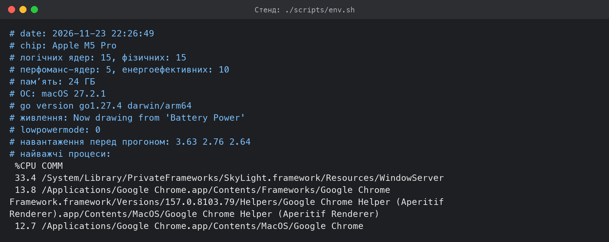

**Звідки параметри, які задає стенд, а не система.** n = 12, місткість 8192 і розмір `last` 16 узято з варіанта. D = 10 с, прогрів 1 с і 3 повтори задає умова. `GOMAXPROCS` лишено типовим (15): потоків 12, тож усі вони можуть виконуватися одночасно. Кількість потоків ролі (6 і 6) і пропорція в X_1 (6 : 6 = 1 : 1) випливають із n. Пауза 5 с між прогонами обрана, щоб прогін не починався з розігрітого попереднім прогоном процесора; кількість подій у вікні не задається, її визначає система.

# Проєктування (до коду)

Первинний проєкт зафіксовано в `README.md` до написання коду; нижче його зміст і окремо те, що змінилося під час реалізації.

**Мова.** Go. Python 3.9 на цій машині має GIL, тож RWLock на `threading.Condition` не дав би паралельного читання; Go дає справжній паралелізм, а політика стандартного `sync.RWMutex` описана в документації.

**Структура.** Масив `[8192]Event`, індекс `head`, лічильник `count = min(записів, 8192)` і лічильник `seq`. Подія має номер (`Seq`, присвоюється під замком, строго зростає), час, тип і код. `append` під замком запису збільшує `seq`, кладе подію в `buf[head]`, зсуває `head` по колу. `last(16)` під замком читання копіює до 16 найновіших подій від новішої до старішої в буфер викликаючого потоку (під замком немає виділення памʼяті) і нічого не присвоює полям структури.

**Синхронізація.** Параметр запуску `-lock global|rw`: один `sync.Mutex` для обох операцій або `sync.RWMutex` (`Lock` для запису, `RLock` для читання).

**Стенд.** Горутини, закріплені на потоках ОС (`runtime.LockOSThread`). Для кожної операції беруться `t_call`, `t_acq`, `t_ret` з монотонного годинника, зберігаються τ і t_wait кожної операції; перцентилі точні: p_q = τ_(⌈q·N⌉) на відсортованому списку. Режими: `run`, `x1`, `cs`, `clock`.

**Що змінилося під час реалізації.**

| Було в проєкті | Стало | Чому |
|---|---|---|
| Подія: номер, час, тип, код | додано поле `Sum` (контрольна сума) | виявляє напівзаписану подію, яку номери самі не виявили б |
| `last` повертає події | повертає ще й розмір буфера | перевірка k = min(16, розмір) |
| Один лічильник порушень | два: інваріант умови і додаткові (без пропусків, суми, k, монотонність номера в потоці) | додаткові перевірки сильніші за умову |
| `time.Now()` для позначок | `time.Since(t0)` (монотонна складова `time.Now()`) | дешевше: 10,9 нс проти 25,7 нс; обидва виміряно |
| Тривалості в одному зростаючому зрізі | шматки по 2^20 значень | щоб `append` не копіював сотні мегабайтів у вимірі |
| Операція, що почалась після кінця вікна, не враховується | вона виконується, у вимір не входить, у «усього append» входить | інакше сума append не збігалась би з `seq` |
| p50 у мікросекундах із десятковими долями | годинник macOS має крок 41,67 нс; усі окремі τ кратні цьому кроку | середні з точних сум крок не спотворює; p50 коротких операцій округлено до кроку (0,042; 0,083 мкс) |

*Лістинг 2 – Структура і операції, bench/ring.go*

```go
package main

import (
	"sync"
	"time"
)

// Кільцевий буфер останніх Cap подій сервісу (структура С6).
// Синхронізація — лише sync.Mutex (глобальний замок) або sync.RWMutex; готових колекцій немає.

const (
	Cap   = 8192 // місткість буфера (Variant_parametr_3 для варіанта 26)
	LastN = 16   // скільки подій повертає last
)

// Event — подія сервісу. Seq присвоюється під замком при append і строго зростає.
// Sum — контрольна сума решти полів: якщо читач побачить напівзаписану подію, сума не зійдеться.
type Event struct {
	Seq    uint64 // номер події
	TimeNs int64  // момент створення, нс від початку програми (монотонний годинник)
	Kind   uint32 // тип події
	Code   uint32 // код події
	Sum    uint64 // контрольна сума
}

func checksum(e *Event) uint64 {
	return e.Seq*0x9E3779B97F4A7C15 ^ uint64(e.TimeNs)*0xC2B2AE3D27D4EB4F ^ uint64(e.Kind)<<32 ^ uint64(e.Code)
}

// Ring — сам буфер. Поля змінюються лише у Append під замком запису.
type Ring struct {
	mu    sync.Mutex   // глобальний замок (режим global)
	rw    sync.RWMutex // замок читання-запису (режим rw)
	useRW bool

	buf   [Cap]Event
	head  int    // індекс комірки, куди піде наступний запис
	count int    // кількість заповнених комірок, min(записів, Cap)
	seq   uint64 // номер останньої події = кількість append
}

func NewRing(useRW bool) *Ring { return &Ring{useRW: useRW} }

// Stamps — моменти однієї операції (нс від початку програми).
type Stamps struct {
	Call, Acq, Rel, Ret int64
	WantRel             bool // брати Rel (момент перед звільненням замка), лише в режимі cs
}

var t0 = time.Now()

// now — монотонний годинник: time.Since(t0) читає монотонну складову time.Now().
func now() int64 { return int64(time.Since(t0)) }

// Append записує подію в буфер.
func (r *Ring) Append(e Event, tm *Stamps) {
	tm.Call = now()
	if r.useRW {
		r.rw.Lock()
	} else {
		r.mu.Lock()
	}
	tm.Acq = now()

	r.seq++
	e.Seq = r.seq
	e.Sum = checksum(&e)
	r.buf[r.head] = e
	r.head++
	if r.head == Cap {
		r.head = 0
	}
	if r.count < Cap {
		r.count++
	}

	if tm.WantRel {
		tm.Rel = now()
	}
	if r.useRW {
		r.rw.Unlock()
	} else {
		r.mu.Unlock()
	}
	tm.Ret = now()
}

// Last копіює до LastN найновіших подій у dst (від новішої до старішої) і повертає їх кількість k та
// розмір буфера на момент читання. Метод нічого не присвоює полям Ring: лише читає їх під RLock
// і пише в буфер dst, який належить викликаючому потоку.
func (r *Ring) Last(dst *[LastN]Event, tm *Stamps) (k, size int) {
	tm.Call = now()
	if r.useRW {
		r.rw.RLock()
	} else {
		r.mu.Lock()
	}
	tm.Acq = now()

	size = r.count
	k = size
	if k > LastN {
		k = LastN
	}
	i := r.head
	for j := 0; j < k; j++ {
		i--
		if i < 0 {
			i += Cap
		}
		dst[j] = r.buf[i]
	}

	if tm.WantRel {
		tm.Rel = now()
	}
	if r.useRW {
		r.rw.RUnlock()
	} else {
		r.mu.Unlock()
	}
	tm.Ret = now()
	return
}

// checkLast перевіряє результат last поза замком. v1 — інваріант умови (не більше 16 подій,
// номери строго спадають); v2 — додаткові перевірки: k = min(16, size), номери йдуть без пропусків,
// контрольні суми, номер найновішої події не менший за той, що бачив цей самий потік раніше.
func checkLast(dst *[LastN]Event, k, size int, prevTop *uint64) (v1, v2 int) {
	if k > LastN {
		v1++
	}
	for j := 1; j < k; j++ {
		if dst[j].Seq >= dst[j-1].Seq {
			v1++
		}
		if dst[j].Seq+1 != dst[j-1].Seq {
			v2++
		}
	}
	want := size
	if want > LastN {
		want = LastN
	}
	if k != want {
		v2++
	}
	for j := 0; j < k; j++ {
		if checksum(&dst[j]) != dst[j].Sum {
			v2++
		}
	}
	if k > 0 {
		if dst[0].Seq < *prevTop {
			v2++
		}
		*prevTop = dst[0].Seq
	}
	return
}

// FinalCheck — перевірка кінцевого стану (потоки зупинено, замок не потрібен).
type FinalCheck struct {
	TotalAppends uint64 `json:"total_appends"`
	FinalSeq     uint64 `json:"final_seq"`
	Size         int    `json:"size"`
	ExpectedSize int    `json:"expected_size"`
	Last16Len    int    `json:"last16_len"`
	Last16Top    uint64 `json:"last16_top_seq"`
	Last16OK     bool   `json:"last16_ok"`
	ScanOK       bool   `json:"scan_ok"`
	SeqEqualsN   bool   `json:"seq_equals_appends"`
	SizeOK       bool   `json:"size_ok"`
	AllOK        bool   `json:"all_ok"`
}

func (r *Ring) Final(totalAppends uint64) FinalCheck {
	fc := FinalCheck{TotalAppends: totalAppends, FinalSeq: r.seq, Size: r.count}
	fc.ExpectedSize = Cap
	if totalAppends < Cap {
		fc.ExpectedSize = int(totalAppends)
	}
	fc.SeqEqualsN = fc.FinalSeq == totalAppends
	fc.SizeOK = fc.Size == fc.ExpectedSize
	var dst [LastN]Event
	var tm Stamps
	k, size := r.Last(&dst, &tm)
	var top uint64
	v1, v2 := checkLast(&dst, k, size, &top)
	fc.Last16Len = k
	fc.Last16Top = top
	fc.Last16OK = v1 == 0 && v2 == 0 && top == totalAppends
	// повний обхід від найстарішої комірки до найновішої: номери без пропусків і правильні суми
	fc.ScanOK = true
	start := r.head - r.count
	if start < 0 {
		start += Cap
	}
	var prev uint64
	for j := 0; j < r.count; j++ {
		e := &r.buf[(start+j)%Cap]
		if checksum(e) != e.Sum || (j > 0 && e.Seq != prev+1) {
			fc.ScanOK = false
		}
		prev = e.Seq
	}
	if r.count > 0 && prev != r.seq {
		fc.ScanOK = false
	}
	fc.AllOK = fc.SeqEqualsN && fc.SizeOK && fc.Last16OK && fc.ScanOK
	return fc
}
```

# Крок 1. Побудова стенду

*Лістинг 3 – Стенд, bench/main.go*

```go
// Стенд ЛР 5: n потоків працюють з кільцевим буфером (С6). Непарні потоки пишуть, парні читають.
// Режими: run (n потоків), x1 (один потік по черзі пише і читає в пропорції n_w : n_r),
// cs (t_cs,w і t_cs,r одним потоком без конкуренції), clock (вартість читання годинника).
package main

import (
	"encoding/json"
	"flag"
	"fmt"
	"math"
	"os"
	"runtime"
	"slices"
	"sync"
	"time"
)

type thread struct {
	id        int
	role      string // "w", "r" або "alt"
	rec       [2]rec // 0 — запис, 1 — читання
	totalW    uint64 // усі append потоку, разом із прогрівом і операцією після кінця вікна
	totalR    uint64
	v1, v2    int
	lastRet   int64
	lastStamp Stamps
}

type ThreadOut struct {
	ID        int    `json:"id"`
	Role      string `json:"role"`
	Ops       uint64 `json:"ops"`
	TotalOps  uint64 `json:"total_ops_incl_warmup"`
	SumWaitNs int64  `json:"sum_wait_ns"`
	MaxWaitNs int64  `json:"max_wait_ns"`
	Viol      int    `json:"violations_last"`
	ViolExtra int    `json:"violations_extra"`
}

type Result struct {
	Mode        string      `json:"mode"`
	Lock        string      `json:"lock"`
	Run         int         `json:"run"`
	N           int         `json:"n"`
	Running     int         `json:"threads_running"`
	Nw          int         `json:"n_w"`
	Nr          int         `json:"n_r"`
	DSec        float64     `json:"d_s"`
	WarmSec     float64     `json:"warmup_s"`
	WindowSec   float64     `json:"window_actual_s"`
	GoVersion   string      `json:"go_version"`
	GOMAXPROCS  int         `json:"gomaxprocs"`
	NumCPU      int         `json:"num_cpu"`
	Threads     []ThreadOut `json:"threads"`
	Write       RoleStats   `json:"write"`
	Read        RoleStats   `json:"read"`
	X           float64     `json:"x_total"`
	PhiW        float64     `json:"phi_w"`
	PhiR        float64     `json:"phi_r"`
	Violations  int         `json:"violations_last_total"`
	ViolExtra   int         `json:"violations_extra_total"`
	Final       FinalCheck  `json:"final"`
	InvariantOK bool        `json:"invariants_ok"`
}

// xorshift64 — генератор аргументів кожного потоку (власний стан, без спільних даних).
type rng uint64

func (x *rng) next() uint64 {
	v := uint64(*x)
	v ^= v << 13
	v ^= v >> 7
	v ^= v << 17
	*x = rng(v)
	return v
}

func runThread(th *thread, r *Ring, startPtr, endPtr *int64, gate <-chan struct{}, wg *sync.WaitGroup, ratioW, ratioR int) {
	defer wg.Done()
	runtime.LockOSThread()
	defer runtime.UnlockOSThread()
	rg := rng(0x9E3779B97F4A7C15 * uint64(th.id+1))
	var tm Stamps
	var dst [LastN]Event
	var prevTop uint64
	<-gate // start і end записані головною горутиною до close(gate)
	start, end := *startPtr, *endPtr
	pos := 0 // для режиму alt: позиція в циклі з ratioW записів і ratioR читань
	for {
		write := th.role == "w"
		if th.role == "alt" {
			write = pos < ratioW
			pos++
			if pos == ratioW+ratioR {
				pos = 0
			}
		}
		if write {
			v := rg.next() // аргументи генеруються в потоці до виклику операції
			e := Event{TimeNs: th.lastRet, Kind: uint32(v & 7), Code: uint32(v >> 32)}
			r.Append(e, &tm)
			th.totalW++
		} else {
			k, size := r.Last(&dst, &tm)
			th.totalR++
			a, b := checkLast(&dst, k, size, &prevTop)
			th.v1 += a
			th.v2 += b
		}
		th.lastRet = tm.Ret
		if tm.Call >= end {
			break
		}
		if tm.Call >= start {
			i := 1
			if write {
				i = 0
			}
			th.rec[i].add(tm.Ret-tm.Call, tm.Acq-tm.Call)
		}
	}
}

func runBench(mode, lock string, n int, dSec, warmSec float64, run int) *Result {
	useRW := lock == "rw"
	nw, nr := (n+1)/2, n/2
	r := NewRing(useRW)
	nt := n // кількість запущених потоків; в x1 — один
	if mode == "x1" {
		nt = 1
	}
	threads := make([]*thread, nt)
	gate := make(chan struct{})
	var wg sync.WaitGroup
	ratioW, ratioR := 1, 1
	if mode == "x1" {
		g := gcd(nw, nr)
		ratioW, ratioR = nw/g, nr/g
	}
	var start, end int64 // початок і кінець вимірювання, нс від t0
	for i := 0; i < nt; i++ {
		role := "r"
		if (i+1)%2 == 1 {
			role = "w"
		}
		if mode == "x1" {
			role = "alt"
		}
		threads[i] = &thread{id: i + 1, role: role}
	}
	startPtr, endPtr := &start, &end
	for _, th := range threads {
		wg.Add(1)
		go runThread(th, r, startPtr, endPtr, gate, &wg, ratioW, ratioR)
	}
	time.Sleep(200 * time.Millisecond) // дати потокам стати на брамі
	s := now() + int64(warmSec*1e9)
	*startPtr, *endPtr = s, s+int64(dSec*1e9)
	close(gate)
	wg.Wait()

	res := &Result{Mode: mode, Lock: lock, Run: run, N: n, Running: nt, Nw: nw, Nr: nr, DSec: dSec, WarmSec: warmSec,
		WindowSec: dSec, GoVersion: runtime.Version(), GOMAXPROCS: runtime.GOMAXPROCS(0), NumCPU: runtime.NumCPU()}
	var wrec, rrec []*rec
	var totalW uint64
	for _, th := range threads {
		totalW += th.totalW
		var ops uint64
		var sw, mw int64
		for i := range th.rec {
			ops += th.rec[i].n
			sw += th.rec[i].sumWait
			if th.rec[i].maxWait > mw {
				mw = th.rec[i].maxWait
			}
		}
		res.Threads = append(res.Threads, ThreadOut{ID: th.id, Role: th.role, Ops: ops, TotalOps: th.totalW + th.totalR,
			SumWaitNs: sw, MaxWaitNs: mw, Viol: th.v1, ViolExtra: th.v2})
		res.Violations += th.v1
		res.ViolExtra += th.v2
		if th.role == "w" || th.role == "alt" {
			wrec = append(wrec, &th.rec[0])
		}
		if th.role == "r" || th.role == "alt" {
			rrec = append(rrec, &th.rec[1])
		}
	}
	res.Write = roleStats("w", wrec, dSec)
	res.Read = roleStats("r", rrec, dSec)
	res.X = res.Write.X + res.Read.X
	if res.X > 0 {
		res.PhiW, res.PhiR = res.Write.X/res.X, res.Read.X/res.X
	}
	res.Final = r.Final(totalW)
	res.InvariantOK = res.Final.AllOK && res.Violations == 0 && res.ViolExtra == 0
	return res
}

func gcd(a, b int) int {
	for b != 0 {
		a, b = b, a%b
	}
	return a
}

func ms(ns int64) float64  { return float64(ns) / 1e6 }
func us(ns uint32) float64 { return float64(ns) / 1e3 }

func printResult(res *Result) {
	fmt.Printf("== режим %s, замок %s, n = %d (n_w = %d, n_r = %d), потоків запущено %d, D = %g с, прогрів %g с, прогін %d\n",
		res.Mode, res.Lock, res.N, res.Nw, res.Nr, res.Running, res.DSec, res.WarmSec, res.Run)
	fmt.Printf("   %s, GOMAXPROCS = %d, логічних ядер = %d\n", res.GoVersion, res.GOMAXPROCS, res.NumCPU)
	if res.Mode == "run" {
		fmt.Println("   потік  роль     операцій за D   найбільший t_wait, мс")
		for _, t := range res.Threads {
			role := "запис"
			if t.Role == "r" {
				role = "читання"
			}
			fmt.Printf("   %5d  %-7s %14d   %10.3f\n", t.ID, role, t.Ops, ms(t.MaxWaitNs))
		}
	}
	for _, rs := range []RoleStats{res.Write, res.Read} {
		name := "запис"
		if rs.Role == "r" {
			name = "читання"
		}
		fmt.Printf("   %-8s N = %d  X = %.0f оп/с  p50 = %.3f мкс  p99 = %.3f мкс  p999 = %.3f мкс  max τ = %.3f мс\n",
			name, rs.N, rs.X, us(rs.P50Ns), us(rs.P99Ns), us(rs.P999Ns), ms(rs.MaxTauNs))
		fmt.Printf("            найбільший t_wait = %.3f мс  w = %.4f  cv = %.4f  середній t_wait = %.0f нс\n",
			ms(rs.MaxWaitNs), rs.W, rs.Cv, rs.MeanWaitNs)
	}
	fmt.Printf("   X = %.0f оп/с  φ_w = %.4f  φ_r = %.4f\n", res.X, res.PhiW, res.PhiR)
	f := res.Final
	fmt.Printf("   інваріанти: порушень last (≤16, строго спадають) = %d, додаткових (без пропусків, суми, k = min(16, розмір), монотонність) = %d\n",
		res.Violations, res.ViolExtra)
	fmt.Printf("   після прогону: усього append = %d, останній seq = %d (збігаються: %v), розмір = %d (очікується %d: %v)\n",
		f.TotalAppends, f.FinalSeq, f.SeqEqualsN, f.Size, f.ExpectedSize, f.SizeOK)
	fmt.Printf("   last(16) з кінцевого стану: %d подій, найновіша seq = %d, коректно: %v; повний обхід буфера коректний: %v\n",
		f.Last16Len, f.Last16Top, f.Last16OK, f.ScanOK)
	fmt.Printf("   ІНВАРІАНТИ: %s\n", map[bool]string{true: "виконано", false: "ПОРУШЕНО"}[res.InvariantOK])
}

// ---- режим cs: t_cs,w і t_cs,r одним потоком без конкуренції ----

type CSResult struct {
	Mode       string  `json:"mode"`
	Lock       string  `json:"lock"`
	Run        int     `json:"run"`
	Ops        int     `json:"ops_per_role"`
	WMeanNs    float64 `json:"t_cs_w_mean_ns"`
	WMedianNs  float64 `json:"t_cs_w_median_ns"`
	RMeanNs    float64 `json:"t_cs_r_mean_ns"`
	RMedianNs  float64 `json:"t_cs_r_median_ns"`
	WTauMeanNs float64 `json:"tau_w_mean_ns"`
	RTauMeanNs float64 `json:"tau_r_mean_ns"`
	ClockNs    float64 `json:"clock_ns"`
	GoVersion  string  `json:"go_version"`
}

func runCS(lock string, ops, run int) *CSResult {
	runtime.LockOSThread()
	defer runtime.UnlockOSThread()
	r := NewRing(lock == "rw")
	var tm Stamps
	tm.WantRel = true
	var rg rng = 12345
	w := make([]uint32, 0, ops)
	rd := make([]uint32, 0, ops)
	var sumTauW, sumTauR float64
	for i := 0; i < ops+100000; i++ { // 100000 операцій прогріву
		v := rg.next()
		r.Append(Event{Kind: uint32(v & 7), Code: uint32(v >> 32)}, &tm)
		if i >= 100000 {
			w = append(w, uint32(tm.Rel-tm.Acq))
			sumTauW += float64(tm.Ret - tm.Call)
		}
	}
	var dst [LastN]Event
	for i := 0; i < ops+100000; i++ {
		r.Last(&dst, &tm)
		if i >= 100000 {
			rd = append(rd, uint32(tm.Rel-tm.Acq))
			sumTauR += float64(tm.Ret - tm.Call)
		}
	}
	mean := func(x []uint32) float64 {
		var s float64
		for _, v := range x {
			s += float64(v)
		}
		return s / float64(len(x))
	}
	med := func(x []uint32) float64 { slices.Sort(x); return float64(x[len(x)/2]) }
	return &CSResult{Mode: "cs", Lock: lock, Run: run, Ops: ops, WMeanNs: mean(w), WMedianNs: med(w),
		RMeanNs: mean(rd), RMedianNs: med(rd), WTauMeanNs: sumTauW / float64(ops), RTauMeanNs: sumTauR / float64(ops),
		GoVersion: runtime.Version()}
}

// ---- режим clock: вартість вимірювання часу ----

type ClockResult struct {
	Mode          string  `json:"mode"`
	NowSinceNs    float64 `json:"time_since_ns"`
	TimeNowNs     float64 `json:"time_now_ns"`
	StampsPerOpNs float64 `json:"three_stamps_ns"`
	Reps          int     `json:"reps"`
}

var sink int64

func runClock(reps int) *ClockResult {
	runtime.LockOSThread()
	defer runtime.UnlockOSThread()
	best := func(f func() int64) float64 {
		b := math.MaxFloat64
		for k := 0; k < 5; k++ {
			s := time.Now()
			sink += f()
			d := float64(time.Since(s).Nanoseconds()) / float64(reps)
			if d < b {
				b = d
			}
		}
		return b
	}
	loop := best(func() int64 {
		var a int64
		for i := 0; i < reps; i++ {
			a += int64(i)
		}
		return a
	})
	since := best(func() int64 {
		var a int64
		for i := 0; i < reps; i++ {
			a += now()
		}
		return a
	})
	nowc := best(func() int64 {
		var a int64
		for i := 0; i < reps; i++ {
			a += time.Now().UnixNano() & 1
		}
		return a
	})
	return &ClockResult{Mode: "clock", NowSinceNs: since - loop, TimeNowNs: nowc - loop, StampsPerOpNs: 3 * (since - loop), Reps: reps}
}

func writeJSON(path string, v any) {
	if path == "" {
		return
	}
	b, err := json.MarshalIndent(v, "", " ")
	if err != nil {
		fmt.Fprintln(os.Stderr, err)
		os.Exit(1)
	}
	if err := os.WriteFile(path, b, 0o644); err != nil {
		fmt.Fprintln(os.Stderr, err)
		os.Exit(1)
	}
}

func main() {
	mode := flag.String("mode", "run", "run | x1 | cs | clock")
	lock := flag.String("lock", "global", "global | rw")
	n := flag.Int("n", 12, "кількість потоків")
	d := flag.Float64("d", 10, "тривалість вимірювання D, с")
	warm := flag.Float64("warm", 1, "прогрів, с")
	run := flag.Int("run", 1, "номер повторення")
	ops := flag.Int("ops", 5_000_000, "операцій кожної ролі в режимі cs")
	out := flag.String("out", "", "файл JSON з повним результатом")
	flag.Parse()
	if *lock != "global" && *lock != "rw" {
		fmt.Fprintln(os.Stderr, "-lock: global або rw")
		os.Exit(2)
	}
	switch *mode {
	case "run", "x1":
		res := runBench(*mode, *lock, *n, *d, *warm, *run)
		printResult(res)
		writeJSON(*out, res)
		if !res.InvariantOK {
			os.Exit(1)
		}
	case "cs":
		c := runCS(*lock, *ops, *run)
		c.ClockNs = runClock(20_000_000).NowSinceNs
		fmt.Printf("== режим cs, замок %s, прогін %d, %d операцій кожної ролі, %s\n", c.Lock, c.Run, c.Ops, c.GoVersion)
		fmt.Printf("   t_cs,w: середній %.1f нс, медіана %.1f нс; τ запису (від виклику до повернення) середня %.1f нс\n", c.WMeanNs, c.WMedianNs, c.WTauMeanNs)
		fmt.Printf("   t_cs,r: середній %.1f нс, медіана %.1f нс; τ читання середня %.1f нс\n", c.RMeanNs, c.RMedianNs, c.RTauMeanNs)
		writeJSON(*out, c)
	case "clock":
		c := runClock(20_000_000)
		fmt.Printf("== режим clock: вартість одного виклику, нс (мінімум із 5 серій по %d, мінус порожній цикл)\n", c.Reps)
		fmt.Printf("   time.Since(t0) (монотонний годинник, використовується стендом): %.1f нс\n", c.NowSinceNs)
		fmt.Printf("   time.Now() з перетворенням у UnixNano (стінний + монотонний): %.1f нс\n", c.TimeNowNs)
		fmt.Printf("   три позначки часу на одну операцію (t_call, t_acq, t_ret): %.1f нс\n", c.StampsPerOpNs)
		writeJSON(*out, c)
	default:
		fmt.Fprintln(os.Stderr, "невідомий режим")
		os.Exit(2)
	}
}
```

*Лістинг 4 – Збір тривалостей і перцентилів, bench/stats.go*

```go
package main

import (
	"math"
	"slices"
)

const chunkSize = 1 << 20

// col — стовпчик значень uint32 (нс), що росте шматками, щоб append не копіював мільйони елементів
// усередині вимірювання. Значення, більші за 4,29 с, насичуються (точний максимум рахується окремо).
type col struct {
	chunks [][]uint32
	cur    []uint32
}

func (c *col) add(v int64) {
	if len(c.cur) == cap(c.cur) {
		if c.cur != nil {
			c.chunks = append(c.chunks, c.cur)
		}
		c.cur = make([]uint32, 0, chunkSize)
	}
	if v < 0 {
		v = 0
	}
	if v > math.MaxUint32 {
		v = math.MaxUint32
	}
	c.cur = append(c.cur, uint32(v))
}

// rec — записи однієї ролі в одному потоці.
type rec struct {
	tau, wait       col
	n               uint64
	sumWait, sumTau int64
	maxWait, maxTau int64
}

func (x *rec) add(tau, wait int64) {
	x.tau.add(tau)
	x.wait.add(wait)
	x.n++
	x.sumTau += tau
	x.sumWait += wait
	if wait > x.maxWait {
		x.maxWait = wait
	}
	if tau > x.maxTau {
		x.maxTau = tau
	}
}

func gather(recs []*rec, pick func(*rec) *col) []uint32 {
	var n int
	for _, r := range recs {
		c := pick(r)
		for _, ch := range c.chunks {
			n += len(ch)
		}
		n += len(c.cur)
	}
	all := make([]uint32, 0, n)
	for _, r := range recs {
		c := pick(r)
		for _, ch := range c.chunks {
			all = append(all, ch...)
		}
		all = append(all, c.cur...)
	}
	return all
}

// quantile: p_q = x_(⌈q·N⌉) на відсортованому за зростанням списку (нумерація з 1).
func quantile(sorted []uint32, q float64) uint32 {
	n := len(sorted)
	if n == 0 {
		return 0
	}
	k := int(math.Ceil(q * float64(n)))
	if k < 1 {
		k = 1
	}
	if k > n {
		k = n
	}
	return sorted[k-1]
}

const histBuckets = 100 // 10 корзин на декаду: корзина b містить [10^(b/10), 10^((b+1)/10)) нс

func histogram(sorted []uint32) []int {
	h := make([]int, histBuckets)
	for _, v := range sorted {
		b := 0
		if v > 1 {
			b = int(math.Floor(10 * math.Log10(float64(v))))
		}
		if b >= histBuckets {
			b = histBuckets - 1
		}
		h[b]++
	}
	return h
}

type RoleStats struct {
	Role       string  `json:"role"`
	Threads    int     `json:"threads"`
	N          uint64  `json:"n_ops"`
	X          float64 `json:"x_ops_per_s"`
	XPerThread float64 `json:"x_per_thread"`
	P50Ns      uint32  `json:"p50_ns"`
	P90Ns      uint32  `json:"p90_ns"`
	P99Ns      uint32  `json:"p99_ns"`
	P999Ns     uint32  `json:"p999_ns"`
	MaxTauNs   int64   `json:"max_tau_ns"`
	MeanTauNs  float64 `json:"mean_tau_ns"`
	SumWaitNs  int64   `json:"sum_wait_ns"`
	MaxWaitNs  int64   `json:"max_wait_ns"`
	MeanWaitNs float64 `json:"mean_wait_ns"`
	WaitP50Ns  uint32  `json:"wait_p50_ns"`
	WaitP99Ns  uint32  `json:"wait_p99_ns"`
	W          float64 `json:"w"`
	Cv         float64 `json:"cv"`
	HistTau    []int   `json:"hist_tau"`
	HistWait   []int   `json:"hist_wait"`
}

// roleStats рахує метрики ролі за записами її потоків; d — тривалість вимірювання, с.
func roleStats(name string, recs []*rec, d float64) RoleStats {
	rs := RoleStats{Role: name, Threads: len(recs)}
	var sumTau int64
	counts := make([]float64, len(recs))
	for i, r := range recs {
		rs.N += r.n
		rs.SumWaitNs += r.sumWait
		sumTau += r.sumTau
		if r.maxWait > rs.MaxWaitNs {
			rs.MaxWaitNs = r.maxWait
		}
		if r.maxTau > rs.MaxTauNs {
			rs.MaxTauNs = r.maxTau
		}
		counts[i] = float64(r.n)
	}
	if len(recs) == 0 || rs.N == 0 {
		return rs
	}
	k := float64(len(recs))
	rs.X = float64(rs.N) / d
	rs.XPerThread = rs.X / k
	rs.MeanTauNs = float64(sumTau) / float64(rs.N)
	rs.MeanWaitNs = float64(rs.SumWaitNs) / float64(rs.N)
	rs.W = float64(rs.SumWaitNs) / 1e9 / (k * d)
	mu := float64(rs.N) / k
	var ss float64
	for _, c := range counts {
		ss += (c - mu) * (c - mu)
	}
	if mu > 0 {
		rs.Cv = math.Sqrt(ss/k) / mu
	}
	tau := gather(recs, func(r *rec) *col { return &r.tau })
	slices.Sort(tau)
	rs.P50Ns, rs.P90Ns, rs.P99Ns, rs.P999Ns = quantile(tau, 0.5), quantile(tau, 0.9), quantile(tau, 0.99), quantile(tau, 0.999)
	rs.HistTau = histogram(tau)
	tau = nil
	wt := gather(recs, func(r *rec) *col { return &r.wait })
	slices.Sort(wt)
	rs.WaitP50Ns, rs.WaitP99Ns = quantile(wt, 0.5), quantile(wt, 0.99)
	rs.HistWait = histogram(wt)
	return rs
}
```

*Лістинг 5 – Модуль Go, bench/go.mod*

```text
module ringbench

go 1.21
```

**Як вимірюється.** Головна горутина ставить моменти початку і кінця вимірювання (початок = старт + 1 с прогріву, кінець = початок + 10 с) і відкриває браму; усі 12 потоків стартують одночасно. Операція входить у вимір, якщо її `t_call` лежить у вікні. Аргументи події (тип і код) генеруються в потоці до виклику, час події береться з `t_ret` попередньої операції (додаткового виклику годинника немає). Перевірка результату `last` виконується в потоці після повернення з операції, тобто поза τ, але між операціями, тому трохи збільшує паузу читача між викликами.

**Накладні витрати вимірювання часу.** Режим `clock` вимірює вартість виклику: найкращий із 5 серій по 20 млн викликів мінус порожній цикл.

| Вимір | нс на виклик |
|---|---|
| time.Since(t0): монотонний годинник, 1 позначка стенду | 10.9 |
| time.Now() з UnixNano (стінний і монотонний годинники) | 25.7 |
| 3 позначки на операцію (t_call, t_acq, t_ret) | 32.6 |

На одну операцію приходиться три позначки (≈ 33 нс), що порівнянно з самою операцією (середня τ в одному потоці ≈ 41–44 нс, див. крок 2). Позначка t_acq береться всередині замка, тому вимірювання подовжує критичну секцію приблизно на одне читання годинника (≈ 11 нс). Це однаково діє на обидва способи синхронізації. Крок годинника macOS 41,67 нс: окремі τ і t_wait кратні йому, p50 запису 0,042 мкс і читання 0,083 мкс означають одну і дві «клітинки» годинника, а не точну тривалість; точними є середні (з сум нс) і значення p99.

Режим X_1: один потік виконує записи і читання по черзі, 1 : 1 (n_w : n_r = 6 : 6), під тим самим замком, 1 с прогріву і D = 10 с, 3 повтори по кожному замку.

*Лістинг 6 – Крок 1, scripts/step1.sh*

```bash
#!/usr/bin/env bash
# Крок 1: вартість вимірювання часу, t_cs і X_1 (один потік по черзі пише і читає, n_w : n_r = 6 : 6 = 1 : 1).
source "$(dirname "$0")/lib.sh"
build
echo '$ bin/ringbench -mode clock'
"$BIN" -mode clock -out "$RAW/clock.json"
for lk in global rw; do
  for i in $(seq 1 $REPS); do
    echo
    echo "\$ bin/ringbench -mode x1 -lock $lk -n $N -d $D -warm $WARM -run $i"
    load_line
    "$BIN" -mode x1 -lock $lk -n $N -d $D -warm $WARM -run $i -out "$RAW/x1_${lk}_$i.json"
    sleep $PAUSE
  done
done
```

*Лістинг 7 – Спільні змінні скриптів, scripts/lib.sh*

```bash
#!/usr/bin/env bash
# Спільні змінні й функції кроків. Підключається через `source`.
set -eu
LAB="$(cd "$(dirname "${BASH_SOURCE[0]}")/.." && pwd)"
GO=/opt/homebrew/bin/go
[ -x "$GO" ] || GO="$(command -v go)"
BIN="$LAB/bin/ringbench"
RAW="$LAB/results/raw"
N=12          # потоків стенду (варіант 26)
D=10          # тривалість вимірювання, с
WARM=1        # прогрів, с
REPS=3        # повторів
PAUSE=5       # пауза між прогонами, с (щоб кожен прогін починався з тих самих умов)
mkdir -p "$RAW" "$LAB/results/tables" "$LAB/bin"

build() { ( cd "$LAB/bench" && "$GO" build -o "$BIN" . ); }

# load_line: навантаження машини перед прогоном (щоб у журналі було видно, що вона вільна)
load_line() { echo "# навантаження перед прогоном: $(uptime | sed 's/.*load averages*: //')"; }
```

*Лістинг 8 – Вивід кроку 1, results/step1.log*

```text
$ bin/ringbench -mode clock
== режим clock: вартість одного виклику, нс (мінімум із 5 серій по 20000000, мінус порожній цикл)
   time.Since(t0) (монотонний годинник, використовується стендом): 10.9 нс
   time.Now() з перетворенням у UnixNano (стінний + монотонний): 25.7 нс
   три позначки часу на одну операцію (t_call, t_acq, t_ret): 32.6 нс

$ bin/ringbench -mode x1 -lock global -n 12 -d 10 -warm 1 -run 1
# навантаження перед прогоном: 3.44 2.76 2.64
== режим x1, замок global, n = 12 (n_w = 6, n_r = 6), потоків запущено 1, D = 10 с, прогрів 1 с, прогін 1
   go1.27.4, GOMAXPROCS = 15, логічних ядер = 15
   запис    N = 93682438  X = 9368244 оп/с  p50 = 0.041 мкс  p99 = 0.042 мкс  p999 = 0.125 мкс  max τ = 2.113 мс
            найбільший t_wait = 0.343 мс  w = 0.1389  cv = 0.0000  середній t_wait = 15 нс
   читання  N = 93682438  X = 9368244 оп/с  p50 = 0.042 мкс  p99 = 0.042 мкс  p999 = 0.125 мкс  max τ = 1.083 мс
            найбільший t_wait = 1.082 мс  w = 0.1396  cv = 0.0000  середній t_wait = 15 нс
   X = 18736488 оп/с  φ_w = 0.5000  φ_r = 0.5000
   інваріанти: порушень last (≤16, строго спадають) = 0, додаткових (без пропусків, суми, k = min(16, розмір), монотонність) = 0
   після прогону: усього append = 103779057, останній seq = 103779057 (збігаються: true), розмір = 8192 (очікується 8192: true)
   last(16) з кінцевого стану: 16 подій, найновіша seq = 103779057, коректно: true; повний обхід буфера коректний: true
   ІНВАРІАНТИ: виконано

$ bin/ringbench -mode x1 -lock global -n 12 -d 10 -warm 1 -run 2
# навантаження перед прогоном: 3.85 2.88 2.69
== режим x1, замок global, n = 12 (n_w = 6, n_r = 6), потоків запущено 1, D = 10 с, прогрів 1 с, прогін 2
   go1.27.4, GOMAXPROCS = 15, логічних ядер = 15
   запис    N = 98250524  X = 9825052 оп/с  p50 = 0.041 мкс  p99 = 0.042 мкс  p999 = 0.084 мкс  max τ = 0.141 мс
            найбільший t_wait = 0.141 мс  w = 0.1404  cv = 0.0000  середній t_wait = 14 нс
   читання  N = 98250524  X = 9825052 оп/с  p50 = 0.042 мкс  p99 = 0.042 мкс  p999 = 0.125 мкс  max τ = 1.270 мс
            найбільший t_wait = 1.270 мс  w = 0.1410  cv = 0.0000  середній t_wait = 14 нс
   X = 19650105 оп/с  φ_w = 0.5000  φ_r = 0.5000
   інваріанти: порушень last (≤16, строго спадають) = 0, додаткових (без пропусків, суми, k = min(16, розмір), монотонність) = 0
   після прогону: усього append = 108483292, останній seq = 108483292 (збігаються: true), розмір = 8192 (очікується 8192: true)
   last(16) з кінцевого стану: 16 подій, найновіша seq = 108483292, коректно: true; повний обхід буфера коректний: true
   ІНВАРІАНТИ: виконано

$ bin/ringbench -mode x1 -lock global -n 12 -d 10 -warm 1 -run 3
# навантаження перед прогоном: 3.96 2.97 2.72
== режим x1, замок global, n = 12 (n_w = 6, n_r = 6), потоків запущено 1, D = 10 с, прогрів 1 с, прогін 3
   go1.27.4, GOMAXPROCS = 15, логічних ядер = 15
   запис    N = 99714184  X = 9971418 оп/с  p50 = 0.041 мкс  p99 = 0.042 мкс  p999 = 0.083 мкс  max τ = 0.066 мс
            найбільший t_wait = 0.056 мс  w = 0.1407  cv = 0.0000  середній t_wait = 14 нс
   читання  N = 99714183  X = 9971418 оп/с  p50 = 0.042 мкс  p99 = 0.042 мкс  p999 = 0.083 мкс  max τ = 0.099 мс
            найбільший t_wait = 0.099 мс  w = 0.1415  cv = 0.0000  середній t_wait = 14 нс
   X = 19942837 оп/с  φ_w = 0.5000  φ_r = 0.5000
   інваріанти: порушень last (≤16, строго спадають) = 0, додаткових (без пропусків, суми, k = min(16, розмір), монотонність) = 0
   після прогону: усього append = 109562527, останній seq = 109562527 (збігаються: true), розмір = 8192 (очікується 8192: true)
   last(16) з кінцевого стану: 16 подій, найновіша seq = 109562527, коректно: true; повний обхід буфера коректний: true
   ІНВАРІАНТИ: виконано

$ bin/ringbench -mode x1 -lock rw -n 12 -d 10 -warm 1 -run 1
# навантаження перед прогоном: 3.51 2.94 2.72
== режим x1, замок rw, n = 12 (n_w = 6, n_r = 6), потоків запущено 1, D = 10 с, прогрів 1 с, прогін 1
   go1.27.4, GOMAXPROCS = 15, логічних ядер = 15
   запис    N = 93528853  X = 9352885 оп/с  p50 = 0.042 мкс  p99 = 0.042 мкс  p999 = 0.125 мкс  max τ = 5.844 мс
            найбільший t_wait = 0.823 мс  w = 0.1467  cv = 0.0000  середній t_wait = 16 нс
   читання  N = 93528852  X = 9352885 оп/с  p50 = 0.042 мкс  p99 = 0.042 мкс  p999 = 0.125 мкс  max τ = 2.894 мс
            найбільший t_wait = 2.097 мс  w = 0.1356  cv = 0.0000  середній t_wait = 14 нс
   X = 18705770 оп/с  φ_w = 0.5000  φ_r = 0.5000
   інваріанти: порушень last (≤16, строго спадають) = 0, додаткових (без пропусків, суми, k = min(16, розмір), монотонність) = 0
   після прогону: усього append = 103588067, останній seq = 103588067 (збігаються: true), розмір = 8192 (очікується 8192: true)
   last(16) з кінцевого стану: 16 подій, найновіша seq = 103588067, коректно: true; повний обхід буфера коректний: true
   ІНВАРІАНТИ: виконано

$ bin/ringbench -mode x1 -lock rw -n 12 -d 10 -warm 1 -run 2
# навантаження перед прогоном: 2.91 2.84 2.69
== режим x1, замок rw, n = 12 (n_w = 6, n_r = 6), потоків запущено 1, D = 10 с, прогрів 1 с, прогін 2
   go1.27.4, GOMAXPROCS = 15, логічних ядер = 15
   запис    N = 95574531  X = 9557453 оп/с  p50 = 0.042 мкс  p99 = 0.042 мкс  p999 = 0.125 мкс  max τ = 0.250 мс
            найбільший t_wait = 0.114 мс  w = 0.1476  cv = 0.0000  середній t_wait = 15 нс
   читання  N = 95574531  X = 9557453 оп/с  p50 = 0.042 мкс  p99 = 0.042 мкс  p999 = 0.125 мкс  max τ = 0.829 мс
            найбільший t_wait = 0.829 мс  w = 0.1372  cv = 0.0000  середній t_wait = 14 нс
   X = 19114906 оп/с  φ_w = 0.5000  φ_r = 0.5000
   інваріанти: порушень last (≤16, строго спадають) = 0, додаткових (без пропусків, суми, k = min(16, розмір), монотонність) = 0
   після прогону: усього append = 105257135, останній seq = 105257135 (збігаються: true), розмір = 8192 (очікується 8192: true)
   last(16) з кінцевого стану: 16 подій, найновіша seq = 105257135, коректно: true; повний обхід буфера коректний: true
   ІНВАРІАНТИ: виконано

$ bin/ringbench -mode x1 -lock rw -n 12 -d 10 -warm 1 -run 3
# навантаження перед прогоном: 2.42 2.74 2.65
== режим x1, замок rw, n = 12 (n_w = 6, n_r = 6), потоків запущено 1, D = 10 с, прогрів 1 с, прогін 3
   go1.27.4, GOMAXPROCS = 15, логічних ядер = 15
   запис    N = 97286514  X = 9728651 оп/с  p50 = 0.042 мкс  p99 = 0.042 мкс  p999 = 0.084 мкс  max τ = 0.080 мс
            найбільший t_wait = 0.080 мс  w = 0.1471  cv = 0.0000  середній t_wait = 15 нс
   читання  N = 97286513  X = 9728651 оп/с  p50 = 0.042 мкс  p99 = 0.042 мкс  p999 = 0.084 мкс  max τ = 0.108 мс
            найбільший t_wait = 0.108 мс  w = 0.1365  cv = 0.0000  середній t_wait = 14 нс
   X = 19457303 оп/с  φ_w = 0.5000  φ_r = 0.5000
   інваріанти: порушень last (≤16, строго спадають) = 0, додаткових (без пропусків, суми, k = min(16, розмір), монотонність) = 0
   після прогону: усього append = 106913260, останній seq = 106913260 (збігаються: true), розмір = 8192 (очікується 8192: true)
   last(16) з кінцевого стану: 16 подій, найновіша seq = 106913260, коректно: true; повний обхід буфера коректний: true
   ІНВАРІАНТИ: виконано
```

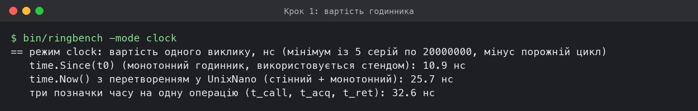

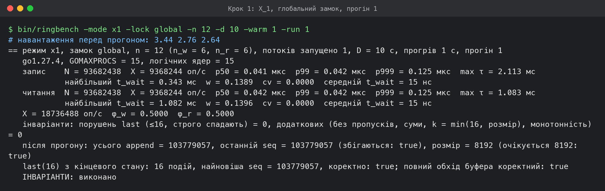

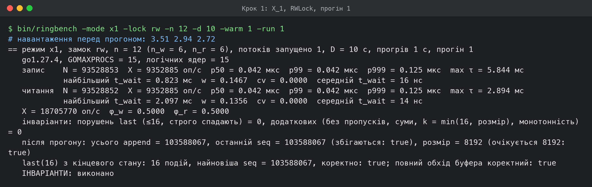

Усі шість прогонів X_1 (з `results/raw/x1_*.json`):

| Замок | Прогін | Записів за D | Читань за D | X_1, оп/с | Інваріанти |
|---|---|---|---|---|---|
| Глобальний замок | 1 | 93 682 438 | 93 682 438 | 18 736 488 | так |
| Глобальний замок | 2 | 98 250 524 | 98 250 524 | 19 650 105 | так |
| Глобальний замок | 3 | 99 714 184 | 99 714 183 | 19 942 837 | так |
| RWLock | 1 | 93 528 853 | 93 528 852 | 18 705 770 | так |
| RWLock | 2 | 95 574 531 | 95 574 531 | 19 114 906 | так |
| RWLock | 3 | 97 286 514 | 97 286 513 | 19 457 303 | так |

Таблиця 1. Стенд (X_1 — медіана трьох прогонів; інваріанти — за прогонами кроків 2 і 3, 6 прогонів)

| n | n_w | n_r | Мова і версія | Логічних ядер | X_1, оп/с | Інваріанти після прогонів кроків 2 і 3 |
|---|---|---|---|---|---|---|
| 12 | 6 | 6 | Go 1.27.4 | 15 | 19 650 105 (глобальний замок), 19 114 906 (RWLock) | виконано в 6 з 6 прогонів; порушень last: 0 |

X_1 під глобальним замком і під RWLock майже однакові: один потік не конкурує, і різниця вартості `Lock/Unlock` та `RLock/RUnlock` мала. Отже подальша різниця між замками виникає лише від конкуренції потоків. Ці X_1 включають вартість трьох позначок часу, перевірки результату `last` і генерації аргументів, тому на операцію приходиться близько 51 нс.

# Крок 2. Глобальний замок

Кожна операція захоплює той самий `sync.Mutex` на весь час роботи зі структурою (`Append` і `Last` у лістингу вище при `useRW == false`). Спочатку одним потоком без конкуренції виміряно t_cs,w і t_cs,r: від моменту після отримання замка (`t_acq`) до моменту безпосередньо перед його звільненням (`t_rel`, береться лише в режимі `cs`). Спершу виконується 100 тис. записів прогріву й 5 млн записів, потім 100 тис. читань прогріву й 5 млн читань уже в заповненому буфері. Потім 3 прогони по n = 12 потоків.

*Лістинг 9 – Крок 2, scripts/step2.sh*

```bash
#!/usr/bin/env bash
# Крок 2: глобальний замок. t_cs,w і t_cs,r одним потоком, потім 3 прогони по D секунд на n потоках.
source "$(dirname "$0")/lib.sh"
build
for i in $(seq 1 $REPS); do
  echo "\$ bin/ringbench -mode cs -lock global -run $i"
  "$BIN" -mode cs -lock global -run $i -out "$RAW/cs_global_$i.json"
done
for i in $(seq 1 $REPS); do
  echo
  echo "\$ bin/ringbench -mode run -lock global -n $N -d $D -warm $WARM -run $i"
  load_line
  "$BIN" -mode run -lock global -n $N -d $D -warm $WARM -run $i -out "$RAW/run_global_$i.json"
  sleep $PAUSE
done
```

*Лістинг 10 – Вивід кроку 2, results/step2.log*

```text
$ bin/ringbench -mode cs -lock global -run 1
== режим cs, замок global, прогін 1, 5000000 операцій кожної ролі, go1.27.4
   t_cs,w: середній 12.0 нс, медіана 0.0 нс; τ запису (від виклику до повернення) середня 40.7 нс
   t_cs,r: середній 15.1 нс, медіана 0.0 нс; τ читання середня 43.7 нс
$ bin/ringbench -mode cs -lock global -run 2
== режим cs, замок global, прогін 2, 5000000 операцій кожної ролі, go1.27.4
   t_cs,w: середній 12.1 нс, медіана 0.0 нс; τ запису (від виклику до повернення) середня 40.3 нс
   t_cs,r: середній 14.7 нс, медіана 0.0 нс; τ читання середня 42.7 нс
$ bin/ringbench -mode cs -lock global -run 3
== режим cs, замок global, прогін 3, 5000000 операцій кожної ролі, go1.27.4
   t_cs,w: середній 12.3 нс, медіана 0.0 нс; τ запису (від виклику до повернення) середня 41.6 нс
   t_cs,r: середній 15.4 нс, медіана 0.0 нс; τ читання середня 44.5 нс

$ bin/ringbench -mode run -lock global -n 12 -d 10 -warm 1 -run 1
# навантаження перед прогоном: 2.81 2.81 2.68
== режим run, замок global, n = 12 (n_w = 6, n_r = 6), потоків запущено 12, D = 10 с, прогрів 1 с, прогін 1
   go1.27.4, GOMAXPROCS = 15, логічних ядер = 15
   потік  роль     операцій за D   найбільший t_wait, мс
       1  запис          7487491        5.411
       2  читання        4975951        6.741
       3  запис          7585200        6.952
       4  читання        4973930        7.135
       5  запис          7647237        7.062
       6  читання        4972801        6.896
       7  запис          7556985        6.487
       8  читання        4970093        7.220
       9  запис          7656185        5.103
      10  читання        4995317        3.885
      11  запис          7495705        6.819
      12  читання        4999229        6.953
   запис    N = 45428803  X = 4542880 оп/с  p50 = 0.042 мкс  p99 = 44.167 мкс  p999 = 164.041 мкс  max τ = 7.062 мс
            найбільший t_wait = 7.062 мс  w = 0.8384  cv = 0.0087  середній t_wait = 1107 нс
   читання  N = 29887321  X = 2988732 оп/с  p50 = 0.083 мкс  p99 = 65.625 мкс  p999 = 188.792 мкс  max τ = 7.221 мс
            найбільший t_wait = 7.220 мс  w = 0.8654  cv = 0.0023  середній t_wait = 1737 нс
   X = 7531612 оп/с  φ_w = 0.6032  φ_r = 0.3968
   інваріанти: порушень last (≤16, строго спадають) = 0, додаткових (без пропусків, суми, k = min(16, розмір), монотонність) = 0
   після прогону: усього append = 49978672, останній seq = 49978672 (збігаються: true), розмір = 8192 (очікується 8192: true)
   last(16) з кінцевого стану: 16 подій, найновіша seq = 49978672, коректно: true; повний обхід буфера коректний: true
   ІНВАРІАНТИ: виконано

$ bin/ringbench -mode run -lock global -n 12 -d 10 -warm 1 -run 2
# навантаження перед прогоном: 4.32 3.17 2.81
== режим run, замок global, n = 12 (n_w = 6, n_r = 6), потоків запущено 12, D = 10 с, прогрів 1 с, прогін 2
   go1.27.4, GOMAXPROCS = 15, логічних ядер = 15
   потік  роль     операцій за D   найбільший t_wait, мс
       1  запис          7621997        8.526
       2  читання        5197356        7.664
       3  запис          7610619        7.281
       4  читання        5178670        8.055
       5  запис          8145137        7.402
       6  читання        5178042        7.465
       7  запис          7675045        6.091
       8  читання        5139157        6.186
       9  запис          7790631        7.509
      10  читання        5098424        5.810
      11  запис          8059507        8.484
      12  читання        4988027        7.726
   запис    N = 46902936  X = 4690294 оп/с  p50 = 0.042 мкс  p99 = 41.625 мкс  p999 = 168.291 мкс  max τ = 11.244 мс
            найбільший t_wait = 8.526 мс  w = 0.8336  cv = 0.0270  середній t_wait = 1066 нс
   читання  N = 30779676  X = 3077968 оп/с  p50 = 0.083 мкс  p99 = 63.667 мкс  p999 = 194.875 мкс  max τ = 8.904 мс
            найбільший t_wait = 8.055 мс  w = 0.8599  cv = 0.0139  середній t_wait = 1676 нс
   X = 7768261 оп/с  φ_w = 0.6038  φ_r = 0.3962
   інваріанти: порушень last (≤16, строго спадають) = 0, додаткових (без пропусків, суми, k = min(16, розмір), монотонність) = 0
   після прогону: усього append = 51561972, останній seq = 51561972 (збігаються: true), розмір = 8192 (очікується 8192: true)
   last(16) з кінцевого стану: 16 подій, найновіша seq = 51561972, коректно: true; повний обхід буфера коректний: true
   ІНВАРІАНТИ: виконано

$ bin/ringbench -mode run -lock global -n 12 -d 10 -warm 1 -run 3
# навантаження перед прогоном: 5.68 3.59 2.97
== режим run, замок global, n = 12 (n_w = 6, n_r = 6), потоків запущено 12, D = 10 с, прогрів 1 с, прогін 3
   go1.27.4, GOMAXPROCS = 15, логічних ядер = 15
   потік  роль     операцій за D   найбільший t_wait, мс
       1  запис          7703361        0.970
       2  читання        4993159        0.965
       3  запис          7564343        1.025
       4  читання        5005452        1.238
       5  запис          7573264        0.983
       6  читання        5031493        1.208
       7  запис          7699138        1.117
       8  читання        5089451        1.130
       9  запис          7653773        1.844
      10  читання        5089557        1.816
      11  запис          7680694        1.089
      12  читання        5068635        1.490
   запис    N = 45874573  X = 4587457 оп/с  p50 = 0.042 мкс  p99 = 44.209 мкс  p999 = 164.625 мкс  max τ = 1.844 мс
            найбільший t_wait = 1.844 мс  w = 0.8364  cv = 0.0074  середній t_wait = 1094 нс
   читання  N = 30277747  X = 3027775 оп/с  p50 = 0.083 мкс  p99 = 65.500 мкс  p999 = 188.584 мкс  max τ = 1.816 мс
            найбільший t_wait = 1.816 мс  w = 0.8630  cv = 0.0077  середній t_wait = 1710 нс
   X = 7615232 оп/с  φ_w = 0.6024  φ_r = 0.3976
   інваріанти: порушень last (≤16, строго спадають) = 0, додаткових (без пропусків, суми, k = min(16, розмір), монотонність) = 0
   після прогону: усього append = 50552317, останній seq = 50552317 (збігаються: true), розмір = 8192 (очікується 8192: true)
   last(16) з кінцевого стану: 16 подій, найновіша seq = 50552317, коректно: true; повний обхід буфера коректний: true
   ІНВАРІАНТИ: виконано
```

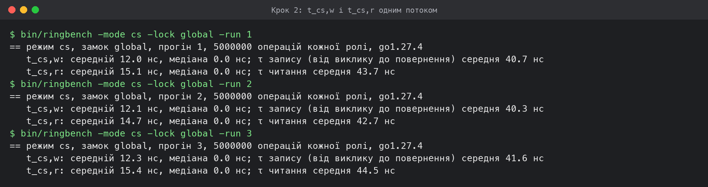

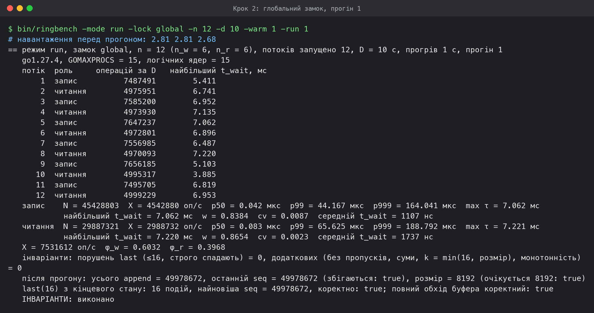

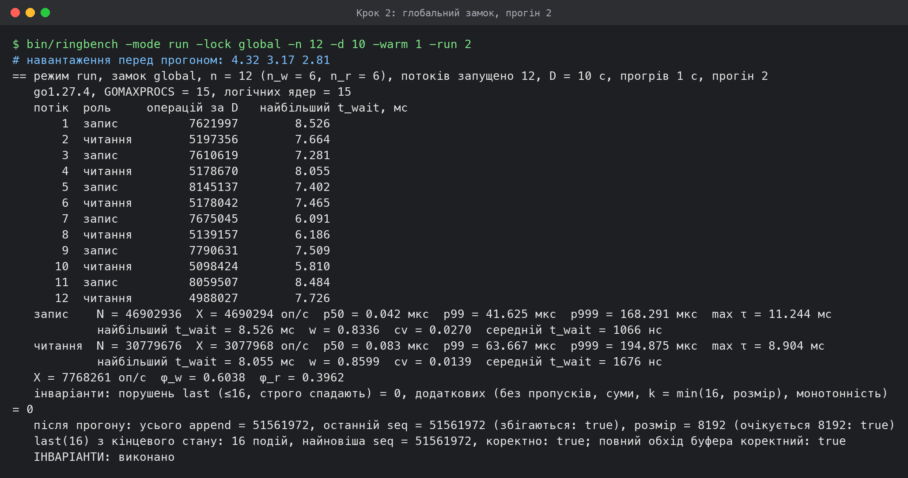

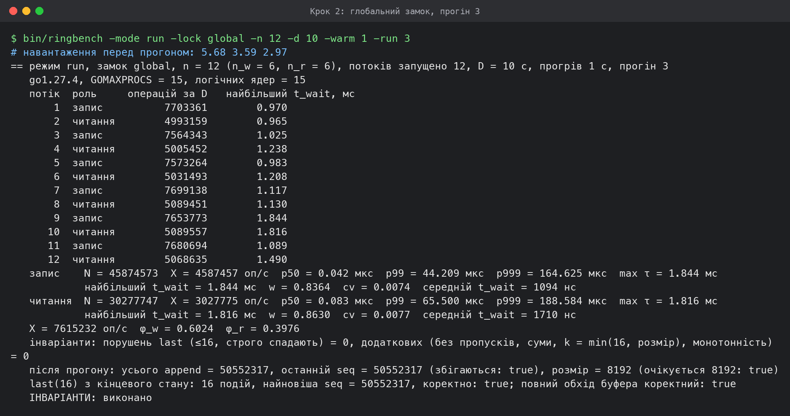

Усі шість прогонів на n потоках (обидва замки, з `results/raw/run_*.json`) і t_cs по прогонах:

| Замок | Прогін | N_w | N_r | X, оп/с | p50 запису, мкс | p99 запису, мкс | p50 читання, мкс | p99 читання, мкс | t_wait,max, мс | w_w | w_r | cv_w | cv_r | Інваріанти |
|---|---|---|---|---|---|---|---|---|---|---|---|---|---|---|
| Глобальний замок | 1 | 45 428 803 | 29 887 321 | 7 531 612 | 0.042 | 44.2 | 0.083 | 65.6 | 7.062 | 0.8384 | 0.8654 | 0.0087 | 0.0023 | так |
| Глобальний замок | 2 | 46 902 936 | 30 779 676 | 7 768 261 | 0.042 | 41.6 | 0.083 | 63.7 | 8.526 | 0.8336 | 0.8599 | 0.0270 | 0.0139 | так |
| Глобальний замок | 3 | 45 874 573 | 30 277 747 | 7 615 232 | 0.042 | 44.2 | 0.083 | 65.5 | 1.844 | 0.8364 | 0.8630 | 0.0074 | 0.0077 | так |
| RWLock | 1 | 289 403 | 12 770 071 | 1 305 947 | 32.708 | 1 525.2 | 0.083 | 160.3 | 6.387 | 0.9497 | 0.9708 | 0.0227 | 0.0078 | так |
| RWLock | 2 | 387 711 | 12 029 813 | 1 241 752 | 24.833 | 1 320.6 | 0.042 | 154.1 | 7.319 | 0.9592 | 0.9762 | 0.0596 | 0.0084 | так |
| RWLock | 3 | 339 462 | 12 767 661 | 1 310 712 | 27.666 | 1 426.6 | 0.083 | 153.4 | 12.362 | 0.9549 | 0.9716 | 0.0254 | 0.0057 | так |

| Замок | Прогін | t_cs,w середній, нс | t_cs,r середній, нс | τ запису середня, нс | τ читання середня, нс | t_cs,w медіана, нс |
|---|---|---|---|---|---|---|
| Глобальний замок | 1 | 12.0 | 15.1 | 40.7 | 43.7 | 0.0 |
| Глобальний замок | 2 | 12.1 | 14.7 | 40.3 | 42.7 | 0.0 |
| Глобальний замок | 3 | 12.3 | 15.4 | 41.6 | 44.5 | 0.0 |
| RWLock | 1 | 12.1 | 15.9 | 43.2 | 45.9 | 0.0 |
| RWLock | 2 | 12.3 | 16.8 | 44.4 | 47.7 | 0.0 |
| RWLock | 3 | 12.1 | 15.5 | 43.1 | 44.4 | 0.0 |

Таблиця 2. Глобальний замок (медіана трьох прогонів; «Разом» для w — частка очікування всіх 12 потоків; t_cs для «Разом» — t̄_cs)

| Роль | Операцій за D | X, оп/с | p50, мкс | p99, мкс | Найбільший t_wait, мс | w | cv | t_cs, мкс |
|---|---|---|---|---|---|---|---|---|
| Запис | 45 874 573 | 4 587 457 | 0.042 | 44.2 | 7.062 | 0.8364 | 0.0087 | 0.0121 |
| Читання | 30 277 747 | 3 027 775 | 0.083 | 65.5 | 7.220 | 0.8630 | 0.0077 | 0.0151 |
| Разом | 76 152 320 | 7 615 232 | — | — | — | 0.8497 | — | 0.0136 (t̄_cs) |

t_cs,w і t_cs,r — середні (медіана розподілу дорівнює 0, бо більшість значень менша за крок годинника 41,67 нс; середнє за 5 млн значень точне). Виміряний t_cs включає приблизно одне читання годинника, як і критична секція в прогонах стенду (там `t_acq` береться всередині замка), тому він порівняний з реальним утриманням замка без конкуренції.

**Межа пропускної здатності.** t̄_cs = (6 · t_cs,w + 6 · t_cs,r) / 12 і ρ = X · t̄_cs:

| Величина | Значення |
|---|---|
| t_cs,w (глобальний замок, один потік), нс | 12.1 |
| t_cs,r (глобальний замок, один потік), нс | 15.1 |
| t̄_cs = (n_w · t_cs,w + n_r · t_cs,r) / n, нс | 13.63 |
| межа 1 / t̄_cs, оп/с | 73 365 862 |
| X(G), оп/с | 7 615 232 |
| X(G) / (1 / t̄_cs) | 0.1038 |
| 1 / X(G), нс на операцію | 131.3 |
| X_1(G), оп/с | 19 650 105 |
| X_1(G) · t̄_cs (один потік, без конкуренції) | 0.268 |

X(G) становить лише десяту частину 1 / t̄_cs, тобто нерівність X ≤ 1 / t̄_cs виконується з великим запасом, а ρ ≈ 0,10. Але ця ρ **не означає, що замок вільний 90 % часу**: потоки 85 % свого часу чекають замка (w = 0,84 і 0,86). Сума очікувань усіх потоків, за тими самими позначками, дорівнює w · n ≈ 10 потокам, які в кожен момент стоять у черзі, тобто замок зайнятий майже безперервно. Розбіжність пояснюється тим, що t_cs виміряно одним потоком, коли поля структури лежать у кеші одного ядра. Під конкуренцією кожне отримання замка потребує пересилання рядків кешу (слово мʼютекса, `head`, `count`, `seq` і самі комірки) від іншого ядра, і між двома операціями проходить ≈ 131 нс (1 / X(G)), а не 13,6 нс. Тому ρ за формулою умови з t_cs без конкуренції занижує завантаженість; межа 1 / t̄_cs тут не досягається, і вузьким місцем є передача замка між ядрами, а не тривалість роботи під замком. Це пояснення узгоджується з X_1 · t̄_cs = 0,27 для одного потоку (замок утримується лише чверть часу одного потоку, решта — позначки, перевірка, генерація), але окремою перевіркою не підтверджене: t_cs під конкуренцією безпосередньо не вимірювався.

# Крок 3. RWLock

Замок запису для `append` (`Lock`), замок читання для `last` (`RLock`) на `sync.RWMutex` (лістинг `bench/ring.go` вище, `useRW == true`).

**Політика стандартного замка Go.** За документацією встановленої версії (`go doc sync.RWMutex`): замок можуть утримувати довільна кількість читачів або один писець. Якщо якась горутина викликає `Lock`, коли замок утримують читачі, нові виклики `RLock` блокуються, доки писець не отримає замок і не звільнить його: це не дає писцю голодувати. Звідси рекурсивне читання (повторний `RLock` у потоці, що вже тримає читання) заборонене, бо при очікуючому писці призведе до взаємного блокування. `RLock` не можна підвищити до `Lock`, `Lock` не можна понизити до `RLock`. Тобто політика Go віддає перевагу писцям: після появи очікуючого писця нові читачі пропускаються лише після нього.

**Перевірка, що читання не змінює поля структури.**

1. Метод `Last` лише читає `count`, `head`, `buf` під `RLock` і пише результат у буфер `dst`, який належить викликаючому потоку; жодного присвоєння полям `Ring` у ньому немає (лістинг `bench/ring.go`).
2. Тест `TestLastDoesNotMutate`: копія масиву `buf` і полів `head`, `count`, `seq` до і після мільйона викликів `Last` в одному потоці порівнюється, розбіжностей немає (для обох замків).
3. Тест `TestConcurrent`: 6 писців і 6 читачів одночасно 0,5 с на кожному замку під `go test -race`; детектор гонок нічого не повідомив, порушень інваріантів 0.

`-race` не доводить відсутності гонок, а лише не знайшов їх у виконаних запусках. П. 1 перевірено за кодом, пп. 2 і 3 за виводом нижче.

*Лістинг 11 – Тести, bench/ring_test.go*

```go
package main

import (
	"sync"
	"sync/atomic"
	"testing"
	"time"
)

// Послідовна коректність: розмір, номери, порядок last.
func TestSequential(t *testing.T) {
	for _, rw := range []bool{false, true} {
		r := NewRing(rw)
		var tm Stamps
		var dst [LastN]Event
		if k, size := r.Last(&dst, &tm); k != 0 || size != 0 {
			t.Fatalf("порожній буфер: k=%d size=%d", k, size)
		}
		for i := 1; i <= 3*Cap+5; i++ {
			r.Append(Event{Kind: uint32(i & 7), Code: uint32(i)}, &tm)
			k, size := r.Last(&dst, &tm)
			wantSize := min(i, Cap)
			if size != wantSize || k != min(LastN, wantSize) {
				t.Fatalf("i=%d: k=%d size=%d", i, k, size)
			}
			for j := 0; j < k; j++ {
				if dst[j].Seq != uint64(i-j) {
					t.Fatalf("i=%d j=%d: seq=%d", i, j, dst[j].Seq)
				}
			}
		}
		if fc := r.Final(uint64(3*Cap + 5)); !fc.AllOK {
			t.Fatalf("Final: %+v", fc)
		}
	}
}

// Читання не змінює поля структури: копія до і після мільйона last() в одному потоці.
func TestLastDoesNotMutate(t *testing.T) {
	for _, rw := range []bool{false, true} {
		r := NewRing(rw)
		var tm Stamps
		for i := 0; i < 20000; i++ {
			r.Append(Event{Kind: uint32(i), Code: uint32(i * 3)}, &tm)
		}
		bufBefore := r.buf // копія масиву
		headB, countB, seqB := r.head, r.count, r.seq
		var dst [LastN]Event
		for i := 0; i < 1_000_000; i++ {
			r.Last(&dst, &tm)
		}
		if r.buf != bufBefore || r.head != headB || r.count != countB || r.seq != seqB {
			t.Fatalf("last() змінила структуру (rw=%v)", rw)
		}
	}
}

// Одночасні читачі і писці (запускати з -race): жодного порушення інваріантів.
func TestConcurrent(t *testing.T) {
	for _, rw := range []bool{false, true} {
		r := NewRing(rw)
		var wg sync.WaitGroup
		var stop atomic.Bool
		var viol atomic.Int64
		var total atomic.Uint64
		for w := 0; w < 6; w++ {
			wg.Add(1)
			go func() {
				defer wg.Done()
				var tm Stamps
				var n uint64
				for !stop.Load() {
					r.Append(Event{Kind: 1, Code: 2}, &tm)
					n++
				}
				total.Add(n)
			}()
		}
		for q := 0; q < 6; q++ {
			wg.Add(1)
			go func() {
				defer wg.Done()
				var tm Stamps
				var dst [LastN]Event
				var top uint64
				for !stop.Load() {
					k, size := r.Last(&dst, &tm)
					a, b := checkLast(&dst, k, size, &top)
					viol.Add(int64(a + b))
				}
			}()
		}
		time.Sleep(500 * time.Millisecond)
		stop.Store(true)
		wg.Wait()
		if viol.Load() != 0 {
			t.Fatalf("rw=%v: порушень %d", rw, viol.Load())
		}
		if fc := r.Final(total.Load()); !fc.AllOK {
			t.Fatalf("rw=%v: Final %+v", rw, fc)
		}
		t.Logf("rw=%v: append = %d", rw, total.Load())
	}
}
```

*Лістинг 12 – Запуск тестів, scripts/test.sh*

```bash
#!/usr/bin/env bash
# Крок 3 (перевірка): go vet і тести, зокрема з детектором гонок; тести також перевіряють, що last() не змінює структуру.
source "$(dirname "$0")/lib.sh"
cd "$LAB/bench"
echo '$ go vet ./...'
"$GO" vet ./...
echo '$ go test -race -count=1 -v ./...'
"$GO" test -race -count=1 -v ./...
echo '$ go test -count=1 -v ./...   (без детектора гонок)'
"$GO" test -count=1 -v ./...
```

*Лістинг 13 – Вивід тестів, results/test.log*

```text
$ go vet ./...
$ go test -race -count=1 -v ./...
=== RUN   TestSequential
--- PASS: TestSequential (0.07s)
=== RUN   TestLastDoesNotMutate
--- PASS: TestLastDoesNotMutate (1.53s)
=== RUN   TestConcurrent
    ring_test.go:102: rw=false: append = 210079
    ring_test.go:102: rw=true: append = 47154
--- PASS: TestConcurrent (1.00s)
PASS
ok  	ringbench	3.710s
$ go test -count=1 -v ./...   (без детектора гонок)
=== RUN   TestSequential
--- PASS: TestSequential (0.01s)
=== RUN   TestLastDoesNotMutate
--- PASS: TestLastDoesNotMutate (0.11s)
=== RUN   TestConcurrent
    ring_test.go:102: rw=false: append = 1712385
    ring_test.go:102: rw=true: append = 166655
--- PASS: TestConcurrent (1.00s)
PASS
ok  	ringbench	1.310s
```

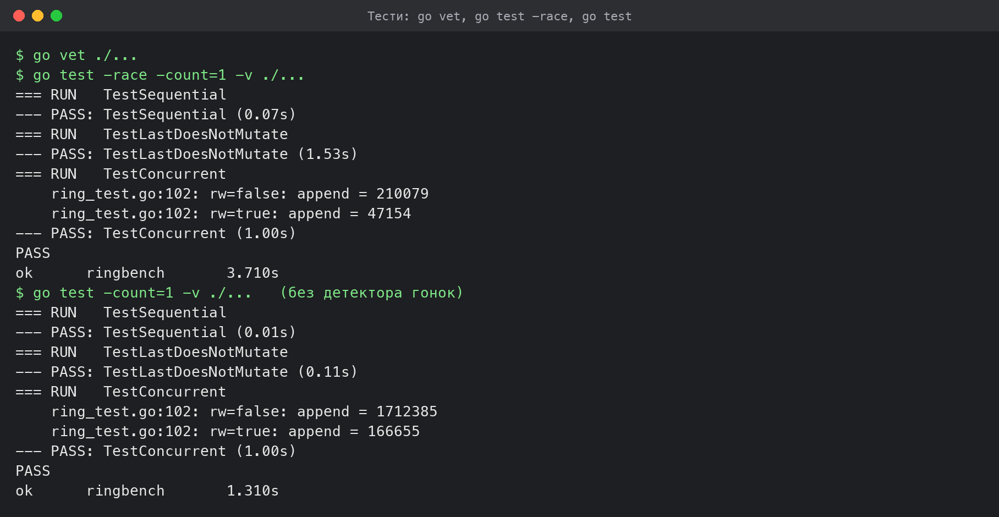

Прогони на RWLock: t_cs для довідки (однопотокові, не входять до таблиці 3) і 3 прогони по n = 12 потоків.

*Лістинг 14 – Крок 3, scripts/step3.sh*

```bash
#!/usr/bin/env bash
# Крок 3: RWLock (sync.RWMutex). Три прогони по D секунд на n потоках; t_cs для довідки.
source "$(dirname "$0")/lib.sh"
build
for i in $(seq 1 $REPS); do
  echo "\$ bin/ringbench -mode cs -lock rw -run $i"
  "$BIN" -mode cs -lock rw -run $i -out "$RAW/cs_rw_$i.json"
done
for i in $(seq 1 $REPS); do
  echo
  echo "\$ bin/ringbench -mode run -lock rw -n $N -d $D -warm $WARM -run $i"
  load_line
  "$BIN" -mode run -lock rw -n $N -d $D -warm $WARM -run $i -out "$RAW/run_rw_$i.json"
  sleep $PAUSE
done
```

*Лістинг 15 – Вивід кроку 3, results/step3.log*

```text
$ bin/ringbench -mode cs -lock rw -run 1
== режим cs, замок rw, прогін 1, 5000000 операцій кожної ролі, go1.27.4
   t_cs,w: середній 12.1 нс, медіана 0.0 нс; τ запису (від виклику до повернення) середня 43.2 нс
   t_cs,r: середній 15.9 нс, медіана 0.0 нс; τ читання середня 45.9 нс
$ bin/ringbench -mode cs -lock rw -run 2
== режим cs, замок rw, прогін 2, 5000000 операцій кожної ролі, go1.27.4
   t_cs,w: середній 12.3 нс, медіана 0.0 нс; τ запису (від виклику до повернення) середня 44.4 нс
   t_cs,r: середній 16.8 нс, медіана 0.0 нс; τ читання середня 47.7 нс
$ bin/ringbench -mode cs -lock rw -run 3
== режим cs, замок rw, прогін 3, 5000000 операцій кожної ролі, go1.27.4
   t_cs,w: середній 12.1 нс, медіана 0.0 нс; τ запису (від виклику до повернення) середня 43.1 нс
   t_cs,r: середній 15.5 нс, медіана 0.0 нс; τ читання середня 44.4 нс

$ bin/ringbench -mode run -lock rw -n 12 -d 10 -warm 1 -run 1
# навантаження перед прогоном: 7.20 4.15 3.20
== режим run, замок rw, n = 12 (n_w = 6, n_r = 6), потоків запущено 12, D = 10 с, прогрів 1 с, прогін 1
   go1.27.4, GOMAXPROCS = 15, логічних ядер = 15
   потік  роль     операцій за D   найбільший t_wait, мс
       1  запис            48703        5.167
       2  читання        2137108        2.768
       3  запис            47522        5.681
       4  читання        2137334        5.274
       5  запис            48397        3.861
       6  читання        2125854        2.062
       7  запис            46514        6.387
       8  читання        2147715        3.098
       9  запис            48172        5.643
      10  читання        2127146        2.200
      11  запис            50095        5.227
      12  читання        2094914        5.239
   запис    N = 289403  X = 28940 оп/с  p50 = 32.708 мкс  p99 = 1525.250 мкс  p999 = 2426.958 мкс  max τ = 6.617 мс
            найбільший t_wait = 6.387 мс  w = 0.9497  cv = 0.0227  середній t_wait = 196888 нс
   читання  N = 12770071  X = 1277007 оп/с  p50 = 0.083 мкс  p99 = 160.291 мкс  p999 = 445.291 мкс  max τ = 5.275 мс
            найбільший t_wait = 5.274 мс  w = 0.9708  cv = 0.0078  середній t_wait = 4561 нс
   X = 1305947 оп/с  φ_w = 0.0222  φ_r = 0.9778
   інваріанти: порушень last (≤16, строго спадають) = 0, додаткових (без пропусків, суми, k = min(16, розмір), монотонність) = 0
   після прогону: усього append = 320451, останній seq = 320451 (збігаються: true), розмір = 8192 (очікується 8192: true)
   last(16) з кінцевого стану: 16 подій, найновіша seq = 320451, коректно: true; повний обхід буфера коректний: true
   ІНВАРІАНТИ: виконано

$ bin/ringbench -mode run -lock rw -n 12 -d 10 -warm 1 -run 2
# навантаження перед прогоном: 7.88 4.46 3.33
== режим run, замок rw, n = 12 (n_w = 6, n_r = 6), потоків запущено 12, D = 10 с, прогрів 1 с, прогін 2
   go1.27.4, GOMAXPROCS = 15, логічних ядер = 15
   потік  роль     операцій за D   найбільший t_wait, мс
       1  запис            67764        5.362
       2  читання        1977365        3.795
       3  запис            61646        7.156
       4  читання        2001298        1.724
       5  запис            59889        7.319
       6  читання        1996112        2.403
       7  запис            63074        6.762
       8  читання        2032218        1.704
       9  запис            71338        7.098
      10  читання        2009136        3.548
      11  запис            64000        7.019
      12  читання        2013684        2.136
   запис    N = 387711  X = 38771 оп/с  p50 = 24.833 мкс  p99 = 1320.584 мкс  p999 = 2278.750 мкс  max τ = 7.486 мс
            найбільший t_wait = 7.319 мс  w = 0.9592  cv = 0.0596  середній t_wait = 148447 нс
   читання  N = 12029813  X = 1202981 оп/с  p50 = 0.042 мкс  p99 = 154.125 мкс  p999 = 367.000 мкс  max τ = 3.796 мс
            найбільший t_wait = 3.795 мс  w = 0.9762  cv = 0.0084  середній t_wait = 4869 нс
   X = 1241752 оп/с  φ_w = 0.0312  φ_r = 0.9688
   інваріанти: порушень last (≤16, строго спадають) = 0, додаткових (без пропусків, суми, k = min(16, розмір), монотонність) = 0
   після прогону: усього append = 424055, останній seq = 424055 (збігаються: true), розмір = 8192 (очікується 8192: true)
   last(16) з кінцевого стану: 16 подій, найновіша seq = 424055, коректно: true; повний обхід буфера коректний: true
   ІНВАРІАНТИ: виконано

$ bin/ringbench -mode run -lock rw -n 12 -d 10 -warm 1 -run 3
# навантаження перед прогоном: 6.90 4.46 3.35
== режим run, замок rw, n = 12 (n_w = 6, n_r = 6), потоків запущено 12, D = 10 с, прогрів 1 с, прогін 3
   go1.27.4, GOMAXPROCS = 15, логічних ядер = 15
   потік  роль     операцій за D   найбільший t_wait, мс
       1  запис            57290       11.866
       2  читання        2150290        6.114
       3  запис            54769        8.201
       4  читання        2126637        6.084
       5  запис            55167       12.362
       6  читання        2124048        8.616
       7  запис            58121       12.341
       8  читання        2130605        3.325
       9  запис            58431       11.839
      10  читання        2126716        2.374
      11  запис            55684       11.804
      12  читання        2109365        4.485
   запис    N = 339462  X = 33946 оп/с  p50 = 27.666 мкс  p99 = 1426.625 мкс  p999 = 2380.583 мкс  max τ = 12.433 мс
            найбільший t_wait = 12.362 мс  w = 0.9549  cv = 0.0254  середній t_wait = 168777 нс
   читання  N = 12767661  X = 1276766 оп/с  p50 = 0.083 мкс  p99 = 153.417 мкс  p999 = 404.833 мкс  max τ = 8.616 мс
            найбільший t_wait = 8.616 мс  w = 0.9716  cv = 0.0057  середній t_wait = 4566 нс
   X = 1310712 оп/с  φ_w = 0.0259  φ_r = 0.9741
   інваріанти: порушень last (≤16, строго спадають) = 0, додаткових (без пропусків, суми, k = min(16, розмір), монотонність) = 0
   після прогону: усього append = 371677, останній seq = 371677 (збігаються: true), розмір = 8192 (очікується 8192: true)
   last(16) з кінцевого стану: 16 подій, найновіша seq = 371677, коректно: true; повний обхід буфера коректний: true
   ІНВАРІАНТИ: виконано
```


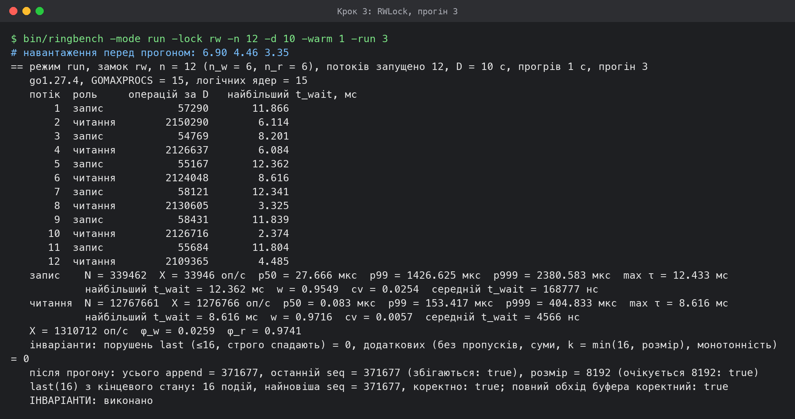

Таблиця 3. RWLock (медіана трьох прогонів; прогони окремо в таблиці вище)

| Роль | Операцій за D | X, оп/с | p50, мкс | p99, мкс | Найбільший t_wait, мс | w | cv |
|---|---|---|---|---|---|---|---|
| Запис | 339 462 | 33 946 | 27.666 | 1 426.6 | 7.319 | 0.9549 | 0.0254 |
| Читання | 12 767 661 | 1 276 766 | 0.083 | 154.1 | 5.274 | 0.9716 | 0.0078 |
| Разом | 13 059 474 | 1 305 947 | — | — | — | 0.9632 | — |

Таблиця 4. Операції потоків за D секунд (медіана трьох прогонів для кожного потоку)

| Потік | Роль | Глобальний замок | RWLock |
|---|---|---|---|
| 1 | запис | 7 621 997 | 57 290 |
| 2 | читання | 4 993 159 | 2 137 108 |
| 3 | запис | 7 585 200 | 54 769 |
| 4 | читання | 5 005 452 | 2 126 637 |
| 5 | запис | 7 647 237 | 55 167 |
| 6 | читання | 5 031 493 | 2 124 048 |
| 7 | запис | 7 675 045 | 58 121 |
| 8 | читання | 5 089 451 | 2 130 605 |
| 9 | запис | 7 656 185 | 58 431 |
| 10 | читання | 5 089 557 | 2 126 716 |
| 11 | запис | 7 680 694 | 55 684 |
| 12 | читання | 4 999 229 | 2 094 914 |

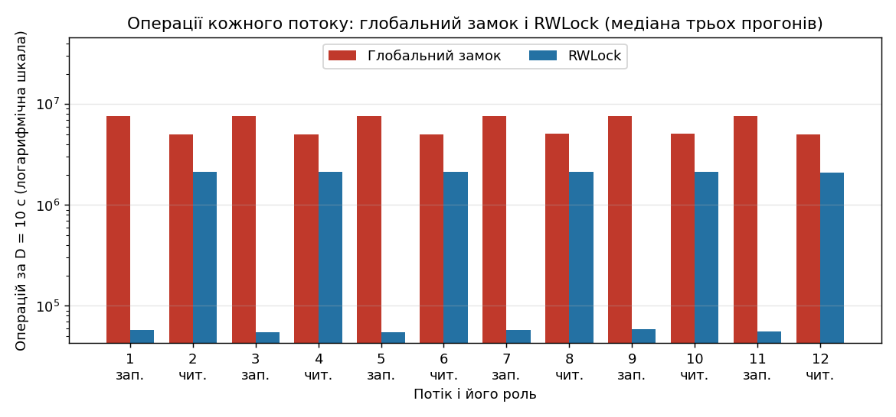

Під глобальним замком усі потоки ролі отримують майже однакову кількість операцій (cv ≈ 0,009 і 0,008), потоки запису виконують більше операцій, ніж читання (7,6 проти 5,0 млн), бо `append` коротший за `last`. Під RWLock писці виконують по ~56 тис. операцій на потік (cv ≈ 0,025), читачі по 2,1 млн.

Результат кінцевих перевірок інваріантів для всіх шести прогонів:

| Замок | Прогін | Порушень last | Додаткових порушень | Усього append | Останній seq | Розмір | Очікуваний розмір | last(16) кінцевого стану | Обхід буфера |
|---|---|---|---|---|---|---|---|---|---|
| Глобальний замок | 1 | 0 | 0 | 49 978 672 | 49 978 672 | 8192 | 8192 | так | так |
| Глобальний замок | 2 | 0 | 0 | 51 561 972 | 51 561 972 | 8192 | 8192 | так | так |
| Глобальний замок | 3 | 0 | 0 | 50 552 317 | 50 552 317 | 8192 | 8192 | так | так |
| RWLock | 1 | 0 | 0 | 320 451 | 320 451 | 8192 | 8192 | так | так |
| RWLock | 2 | 0 | 0 | 424 055 | 424 055 | 8192 | 8192 | так | так |
| RWLock | 3 | 0 | 0 | 371 677 | 371 677 | 8192 | 8192 | так | так |

Порушень інваріантів у жодному прогоні немає: у кожному результаті `last` не більше 16 подій і номери строго спадають, додаткові перевірки теж нуль, кількість `append` дорівнює останньому `seq`, розмір дорівнює 8192, `last(16)` з кінцевого стану коректний. Перевірка «кількість append = seq» збігається за побудовою, якщо лічильник коректно захищено замком: вона виявила б втрату приростів через гонку, але не є незалежним фактом про вміст буфера; незалежніші перевірки вмісту — обхід усього буфера і контрольні суми подій.

# Крок 4. Метрики прискорення

Таблиця 5 рахується з таблиць 1–3 (X_1 для відповідного замка: S(n) для глобального замка ділиться на X_1 глобального замка, для RWLock на X_1 RWLock).

Таблиця 5. Метрики прискорення

| Метрика | Формула | Значення |
|---|---|---|
| S(n), глобальний замок | X(G) / X_1 | 0.388 |
| E(n), глобальний замок | S(n) / n | 0.0323 |
| S(n), RWLock | X(RW) / X_1 | 0.068 |
| E(n), RWLock | S(n) / n | 0.0057 |
| S_w | X_w(RW) / X_w(G) | 0.0074 |
| S_r | X_r(RW) / X_r(G) | 0.422 |
| S_Σ | X(RW) / X(G) | 0.171 |
| ρ, завантаженість глобального замка | X(G) · t̄_cs | 0.104 |

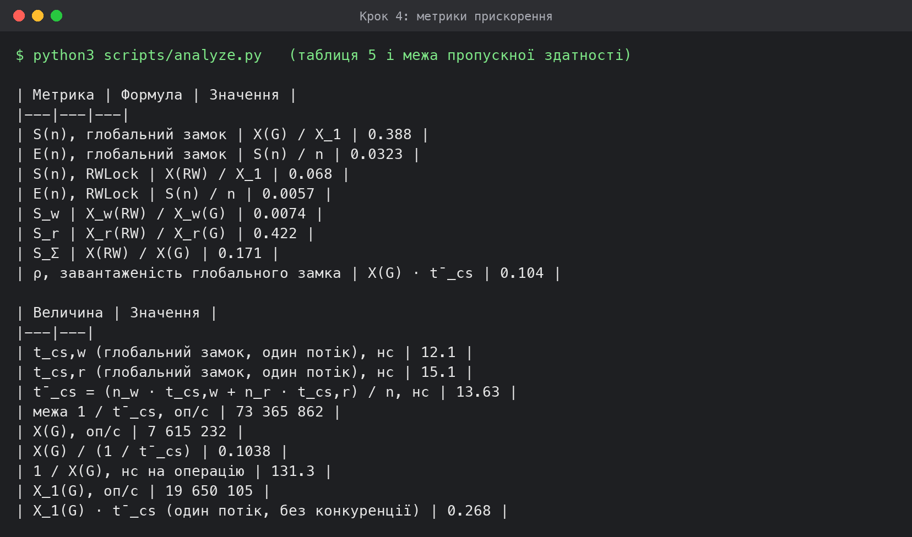

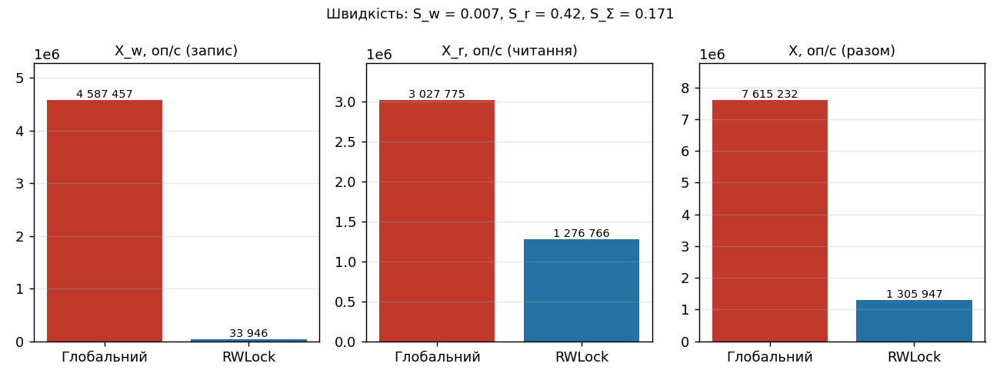

S(12) = 0,39 під глобальним замком: дванадцять потоків дають у 2,6 раза **менше** операцій за секунду, ніж один потік, E = 3 %. Причина: критична секція (≈ 14 нс) коротша за пересилання рядка кешу між ядрами, тож потоки лише по черзі чекають і додатково передають замок один одному. Під RWLock S = 0,07, E = 0,6 %. S_w = 0,007: з RWLock запис повільніший майже в 135 разів; S_r = 0,42: читання теж повільніше (у 2,4 раза); S_Σ = 0,17.

**Порівняння X(G) з межею 1 / t̄_cs.** X(G) = 7,6 млн оп/с, межа 73,4 млн оп/с, X(G) / межа = 0,10, нерівність виконується; чому ρ = 0,10 не є реальною завантаженістю замка, пояснено в розділі кроку 2.

# Крок 5. Порівняння доступу до даних

Таблиця 6. Порівняння доступу до даних (медіани; RW / G — відношення значення з RWLock до значення з глобальним замком; G ≠ 0 в усіх рядках, тому різниці не потрібні; p50 читання в обох замків дорівнює 0,083 мкс, тобто дві клітинки годинника, відношення 1,000)

| Показник | Глобальний замок: запис | Глобальний замок: читання | RWLock: запис | RWLock: читання | RW / G: запис | RW / G: читання |
|---|---|---|---|---|---|---|
| X, оп/с | 4 587 457 | 3 027 775 | 33 946 | 1 276 766 | 0.007 | 0.422 |
| x, на один потік ролі, оп/с | 764 576 | 504 629 | 5 658 | 212 794 | 0.007 | 0.422 |
| p50, мкс | 0.042 | 0.083 | 27.666 | 0.083 | 658.714 | 1.000 |
| p99, мкс | 44.2 | 65.5 | 1 426.6 | 154.1 | 32.301 | 2.353 |
| h = p99 / p50 | 1 051.6 | 789.2 | 51.6 | 1 856.9 | 0.049 | 2.353 |
| Найбільший t_wait, мс | 7.062 | 7.220 | 7.319 | 5.274 | 1.036 | 0.731 |
| w | 0.8364 | 0.8630 | 0.9549 | 0.9716 | 1.142 | 1.126 |
| cv | 0.0087 | 0.0077 | 0.0254 | 0.0078 | 2.915 | 1.021 |
| φ, частка ролі в усіх операціях | 0.6024 | 0.3976 | 0.0260 | 0.9777 | 0.043 | 2.459 |

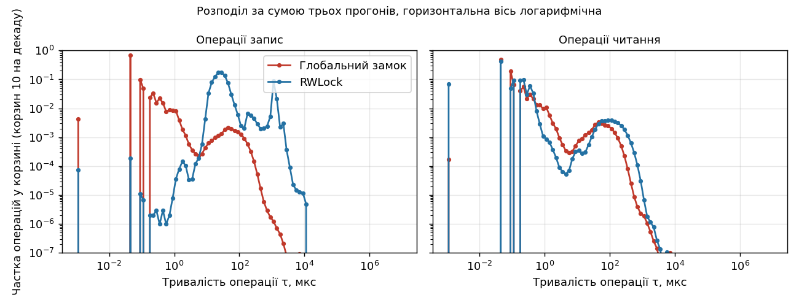

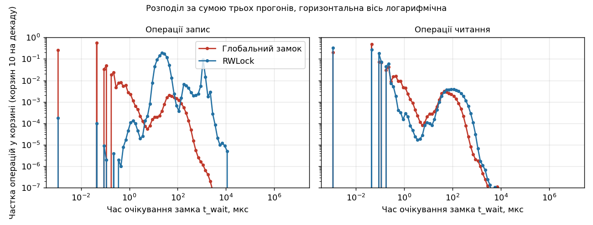

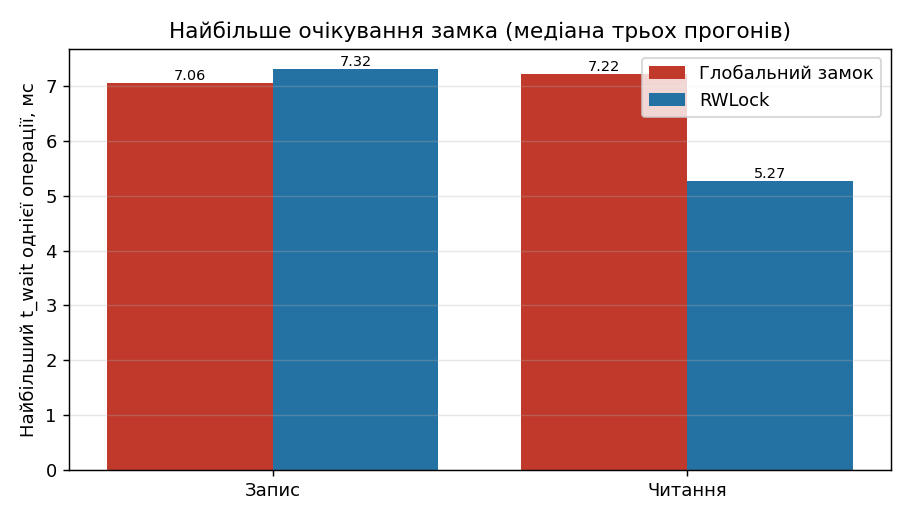

Лівий крайній стовпчик на графіках розподілу (близько 0,001 мкс) — операції, для яких годинник не змінився (τ або t_wait = 0 нс): їх частка велика, бо одна клітинка годинника (41,67 нс) порівнянна з тривалістю операції.

**Висновок.** Заміна глобального замка на RWLock **не збільшила швидкість жодної ролі**: X_w впала в 135 разів (S_w = 0,0074), X_r у 2,4 раза (S_r = 0,42). Швидкість зменшилась в обох ролей, у запису значно сильніше.

- **Запис.** p50 зріс з 0,042 до 27,7 мкс (×659), p99 з 44 до 1 427 мкс (×32), w з 0,836 до 0,955 (×1,14). Кожен `Lock` в RWLock — це захоплення внутрішнього мʼютекса писців, оголошення про писця, очікування, поки всі активні читачі вийдуть, і розбудова заблокованих читачів після звільнення; писець засинає і прокидається (десятки мікросекунд), тоді як під глобальним замком писець часто отримує замок одразу (p50 лише одна клітинка годинника: мʼютекс Go допускає захоплення «на ходу»). Показник h = p99 / p50 при цьому *зменшився* (1052 → 52, ×0,049): це не покращення хвоста, а наслідок того, що медіана виросла в 659 разів; абсолютний хвіст (p99) теж вищий. Рівномірність між писцями: cv зріс з 0,009 до 0,025 (×2,9), але лишається малим: потоки запису отримують замок майже порівну.
- **Читання.** Медіана однакова (0,083 мкс), але p99 зріс з 65,5 до 154 мкс (×2,35), h з 789 до 1857, w з 0,863 до 0,972. cv читачів майже не змінився (0,0077 → 0,0078, ×1,02). Читачі не виграють від паралельного читання: `last(16)` триває ≈ 15 нс, а `RLock` і `RUnlock` — це атомарні додавання до одного спільного лічильника читачів, який так само пересилається між ядрами, як слово мʼютекса; паралелізму від цього немає. До цього додається політика Go: кожен писець зупиняє нових читачів, поки сам не пройде, читачі накопичуються і прокидаються порціями (це пояснення правдоподібне, але окремо не перевірялося; другий пік розподілу τ читання біля 100 мкс є й під глобальним замком, тож він має іншу природу, а в RWLock лише зсувається вправо).
- **Голодування.** Найбільший t_wait запису 7,06 мс (G) і 7,32 мс (RW), у прогонах від 1,8 до 12,4 мс; D = 10 с, тому голодування писців немає ні в одного замка: значення на три порядки менші за D. Ці максимуми — поодинокі події (імовірно, витіснення потоку планувальником ОС), різниця між замками в них не значуща (діапазони прогонів перекриваються), тож висновків із відношення 1,04 робити не можна.

Зі змінами в таблиці 6 повʼязано **частку очікування w і хвіст p99**: w зросла в обох ролей (×1,14 і ×1,13), p99 зріс в обох (×32 і ×2,35). Рівномірність між потоками (cv) змінилась суттєво лише для запису (×2,9), але в абсолютних числах обидва cv малі, тому рівномірність не пояснює зміну швидкості. Частка запису в усіх операціях упала з 0,60 до 0,026: з RWLock потік переважно читає.

**Несподіване.** RWLock, який у підручниках дає виграш для «багато читачів і мало писців», тут програє всюди. Імовірні причини: (1) критична секція надзвичайно коротка (≈ 12–15 нс), (2) стенд має 50 % потоків-писців і працює без пауз, тож писець майже завжди очікує, а політика Go з блокуванням нових читачів при очікуючому писці постійно зупиняє читачів, (3) лічильник читачів є спільною змінною, тож читачі не масштабуються. Окремо перевіряти, при якій довжині читання RWLock почне вигравати, не довелося; наведене пояснення випливає з устрою `sync.RWMutex`, з X_1 (без конкуренції різниця замків мала: 19,7 і 19,1 млн оп/с) і з форми розподілів, але прямо не підтверджене додатковим експериментом.

# Висновки

1. Стенд на Go (12 потоків, закріплених на потоках ОС) виконав по 3 прогони по 10 с для кожного замка; інваріанти С6 виконано в усіх шести прогонах: порушень `last` 0, кількість append дорівнює останньому seq, розмір 8192, `last(16)` з кінцевого стану коректний.
2. Глобальний замок: X = 7,6 млн оп/с (запис 4,6, читання 3,0 млн), S(12) = 0,39, E = 3 %: потоки не прискорюють, а сповільнюють порівняно з одним (X_1 = 19,7 млн оп/с). Верхня межа 1 / t̄_cs = 73 млн оп/с не досягається (ρ = 0,10), бо t_cs, виміряний без конкуренції, не враховує передачі замка між ядрами.
3. RWLock: X = 1,3 млн оп/с (запис 34 тис., читання 1,28 млн), S_Σ = 0,17. Швидкість упала в обох ролей (S_w = 0,0074, S_r = 0,42). Це повʼязано зі зростанням w (0,84 → 0,95 для запису, 0,86 → 0,97 для читання) і хвоста p99 (×32 і ×2,35).
4. Обмеження: на машині працював робочий стіл; прогони від батареї; крок годинника 41,67 нс робить p50 коротких операцій грубим; три повтори дають лише оцінку розкиду (таблиця прогонів вище). Пояснення причин (передача рядків кешу, вартість `RWMutex`) узгоджуються з даними, але не перевірені окремими експериментами.

# Використання генеративних моделей

<!-- заповнює автор -->

# Додаток А. Аналіз

*Лістинг 16 – Аналіз результатів, scripts/analyze.py*

```python
#!/usr/bin/env python3
"""Аналіз ЛР 5 з файлів results/raw/*.json (лише стандартна бібліотека і matplotlib).

Читає сирі результати прогонів, бере медіану трьох повторів кожної величини і пише
таблиці 1–6 умови та допоміжні таблиці в results/tables/*.md, results/summary.json і графіки screens/chart_*.png.
Жодне число таблиць не вводиться вручну.
"""
import glob
import json
import math
import os
import statistics

import matplotlib

matplotlib.use("Agg")
import matplotlib.pyplot as plt  # noqa: E402

ROOT = os.path.abspath(os.path.join(os.path.dirname(__file__), ".."))
RAW = os.path.join(ROOT, "results", "raw")
TAB = os.path.join(ROOT, "results", "tables")
SCR = os.path.join(ROOT, "screens")
os.makedirs(TAB, exist_ok=True)
os.makedirs(SCR, exist_ok=True)
plt.rcParams.update({"font.size": 10})
LOCKS = {"global": "Глобальний замок", "rw": "RWLock"}


def load(pattern):
    return [json.load(open(f, encoding="utf-8")) for f in sorted(glob.glob(os.path.join(RAW, pattern)))]


def med(xs):
    return statistics.median(xs)


def fmt(x, d=2):
    if x is None or (isinstance(x, float) and math.isnan(x)):
        return "—"
    return f"{x:,.{d}f}".replace(",", " ")


def fint(x):
    return f"{round(x):,}".replace(",", " ")


def table(head, rows):
    out = ["| " + " | ".join(head) + " |", "|" + "---|" * len(head)]
    out += ["| " + " | ".join(str(c) for c in r) + " |" for r in rows]
    return "\n".join(out)


def write(name, text):
    open(os.path.join(TAB, name), "w", encoding="utf-8").write(text.rstrip() + "\n")


def ratio(rw, g):
    """RW / G; якщо G = 0 — різниця RW − G (правило умови)."""
    if g == 0:
        return "різниця " + fmt(rw - g, 4)
    return fmt(rw / g, 3)


runs = {lk: load(f"run_{lk}_*.json") for lk in LOCKS}
x1 = {lk: load(f"x1_{lk}_*.json") for lk in LOCKS}
cs = {lk: load(f"cs_{lk}_*.json") for lk in LOCKS}
clock = load("clock.json")
for lk in LOCKS:
    assert len(runs[lk]) == 3 and len(x1[lk]) == 3 and len(cs[lk]) == 3, f"{lk}: очікується 3 прогони"
n = runs["global"][0]["n"]
nw, nr = runs["global"][0]["n_w"], runs["global"][0]["n_r"]
D = runs["global"][0]["d_s"]


def role_med(lk, role, key):
    return med([r[role][key] for r in runs[lk]])


S = {}   # зведення для summary.json
for lk in LOCKS:
    s = {}
    for role in ("write", "read"):
        key = {"write": "w", "read": "r"}[role]
        d = {k: role_med(lk, role, k) for k in
             ("n_ops", "x_ops_per_s", "x_per_thread", "p50_ns", "p99_ns", "p999_ns", "max_wait_ns", "w", "cv",
              "mean_tau_ns", "sum_wait_ns")}
        d["h"] = d["p99_ns"] / d["p50_ns"]
        d["phi"] = d["x_ops_per_s"] / med([r["x_total"] for r in runs[lk]])
        s[key] = d
    s["X"] = med([r["x_total"] for r in runs[lk]])
    s["N"] = med([r["write"]["n_ops"] + r["read"]["n_ops"] for r in runs[lk]])
    s["w_all"] = med([(r["write"]["sum_wait_ns"] + r["read"]["sum_wait_ns"]) / 1e9 / (n * D) for r in runs[lk]])
    s["max_wait_read_ns"] = role_med(lk, "read", "max_wait_ns")
    s["X1"] = med([r["x_total"] for r in x1[lk]])
    s["X1_runs"] = [r["x_total"] for r in x1[lk]]
    s["t_cs_w_ns"] = med([c["t_cs_w_mean_ns"] for c in cs[lk]])
    s["t_cs_r_ns"] = med([c["t_cs_r_mean_ns"] for c in cs[lk]])
    s["threads"] = [med([r["threads"][i]["ops"] for r in runs[lk]]) for i in range(n)]
    s["inv_ok"] = sum(1 for r in runs[lk] if r["invariants_ok"])
    s["viol"] = sum(r["violations_last_total"] + r["violations_extra_total"] for r in runs[lk])
    S[lk] = s
G, RW = S["global"], S["rw"]
tcs_w, tcs_r = G["t_cs_w_ns"], G["t_cs_r_ns"]
tcs_bar = (nw * tcs_w + nr * tcs_r) / n            # нс
bound = 1e9 / tcs_bar                              # оп/с
rho = G["X"] * tcs_bar / 1e9

# ---- Таблиця 1 ----
goversion = runs["global"][0]["go_version"]
ncpu = runs["global"][0]["num_cpu"]
inv_total = sum(S[l]["inv_ok"] for l in LOCKS)
viol_total = sum(S[l]["viol"] for l in LOCKS)
write("table1.md", table(
    ["n", "n_w", "n_r", "Мова і версія", "Логічних ядер", "X_1, оп/с", "Інваріанти після прогонів кроків 2 і 3"],
    [[n, nw, nr, f"Go {goversion.replace('go', '')}", ncpu,
      f"{fint(G['X1'])} (глобальний замок), {fint(RW['X1'])} (RWLock)",
      f"виконано в {inv_total} з 6 прогонів; порушень last: {viol_total}"]]))

# ---- Таблиці 2 і 3 ----
def role_rows(lk, with_cs):
    s = S[lk]
    rows = []
    for key, name in (("w", "Запис"), ("r", "Читання")):
        d = s[key]
        row = [name, fint(d["n_ops"]), fint(d["x_ops_per_s"]), fmt(d["p50_ns"] / 1e3, 3), fmt(d["p99_ns"] / 1e3, 1),
               fmt(d["max_wait_ns"] / 1e6, 3), fmt(d["w"], 4), fmt(d["cv"], 4)]
        if with_cs:
            row.append(fmt((tcs_w if key == "w" else tcs_r) / 1e3, 4))
        rows.append(row)
    tot = ["Разом", fint(s["N"]), fint(s["X"]), "—", "—", "—", fmt(s["w_all"], 4), "—"]
    if with_cs:
        tot.append(fmt(tcs_bar / 1e3, 4) + " (t̄_cs)")
    rows.append(tot)
    return rows

head = ["Роль", "Операцій за D", "X, оп/с", "p50, мкс", "p99, мкс", "Найбільший t_wait, мс", "w", "cv"]
write("table2.md", table(head + ["t_cs, мкс"], role_rows("global", True)))
write("table3.md", table(head, role_rows("rw", False)))

# ---- Таблиця 4 ----
rows = []
for i in range(n):
    rows.append([i + 1, "запис" if (i + 1) % 2 else "читання", fint(G["threads"][i]), fint(RW["threads"][i])])
write("table4.md", table(["Потік", "Роль", "Глобальний замок", "RWLock"], rows))

# ---- Таблиця 5 ----
S_G, S_RW = G["X"] / G["X1"], RW["X"] / RW["X1"]
Sw = RW["w"]["x_ops_per_s"] / G["w"]["x_ops_per_s"]
Sr = RW["r"]["x_ops_per_s"] / G["r"]["x_ops_per_s"]
Ssum = RW["X"] / G["X"]
write("table5.md", table(["Метрика", "Формула", "Значення"], [
    ["S(n), глобальний замок", "X(G) / X_1", fmt(S_G, 3)],
    ["E(n), глобальний замок", "S(n) / n", fmt(S_G / n, 4)],
    ["S(n), RWLock", "X(RW) / X_1", fmt(S_RW, 3)],
    ["E(n), RWLock", "S(n) / n", fmt(S_RW / n, 4)],
    ["S_w", "X_w(RW) / X_w(G)", fmt(Sw, 4)],
    ["S_r", "X_r(RW) / X_r(G)", fmt(Sr, 3)],
    ["S_Σ", "X(RW) / X(G)", fmt(Ssum, 3)],
    ["ρ, завантаженість глобального замка", "X(G) · t̄_cs", fmt(rho, 3)],
]))
write("table5b.md", table(["Величина", "Значення"], [
    ["t_cs,w (глобальний замок, один потік), нс", fmt(tcs_w, 1)],
    ["t_cs,r (глобальний замок, один потік), нс", fmt(tcs_r, 1)],
    ["t̄_cs = (n_w · t_cs,w + n_r · t_cs,r) / n, нс", fmt(tcs_bar, 2)],
    ["межа 1 / t̄_cs, оп/с", fint(bound)],
    ["X(G), оп/с", fint(G["X"])],
    ["X(G) / (1 / t̄_cs)", fmt(G["X"] / bound, 4)],
    ["1 / X(G), нс на операцію", fmt(1e9 / G["X"], 1)],
    ["X_1(G), оп/с", fint(G["X1"])],
    ["X_1(G) · t̄_cs (один потік, без конкуренції)", fmt(G["X1"] * tcs_bar / 1e9, 3)],
]))

# ---- Таблиця 6 ----
def metric_rows():
    spec = [
        ("X, оп/с", "x_ops_per_s", lambda v: fint(v)),
        ("x, на один потік ролі, оп/с", "x_per_thread", lambda v: fint(v)),
        ("p50, мкс", "p50_ns", lambda v: fmt(v / 1e3, 3)),
        ("p99, мкс", "p99_ns", lambda v: fmt(v / 1e3, 1)),
        ("h = p99 / p50", "h", lambda v: fmt(v, 1)),
        ("Найбільший t_wait, мс", "max_wait_ns", lambda v: fmt(v / 1e6, 3)),
        ("w", "w", lambda v: fmt(v, 4)),
        ("cv", "cv", lambda v: fmt(v, 4)),
        ("φ, частка ролі в усіх операціях", "phi", lambda v: fmt(v, 4)),
    ]
    out = []
    for name, key, f in spec:
        gw, gr, rw_, rr = G["w"][key], G["r"][key], RW["w"][key], RW["r"][key]
        scale = 1e6 if key == "max_wait_ns" else 1
        out.append([name, f(gw), f(gr), f(rw_), f(rr), ratio(rw_, gw), ratio(rr, gr)])
    return out
write("table6.md", table(["Показник", "Глобальний замок: запис", "Глобальний замок: читання", "RWLock: запис",
                          "RWLock: читання", "RW / G: запис", "RW / G: читання"], metric_rows()))

# ---- Допоміжні таблиці ----
rr = []
for lk in LOCKS:
    for r in runs[lk]:
        rr.append([LOCKS[lk], r["run"], fint(r["write"]["n_ops"]), fint(r["read"]["n_ops"]), fint(r["x_total"]),
                   fmt(r["write"]["p50_ns"] / 1e3, 3), fmt(r["write"]["p99_ns"] / 1e3, 1),
                   fmt(r["read"]["p50_ns"] / 1e3, 3), fmt(r["read"]["p99_ns"] / 1e3, 1),
                   fmt(r["write"]["max_wait_ns"] / 1e6, 3), fmt(r["write"]["w"], 4), fmt(r["read"]["w"], 4),
                   fmt(r["write"]["cv"], 4), fmt(r["read"]["cv"], 4),
                   "так" if r["invariants_ok"] else "НІ"])
write("runs.md", table(["Замок", "Прогін", "N_w", "N_r", "X, оп/с", "p50 запису, мкс", "p99 запису, мкс",
                        "p50 читання, мкс", "p99 читання, мкс", "t_wait,max, мс", "w_w", "w_r", "cv_w", "cv_r",
                        "Інваріанти"], rr))

x1rows = []
for lk in LOCKS:
    for r in x1[lk]:
        x1rows.append([LOCKS[lk], r["run"], fint(r["write"]["n_ops"]), fint(r["read"]["n_ops"]), fint(r["x_total"]),
                       "так" if r["invariants_ok"] else "НІ"])
write("x1.md", table(["Замок", "Прогін", "Записів за D", "Читань за D", "X_1, оп/с", "Інваріанти"], x1rows))

csrows = []
for lk in LOCKS:
    for c in cs[lk]:
        csrows.append([LOCKS[lk], c["run"], fmt(c["t_cs_w_mean_ns"], 1), fmt(c["t_cs_r_mean_ns"], 1),
                       fmt(c["tau_w_mean_ns"], 1), fmt(c["tau_r_mean_ns"], 1), fmt(c["t_cs_w_median_ns"], 1)])
write("cs.md", table(["Замок", "Прогін", "t_cs,w середній, нс", "t_cs,r середній, нс", "τ запису середня, нс",
                      "τ читання середня, нс", "t_cs,w медіана, нс"], csrows))

c0 = clock[0]
write("clock.md", table(["Вимір", "нс на виклик"], [
    ["time.Since(t0): монотонний годинник, 1 позначка стенду", fmt(c0["time_since_ns"], 1)],
    ["time.Now() з UnixNano (стінний і монотонний годинники)", fmt(c0["time_now_ns"], 1)],
    ["3 позначки на операцію (t_call, t_acq, t_ret)", fmt(c0["three_stamps_ns"], 1)],
]))

inv = []
for lk in LOCKS:
    for r in runs[lk]:
        f = r["final"]
        inv.append([LOCKS[lk], r["run"], r["violations_last_total"], r["violations_extra_total"],
                    fint(f["total_appends"]), fint(f["final_seq"]), f["size"], f["expected_size"],
                    "так" if f["last16_ok"] else "НІ", "так" if f["scan_ok"] else "НІ"])
write("invariants.md", table(["Замок", "Прогін", "Порушень last", "Додаткових порушень", "Усього append",
                              "Останній seq", "Розмір", "Очікуваний розмір", "last(16) кінцевого стану", "Обхід буфера"], inv))

# ---- Графіки ----
C = {"global": "#c0392b", "rw": "#2471a3"}
xs = list(range(1, n + 1))

fig, ax = plt.subplots(figsize=(9, 4.2))
wd = 0.38
ax.bar([x - wd / 2 for x in xs], G["threads"], wd, color=C["global"], label="Глобальний замок")
ax.bar([x + wd / 2 for x in xs], RW["threads"], wd, color=C["rw"], label="RWLock")
ax.set_yscale("log")
ax.set_xticks(xs)
ax.set_xticklabels([f"{x}\n{'зап.' if x % 2 else 'чит.'}" for x in xs])
ax.set_xlabel("Потік і його роль")
ax.set_ylabel("Операцій за D = 10 с (логарифмічна шкала)")
ax.set_title("Операції кожного потоку: глобальний замок і RWLock (медіана трьох прогонів)")
ax.set_ylim(top=max(G["threads"]) * 6)
ax.legend(ncol=2, loc="upper center")
ax.grid(axis="y", alpha=.3)
fig.tight_layout()
fig.savefig(os.path.join(SCR, "chart_threads.png"), dpi=130)
plt.close(fig)

fig, axs = plt.subplots(1, 3, figsize=(10, 3.8))
for ax, (title, g, r_) in zip(axs, (("X_w, оп/с (запис)", G["w"]["x_ops_per_s"], RW["w"]["x_ops_per_s"]),
                                    ("X_r, оп/с (читання)", G["r"]["x_ops_per_s"], RW["r"]["x_ops_per_s"]),
                                    ("X, оп/с (разом)", G["X"], RW["X"]))):
    ax.bar(["Глобальний", "RWLock"], [g, r_], color=[C["global"], C["rw"]])
    for i, v in enumerate((g, r_)):
        ax.text(i, v, fint(v), ha="center", va="bottom", fontsize=8)
    ax.set_title(title, fontsize=10)
    ax.set_ylim(0, max(g, r_) * 1.15)
    ax.grid(axis="y", alpha=.3)
fig.suptitle(f"Швидкість: S_w = {fmt(Sw, 3)}, S_r = {fmt(Sr, 2)}, S_Σ = {fmt(Ssum, 3)}", fontsize=10)
fig.tight_layout()
fig.savefig(os.path.join(SCR, "chart_throughput.png"), dpi=130)
plt.close(fig)


def hist_sum(lk, role, key):
    tot = [0] * 100
    for r in runs[lk]:
        for i, c in enumerate(r[role][key]):
            tot[i] += c
    s = sum(tot)
    return [c / s for c in tot]


def centers():
    return [10 ** ((b + 0.5) / 10) / 1e3 for b in range(100)]   # мкс


for key, fname, label in (("hist_tau", "chart_tau.png", "Тривалість операції τ, мкс"),
                          ("hist_wait", "chart_wait.png", "Час очікування замка t_wait, мкс")):
    fig, axs = plt.subplots(1, 2, figsize=(10, 3.8), sharey=True)
    for ax, (role, rname) in zip(axs, (("write", "запис"), ("read", "читання"))):
        for lk in LOCKS:
            h = hist_sum(lk, role, key)
            ax.plot(centers(), h, marker=".", color=C[lk], label=LOCKS[lk])
        ax.set_xscale("log")
        ax.set_yscale("log")
        ax.set_xlabel(label)
        ax.set_title(f"Операції {rname}", fontsize=10)
        ax.grid(alpha=.3)
        ax.set_ylim(1e-7, 1)
    axs[0].set_ylabel("Частка операцій у корзині (корзин 10 на декаду)")
    axs[0].legend()
    fig.suptitle("Розподіл за сумою трьох прогонів, горизонтальна вісь логарифмічна", fontsize=10)
    fig.tight_layout()
    fig.savefig(os.path.join(SCR, fname), dpi=130)
    plt.close(fig)

fig, ax = plt.subplots(figsize=(7, 4))
labels = ["Запис", "Читання"]
gv = [G["w"]["max_wait_ns"] / 1e6, G["max_wait_read_ns"] / 1e6]
rv = [RW["w"]["max_wait_ns"] / 1e6, RW["max_wait_read_ns"] / 1e6]
ax.bar([0 - .2, 1 - .2], gv, .4, color=C["global"], label="Глобальний замок")
ax.bar([0 + .2, 1 + .2], rv, .4, color=C["rw"], label="RWLock")
for i, (a, b) in enumerate(zip(gv, rv)):
    ax.text(i - .2, a, fmt(a, 2), ha="center", va="bottom", fontsize=8)
    ax.text(i + .2, b, fmt(b, 2), ha="center", va="bottom", fontsize=8)
ax.set_xticks([0, 1])
ax.set_xticklabels(labels)
ax.set_ylabel("Найбільший t_wait однієї операції, мс")
ax.set_title("Найбільше очікування замка (медіана трьох прогонів)")
ax.legend()
ax.grid(axis="y", alpha=.3)
fig.tight_layout()
fig.savefig(os.path.join(SCR, "chart_wait_max.png"), dpi=130)
plt.close(fig)

# ---- summary.json і друк ----
summary = {"n": n, "n_w": nw, "n_r": nr, "D": D, "go": goversion, "num_cpu": ncpu, "G": G, "RW": RW,
           "t_cs_bar_ns": tcs_bar, "bound_ops_per_s": bound, "rho": rho,
           "S_G": S_G, "E_G": S_G / n, "S_RW": S_RW, "E_RW": S_RW / n, "S_w": Sw, "S_r": Sr, "S_sum": Ssum}
json.dump(summary, open(os.path.join(ROOT, "results", "summary.json"), "w"), indent=1, ensure_ascii=False)
for name in ("table1", "table2", "table3", "table4", "table5", "table5b", "table6", "x1", "cs", "clock", "runs", "invariants"):
    print(f"--- {name}")
    print(open(os.path.join(TAB, name + ".md"), encoding="utf-8").read())
```

*Лістинг 17 – Вивід аналізу, results/analyze.log*

```text
--- table1
| n | n_w | n_r | Мова і версія | Логічних ядер | X_1, оп/с | Інваріанти після прогонів кроків 2 і 3 |
|---|---|---|---|---|---|---|
| 12 | 6 | 6 | Go 1.27.4 | 15 | 19 650 105 (глобальний замок), 19 114 906 (RWLock) | виконано в 6 з 6 прогонів; порушень last: 0 |

--- table2
| Роль | Операцій за D | X, оп/с | p50, мкс | p99, мкс | Найбільший t_wait, мс | w | cv | t_cs, мкс |
|---|---|---|---|---|---|---|---|---|
| Запис | 45 874 573 | 4 587 457 | 0.042 | 44.2 | 7.062 | 0.8364 | 0.0087 | 0.0121 |
| Читання | 30 277 747 | 3 027 775 | 0.083 | 65.5 | 7.220 | 0.8630 | 0.0077 | 0.0151 |
| Разом | 76 152 320 | 7 615 232 | — | — | — | 0.8497 | — | 0.0136 (t̄_cs) |

--- table3
| Роль | Операцій за D | X, оп/с | p50, мкс | p99, мкс | Найбільший t_wait, мс | w | cv |
|---|---|---|---|---|---|---|---|
| Запис | 339 462 | 33 946 | 27.666 | 1 426.6 | 7.319 | 0.9549 | 0.0254 |
| Читання | 12 767 661 | 1 276 766 | 0.083 | 154.1 | 5.274 | 0.9716 | 0.0078 |
| Разом | 13 059 474 | 1 305 947 | — | — | — | 0.9632 | — |

--- table4
| Потік | Роль | Глобальний замок | RWLock |
|---|---|---|---|
| 1 | запис | 7 621 997 | 57 290 |
| 2 | читання | 4 993 159 | 2 137 108 |
| 3 | запис | 7 585 200 | 54 769 |
| 4 | читання | 5 005 452 | 2 126 637 |
| 5 | запис | 7 647 237 | 55 167 |
| 6 | читання | 5 031 493 | 2 124 048 |
| 7 | запис | 7 675 045 | 58 121 |
| 8 | читання | 5 089 451 | 2 130 605 |
| 9 | запис | 7 656 185 | 58 431 |
| 10 | читання | 5 089 557 | 2 126 716 |
| 11 | запис | 7 680 694 | 55 684 |
| 12 | читання | 4 999 229 | 2 094 914 |

--- table5
| Метрика | Формула | Значення |
|---|---|---|
| S(n), глобальний замок | X(G) / X_1 | 0.388 |
| E(n), глобальний замок | S(n) / n | 0.0323 |
| S(n), RWLock | X(RW) / X_1 | 0.068 |
| E(n), RWLock | S(n) / n | 0.0057 |
| S_w | X_w(RW) / X_w(G) | 0.0074 |
| S_r | X_r(RW) / X_r(G) | 0.422 |
| S_Σ | X(RW) / X(G) | 0.171 |
| ρ, завантаженість глобального замка | X(G) · t̄_cs | 0.104 |

--- table5b
| Величина | Значення |
|---|---|
| t_cs,w (глобальний замок, один потік), нс | 12.1 |
| t_cs,r (глобальний замок, один потік), нс | 15.1 |
| t̄_cs = (n_w · t_cs,w + n_r · t_cs,r) / n, нс | 13.63 |
| межа 1 / t̄_cs, оп/с | 73 365 862 |
| X(G), оп/с | 7 615 232 |
| X(G) / (1 / t̄_cs) | 0.1038 |
| 1 / X(G), нс на операцію | 131.3 |
| X_1(G), оп/с | 19 650 105 |
| X_1(G) · t̄_cs (один потік, без конкуренції) | 0.268 |

--- table6
| Показник | Глобальний замок: запис | Глобальний замок: читання | RWLock: запис | RWLock: читання | RW / G: запис | RW / G: читання |
|---|---|---|---|---|---|---|
| X, оп/с | 4 587 457 | 3 027 775 | 33 946 | 1 276 766 | 0.007 | 0.422 |
| x, на один потік ролі, оп/с | 764 576 | 504 629 | 5 658 | 212 794 | 0.007 | 0.422 |
| p50, мкс | 0.042 | 0.083 | 27.666 | 0.083 | 658.714 | 1.000 |
| p99, мкс | 44.2 | 65.5 | 1 426.6 | 154.1 | 32.301 | 2.353 |
| h = p99 / p50 | 1 051.6 | 789.2 | 51.6 | 1 856.9 | 0.049 | 2.353 |
| Найбільший t_wait, мс | 7.062 | 7.220 | 7.319 | 5.274 | 1.036 | 0.731 |
| w | 0.8364 | 0.8630 | 0.9549 | 0.9716 | 1.142 | 1.126 |
| cv | 0.0087 | 0.0077 | 0.0254 | 0.0078 | 2.915 | 1.021 |
| φ, частка ролі в усіх операціях | 0.6024 | 0.3976 | 0.0260 | 0.9777 | 0.043 | 2.459 |

--- x1
| Замок | Прогін | Записів за D | Читань за D | X_1, оп/с | Інваріанти |
|---|---|---|---|---|---|
| Глобальний замок | 1 | 93 682 438 | 93 682 438 | 18 736 488 | так |
| Глобальний замок | 2 | 98 250 524 | 98 250 524 | 19 650 105 | так |
| Глобальний замок | 3 | 99 714 184 | 99 714 183 | 19 942 837 | так |
| RWLock | 1 | 93 528 853 | 93 528 852 | 18 705 770 | так |
| RWLock | 2 | 95 574 531 | 95 574 531 | 19 114 906 | так |
| RWLock | 3 | 97 286 514 | 97 286 513 | 19 457 303 | так |

--- cs
| Замок | Прогін | t_cs,w середній, нс | t_cs,r середній, нс | τ запису середня, нс | τ читання середня, нс | t_cs,w медіана, нс |
|---|---|---|---|---|---|---|
| Глобальний замок | 1 | 12.0 | 15.1 | 40.7 | 43.7 | 0.0 |
| Глобальний замок | 2 | 12.1 | 14.7 | 40.3 | 42.7 | 0.0 |
| Глобальний замок | 3 | 12.3 | 15.4 | 41.6 | 44.5 | 0.0 |
| RWLock | 1 | 12.1 | 15.9 | 43.2 | 45.9 | 0.0 |
| RWLock | 2 | 12.3 | 16.8 | 44.4 | 47.7 | 0.0 |
| RWLock | 3 | 12.1 | 15.5 | 43.1 | 44.4 | 0.0 |

--- clock
| Вимір | нс на виклик |
|---|---|
| time.Since(t0): монотонний годинник, 1 позначка стенду | 10.9 |
| time.Now() з UnixNano (стінний і монотонний годинники) | 25.7 |
| 3 позначки на операцію (t_call, t_acq, t_ret) | 32.6 |

--- runs
| Замок | Прогін | N_w | N_r | X, оп/с | p50 запису, мкс | p99 запису, мкс | p50 читання, мкс | p99 читання, мкс | t_wait,max, мс | w_w | w_r | cv_w | cv_r | Інваріанти |
|---|---|---|---|---|---|---|---|---|---|---|---|---|---|---|
| Глобальний замок | 1 | 45 428 803 | 29 887 321 | 7 531 612 | 0.042 | 44.2 | 0.083 | 65.6 | 7.062 | 0.8384 | 0.8654 | 0.0087 | 0.0023 | так |
| Глобальний замок | 2 | 46 902 936 | 30 779 676 | 7 768 261 | 0.042 | 41.6 | 0.083 | 63.7 | 8.526 | 0.8336 | 0.8599 | 0.0270 | 0.0139 | так |
| Глобальний замок | 3 | 45 874 573 | 30 277 747 | 7 615 232 | 0.042 | 44.2 | 0.083 | 65.5 | 1.844 | 0.8364 | 0.8630 | 0.0074 | 0.0077 | так |
| RWLock | 1 | 289 403 | 12 770 071 | 1 305 947 | 32.708 | 1 525.2 | 0.083 | 160.3 | 6.387 | 0.9497 | 0.9708 | 0.0227 | 0.0078 | так |
| RWLock | 2 | 387 711 | 12 029 813 | 1 241 752 | 24.833 | 1 320.6 | 0.042 | 154.1 | 7.319 | 0.9592 | 0.9762 | 0.0596 | 0.0084 | так |
| RWLock | 3 | 339 462 | 12 767 661 | 1 310 712 | 27.666 | 1 426.6 | 0.083 | 153.4 | 12.362 | 0.9549 | 0.9716 | 0.0254 | 0.0057 | так |

--- invariants
| Замок | Прогін | Порушень last | Додаткових порушень | Усього append | Останній seq | Розмір | Очікуваний розмір | last(16) кінцевого стану | Обхід буфера |
|---|---|---|---|---|---|---|---|---|---|
| Глобальний замок | 1 | 0 | 0 | 49 978 672 | 49 978 672 | 8192 | 8192 | так | так |
| Глобальний замок | 2 | 0 | 0 | 51 561 972 | 51 561 972 | 8192 | 8192 | так | так |
| Глобальний замок | 3 | 0 | 0 | 50 552 317 | 50 552 317 | 8192 | 8192 | так | так |
| RWLock | 1 | 0 | 0 | 320 451 | 320 451 | 8192 | 8192 | так | так |
| RWLock | 2 | 0 | 0 | 424 055 | 424 055 | 8192 | 8192 | так | так |
| RWLock | 3 | 0 | 0 | 371 677 | 371 677 | 8192 | 8192 | так | так |
```

# Додаток Б. Допоміжні скрипти

*Лістинг 18 – Серія, scripts/run_all.sh*

```bash
#!/usr/bin/env bash
# Увесь експеримент: тести, потім кроки 1–3 (виміри), потім аналіз (кроки 4–5).
# Вивід кожного кроку — в results/<крок>.log цілим одним запуском.
set -euo pipefail
cd "$(dirname "$0")/.."
rm -f results/.measurements_done
mkdir -p results/raw
./scripts/env.sh        2>&1 | tee results/env.log
./scripts/test.sh       2>&1 | tee results/test.log
./scripts/step1.sh      2>&1 | tee results/step1.log
./scripts/step2.sh      2>&1 | tee results/step2.log
./scripts/step3.sh      2>&1 | tee results/step3.log
touch results/.measurements_done
python3 scripts/analyze.py 2>&1 | tee results/analyze.log
```

*Лістинг 19 – Опис стенду, scripts/env.sh*

```bash
#!/usr/bin/env bash
# Опис стенду: машина, ОС, Go, навантаження.
source "$(dirname "$0")/lib.sh"
echo "# date: $(date '+%Y-%m-%d %H:%M:%S')"
echo "# chip: $(sysctl -n machdep.cpu.brand_string)"
echo "# логічних ядер: $(sysctl -n hw.logicalcpu), фізичних: $(sysctl -n hw.physicalcpu)"
echo "# перфоманс-ядер: $(sysctl -n hw.perflevel0.logicalcpu), енергоефективних: $(sysctl -n hw.perflevel1.logicalcpu)"
echo "# памʼять: $(( $(sysctl -n hw.memsize) / 1073741824 )) ГБ"
echo "# ОС: $(sw_vers -productName) $(sw_vers -productVersion)"
echo "# $("$GO" version)"
echo "# живлення: $(pmset -g batt | head -1)"
echo "# $(pmset -g | grep -i lowpowermode || echo 'lowpowermode: 0')"
load_line
echo "# найважчі процеси:"
ps -Ao pcpu,comm -r | head -4
```
