# Вихідні дані варіанта

| Параметр | Значення |
|---|---|
| Датасет | Д2, BloodMNIST: K = 8 класів, C = 3 канали, зображення 28 × 28 |
| Ширина мережі | Ш3: c1 / c2 / h = 64 / 128 / 512 |
| P_max | 2 |
| Глобальний батч B, батч процесу b = B / P_max | 192, 96 |
| K_c, s_f | 10 кроків, крок 25 |
| N (навчальна частина), тест | перші 7000 прикладів train; увесь test (3421) |
| Оптимізатор | SGD, момент 0,9, η₀ = 0,02 (η_P = η₀ · P_max = 0,04 у кроці 4); `torch.manual_seed(0)` до створення моделі |
| n_ep | 3 епохи |
| Швидкість | 10 кроків прогріву і 50 вимірюваних; X = 50 · B / t |

**Стенд.** MacBook Pro з Apple M5 Pro: 15 фізичних ядер (5 продуктивних і 10 енергоефективних; логічних теж 15), 24 ГБ памʼяті, macOS 27.2.1, Python 3.12.16, PyTorch 2.15.0 (CPU), бекенд gloo. Docker і віртуальні машини не використовуються; **torchrun і всі процеси навчання працюють на цій самій машині** (окремого генератора навантаження в роботі немає). C_phys = 15, P_max = 2, тому n_th = ⌊15 / 2⌋ = 7 потоків на процес у всіх прогонах: один процес займає 7 ядер із 15, два — 14.

**Неоднорідність ядер.** Ядра двох типів різної швидкості, а операція всередині процесу чекає найповільнішого з 7 потоків. Закріпити потоки за ядрами в macOS не можна, тому розклад потоків за типами ядер визначає ОС і від нього залежить час кроку. Продуктивних ядер лише 5, тож навіть один процес із 7 потоками має щонайменше два потоки на енергоефективних ядрах. Це одна з причин розкиду повторів (крок 3).

**Фонове навантаження.** Це робоча машина, а не виділений стенд: під час серії працювали віртуальна машина Parallels (0,6–1,1 ядра за знімками `top`), графічна оболонка і служби macOS. Знімок `top` на початку кожного кроку є на початку відповідного журналу. Інших важких задач (навчань, збірок) не було.

**Звідки параметри, які задає стенд, а не система.**

- n_th = 7 випливає з умови і однаковий у всіх прогонах, щоб різниця швидкості між P = 1 і P = 2 не походила від різної кількості потоків. `OMP_NUM_THREADS = 7` задано явно (torchrun інакше ставить 1), у скрипті викликається `torch.set_num_threads(7)`.
- 10 + 50 кроків — з методики умови. 7 повторів кожної конфігурації — мій вибір: один прогін на цій машині дає число, яке коливається на 6–20 %, тому конфігурації виконуються 7 разів по колу, у таблицях стоїть медіана повторів, розкид — окремою таблицею.
- b = 96 і B = 192 — з таблиці варіантів.

| Процесор | Фізичних ядер C_phys | Логічних ядер | Памʼять, ГБ | ОС | Python | PyTorch | n_th |
|---|---|---|---|---|---|---|---|
| Apple M5 Pro (5 продуктивних + 10 енергоефективних) | 15 | 15 | 24 | macOS 27.2.1 | 3.12.16 | 2.15.0 | 7 |

| Датасет | K | C | c1 / c2 / h | n_params | M, МіБ | N | B | P_max |
|---|---|---|---|---|---|---|---|---|
| Д2 bloodmnist | 8 | 3 | 64 / 128 / 512 | 3291528 | 12,56 | 7000 | 192 | 2 |

# Проєктування (до коду)

Первинний проєкт зафіксовано в `README.md` до написання коду; нижче його зміст, а окремо — що змінилося під час реалізації.

**Один скрипт `train.py`**, режим вибирається параметрами (`--task`, `--sync none|manual|ddp`, `--ns`, `--b`, `--lr`, `--ckpt-every`, `--fail-step`). Модель, завантаження даних і формула `n_params` — з умови дослівно.

**Порядок прикладів.** `DistributedSampler(shuffle=True, seed=0)` з явними `num_replicas` і `rank` працює і без `init_process_group`, тому прогони з одним процесом використовують той самий семплер з `num_replicas = 1`. Перестановка епохи залежить лише від зерна і номера епохи, тож перші B позицій — ті самі приклади і в прогоні з одним процесом, і на двох (процес r бере позиції r, r + 2, …). Прогін з одним процесом і B = 192 та прогін на двох процесах з b = 96 проходять на кожному кроці одні й ті самі приклади.

**Кількість кроків за епоху** n_e = ⌊⌈N / P⌉ / b⌋: P = 2, b = 96 → ⌊3500 / 96⌋ = 36 (108 кроків за 3 епохи); P = 1, b = 192 → ⌊7000 / 192⌋ = 36 (108); P = 1, b = 96 → ⌊7000 / 96⌋ = 72 (216). Звірено з фактичним `len(DataLoader)` у кроці 4.

**Нумерація кроків.** Глобальний крок оптимізатора нумерується від 1. Контрольна точка записується після кроку, кратного K_c (10, 20, …). Відмова: rank 1 на початку кроку 25, до прямого проходу. Отже, до відмови завершено кроки 1–24, остання контрольна точка — на кроці 20, повторно виконуються кроки 21–24, тобто 4 кроки.

**Час.** `time.perf_counter()` для швидкості, `time.time()` для подій контрольних точок і відмови (однакова годинникова база в різних процесах). Журнал подій `events.jsonl`: контрольна точка (після `os.replace`), відмова (перед `os._exit`), відновлення, кінець першого кроку після відновлення. t_lost = (t_f − t_c) + t_r, t_r відраховується від t_f до кінця першого кроку після відновлення.

**Метод вимірів швидкості.** t_step — медіана 50 вимірюваних кроків процесу 0 (прямий і зворотний прохід, синхронізація, крок оптимізатора). Читання батча з DataLoader у t_step не входить і вимірюється окремо (менше 0,6 мс, менше 1 % кроку). X = 50 · B / t, де t — сума 50 вимірюваних кроків; контрольне значення за годинником, з читанням батча, наведено в кроці 1.

**Що очікувалося до вимірів.** `max|g − ḡ| / max|g|` порядку 10⁻⁷–10⁻⁵; різниця сум ваг, що дорівнює нулю (після `all_reduce` усереднений градієнт однаковий в обох процесах побітово); прискорення на двох процесах менше 2 і залежне від розкладу потоків за типами ядер.

**Що змінилося під час реалізації.**

| Було в проєкті | Стало | Чому |
|---|---|---|
| `torchrun --standalone` для всіх прогонів | `--rdzv-backend=static --master-addr=127.0.0.1 --master-port=29500`, `GLOO_SOCKET_IFNAME=lo0` | `--standalone` і gloo беруть адресу з імені машини, яке мережа перетворює на довгу назву `…ip6.arpa`; рандеву зависало, c10d друкував попередження про недоступні IPv6-адреси |
| `dist.init_process_group("gloo")` зі змінних середовища | `TCPStore`-клієнт до `MASTER_ADDR:MASTER_PORT` і `PrefixStore` з номером спроби | `--rdzv-backend=static` створює сховище один раз і лишає між перезапусками; адреси gloo попередньої спроби лишалися в ньому, і перезапущені процеси чекали на мертвий порт (відновлення зависало). Параметр `group_name` PyTorch ігнорує — перевірено в тексті `init_process_group` |
| один вимір на конфігурацію | 7 повторів по колу, у таблицях медіана, розкид окремо | один вимір на цій машині не відтворюється |
| контроль лише порівнянням із кроком 2 | додатковий прогін з контрольними точками без відмови | відділити вплив самих контрольних точок від впливу відмови |
| лише параметри з умови | параметр `--max-steps` | налагодження відновлення на короткому прогоні; у серії не використовується |

# Крок 1. Стенд і навчання в одному процесі

**Вимога.** Підготувати стенд, завантажити датасет, побудувати мережу, обчислити n_params і M, задати n_th, навчити модель 3 епохи в одному процесі без torch.distributed з батчем B = 192 і η₀, записати ACC і AUC, виміряти t_step і X(1).

**Команда.** `./scripts/step1.sh` (датасет: `./scripts/get_data.sh`).

*Лістинг 1 – Вивід кроку 1, results/step1.log*

```text
# Фонове навантаження на початку кроку
22:43  up 5 days, 11:43, 1 user, load averages: 4.28 3.57 3.47
PID    COMMAND          %CPU
29138  prl_vm_app       59.6
419    WindowServer     37.8
0      kernel_task      15.9
1      launchd          7.9 
31461  top              7.3 

# Стенд
machdep.cpu.brand_string: Apple M5 Pro
hw.physicalcpu: 15
hw.logicalcpu: 15
hw.perflevel0.physicalcpu: 5
hw.perflevel1.physicalcpu: 10
hw.memsize: 25769803776
27.2.1
Python 3.12.16
OMP_NUM_THREADS=7

# Параметри мережі, M, n_e
{
 "cpu": "Apple M5 Pro",
 "c_phys": 15,
 "c_logical": 15,
 "c_perf": 5,
 "c_eff": 10,
 "mem_gb": 24.0,
 "os": "macOS 27.2.1",
 "python": "3.12.16",
 "torch": "2.15.0",
 "n_th": 7,
 "dataset": "Д2 bloodmnist",
 "K": 8,
 "C": 3,
 "widths": [
  64,
  128,
  512
 ],
 "n_params": 3291528,
 "M_bytes": 13166112,
 "M_mib": 12.556182861328125,
 "n_tensors": 8,
 "tensor_sizes": {
  "features.0.weight": 1728,
  "features.0.bias": 64,
  "features.3.weight": 73728,
  "features.3.bias": 128,
  "head.1.weight": 3211264,
  "head.1.bias": 512,
  "head.3.weight": 4096,
  "head.3.bias": 8
 },
 "N": 7000,
 "B": 192,
 "P_max": 2,
 "b": 96,
 "K_c": 10,
 "s_f": 25,
 "n_ep": 3,
 "lr0": 0.02,
 "n_e": {
  "P=1,b=192": 36,
  "P=2,b=96": 36,
  "P=1,b=96": 72
 },
 "test_size": 3421
}

# Навчання в одному процесі без torch.distributed: батч B = 192, η = 0,02, 3 епохи
[s1_single_train] P=1 b=192 lr=0.02: n_e=36, кроків 108, ACC=0.7790, AUC=0.9593, max втрата останньої епохи 1.0820, різниця сум ваг 0.000e+00, час навчання 6.9 с

# Швидкість: 10 кроків прогріву + 50 вимірюваних, 7 повторів
[s1_single_bench_r1] sync=none P=1 b=192: t_step=64.20 мс (fwd 17.55, bwd 45.63, sync 0.00, opt 0.72), X=2868.0 прикл./с, завантаження батча 0.53 мс
[s1_single_bench_r2] sync=none P=1 b=192: t_step=59.41 мс (fwd 15.94, bwd 42.44, sync 0.00, opt 0.65), X=3206.0 прикл./с, завантаження батча 0.39 мс
[s1_single_bench_r3] sync=none P=1 b=192: t_step=60.72 мс (fwd 16.72, bwd 43.21, sync 0.00, opt 0.67), X=3155.4 прикл./с, завантаження батча 0.40 мс
[s1_single_bench_r4] sync=none P=1 b=192: t_step=60.28 мс (fwd 16.31, bwd 43.18, sync 0.00, opt 0.66), X=3123.7 прикл./с, завантаження батча 0.43 мс
[s1_single_bench_r5] sync=none P=1 b=192: t_step=58.29 мс (fwd 16.05, bwd 41.67, sync 0.00, opt 0.64), X=3237.6 прикл./с, завантаження батча 0.49 мс
[s1_single_bench_r6] sync=none P=1 b=192: t_step=59.23 мс (fwd 16.06, bwd 42.29, sync 0.00, opt 0.65), X=3216.9 прикл./с, завантаження батча 0.39 мс
[s1_single_bench_r7] sync=none P=1 b=192: t_step=57.98 мс (fwd 15.80, bwd 41.59, sync 0.00, opt 0.63), X=3245.0 прикл./с, завантаження батча 0.40 мс
```

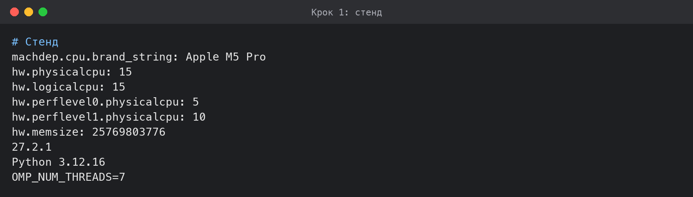

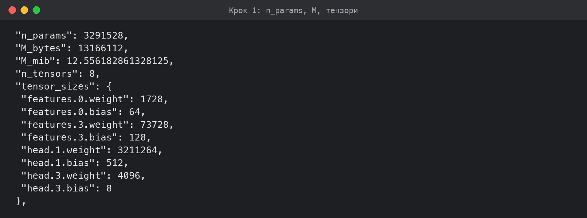

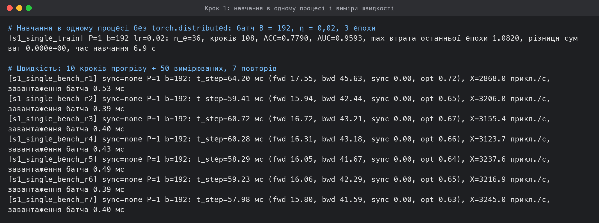

Перевірка n_params: сума восьми доданків формули збігається із сумою `numel` восьми тензорів (у коді `assert`).

| Доданок формули | Значення |
|---|---|
| 9·C·c1 | 1728 |
| c1 | 64 |
| 9·c1·c2 | 73728 |
| c2 | 128 |
| 49·c2·h | 3211264 |
| h | 512 |
| h·K | 4096 |
| K | 8 |
| Сума (збігається з сумою numel усіх 8 тензорів) | 3291528 |

M = 4 · 3 291 528 = 13 166 112 байт = 12,56 МіБ (в умові «близько 12,6 МіБ»).

| Тензор | Елементів | Розмір, МіБ |
|---|---|---|
| features.0.weight | 1728 | 0,007 |
| features.0.bias | 64 | 0,000 |
| features.3.weight | 73728 | 0,281 |
| features.3.bias | 128 | 0,000 |
| head.1.weight | 3211264 | 12,250 |
| head.1.bias | 512 | 0,002 |
| head.3.weight | 4096 | 0,016 |
| head.3.bias | 8 | 0,000 |

Найбільший тензор — вага `head.1.weight` (12,25 МіБ з 12,56): майже весь обмін припадає на один тензор, що важливо для кроку 2.

**Швидкість.** t_step і X(1) для рядка 1 таблиці 2: медіана 7 повторів, розкид і фази кроку нижче. Нижче також показано, що X за сумою кроків відрізняється від X за годинником, з читанням батча, менше ніж на 1,1 %.

| Конфігурація | Повторів | t_step (медіана повторів), мс | t_step мін – макс, мс | X (медіана), прикл./с | X мін – макс | Розкид t_step, % від медіани |
|---|---|---|---|---|---|---|
| 1 процес без distributed, b = 192 | 7 | 59,41 | 57,98 – 64,20 | 3206,0 | 2868,0 – 3245,0 | 10,5 |
| 2 процеси, ручна синхронізація, b = 96 | 7 | 53,43 | 52,07 – 56,11 | 3520,7 | 3269,5 – 3655,9 | 7,6 |
| 2 процеси, DDP, b = 96 (крок 2) | 7 | 45,12 | 44,72 – 47,64 | 4248,7 | 3989,2 – 4285,7 | 6,5 |
| 2 процеси, DDP no_sync, b = 96 (крок 2) | 7 | 43,14 | 41,71 – 49,43 | 4360,3 | 3921,4 – 4573,9 | 17,9 |
| 1 процес, DDP, b = 192 | 7 | 60,87 | 58,24 – 65,28 | 3138,9 | 2908,8 – 3279,1 | 11,6 |
| 2 процеси, DDP, b = 96 (крок 3) | 7 | 43,12 | 41,75 – 45,24 | 4462,3 | 4246,4 – 4598,5 | 8,1 |
| 1 процес, DDP no_sync, b = 192 | 7 | 59,13 | 57,77 – 64,62 | 3230,0 | 2925,4 – 3312,4 | 11,6 |
| 2 процеси, DDP no_sync, b = 96 (крок 3) | 7 | 41,78 | 38,23 – 46,78 | 4586,1 | 4115,9 – 4978,7 | 20,5 |
| 1 процес, DDP, b = 96 | 7 | 32,67 | 31,37 – 34,68 | 2904,9 | 2713,5 – 2993,8 | 10,1 |

| Конфігурація | t_fwd, мс | t_bwd, мс | t_sync, мс | t_opt, мс | t_step, мс | Читання батча, мс (поза t_step) |
|---|---|---|---|---|---|---|
| 1 процес без distributed, b = 192 | 16,06 | 42,44 | 0,00 | 0,65 | 59,41 | 0,40 |
| 2 процеси, ручна синхронізація, b = 96 | 12,65 | 30,24 | 9,78 | 1,07 | 53,43 | 0,26 |
| 2 процеси, DDP, b = 96 (крок 2) | 12,52 | 31,66 | 0,00 | 1,01 | 45,12 | 0,26 |
| 2 процеси, DDP no_sync, b = 96 (крок 2) | 11,77 | 30,47 | 0,00 | 0,82 | 43,14 | 0,29 |
| 1 процес, DDP, b = 192 | 16,10 | 44,19 | 0,00 | 0,62 | 60,87 | 0,38 |
| 2 процеси, DDP, b = 96 (крок 3) | 12,00 | 30,20 | 0,00 | 0,91 | 43,12 | 0,24 |
| 1 процес, DDP no_sync, b = 192 | 16,07 | 42,29 | 0,00 | 0,63 | 59,13 | 0,37 |
| 2 процеси, DDP no_sync, b = 96 (крок 3) | 11,84 | 28,78 | 0,00 | 0,70 | 41,78 | 0,25 |
| 1 процес, DDP, b = 96 | 9,70 | 22,11 | 0,00 | 0,65 | 32,67 | 0,25 |

| Конфігурація | X за сумою 50 кроків, прикл./с | X за годинником 50 кроків разом із читанням батча | Різниця, % |
|---|---|---|---|
| 1 процес без distributed, b = 192 | 3206,0 | 3183,7 | 0,7 |
| 2 процеси, ручна синхронізація, b = 96 | 3520,7 | 3486,0 | 1,0 |
| 2 процеси, DDP, b = 96 (крок 2) | 4248,7 | 4211,0 | 0,9 |
| 2 процеси, DDP no_sync, b = 96 (крок 2) | 4360,3 | 4322,8 | 0,9 |
| 1 процес, DDP, b = 192 | 3138,9 | 3119,1 | 0,6 |
| 2 процеси, DDP, b = 96 (крок 3) | 4462,3 | 4438,4 | 0,5 |
| 1 процес, DDP no_sync, b = 192 | 3230,0 | 3209,9 | 0,6 |
| 2 процеси, DDP no_sync, b = 96 (крок 3) | 4586,1 | 4554,0 | 0,7 |
| 1 процес, DDP, b = 96 | 2904,9 | 2884,4 | 0,7 |

**Навчання в одному процесі.** n_e = 36, 108 кроків, ACC = 0,7790, AUC = 0,9593 (таблиця 2 нижче).

**Висновок.** Один процес із 7 потоками і B = 192: t_step = 59,41 мс, X(1) = 3206 прикл./с; розкид повторів 10,5 % (57,98–64,20 мс), тому далі використано медіани повторів.

# Крок 2. Два процеси: ручна синхронізація і DDP

**Вимога.** Ручна синхронізація (broadcast ваг з процесу 0, all_reduce кожного `p.grad`, ділення на P) на 2 процесах; еквівалентність градієнтів на першому батчі; суми ваг після 50 кроків; t_step і t_sync; DDP з типовим кошиком; t_step,ns окремим прогоном; навчання з DDP.

**Команда.** `./scripts/step2.sh`. Ручна синхронізація реалізована в `do_step` і `wrap` (лістинг у додатку А). Номери прикладів: процес r бере позиції r, r + 2, … перших 192 позицій перестановки епохи 0, тобто саме той перший батч, який бачить навчання на кроці 1. Градієнт g — окремий процес без torch.distributed, а ḡ — два процеси; g зберігається у файл.

*Лістинг 2 – Вивід кроку 2, results/step2.log*

```text
# Фонове навантаження на початку кроку
22:44  up 5 days, 11:43, 1 user, load averages: 5.62 4.08 3.66
PID    COMMAND          %CPU 
29138  prl_vm_app       111.4
31832  BackgroundShortc 42.9 
419    WindowServer     35.6 
0      kernel_task      32.6 
31695  siriactionsd     17.7 

# 2.1 Еквівалентність: g в одному процесі, ḡ на двох (ручна синхронізація), перший батч з B = 192
[grad_single] 1 процес, батч 192: градієнт збережено; повторний обрахунок у тому самому процесі: max відношення різниці 0.000e+00; перші індекси батча [5044, 5041, 5817, 3468, 155, 1299]
[equiv] max |g − ḡ| / max |g| за тензорами = 7.419e-06
   features.0.weight      max|g| = 2.9186e-03   |g − ḡ|/|g| = 7.419e-06   (контроль: g_0 замість ḡ: 4.897e-01)
   features.0.bias        max|g| = 3.3167e-03   |g − ḡ|/|g| = 2.106e-07   (контроль: g_0 замість ḡ: 9.137e-01)
   features.3.weight      max|g| = 5.4318e-03   |g − ḡ|/|g| = 6.087e-06   (контроль: g_0 замість ḡ: 6.844e-01)
   features.3.bias        max|g| = 6.6534e-03   |g − ḡ|/|g| = 3.499e-07   (контроль: g_0 замість ḡ: 6.605e-01)
   head.1.weight          max|g| = 5.4527e-03   |g − ḡ|/|g| = 5.978e-07   (контроль: g_0 замість ḡ: 4.443e-01)
   head.1.bias            max|g| = 1.0637e-02   |g − ḡ|/|g| = 1.751e-07   (контроль: g_0 замість ḡ: 4.711e-01)
   head.3.weight          max|g| = 1.5202e-02   |g − ḡ|/|g| = 3.676e-07   (контроль: g_0 замість ḡ: 6.743e-01)
   head.3.bias            max|g| = 6.5459e-02   |g − ḡ|/|g| = 5.691e-08   (контроль: g_0 замість ḡ: 7.153e-01)

# 2.2 50 кроків з ручною синхронізацією, суми ваг у float64
[sync50] суми ваг (float64) за процесами: ['-95.2529108979027', '-95.2529108979027']; max − min = 0.000e+00

# 2.3 Швидкість: ручна синхронізація, DDP, DDP з no_sync; 7 повторів по колу
[s2_manual_r1] sync=manual P=2 b=96: t_step=52.07 мс (fwd 12.32, bwd 28.90, sync 9.83, opt 1.04), X=3637.3 прикл./с, завантаження батча 0.23 мс
[s2_ddp_r1] sync=ddp P=2 b=96: t_step=44.82 мс (fwd 12.50, bwd 31.17, sync 0.00, opt 1.01), X=4248.7 прикл./с, завантаження батча 0.40 мс
[s2_ddpns_r1] sync=ddp ns P=2 b=96: t_step=43.14 мс (fwd 12.52, bwd 29.72, sync 0.00, opt 0.85), X=4408.3 прикл./с, завантаження батча 0.24 мс
[s2_manual_r2] sync=manual P=2 b=96: t_step=53.43 мс (fwd 12.65, bwd 30.24, sync 9.34, opt 1.09), X=3520.7 прикл./с, завантаження батча 0.50 мс
[s2_ddp_r2] sync=ddp P=2 b=96: t_step=44.72 мс (fwd 12.79, bwd 30.85, sync 0.00, opt 1.06), X=4285.7 прикл./с, завантаження батча 0.24 мс
[s2_ddpns_r2] sync=ddp ns P=2 b=96: t_step=49.43 мс (fwd 12.22, bwd 35.11, sync 0.00, opt 0.97), X=3921.4 прикл./с, завантаження батча 0.48 мс
[s2_manual_r3] sync=manual P=2 b=96: t_step=56.11 мс (fwd 13.11, bwd 31.98, sync 9.74, opt 1.13), X=3401.7 прикл./с, завантаження батча 0.25 мс
[s2_ddp_r3] sync=ddp P=2 b=96: t_step=47.64 мс (fwd 13.41, bwd 32.93, sync 0.00, opt 1.06), X=3989.2 прикл./с, завантаження батча 0.31 мс
[s2_ddpns_r3] sync=ddp ns P=2 b=96: t_step=42.95 мс (fwd 11.06, bwd 30.47, sync 0.00, opt 0.76), X=4297.6 прикл./с, завантаження батча 0.37 мс
[s2_manual_r4] sync=manual P=2 b=96: t_step=54.98 мс (fwd 12.89, bwd 31.09, sync 9.94, opt 1.10), X=3269.5 прикл./с, завантаження батча 0.30 мс
[s2_ddp_r4] sync=ddp P=2 b=96: t_step=46.56 мс (fwd 12.76, bwd 32.68, sync 0.00, opt 1.02), X=4111.3 прикл./с, завантаження батча 0.26 мс
[s2_ddpns_r4] sync=ddp ns P=2 b=96: t_step=44.18 мс (fwd 11.73, bwd 30.75, sync 0.00, opt 0.82), X=4360.3 прикл./с, завантаження батча 0.36 мс
[s2_manual_r5] sync=manual P=2 b=96: t_step=55.32 мс (fwd 12.97, bwd 31.57, sync 9.70, opt 1.07), X=3414.9 прикл./с, завантаження батча 0.37 мс
[s2_ddp_r5] sync=ddp P=2 b=96: t_step=45.59 мс (fwd 12.46, bwd 31.83, sync 0.00, opt 0.94), X=4184.3 прикл./с, завантаження батча 0.23 мс
[s2_ddpns_r5] sync=ddp ns P=2 b=96: t_step=41.71 мс (fwd 10.93, bwd 29.47, sync 0.00, opt 0.68), X=4573.9 прикл./с, завантаження батча 0.28 мс
[s2_manual_r6] sync=manual P=2 b=96: t_step=52.44 мс (fwd 12.07, bwd 29.70, sync 9.78, opt 0.96), X=3655.9 прикл./с, завантаження батча 0.26 мс
[s2_ddp_r6] sync=ddp P=2 b=96: t_step=45.12 мс (fwd 12.47, bwd 31.66, sync 0.00, opt 0.95), X=4271.7 прикл./с, завантаження батча 0.27 мс
[s2_ddpns_r6] sync=ddp ns P=2 b=96: t_step=42.45 мс (fwd 12.08, bwd 29.58, sync 0.00, opt 0.86), X=4500.1 прикл./с, завантаження батча 0.29 мс
[s2_manual_r7] sync=manual P=2 b=96: t_step=52.44 мс (fwd 12.02, bwd 29.56, sync 9.83, opt 0.98), X=3635.6 прикл./с, завантаження батча 0.24 мс
[s2_ddp_r7] sync=ddp P=2 b=96: t_step=44.96 мс (fwd 12.52, bwd 31.61, sync 0.00, opt 0.96), X=4253.8 прикл./с, завантаження батча 0.25 мс
[s2_ddpns_r7] sync=ddp ns P=2 b=96: t_step=44.17 мс (fwd 11.77, bwd 31.75, sync 0.00, opt 0.82), X=4286.1 прикл./с, завантаження батча 0.25 мс

# 2.4 Навчання з DDP на 2 процесах: батч процесу 96, B = 192, η = 0,02, 3 епохи
[s2_ddp_train] P=2 b=96 lr=0.02: n_e=36, кроків 108, ACC=0.7790, AUC=0.9594, max втрата останньої епохи 1.0830, різниця сум ваг 0.000e+00, час навчання 5.5 с
```

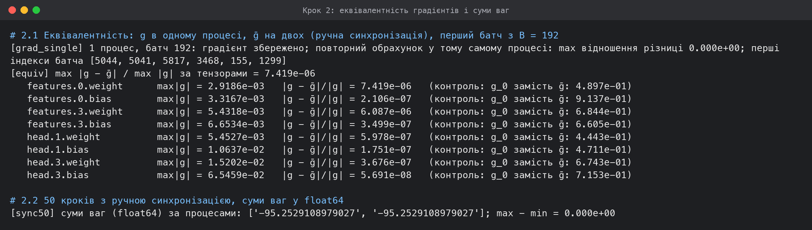

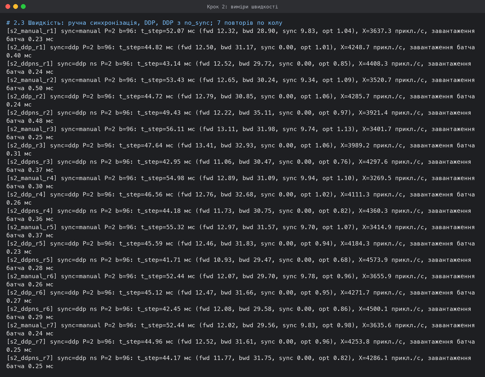

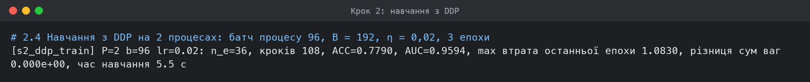

**Еквівалентність.** Найбільше відношення max|g − ḡ| / max|g| за тензорами дорівнює 7,42·10⁻⁶ (тензор `features.0.weight`; решта від 6·10⁻⁸ до 6·10⁻⁶). Це в межах 10⁻⁶–10⁻⁵ з умови: різниця виникає лише від порядку додавання у float32. Це справжня перевірка, а не збіг за побудовою: контроль, у якому замість ḡ взято градієнт лише процесу 0 (половина батча), дає відхилення 0,44–0,91, тобто на п'ять порядків більше. Повторний обрахунок g в тому самому процесі дає різницю рівно 0, отже 7·10⁻⁶ — не шум обчислень, а наслідок іншого порядку додавання.

| Тензор | max \|g\| | \|g − ḡ\| / max \|g\| | Контроль: \|g − g_0\| / max \|g\| (градієнт лише процесу 0) |
|---|---|---|---|
| features.0.weight | 2,92·10^-3^ | 7,42·10^-6^ | 0,490 |
| features.0.bias | 3,32·10^-3^ | 2,11·10^-7^ | 0,914 |
| features.3.weight | 5,43·10^-3^ | 6,09·10^-6^ | 0,684 |
| features.3.bias | 6,65·10^-3^ | 3,50·10^-7^ | 0,660 |
| head.1.weight | 5,45·10^-3^ | 5,98·10^-7^ | 0,444 |
| head.1.bias | 1,06·10^-2^ | 1,75·10^-7^ | 0,471 |
| head.3.weight | 1,52·10^-2^ | 3,68·10^-7^ | 0,674 |
| head.3.bias | 6,55·10^-2^ | 5,69·10^-8^ | 0,715 |

**Суми ваг після 50 кроків.** Обидва процеси мають суму −95,2529108979027, різниця max − min = 0. Нуль очікувався: all_reduce суми двох чисел комутативний, усереднений градієнт побітово однаковий, а початкові ваги й стан оптимізатора однакові. Тому це перевірка, що розсилка ваг і детермінізм працюють, а не перевірка точності арифметики.

| Процес | Сума ваг після 50 кроків (float64) |
|---|---|
| 0 | -95.2529108979027 |
| 1 | -95.2529108979027 |

**Таблиця 2. Синхронізація градієнтів** (медіани 7 повторів; для ручної синхронізації «час обміну» = t_sync, для DDP = t_comm,exp = t_step − t_step,ns; частка = час обміну / t_step).

| Режим | t_step, мс | Час обміну на крок, мс | Частка кроку в обміні | X, прикл./с |
|---|---|---|---|---|
| 1 процес, батч B | 59,41 | 0 | 0 | 3206,0 |
| P_max процесів, ручна синхронізація | 53,43 | 9,78 | 0,183 | 3520,7 |
| P_max процесів, DDP | 45,12 | 1,98 | 0,044 | 4248,7 |
| P_max процесів, DDP, no_sync | 43,14 | 0 | 0 | 4360,3 |

| max \|g − ḡ\| / max \|g\| | Різниця сум ваг між процесами після 50 кроків | ACC, 1 процес | ACC, DDP на P_max | AUC, 1 процес | AUC, DDP на P_max |
|---|---|---|---|---|---|
| 7,42·10^-6^ | 0 | 0,7790 | 0,7790 | 0,9593 | 0,9594 |

**Парні різниці DDP − no_sync.** t_comm,exp — різниця двох медіан, кожна з яких має розкид 6–18 %, тому наведено ще й парні різниці за номером повтору (повтори чергуються, парні значення близькі за часом).

| Пара | Повторів | Медіана парних різниць, мс | мін – макс, мс | Кількість відʼємних різниць |
|---|---|---|---|---|
| 2 процеси, крок 2: DDP − no_sync | 7 | 2,38 | −4,71 – 4,69 | 1 |
| 2 процеси, крок 3: DDP − no_sync | 7 | 3,16 | −3,66 – 3,65 | 2 |
| 1 процес, крок 3: DDP − no_sync | 7 | 0,73 | −0,86 – 3,10 | 1 |

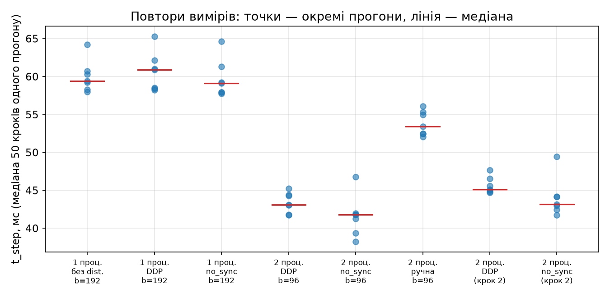

**Навчання зі зіставленням траєкторій.** DDP на 2 процесах: ACC = 0,7790, AUC = 0,9594; один процес з B = 192: ACC = 0,7790, AUC = 0,9593. Втрати кроків спочатку збігаються (різниця 0–2·10⁻⁷ у перших кроках), але далі розходяться через округлення (6·10⁻⁴ на кроці 36, найбільше 2,8·10⁻² на кроці 87): рівність градієнтів точна лише для дійсних чисел, а нелінійна динаміка навчання підсилює різницю 10⁻⁷. Тому траєкторії двох режимів не збігаються побітово, хоч ACC однакова. Різниця сум ваг між процесами після навчання з DDP теж 0.

**Висновок.** Паралельний крок дає той самий градієнт з точністю 7·10⁻⁶. Ручна синхронізація витрачає t_sync = 9,78 мс (частка 0,183 від кроку 53,43 мс): 8 окремих all_reduce, усі після backward, без перекриття; майже весь час — один тензор 12,25 МіБ (≈ 1,3 ГБ/с через loopback). DDP перекриває обмін з backward: його t_step 45,12 мс менший, ніж у ручної (на 8,3 мс), і лише на 1,98 мс (4,4 %) більший за no_sync. Але парні різниці коливаються від −4,7 до +4,7 мс, тож t_comm,exp = 2 мс — оцінка зі шумом того ж порядку, а не точне число. Обидва двопроцесні режими швидші за один процес (X = 3521 і 4249 проти 3206 прикл./с).

# Крок 3. Strong scaling

**Вимога.** DDP, P від 1 до P_max = 2, B = 192 (b = 192 і 96); P = 1 теж через torchrun з DDP; S, E, e, c; графік X(P) з ідеальною прямою. Рядки P = 3 і 4 не заповнюються (P_max = 2).

**Команда.** `./scripts/step3.sh` (7 повторів по колу чотирьох конфігурацій).

*Лістинг 3 – Вивід кроку 3, results/step3.log*

```text
# Фонове навантаження на початку кроку
22:46  up 5 days, 11:46, 1 user, load averages: 6.93 5.15 4.15
PID    COMMAND          %CPU
29138  prl_vm_app       67.3
419    WindowServer     33.9
0      kernel_task      15.1
32759  top              6.9 
568    coreaudiod       5.8 

# Strong scaling: B = 192; 7 повторів по колу: DDP і DDP з no_sync для P = 1 (b = 192) і P = 2 (b = 96)
[s3_p1_r1] sync=ddp P=1 b=192: t_step=65.28 мс (fwd 17.33, bwd 47.12, sync 0.00, opt 0.69), X=2908.8 прикл./с, завантаження батча 0.42 мс
[s3_p2_r1] sync=ddp P=2 b=96: t_step=45.24 мс (fwd 12.63, bwd 31.55, sync 0.00, opt 1.01), X=4246.4 прикл./с, завантаження батча 0.24 мс
[s3_p1ns_r1] sync=ddp ns P=1 b=192: t_step=64.62 мс (fwd 16.86, bwd 46.96, sync 0.00, opt 0.69), X=2925.4 прикл./с, завантаження батча 0.45 мс
[s3_p2ns_r1] sync=ddp ns P=2 b=96: t_step=41.80 мс (fwd 11.09, bwd 29.46, sync 0.00, opt 0.70), X=4586.1 прикл./с, завантаження батча 0.28 мс
[s3_p1_r2] sync=ddp P=1 b=192: t_step=62.15 мс (fwd 16.49, bwd 45.06, sync 0.00, opt 0.67), X=3055.1 прикл./с, завантаження батча 0.39 мс
[s3_p2_r2] sync=ddp P=2 b=96: t_step=44.26 мс (fwd 12.36, bwd 30.97, sync 0.00, opt 0.93), X=4304.9 прикл./с, завантаження батча 0.27 мс
[s3_p1ns_r2] sync=ddp ns P=1 b=192: t_step=61.33 мс (fwd 16.34, bwd 44.35, sync 0.00, opt 0.64), X=3121.8 прикл./с, завантаження батча 0.39 мс
[s3_p2ns_r2] sync=ddp ns P=2 b=96: t_step=41.99 мс (fwd 11.95, bwd 29.38, sync 0.00, opt 0.70), X=4559.7 прикл./с, завантаження батча 0.27 мс
[s3_p1_r3] sync=ddp P=1 b=192: t_step=60.87 мс (fwd 16.12, bwd 44.19, sync 0.00, opt 0.62), X=3138.7 прикл./с, завантаження батча 0.40 мс
[s3_p2_r3] sync=ddp P=2 b=96: t_step=43.12 мс (fwd 12.00, bwd 30.20, sync 0.00, opt 0.91), X=4462.3 прикл./с, завантаження батча 0.22 мс
[s3_p1ns_r3] sync=ddp ns P=1 b=192: t_step=59.13 мс (fwd 16.07, bwd 42.44, sync 0.00, opt 0.63), X=3230.0 прикл./с, завантаження батча 0.37 мс
[s3_p2ns_r3] sync=ddp ns P=2 b=96: t_step=46.78 мс (fwd 13.25, bwd 32.78, sync 0.00, opt 0.88), X=4115.9 прикл./с, завантаження батча 0.52 мс
[s3_p1_r4] sync=ddp P=1 b=192: t_step=61.04 мс (fwd 16.10, bwd 44.44, sync 0.00, opt 0.61), X=3138.9 прикл./с, завантаження батча 0.38 мс
[s3_p2_r4] sync=ddp P=2 b=96: t_step=43.04 мс (fwd 11.98, bwd 30.18, sync 0.00, opt 0.90), X=4464.6 прикл./с, завантаження батча 0.22 мс
[s3_p1ns_r4] sync=ddp ns P=1 b=192: t_step=57.94 мс (fwd 15.80, bwd 41.50, sync 0.00, opt 0.61), X=3275.9 прикл./с, завантаження батча 0.37 мс
[s3_p2ns_r4] sync=ddp ns P=2 b=96: t_step=39.39 мс (fwd 10.50, bwd 28.24, sync 0.00, opt 0.65), X=4764.1 прикл./с, завантаження батча 0.22 мс
[s3_p1_r5] sync=ddp P=1 b=192: t_step=58.50 мс (fwd 15.79, bwd 41.88, sync 0.00, opt 0.62), X=3269.4 прикл./с, завантаження батча 0.38 мс
[s3_p2_r5] sync=ddp P=2 b=96: t_step=44.41 мс (fwd 12.34, bwd 30.98, sync 0.00, opt 0.94), X=4338.6 прикл./с, завантаження батча 0.22 мс
[s3_p1ns_r5] sync=ddp ns P=1 b=192: t_step=57.77 мс (fwd 15.71, bwd 41.37, sync 0.00, opt 0.62), X=3312.4 прикл./с, завантаження батча 0.37 мс
[s3_p2ns_r5] sync=ddp ns P=2 b=96: t_step=41.25 мс (fwd 11.84, bwd 28.70, sync 0.00, opt 0.84), X=4640.6 прикл./с, завантаження батча 0.23 мс
[s3_p1_r6] sync=ddp P=1 b=192: t_step=58.24 мс (fwd 15.75, bwd 41.87, sync 0.00, opt 0.61), X=3279.1 прикл./с, завантаження батча 0.37 мс
[s3_p2_r6] sync=ddp P=2 b=96: t_step=41.77 мс (fwd 11.84, bwd 28.97, sync 0.00, opt 0.87), X=4543.2 прикл./с, завантаження батча 0.26 мс
[s3_p1ns_r6] sync=ddp ns P=1 b=192: t_step=57.92 мс (fwd 15.84, bwd 41.44, sync 0.00, opt 0.62), X=3293.2 прикл./с, завантаження батча 0.37 мс
[s3_p2ns_r6] sync=ddp ns P=2 b=96: t_step=38.23 мс (fwd 10.38, bwd 27.33, sync 0.00, opt 0.63), X=4978.7 прикл./с, завантаження батча 0.25 мс
[s3_p1_r7] sync=ddp P=1 b=192: t_step=58.40 мс (fwd 15.77, bwd 41.94, sync 0.00, opt 0.60), X=3271.4 прикл./с, завантаження батча 0.37 мс
[s3_p2_r7] sync=ddp P=2 b=96: t_step=41.75 мс (fwd 11.82, bwd 29.08, sync 0.00, opt 0.88), X=4598.5 прикл./с, завантаження батча 0.26 мс
[s3_p1ns_r7] sync=ddp ns P=1 b=192: t_step=59.25 мс (fwd 16.17, bwd 42.29, sync 0.00, opt 0.65), X=3146.1 прикл./с, завантаження батча 0.38 мс
[s3_p2ns_r7] sync=ddp ns P=2 b=96: t_step=41.78 мс (fwd 12.23, bwd 28.78, sync 0.00, opt 0.91), X=4514.4 прикл./с, завантаження батча 0.24 мс
```

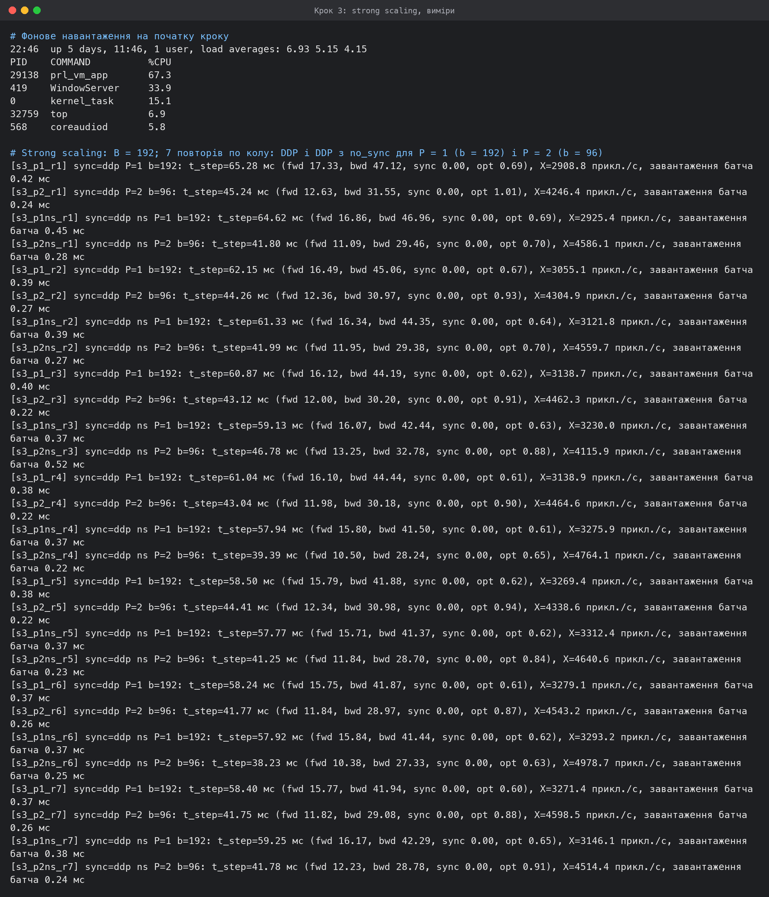

**Таблиця 3. Strong scaling, B = const** (X(1) тут — одного процесу з DDP через torchrun, 3139 прикл./с; у таблиці 2 — процес без distributed, 3206 прикл./с; різниця 2 % у межах розкиду).

| P | b | t_step, мс | t_step,ns, мс | X, прикл./с | S | E | e | c |
|---|---|---|---|---|---|---|---|---|
| 1 | 192 | 60,87 | 59,13 | 3138,9 | 1 | 1 | − | 0,029 |
| 2 | 96 | 43,12 | 41,78 | 4462,3 | 1,422 | 0,711 | 0,407 | 0,031 |

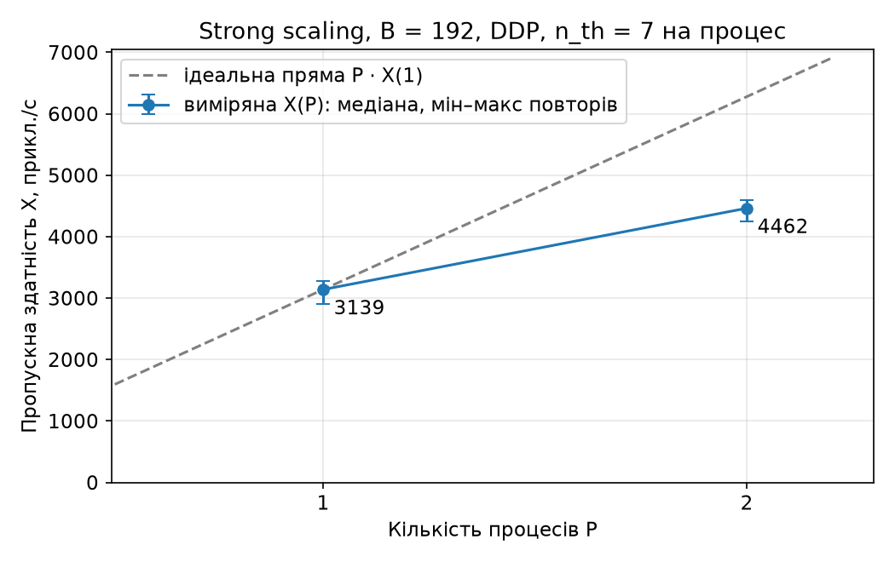

S(2) = 4462 / 3139 = 1,42, E(2) = 0,71, e(2) = (1/1,42 − 1/2) / (1 − 1/2) = 0,41. Метрика Карпа-Флатта визначена лише для P = 2: одна точка не дозволяє сказати, росте e з P чи ні, тож висновку про тренд (обмін чи послідовна частина) робити не можна.

Частка обміну c = 0,031 (P = 2) і 0,029 (P = 1, де all_reduce тривіальний, отже ≈ 0,03 — це рівень шуму вимірювання різниці медіан). Тобто обмін пояснює щонайбільше 3 % кроку, тоді як втрата ефективності — 29 %. Розклад:

| Величина | Значення |
|---|---|
| S = X(2) / X(1) із синхронізацією (таблиця 3) | 1,422 |
| S без обміну = X_ns(2) / X_ns(1), обидва прогони з no_sync | 1,420 |
| t_step, 1 процес, b = 96, DDP (таблиця 4), мс | 32,67 |
| t_step,ns, 2 процеси, b = 96, без обміну (таблиця 3), мс | 41,78 |
| Уповільнення кроку b = 96 від появи другого процесу без жодного обміну, мс | 9,12 |
| те саме, % від t_step одного процесу | 27,9 |
| t_comm,exp, 2 процеси, b = 96, мс | 1,33 |
| E_w за відношенням t_step(P = 1) / t_step(P = 2) (в таблиці 4 E_w рахується за X, тому число трохи інше) | 0,758 |
| E_w без обміну = t_step(P = 1) / t_step,ns(P = 2) | 0,782 |

S без обміну (обидва прогони з no_sync) дорівнює 1,420, тобто збігається з S із синхронізацією 1,422: втрата ефективності не з обміну. Це **несподіваний для умови результат**: очікувалося, що e визначатиме обмін. Висновок про причину нижче є гіпотезою, прямих вимірів розкладу потоків я не робив: два процеси по 7 потоків займають 14 з 15 ядер, з яких лише 5 продуктивні, крок b = 96 уповільнюється на 9,1 мс (28 %) від самої появи другого процесу без жодного обміну; це узгоджується з конкуренцією за ядра, кеші й пам'ять та з неоднорідністю ядер.

**Висновок.** Два процеси дають лише 1,42× прискорення (E = 0,71) при тому, що частка обміну не більше 3 %; DDP тут обмежений не мережею, а обчислювальними ресурсами однієї машини. Розкид повторів 8–20 %, тому S має похибку порядку ± 0,1.

# Крок 4. Weak scaling і правило масштабування швидкості навчання

**Вимога.** Weak scaling b = 96, P = 1 і 2 (рядок P = 2 з таблиці 3); навчання в двох додаткових режимах (P = 1, b = 96, η₀; P = 2, η_P = 0,04) і порівняння з режимом кроку 2.

**Команда.** `./scripts/step4.sh`. Навчання P = 1 виконано без torch.distributed (той самий порядок прикладів семплером з `num_replicas = 1`).

*Лістинг 4 – Вивід кроку 4, results/step4.log*

```text
# Фонове навантаження на початку кроку
22:49  up 5 days, 11:48, 1 user, load averages: 5.43 5.43 4.45
PID    COMMAND          %CPU
29138  prl_vm_app       42.1
419    WindowServer     30.7
0      kernel_task      7.9 
33526  top              7.9 
568    coreaudiod       5.4 

# Weak scaling: b = 96; P = 1 (DDP через torchrun), 7 повторів. Рядок P = 2 береться з кроку 3
[s4_p1_r1] sync=ddp P=1 b=96: t_step=32.67 мс (fwd 9.63, bwd 22.27, sync 0.00, opt 0.65), X=2912.8 прикл./с, завантаження батча 0.25 мс
[s4_p1_r2] sync=ddp P=1 b=96: t_step=32.78 мс (fwd 9.70, bwd 22.10, sync 0.00, opt 0.66), X=2945.4 прикл./с, завантаження батча 0.25 мс
[s4_p1_r3] sync=ddp P=1 b=96: t_step=32.58 мс (fwd 9.70, bwd 22.11, sync 0.00, opt 0.65), X=2904.9 прикл./с, завантаження батча 0.22 мс
[s4_p1_r4] sync=ddp P=1 b=96: t_step=33.75 мс (fwd 10.06, bwd 22.93, sync 0.00, opt 0.66), X=2776.5 прикл./с, завантаження батча 0.27 мс
[s4_p1_r5] sync=ddp P=1 b=96: t_step=34.68 мс (fwd 10.48, bwd 23.40, sync 0.00, opt 0.67), X=2713.5 прикл./с, завантаження батча 0.27 мс
[s4_p1_r6] sync=ddp P=1 b=96: t_step=32.20 мс (fwd 9.84, bwd 21.77, sync 0.00, opt 0.62), X=2756.1 прикл./с, завантаження батча 0.27 мс
[s4_p1_r7] sync=ddp P=1 b=96: t_step=31.37 мс (fwd 9.27, bwd 21.53, sync 0.00, opt 0.62), X=2993.8 прикл./с, завантаження батча 0.22 мс

# Навчання: P = 1, b = 96, η = 0,02 (без torch.distributed)
[s4_p1_train] P=1 b=96 lr=0.02: n_e=72, кроків 216, ACC=0.8366, AUC=0.9776, max втрата останньої епохи 0.6986, різниця сум ваг 0.000e+00, час навчання 7.3 с

# Навчання: P = 2, b = 96 (B = 192), η_P = 0,02 · 2 = 0,04 (лінійне правило, B_0 = b)
[s4_p2_lrP_train] P=2 b=96 lr=0.04: n_e=36, кроків 108, ACC=0.8077, AUC=0.9725, max втрата останньої епохи 0.7273, різниця сум ваг 0.000e+00, час навчання 5.0 с
```

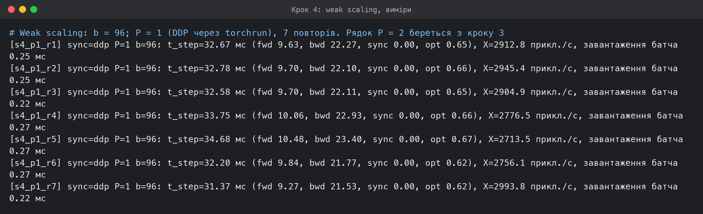

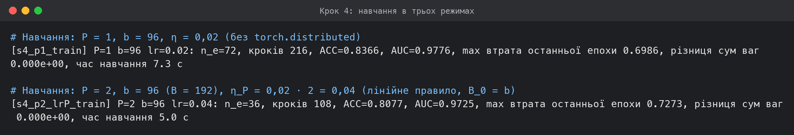

**Таблиця 4. Weak scaling, b = const.**

| P | B_P | t_step, мс | X, прикл./с | S_w | E_w |
|---|---|---|---|---|---|
| 1 | 96 | 32,67 | 2904,9 | 1 | 1 |
| 2 | 192 | 43,12 | 4462,3 | 1,536 | 0,768 |

S_w = 4462 / 2905 = 1,54, E_w = 0,77. Втрата ефективності так само пояснюється не обміном (c ≈ 0,03), а уповільненням кроку з 32,7 до 43,1 мс при появі другого процесу (таблиця розкладу в кроці 3: E_w без обміну 0,78). E_w = 0,77 трохи вище за E = 0,71 у strong scaling, але в межах розкиду повторів (8–10 %) відмінність між ними не можна вважати підтвердженою.

**Таблиця 5. Якість за різних глобальних батчів.**

| Режим | B_P | η | Кроків оптимізатора за n_ep епох | ACC | AUC | Найбільша втрата за останню епоху |
|---|---|---|---|---|---|---|
| P = 1 | 96 | 0,02 (η₀) | 216 | 0,8366 | 0,9776 | 0,6986 |
| P = P_max, з кроку 2 | 192 | 0,02 (η₀) | 108 | 0,7790 | 0,9594 | 1,0830 |
| P = P_max | 192 | 0,04 (η_P) | 108 | 0,8077 | 0,9725 | 0,7273 |

Перевірка кількості кроків: n_e за формулою збігається з фактичним `len(DataLoader)`.

| Режим | n_e за формулою ⌊⌈N / P⌉ / b⌋ | n_e фактичний (len(DataLoader)) | Кроків за 3 епохи: 3 · n_e | Кроків виконано |
|---|---|---|---|---|
| P = 1, b = 96 | 72 | 72 | 216 | 216 |
| P = 2, b = 96, η₀ | 36 | 36 | 108 | 108 |
| P = 2, b = 96, η_P | 36 | 36 | 108 | 108 |
| P = 1, b = 192 (крок 1) | 36 | 36 | 108 | 108 |

| Режим | Втрата кроку 1 | Найбільша втрата за епоху 1 | Середня втрата епохи 1 | Середня втрата епохи 3 | Втрата останнього кроку | Є NaN |
|---|---|---|---|---|---|---|
| P = 1, b = 96, η₀ | 2,0727 | 2,0727 | 1,4180 | 0,5204 | 0,4860 | ні |
| P = 2, B = 192, η₀ | 2,0740 | 2,0740 | 1,7180 | 0,7843 | 0,6448 | ні |
| P = 2, B = 192, η_P | 2,0740 | 2,0740 | 1,6001 | 0,5530 | 0,4812 | ні |

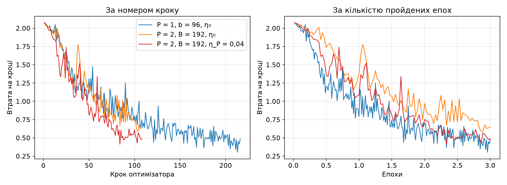

**Висновки.** (1) Той самий B = 192 з η₀ має удвічі менше кроків за ті ж 3 епохи, і ACC падає з 0,8366 до 0,7790 (AUC 0,9776 → 0,9594): модель отримала вдвічі менше оновлень. (2) Лінійне правило η_P = 0,04 повертає ACC до 0,8077 (AUC 0,9725) і втрату останньої епохи (максимум 0,727 проти 1,083 з η₀), але не до рівня P = 1 (0,8366 / 0,6986). (3) **Розходження не сталося:** без розігріву η_P = 0,04 не дало ні NaN, ні зростання втрати; найбільша втрата за епоху 1 дорівнює втраті кроку 1 (2,07). (4) Усі три цифри — один прогін на режим з одним зерном; різниці ACC в 3 і 6 пунктів збігаються за напрямком з очікуваним, але статистичну значущість не оцінено.

# Крок 5. Контрольні точки і відновлення після відмови

**Вимога.** DDP на 2 процесах з контрольними точками кожні K_c = 10 кроків (rank 0, `ckpt.tmp` → `os.replace` → `ckpt.pt`, `dist.barrier`), відновленням під час старту (читання `ckpt.pt`, `sampler.set_epoch`, пропуск `step_in_epoch` батчів) і відмовою rank 1 на початку кроку 25 (файл-позначка, `os._exit(1)`); `torchrun --max-restarts=1` зі статичною адресою; крок останньої контрольної точки, кроки повторно, t_lost; порівняння втрат на кроках 23–27 і ACC з прогоном без відмови з кроку 2.

**Команда.** `./scripts/step5.sh`. Вивід — цілим одним запуском скрипта. Зависання відновлення через сховище рандеву (див. таблицю змін) виявлено раніше, на коротких налагоджувальних запусках `--max-steps 30`; їхніх виводів у репозиторії немає, а `step5.sh` виконано один раз після виправлення.

*Лістинг 5 – Вивід кроку 5, results/step5.log*

```text
# Фонове навантаження на початку кроку
22:50  up 5 days, 11:49, 1 user, load averages: 6.88 5.81 4.65
PID    COMMAND          %CPU
29138  prl_vm_app       58.7
419    WindowServer     37.4
0      kernel_task      10.9
33757  top              8.3 
568    coreaudiod       6.6 

# Прогін з відмовою: torchrun --max-restarts=1, статична адреса групи
W1123 22:50:07.000000 33771 torch/distributed/elastic/multiprocessing/api.py:1028] Sending process 33775 closing signal SIGTERM
E1123 22:50:07.020000 33771 torch/distributed/elastic/multiprocessing/api.py:1002] failed (exitcode: 1) local_rank: 1 (pid: 33776) of binary: /Users/bogdan/My Files/Documents/uni/Високопродуктивні/lab6/.venv/bin/python3.12
[s5_fail] P=2 b=96 lr=0.02: n_e=36, кроків 108, ACC=0.7790, AUC=0.9594, max втрата останньої епохи 1.0830, різниця сум ваг 0.000e+00, час навчання 4.7 с

# Файл-позначка (час відмови, секунди Unix) і журнал подій
1795467006.891145
{"event": "proc_start", "rank": 0, "t_proc_start": 1795467004.398935, "t": 1795467005.635796, "attempt": 0}
{"event": "proc_start", "rank": 1, "t_proc_start": 1795467004.403709, "t": 1795467005.636225, "attempt": 0}
{"event": "ckpt", "step": 10, "t": 1795467006.163427, "attempt": 0}
{"event": "ckpt", "step": 20, "t": 1795467006.675124, "attempt": 0}
{"event": "fail", "step": 25, "rank": 1, "t": 1795467006.891435, "attempt": 0}
{"event": "proc_start", "rank": 0, "t_proc_start": 1795467007.05054, "t": 1795467008.491601, "attempt": 1}
{"event": "proc_start", "rank": 1, "t_proc_start": 1795467007.054615, "t": 1795467008.4918551, "attempt": 1}
{"event": "resume", "from_step": 20, "epoch": 0, "step_in_epoch": 20, "t": 1795467008.501017, "attempt": 1}
{"event": "first_step_after_resume", "step": 21, "t": 1795467008.590751, "attempt": 1}
{"event": "ckpt", "step": 30, "t": 1795467009.065321, "attempt": 1}
{"event": "ckpt", "step": 40, "t": 1795467009.607263, "attempt": 1}
{"event": "ckpt", "step": 50, "t": 1795467010.083647, "attempt": 1}
{"event": "ckpt", "step": 60, "t": 1795467010.5747, "attempt": 1}
{"event": "ckpt", "step": 70, "t": 1795467011.106289, "attempt": 1}
{"event": "ckpt", "step": 80, "t": 1795467011.6817799, "attempt": 1}
{"event": "ckpt", "step": 90, "t": 1795467012.263653, "attempt": 1}
{"event": "ckpt", "step": 100, "t": 1795467012.817077, "attempt": 1}

# Контроль: ті самі контрольні точки без відмови (чи змінюють вони навчання)
[s5_ckpt_nofail] P=2 b=96 lr=0.02: n_e=36, кроків 108, ACC=0.7790, AUC=0.9594, max втрата останньої епохи 1.0830, різниця сум ваг 0.000e+00, час навчання 5.7 с
```

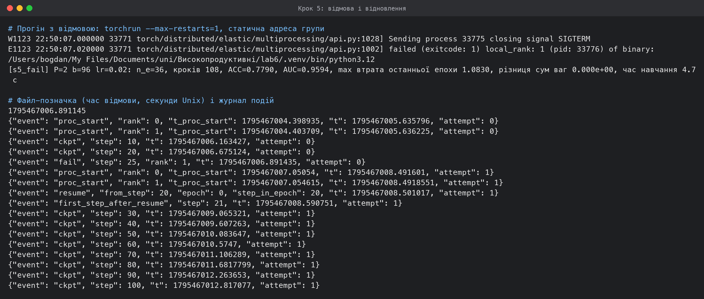

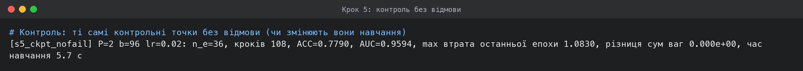

**Таблиця 6. Відмова і відновлення.** t_f і t_c — час подій з `events.jsonl`; t_r від відмови до кінця кроку 21.

| K_c | s_f | Крок останньої контрольної точки | Кроків виконано повторно | t_lost, с |
|---|---|---|---|---|
| 10 | 25 | 20 | 4 | 1,92 |

Складові t_lost:

| Складова | Значення, с |
|---|---|
| t_f − t_c: від запису контрольної точки (крок 20) до відмови | 0,216 |
|    з них виконання кроків 21–24 до відмови (від кінця кроку 20 до відмови) | 0,225 |
| t_r: від відмови до завершення першого кроку після відновлення (крок 21) | 1,699 |
|    відмова → старт нових процесів (час початку процесу, спроба 1) | 0,159 |
|    старт процесу → група створена, контрольна точка прочитана (подія resume) | 1,450 |
|    resume → кінець кроку 21 | 0,090 |
| t_lost = (t_f − t_c) + t_r | 1,916 |
| Для порівняння: 4 повторні кроки за тривалістю кроків спроби 1 | 0,207 |
| Час файла-позначки − час події fail (контроль годинника), с | −0,000290 |

t_lost = (t_f − t_c) + t_r = 0,216 + 1,699 = 1,916 с. Повторно виконано 4 кроки (21–24): останній завершений крок до відмови 24, контрольна точка на кроці 20. Для цієї відмови K_c / 2 = 5 кроків дали б у середньому, а тут — 4. Основну частину t_lost (1,45 з 1,92 с) займає старт нових процесів до створення групи і читання контрольної точки (імпорт PyTorch, завантаження даних), саме повторення чотирьох кроків — лише 0,2 с. Відновлення швидке тому, що модель мала 12,6 МіБ і крок ≈ 50 мс; для довших кроків внесок повторних кроків зростав би до K_c / 2 кроків.

| Крок | s_f − 2 = 23 | s_f − 1 = 24 | s_f = 25 | s_f + 1 = 26 | s_f + 2 = 27 | ACC після n_ep епох |
|---|---|---|---|---|---|---|
| Втрата, прогін з відмовою | 1,634235 | 1,585747 | 1,567839 | 1,515025 | 1,444932 | 0,7790 |
| Втрата, прогін без відмови | 1,634235 | 1,585747 | 1,567839 | 1,515025 | 1,444932 | 0,7790 |

| Крок | Спроба 0 (до відмови) | Спроба 1 (після відновлення) | Без відмови (крок 2) | Спроба 1 − без відмови |
|---|---|---|---|---|
| 19 | 1,773119 | − | 1,773119 | − |
| 20 | 1,796102 | − | 1,796102 | − |
| 21 | 1,741743 | 1,741743 | 1,741743 | 0 |
| 22 | 1,680531 | 1,680531 | 1,680531 | 0 |
| 23 | 1,634235 | 1,634235 | 1,634235 | 0 |
| 24 | 1,585747 | 1,585747 | 1,585747 | 0 |
| 25 | − | 1,567839 | 1,567839 | 0 |
| 26 | − | 1,515025 | 1,515025 | 0 |
| 27 | − | 1,444932 | 1,444932 | 0 |
| 28 | − | 1,353712 | 1,353712 | 0 |

| Порівняння втрат за кроками | Кроків | Кроків з відмінною втратою (float32) | Найбільша |різниця| |
|---|---|---|---|
| прогін з відмовою (остаточна траєкторія) і без відмови (крок 2) | 108 | 0 | 0 |
|   те саме, лише кроки після відновлення (21…) | 88 | 0 | 0 |
| прогін з контрольними точками без відмови і без відмови (крок 2) | 108 | 0 | 0 |
| 1 процес B = 192 (крок 1) і DDP P = 2 (крок 2) | 108 | 102 | 2,81·10^-2^ |

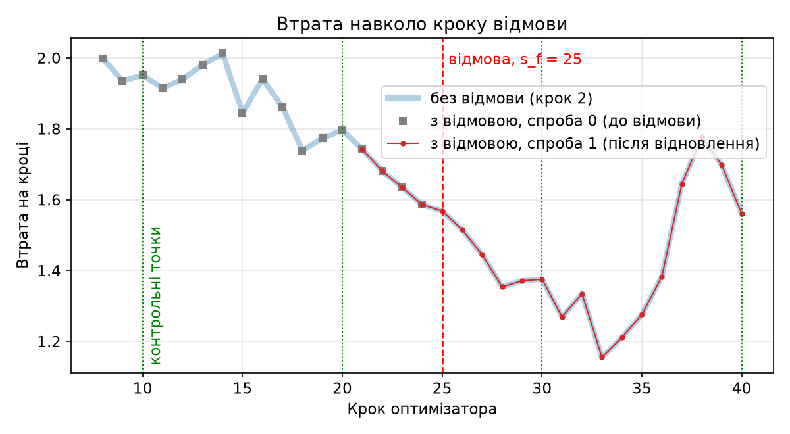

**Висновок.** Втрата на кроках 23–27 і на всіх 108 кроках прогону з відмовою збігається з прогоном без відмови **побітово** (різниця 0 у float32), так само ACC = 0,7790; кроки 21–24 повторно дали ті самі втрати, що й до відмови. Це випливає з відновлення ваг і моментів, того самого порядку прикладів (`set_epoch` і пропуск батчів), однакових n_th і детермінованого all_reduce двох процесів. Прогін з контрольними точками без відмови також збігається побітово: самі контрольні точки навчання не змінюють. Збіг побітовий, бо обчислення детерміновані; без відновлення стану оптимізатора (момент SGD) втрати після відновлення, очікувано, відрізнялися б, але цей варіант я не запускав.

# Висновки

1. n_params = 3 291 528, M = 12,56 МіБ; n_th = 7 для всіх прогонів (C_phys = 15, 5 + 10 неоднорідних ядер).
2. Градієнт на двох процесах збігається з градієнтом на одному з відхиленням 7,4·10⁻⁶; різниця сум ваг після 50 кроків 0.
3. Ручна синхронізація: t_sync = 9,78 мс (18,3 % кроку); DDP перекриває обмін, t_comm,exp ≈ 2 мс (4,4 %), але оцінка коливається в межах ± 4,7 мс.
4. Strong scaling: S(2) = 1,42, E = 0,71, e = 0,41 (одна точка, тренд не визначається); weak: S_w = 1,54, E_w = 0,77. Втрата ефективності не з обміну (S без обміну 1,42), ймовірно, конкуренція за ядра на неоднорідному процесорі.
5. Подвоєння B без зміни η вдвічі зменшило кількість кроків і ACC з 0,837 до 0,779; η_P = 0,04 повернула 0,808 без розходження.
6. Відновлення: контрольна точка на кроці 20, 4 повторні кроки, t_lost = 1,92 с, переважно старт процесів; траєкторія збігається з прогоном без відмови побітово.

# Використання генеративних моделей

<!-- заповнює автор -->

# Додаток А. Скрипт навчання

*Лістинг 6 – Скрипт навчання, train.py*

```python
#!/usr/bin/env python3
"""ЛР 6, варіант 26. Розподілене навчання за даними на CPU: BloodMNIST (Д2), ширина Ш3, P_max = 2.

Один скрипт, режим вибирається параметрами:
  --task info          стенд, n_params, M, n_e
  --task train         навчання n_ep епох, втрата кожного кроку, ACC, AUC (також з контрольними точками і відмовою)
  --task bench         10 кроків прогріву і 50 вимірюваних (t_step, t_sync, X)
  --task grad_single   градієнт g на першому батчі в одному процесі
  --task equiv         ḡ на P_max процесах (ручна синхронізація) і порівняння з g
  --task sync50        50 кроків з ручною синхронізацією, суми ваг у float64, all_gather
  --sync none|manual|ddp, --ns (прямий і зворотний прохід у model.no_sync())
Запуск у кількох процесах: torchrun --standalone --nproc_per_node=P train.py ...
"""
import time

T_PROC_START = time.time()          # початок процесу: для оцінки t_r після відновлення

import argparse
import json
import os
import platform
import subprocess
import sys
from contextlib import nullcontext

import numpy as np
import torch
import torch.distributed as dist
import torch.nn.functional as F
from torch import nn
from torch.nn.parallel import DistributedDataParallel as DDP
from torch.utils.data import DataLoader, DistributedSampler, TensorDataset

# ---------------- параметри варіанта 26 ----------------
VARIANT = {"dataset": "Д2", "width": "Ш3", "P_max": 2, "B": 192, "K_c": 10, "s_f": 25,
           "N": 7000, "n_ep": 3, "lr0": 0.02, "momentum": 0.9, "seed": 0}
WARMUP, MEASURED = 10, 50

# ---------------- модель і дані: дослівно з умови ----------------
DATASETS = {  # позначка: (файл, класів K, каналів C)
    "Д1": ("dermamnist", 7, 3),
    "Д2": ("bloodmnist", 8, 3),
    "Д3": ("organamnist", 11, 1),
    "Д4": ("organcmnist", 11, 1),
    "Д5": ("pathmnist", 9, 3),
    "Д6": ("octmnist", 4, 1),
}
WIDTHS = {"Ш1": (16, 32, 128), "Ш2": (32, 64, 256), "Ш3": (64, 128, 512)}


def load_split(path, split, n=None):
    """Розбиття split ("train" або "test") файлу .npz як TensorDataset."""
    d = np.load(path)
    x = d[f"{split}_images"][:n]          # (N, 28, 28) або (N, 28, 28, 3), uint8
    y = d[f"{split}_labels"][:n].reshape(-1)   # (N, 1) -> (N,)
    if x.ndim == 3:
        x = x[:, None, :, :]              # (N, 1, 28, 28)
    else:
        x = x.transpose(0, 3, 1, 2)       # (N, 3, 28, 28)
    x = torch.from_numpy(np.ascontiguousarray(x)).float()
    x = (x / 255 - 0.5) / 0.5
    return TensorDataset(x, torch.from_numpy(y.astype(np.int64)))


class Net(nn.Module):
    def __init__(self, C, c1, c2, h, K):
        super().__init__()
        self.features = nn.Sequential(
            # 28 x 28 -> 14 x 14
            nn.Conv2d(C, c1, 3, padding=1), nn.ReLU(), nn.MaxPool2d(2),
            # 14 x 14 -> 7 x 7
            nn.Conv2d(c1, c2, 3, padding=1), nn.ReLU(), nn.MaxPool2d(2),
        )
        self.head = nn.Sequential(
            nn.Flatten(), nn.Linear(7 * 7 * c2, h), nn.ReLU(),
            nn.Linear(h, K),
        )

    def forward(self, x):
        return self.head(self.features(x))


def n_params_formula(C, c1, c2, h, K):
    return 9 * C * c1 + c1 + 9 * c1 * c2 + c2 + 49 * c2 * h + h + h * K + K


# ---------------- допоміжне ----------------
def sysctl(name, default=None):
    try:
        return subprocess.check_output(["sysctl", "-n", name], text=True).strip()
    except Exception:
        return default


def c_phys():
    v = sysctl("hw.physicalcpu")
    return int(v) if v else (os.cpu_count() or 1)


def events(a, **kw):
    """Журнал подій (контрольні точки, відмова, відновлення): рядок JSON, дописується атомарно."""
    if not a.ckpt_dir:
        return
    kw["t"] = time.time()
    kw["attempt"] = int(os.environ.get("TORCHELASTIC_RESTART_COUNT", 0))
    fd = os.open(os.path.join(a.ckpt_dir, "events.jsonl"), os.O_WRONLY | os.O_APPEND | os.O_CREAT, 0o644)
    os.write(fd, (json.dumps(kw, ensure_ascii=False) + "\n").encode())
    os.close(fd)


def build(a, rank, world):
    """Дані, семплер, завантажувач, модель, оптимізатор."""
    name, K, C = DATASETS[VARIANT["dataset"]]
    c1, c2, h = WIDTHS[VARIANT["width"]]
    path = os.path.join(os.path.dirname(os.path.abspath(__file__)), "data", f"{name}.npz")
    train = load_split(path, "train", n=VARIANT["N"])
    torch.manual_seed(VARIANT["seed"])        # до створення моделі
    model = Net(C, c1, c2, h, K)
    n_params = sum(p.numel() for p in model.parameters())
    assert n_params == n_params_formula(C, c1, c2, h, K)
    # DistributedSampler з явними num_replicas і rank працює й без init_process_group
    sampler = DistributedSampler(train, num_replicas=world, rank=rank, shuffle=True, seed=0)
    loader = DataLoader(train, batch_size=a.b, sampler=sampler, drop_last=True)
    return path, name, K, C, (c1, c2, h), train, model, n_params, sampler, loader


def wrap(model, a):
    """Ручна синхронізація: broadcast ваг з процесу 0; DDP розсилає параметри сам."""
    if a.sync == "manual":
        for p in model.parameters():
            dist.broadcast(p.data, src=0)
        return model
    if a.sync == "ddp":
        return DDP(model)
    return model


def evaluate(model, test):
    """ACC і AUC на тестовій частині (AUC: «один проти решти», середнє за класами)."""
    from sklearn.metrics import roc_auc_score
    model.eval()
    probs = []
    with torch.no_grad():
        for i in range(0, len(test), 1000):
            probs.append(torch.softmax(model(test.tensors[0][i:i + 1000]), dim=1))
    prob = torch.cat(probs).numpy()
    y = test.tensors[1].numpy()
    acc = float((prob.argmax(1) == y).mean())
    auc = float(roc_auc_score(y, prob, multi_class="ovr", average="macro"))
    model.train()
    return acc, auc


def weight_sum(model):
    return float(sum(p.detach().double().sum().item() for p in model.parameters()))


def gather_sums(model, world):
    """Суми всіх ваг у float64 з усіх процесів через all_gather; повертає список і max − min."""
    s = torch.tensor([weight_sum(model)], dtype=torch.float64)
    if world == 1:
        return [float(s[0])], 0.0
    parts = [torch.zeros(1, dtype=torch.float64) for _ in range(world)]
    dist.all_gather(parts, s)
    v = [float(t[0]) for t in parts]
    return v, max(v) - min(v)


def do_step(model, opt, x, y, a, world):
    """Один крок навчання. Повертає втрату і тривалості фаз, секунди."""
    pc = time.perf_counter
    t0 = pc()
    opt.zero_grad(set_to_none=True)
    with (model.no_sync() if a.ns else nullcontext()):
        loss = F.cross_entropy(model(x), y)
        t1 = pc()
        loss.backward()
    t2 = pc()
    t_sync = 0.0
    if a.sync == "manual":
        ts0 = t_last = pc()
        for p in model.parameters():
            dist.all_reduce(p.grad, op=dist.ReduceOp.SUM)
            t_last = pc()                    # момент повернення з останнього all_reduce
            p.grad /= world
        t_sync = t_last - ts0
    t3 = pc()
    opt.step()
    t4 = pc()
    return loss.detach(), {"fwd": t1 - t0, "bwd": t2 - t1, "sync": t_sync, "opt": t4 - t3, "step": t4 - t0}


def batch_stream(loader, sampler):
    epoch = 0
    while True:
        sampler.set_epoch(epoch)
        for x, y in loader:
            yield epoch, x, y
        epoch += 1


def med(v):
    return float(np.median(v))


def save_json(a, name, obj):
    os.makedirs(a.outdir, exist_ok=True)
    with open(os.path.join(a.outdir, name + ".json"), "w", encoding="utf-8") as f:
        json.dump(obj, f, ensure_ascii=False, indent=1)


def common_meta(a, rank, world):
    return {"tag": a.tag, "task": a.task, "sync": a.sync, "ns": a.ns, "world": world, "b": a.b,
            "B_global": a.b * world, "lr": a.lr, "threads": torch.get_num_threads(),
            "omp_num_threads_env": os.environ.get("OMP_NUM_THREADS")}


# ---------------- режими ----------------
def task_info(a):
    name, K, C = DATASETS[VARIANT["dataset"]]
    c1, c2, h = WIDTHS[VARIANT["width"]]
    model = Net(C, c1, c2, h, K)
    n_params = sum(p.numel() for p in model.parameters())
    assert n_params == n_params_formula(C, c1, c2, h, K)
    N, b, P_max = VARIANT["N"], VARIANT["B"] // VARIANT["P_max"], VARIANT["P_max"]
    cp = c_phys()
    info = {
        "cpu": sysctl("machdep.cpu.brand_string"), "c_phys": cp, "c_logical": int(sysctl("hw.logicalcpu", 0)),
        "c_perf": int(sysctl("hw.perflevel0.physicalcpu", 0)), "c_eff": int(sysctl("hw.perflevel1.physicalcpu", 0)),
        "mem_gb": int(sysctl("hw.memsize", 0)) / 2 ** 30,
        "os": "macOS " + platform.mac_ver()[0], "python": platform.python_version(), "torch": torch.__version__,
        "n_th": cp // P_max, "dataset": f"{VARIANT['dataset']} {name}", "K": K, "C": C,
        "widths": [c1, c2, h], "n_params": n_params, "M_bytes": 4 * n_params, "M_mib": 4 * n_params / 2 ** 20,
        "n_tensors": len(list(model.parameters())),
        "tensor_sizes": {n: p.numel() for n, p in model.named_parameters()},
        "N": N, "B": VARIANT["B"], "P_max": P_max, "b": b, "K_c": VARIANT["K_c"], "s_f": VARIANT["s_f"],
        "n_ep": VARIANT["n_ep"], "lr0": VARIANT["lr0"],
        "n_e": {"P=1,b=192": (N // 1) // 192, "P=2,b=96": -(-N // 2) // 96, "P=1,b=96": (N // 1) // 96},
        "test_size": len(np.load(os.path.join(os.path.dirname(os.path.abspath(__file__)), "data", f"{name}.npz"))["test_labels"]),
    }
    save_json(a, "stand", info)
    print(json.dumps(info, ensure_ascii=False, indent=1))


def task_train(a, rank, world):
    path, name, K, C, widths, train, model, n_params, sampler, loader = build(a, rank, world)
    test = load_split(path, "test")
    model = wrap(model, a)
    inner = model.module if isinstance(model, DDP) else model
    opt = torch.optim.SGD(model.parameters(), lr=a.lr, momentum=VARIANT["momentum"])
    n_e = len(loader)
    start_epoch = start_i = step = 0
    resumed = False
    ck = os.path.join(a.ckpt_dir, "ckpt.pt") if a.ckpt_dir else None
    flag = os.path.join(a.ckpt_dir, "failed.flag") if a.ckpt_dir else None
    events(a, event="proc_start", rank=rank, t_proc_start=T_PROC_START)
    if ck and os.path.exists(ck):
        st = torch.load(ck, map_location="cpu")
        inner.load_state_dict(st["model"])
        opt.load_state_dict(st["opt"])
        start_epoch, start_i, step = st["epoch"], st["step_in_epoch"], st["step"]
        resumed = True
        if rank == 0:
            events(a, event="resume", from_step=step, epoch=start_epoch, step_in_epoch=start_i)
    os.makedirs(a.outdir, exist_ok=True)
    csv_path = os.path.join(a.outdir, a.tag + ".csv")
    fcsv = None
    if rank == 0:
        fcsv = open(csv_path, "a" if resumed else "w", encoding="utf-8")
        if not resumed:
            fcsv.write("attempt,step,epoch,i,loss,t_step,t_end\n")
    attempt = int(os.environ.get("TORCHELASTIC_RESTART_COUNT", 0))
    if world > 1:
        dist.barrier()
    t_train0 = time.perf_counter()
    first_after_resume = resumed
    for epoch in range(start_epoch, VARIANT["n_ep"]):
        sampler.set_epoch(epoch)
        for i, (x, y) in enumerate(loader):
            if epoch == start_epoch and i < start_i:
                continue                      # пропуск уже виконаних батчів епохи
            step += 1
            if a.fail_step and step == a.fail_step and rank == world - 1 and not os.path.exists(flag):
                t_f = time.time()
                with open(flag, "w") as f:
                    f.write(repr(t_f))        # позначка: після перезапуску відмова не повторюється
                events(a, event="fail", step=step, rank=rank)
                sys.stdout.flush()
                os._exit(1)
            loss, ph = do_step(model, opt, x, y, a, world)
            if world > 1:
                dist.all_reduce(loss)
                loss /= world                 # втрата на всьому батчі B: середнє втрат процесів
            if rank == 0:
                fcsv.write(f"{attempt},{step},{epoch},{i},{loss.item():.9g},{ph['step']:.6f},{time.time():.6f}\n")
                fcsv.flush()
                if first_after_resume:
                    events(a, event="first_step_after_resume", step=step)
                    first_after_resume = False
            if a.ckpt_every and step % a.ckpt_every == 0:
                if rank == 0:
                    state = {"model": inner.state_dict(), "opt": opt.state_dict(), "epoch": epoch,
                             "step_in_epoch": i + 1, "step": step}
                    torch.save(state, os.path.join(a.ckpt_dir, "ckpt.tmp"))
                    os.replace(os.path.join(a.ckpt_dir, "ckpt.tmp"), ck)
                    events(a, event="ckpt", step=step)
                if world > 1:
                    dist.barrier()
            if a.max_steps and step >= a.max_steps:
                break
        if a.max_steps and step >= a.max_steps:
            break
    t_train = time.perf_counter() - t_train0
    sums, diff = gather_sums(inner, world)
    if rank == 0:
        fcsv.close()
        rows = [l.split(",") for l in open(csv_path, encoding="utf-8").read().splitlines()[1:]]
        last = {}                             # для повторених кроків лишається значення після відновлення
        for r in rows:
            last[int(r[1])] = (int(r[2]), float(r[4]))
        acc, auc = evaluate(inner, test)
        loss_last = [v for e, v in last.values() if e == VARIANT["n_ep"] - 1]
        res = common_meta(a, rank, world)
        res.update({"n_params": n_params, "n_e": n_e, "steps_total": step, "steps_logged": len(last),
                    "acc": acc, "auc": auc, "max_loss_last_epoch": max(loss_last) if loss_last else None,
                    "final_loss": last[max(last)][1], "t_train_s": t_train, "resumed": resumed,
                    "weight_sums": sums, "weight_sum_diff": diff,
                    "ckpt_every": a.ckpt_every, "fail_step": a.fail_step})
        save_json(a, a.tag, res)
        print(f"[{a.tag}] P={world} b={a.b} lr={a.lr}: n_e={n_e}, кроків {step}, ACC={acc:.4f}, AUC={auc:.4f}, "
              f"max втрата останньої епохи {max(loss_last, default=float("nan")):.4f}, різниця сум ваг {diff:.3e}, час навчання {t_train:.1f} с")
    if world > 1:
        dist.barrier()


def task_bench(a, rank, world):
    path, name, K, C, widths, train, model, n_params, sampler, loader = build(a, rank, world)
    model = wrap(model, a)
    opt = torch.optim.SGD(model.parameters(), lr=a.lr, momentum=VARIANT["momentum"])
    stream = batch_stream(loader, sampler)
    recs, loads = [], []
    wall0 = None
    if world > 1:
        dist.barrier()
    for k in range(WARMUP + MEASURED):
        tl = time.perf_counter()
        epoch, x, y = next(stream)
        tl = time.perf_counter() - tl
        if k == WARMUP:
            if world > 1:
                dist.barrier()                # процеси починають вимірювання разом
            wall0 = time.perf_counter()
        loss, ph = do_step(model, opt, x, y, a, world)
        if k >= WARMUP:
            recs.append(ph)
            loads.append(tl)
    wall = time.perf_counter() - wall0
    t_sum = sum(r["step"] for r in recs)
    B = a.b * world
    by_rank = [None] * world
    if world > 1:
        dist.all_gather_object(by_rank, med([r["step"] for r in recs]))
    else:
        by_rank = [med([r["step"] for r in recs])]
    if rank == 0:
        res = common_meta(a, rank, world)
        res.update({"n_params": n_params,
                    "t_step_ms": 1e3 * med([r["step"] for r in recs]),
                    "t_fwd_ms": 1e3 * med([r["fwd"] for r in recs]),
                    "t_bwd_ms": 1e3 * med([r["bwd"] for r in recs]),
                    "t_sync_ms": 1e3 * med([r["sync"] for r in recs]),
                    "t_opt_ms": 1e3 * med([r["opt"] for r in recs]),
                    "t_load_ms": 1e3 * med(loads),
                    "t_step_mean_ms": 1e3 * float(np.mean([r["step"] for r in recs])),
                    "t_step_ms_by_rank": [1e3 * v for v in by_rank],
                    "t_total_s": t_sum, "X": MEASURED * B / t_sum,
                    "wall_s": wall, "X_wall": MEASURED * B / wall,
                    "steps_ms": [1e3 * r["step"] for r in recs]})
        if isinstance(model, DDP):
            try:
                d = model._get_ddp_logging_data()
                res["ddp_bucket_sizes"] = d.get("bucket_sizes")
                res["ddp_num_buckets"] = d.get("num_buckets_reduced")
            except Exception as e:           # pragma: no cover
                res["ddp_bucket_sizes"] = str(e)
        save_json(a, a.tag, res)
        print(f"[{a.tag}] sync={a.sync}{' ns' if a.ns else ''} P={world} b={a.b}: t_step={res['t_step_ms']:.2f} мс "
              f"(fwd {res['t_fwd_ms']:.2f}, bwd {res['t_bwd_ms']:.2f}, sync {res['t_sync_ms']:.2f}, opt {res['t_opt_ms']:.2f}), "
              f"X={res['X']:.1f} прикл./с, завантаження батча {res['t_load_ms']:.2f} мс")
    if world > 1:
        dist.barrier()


def first_batch_indices(train, B, world, rank, b):
    """Приклади першого батча епохи 0: процес r бере позиції r, r + P, ... перших B позицій перестановки."""
    s = DistributedSampler(train, num_replicas=world, rank=rank, shuffle=True, seed=0)
    s.set_epoch(0)
    return list(s)[:b]


def grads_on(model, train, idx):
    model.zero_grad(set_to_none=True)
    x, y = train.tensors[0][idx], train.tensors[1][idx]
    F.cross_entropy(model(x), y).backward()
    return {n: p.grad.detach().clone() for n, p in model.named_parameters()}


def task_grad_single(a):
    path, name, K, C, widths, train, model, n_params, sampler, loader = build(a, 0, 1)
    B = VARIANT["B"]
    idx = first_batch_indices(train, B, 1, 0, B)
    g = grads_on(model, train, idx)
    g2 = grads_on(model, train, idx)          # повтор у тому самому процесі: відтворюваність
    rep = max(float((g[n] - g2[n]).abs().max()) / float(g[n].abs().max()) for n in g)
    os.makedirs(a.outdir, exist_ok=True)
    torch.save({"g": g, "idx": idx}, os.path.join(a.outdir, "g_single.pt"))
    print(f"[grad_single] 1 процес, батч {B}: градієнт збережено; повторний обрахунок у тому самому процесі: "
          f"max відношення різниці {rep:.3e}; перші індекси батча {idx[:6]}")


def task_equiv(a, rank, world):
    path, name, K, C, widths, train, model, n_params, sampler, loader = build(a, rank, world)
    model = wrap(model, a)                    # ручна: broadcast ваг з процесу 0
    b = a.b
    idx = first_batch_indices(train, VARIANT["B"], world, rank, b)
    g_loc = grads_on(model, train, idx)       # локальний градієнт g_r
    gbar = {}
    for n, p in model.named_parameters():
        dist.all_reduce(p.grad, op=dist.ReduceOp.SUM)
        p.grad /= world
        gbar[n] = p.grad.detach().clone()
    if rank == 0:
        ref = torch.load(os.path.join(a.outdir, "g_single.pt"))
        g = ref["g"]
        per, ctl = {}, {}
        for n in g:
            den = float(g[n].abs().max())
            per[n] = float((g[n] - gbar[n]).abs().max()) / den
            ctl[n] = float((g[n] - g_loc[n]).abs().max()) / den     # контроль: градієнт лише процесу 0
        res = common_meta(a, rank, world)
        res.update({"per_tensor": per, "max_ratio": max(per.values()), "control_local_vs_full": ctl,
                    "control_max_ratio": max(ctl.values()),
                    "max_abs_g": {n: float(g[n].abs().max()) for n in g},
                    "indices_rank0_first": idx[:6]})
        save_json(a, a.tag, res)
        print(f"[equiv] max |g − ḡ| / max |g| за тензорами = {res['max_ratio']:.3e}")
        for n in g:
            print(f"   {n:22s} max|g| = {res['max_abs_g'][n]:.4e}   |g − ḡ|/|g| = {per[n]:.3e}   "
                  f"(контроль: g_0 замість ḡ: {ctl[n]:.3e})")
    dist.barrier()


def task_sync50(a, rank, world):
    path, name, K, C, widths, train, model, n_params, sampler, loader = build(a, rank, world)
    model = wrap(model, a)
    opt = torch.optim.SGD(model.parameters(), lr=a.lr, momentum=VARIANT["momentum"])
    stream = batch_stream(loader, sampler)
    for k in range(50):
        epoch, x, y = next(stream)
        do_step(model, opt, x, y, a, world)
    sums, diff = gather_sums(model, world)
    if rank == 0:
        res = common_meta(a, rank, world)
        res.update({"steps": 50, "weight_sums": sums, "weight_sum_diff": diff})
        save_json(a, a.tag, res)
        print(f"[sync50] суми ваг (float64) за процесами: {[repr(s) for s in sums]}; max − min = {diff:.3e}")
    dist.barrier()


def main():
    ap = argparse.ArgumentParser()
    ap.add_argument("--task", required=True, choices=["info", "train", "bench", "grad_single", "equiv", "sync50"])
    ap.add_argument("--sync", default="none", choices=["none", "manual", "ddp"])
    ap.add_argument("--ns", action="store_true", help="прямий і зворотний прохід у model.no_sync()")
    ap.add_argument("--b", type=int, default=VARIANT["B"] // VARIANT["P_max"], help="батч процесу")
    ap.add_argument("--lr", type=float, default=VARIANT["lr0"])
    ap.add_argument("--tag", default="run")
    ap.add_argument("--outdir", default="results/runs")
    ap.add_argument("--ckpt-every", type=int, default=0)
    ap.add_argument("--fail-step", type=int, default=0)
    ap.add_argument("--ckpt-dir", default="")
    ap.add_argument("--max-steps", type=int, default=0, help="налагодження: зупинити навчання після стількох кроків")
    a = ap.parse_args()

    n_th = c_phys() // VARIANT["P_max"]       # n_th = ⌊C_phys / P_max⌋, однаково для всіх прогонів
    torch.set_num_threads(n_th)
    if a.task == "info":
        return task_info(a)
    rank, world = 0, 1
    if a.sync != "none":
        # --rdzv-backend=static створює TCPStore один раз і лишає його між перезапусками, тому адреси gloo з
        # попередньої спроби лишаються в сховищі, і перезапущені процеси чекають на мертвий порт.
        # Параметр group_name у PyTorch ігнорується, тому кожній спробі дається власний простір ключів через PrefixStore.
        attempt = os.environ.get("TORCHELASTIC_RESTART_COUNT", "0")
        store = dist.TCPStore(os.environ["MASTER_ADDR"], int(os.environ["MASTER_PORT"]),
                              int(os.environ["WORLD_SIZE"]), is_master=False)
        store = dist.PrefixStore(f"{os.environ.get('RUN_ID', 'run')}-attempt{attempt}", store)
        dist.init_process_group(backend="gloo", store=store, rank=int(os.environ["RANK"]),
                                world_size=int(os.environ["WORLD_SIZE"]))
        rank, world = dist.get_rank(), dist.get_world_size()
    if a.task == "train":
        task_train(a, rank, world)
    elif a.task == "bench":
        task_bench(a, rank, world)
    elif a.task == "grad_single":
        task_grad_single(a)
    elif a.task == "equiv":
        task_equiv(a, rank, world)
    elif a.task == "sync50":
        task_sync50(a, rank, world)
    if world > 1:
        dist.destroy_process_group()


if __name__ == "__main__":
    main()
```

# Додаток Б. Скрипти кроків

*Лістинг 7 – Спільні налаштування, scripts/env.sh*

```bash
# Спільні налаштування кроків: venv, кількість потоків, запуск torchrun.
cd "$(dirname "${BASH_SOURCE[0]}")/.."
PY=.venv/bin/python
TR=.venv/bin/torchrun
# n_th = ⌊C_phys / P_max⌋ для всіх прогонів; torchrun сам виставив би OMP_NUM_THREADS=1, тому задаємо явно
export OMP_NUM_THREADS=$(( $(sysctl -n hw.physicalcpu) / 2 ))
# gloo і torchrun на macOS визначають адресу за іменем машини, яке мережа перетворює на довгу ip6.arpa-назву:
# рандеву зависало. Явно фіксуємо loopback.
export GLOO_SOCKET_IFNAME=lo0
export RUN_ID="lab6-$(date +%s)"
R=7                       # повторів кожної конфігурації вимірів швидкості
RUNS=results/runs
mkdir -p "$RUNS"

# one <P> <аргументи train.py> — P процесів через torchrun, P = 0 — один процес без torch.distributed
one() {
  local P=$1; shift
  if [ "$P" = 0 ]; then $PY train.py "$@"
  else $TR --nnodes=1 --nproc_per_node="$P" --rdzv-backend=static --master-addr=127.0.0.1 --master-port=29500 \
           --node-rank=0 train.py "$@" 2>&1 | grep -v 'Redirects are currently not supported'
  fi
}

# bg — знімок фонового навантаження на початку кроку (другий вибір top показує поточне, а не середнє від старту)
bg() { echo "# Фонове навантаження на початку кроку"; uptime; top -l 2 -n 5 -o cpu -stats pid,command,cpu | tail -6; echo; }
```

*Лістинг 8 – Завантаження даних, scripts/get_data.sh*

```bash
#!/usr/bin/env bash
# Завантаження BloodMNIST (MedMNIST v3.0, Zenodo) без пакета medmnist.
set -eu
cd "$(dirname "$0")/.."
mkdir -p data
URL="https://zenodo.org/records/10519652/files"
[ -s data/bloodmnist.npz ] || curl -L -o data/bloodmnist.npz "$URL/bloodmnist.npz?download=1"
ls -l data/bloodmnist.npz
```

*Лістинг 9 – Крок 1, scripts/step1.sh*

```bash
#!/usr/bin/env bash
# Крок 1: стенд, n_params і M, навчання в одному процесі без torch.distributed, виміри t_step і X(1).
set -eu -o pipefail
source "$(dirname "$0")/env.sh"
{
bg
echo "# Стенд"
sysctl machdep.cpu.brand_string hw.physicalcpu hw.logicalcpu hw.perflevel0.physicalcpu hw.perflevel1.physicalcpu hw.memsize
sw_vers -productVersion
$PY --version
echo "OMP_NUM_THREADS=$OMP_NUM_THREADS"
echo
echo "# Параметри мережі, M, n_e"
$PY train.py --task info --outdir "$RUNS"
echo
echo "# Навчання в одному процесі без torch.distributed: батч B = 192, η = 0,02, 3 епохи"
$PY train.py --task train --sync none --b 192 --tag s1_single_train
echo
echo "# Швидкість: 10 кроків прогріву + 50 вимірюваних, $R повторів"
for r in $(seq 1 $R); do
  $PY train.py --task bench --sync none --b 192 --tag s1_single_bench_r$r
done
} 2>&1 | tee results/step1.log
```

*Лістинг 10 – Крок 2, scripts/step2.sh*

```bash
#!/usr/bin/env bash
# Крок 2: P_max = 2 процеси, ручна синхронізація, еквівалентність, DDP, no_sync, навчання з DDP.
set -eu -o pipefail
source "$(dirname "$0")/env.sh"
{
bg
echo "# 2.1 Еквівалентність: g в одному процесі, ḡ на двох (ручна синхронізація), перший батч з B = 192"
one 0 --task grad_single --outdir "$RUNS" --tag s2_grad_single
one 2 --task equiv --sync manual --b 96 --outdir "$RUNS" --tag s2_equiv
echo
echo "# 2.2 50 кроків з ручною синхронізацією, суми ваг у float64"
one 2 --task sync50 --sync manual --b 96 --outdir "$RUNS" --tag s2_sync50
echo
echo "# 2.3 Швидкість: ручна синхронізація, DDP, DDP з no_sync; $R повторів по колу"
for r in $(seq 1 $R); do
  one 2 --task bench --sync manual --b 96 --tag s2_manual_r$r
  one 2 --task bench --sync ddp --b 96 --tag s2_ddp_r$r
  one 2 --task bench --sync ddp --ns --b 96 --tag s2_ddpns_r$r
done
echo
echo "# 2.4 Навчання з DDP на 2 процесах: батч процесу 96, B = 192, η = 0,02, 3 епохи"
one 2 --task train --sync ddp --b 96 --tag s2_ddp_train
} 2>&1 | tee results/step2.log
```

*Лістинг 11 – Крок 3, scripts/step3.sh*

```bash
#!/usr/bin/env bash
# Крок 3: strong scaling з DDP, B = 192 = const, P = 1 і 2 (P_max = 2); P = 1 теж через torchrun.
set -eu -o pipefail
source "$(dirname "$0")/env.sh"
{
bg
echo "# Strong scaling: B = 192; $R повторів по колу: DDP і DDP з no_sync для P = 1 (b = 192) і P = 2 (b = 96)"
for r in $(seq 1 $R); do
  one 1 --task bench --sync ddp --b 192 --tag s3_p1_r$r
  one 2 --task bench --sync ddp --b 96 --tag s3_p2_r$r
  one 1 --task bench --sync ddp --ns --b 192 --tag s3_p1ns_r$r
  one 2 --task bench --sync ddp --ns --b 96 --tag s3_p2ns_r$r
done
} 2>&1 | tee results/step3.log
```

*Лістинг 12 – Крок 4, scripts/step4.sh*

```bash
#!/usr/bin/env bash
# Крок 4: weak scaling (b = 96, P = 1 і 2) і якість за різних глобальних батчів.
set -eu -o pipefail
source "$(dirname "$0")/env.sh"
{
bg
echo "# Weak scaling: b = 96; P = 1 (DDP через torchrun), $R повторів. Рядок P = 2 береться з кроку 3"
for r in $(seq 1 $R); do
  one 1 --task bench --sync ddp --b 96 --tag s4_p1_r$r
done
echo
echo "# Навчання: P = 1, b = 96, η = 0,02 (без torch.distributed)"
one 0 --task train --sync none --b 96 --lr 0.02 --tag s4_p1_train
echo
echo "# Навчання: P = 2, b = 96 (B = 192), η_P = 0,02 · 2 = 0,04 (лінійне правило, B_0 = b)"
one 2 --task train --sync ddp --b 96 --lr 0.04 --tag s4_p2_lrP_train
} 2>&1 | tee results/step4.log
```

*Лістинг 13 – Крок 5, scripts/step5.sh*

```bash
#!/usr/bin/env bash
# Крок 5: контрольні точки кожні K_c = 10 кроків, відмова rank 1 на початку кроку s_f = 25, відновлення.
set -eu -o pipefail
source "$(dirname "$0")/env.sh"
CK=results/step5
{
bg
if lsof -nP -iTCP:29500 >/dev/null 2>&1; then echo "порт 29500 зайнятий"; exit 1; fi
rm -rf "$CK" "$CK"_nofail; mkdir -p "$CK" "$CK"_nofail
echo "# Прогін з відмовою: torchrun --max-restarts=1, статична адреса групи"
$TR --nnodes=1 --nproc_per_node=2 --max-restarts=1 --rdzv-backend=static \
    --master-addr=127.0.0.1 --master-port=29500 --node-rank=0 \
    train.py --task train --sync ddp --b 96 --lr 0.02 --tag s5_fail \
    --ckpt-dir "$CK" --ckpt-every 10 --fail-step 25 2>&1 | grep -v 'Redirects are currently not supported'
echo
echo "# Файл-позначка (час відмови, секунди Unix) і журнал подій"
cat "$CK/failed.flag"; echo
cat "$CK/events.jsonl"
echo
echo "# Контроль: ті самі контрольні точки без відмови (чи змінюють вони навчання)"
$TR --nnodes=1 --nproc_per_node=2 --rdzv-backend=static --master-addr=127.0.0.1 --master-port=29500 \
    --node-rank=0 train.py --task train --sync ddp --b 96 --lr 0.02 --tag s5_ckpt_nofail \
    --ckpt-dir "$CK"_nofail --ckpt-every 10 2>&1 | grep -v 'Redirects are currently not supported'
} 2>&1 | tee results/step5.log
```

*Лістинг 14 – Серія, scripts/series.sh*

```bash
#!/usr/bin/env bash
# Усі кроки по порядку. На машині не має бути іншого навантаження.
set -eu
cd "$(dirname "$0")/.."
./scripts/step1.sh
./scripts/step2.sh
./scripts/step3.sh
./scripts/step4.sh
./scripts/step5.sh
```

*Лістинг 15 – Версії пакетів, requirements.txt*

```text
cloudpickle==3.1.3
contourpy==1.4.0
cycler==0.12.1
filelock==4.3.1
fire==0.7.1
fonttools==4.68.0
fsspec==2026.9.0
ImageIO==2.38.2
Jinja2==3.1.6
joblib==1.6.0
kiwisolver==1.5.1
lazy-loader==0.6
MarkupSafe==3.0.4
matplotlib==3.11.2
medmnist==3.0.2
mpmath==1.3.0
narwhals==2.29.0
networkx==3.7
numpy==2.5.5
packaging==26.3
pandas==3.1.1
pillow==13.0.0
pyparsing==3.3.3
python-dateutil==4.0.0
scikit-image==0.26.0
scikit-learn==1.9.1
scipy==1.18.1
setuptools==84.2.1
sympy==1.14.0
termcolor==3.3.0
threadpoolctl==3.8.0
tifffile==2026.11.16
torch==2.15.0
torchvision==0.29.2
tqdm==4.70.1
typing_extensions==4.16.0
tzdata==2026.6
```

# Додаток В. Аналіз

*Лістинг 16 – Аналіз результатів, scripts/analyze.py*

```python
#!/usr/bin/env python3
"""Таблиці 1–6 і графіки ЛР 6 з сирих результатів results/runs/*.json, *.csv і results/step5/.

Запуск: .venv/bin/python scripts/analyze.py
Пише results/tables/*.md, screens/chart_*.png і results/summary.json. Жодних чисел, введених вручну.
"""
import csv
import glob
import json
import os
import statistics as st

import matplotlib
matplotlib.use("Agg")
import matplotlib.pyplot as plt

ROOT = os.path.abspath(os.path.join(os.path.dirname(__file__), ".."))
RUNS = os.path.join(ROOT, "results", "runs")
TAB = os.path.join(ROOT, "results", "tables")
SCR = os.path.join(ROOT, "screens")
os.makedirs(TAB, exist_ok=True)
os.makedirs(SCR, exist_ok=True)
SUMMARY = {}


def J(tag):
    with open(os.path.join(RUNS, tag + ".json"), encoding="utf-8") as f:
        return json.load(f)


def reps(prefix):
    """Усі повтори <prefix>_r1, _r2, ..."""
    out = []
    for p in sorted(glob.glob(os.path.join(RUNS, prefix + "_r[0-9]*.json")),
                    key=lambda s: int(s.rsplit("_r", 1)[1][:-5])):
        with open(p, encoding="utf-8") as f:
            out.append(json.load(f))
    return out


def csv_rows(tag):
    with open(os.path.join(RUNS, tag + ".csv"), encoding="utf-8") as f:
        return list(csv.DictReader(f))


def final_losses(tag):
    """step -> (epoch, loss); для повторених після відновлення кроків лишається останнє значення."""
    d = {}
    for r in csv_rows(tag):
        d[int(r["step"])] = (int(r["epoch"]), float(r["loss"]))
    return d


def fmt(x, nd=2):
    if x is None:
        return "−"
    return f"{x:.{nd}f}".replace(".", ",").replace("-", "−")


def fsci(x):
    s = f"{x:.2e}".replace(".", ",").replace("-", "−")
    m, e = s.split("e")
    return f"{m}·10^{int(e.replace('−', '-'))}^"


def table(path, header, rows):
    with open(os.path.join(TAB, path), "w", encoding="utf-8") as f:
        f.write("| " + " | ".join(header) + " |\n")
        f.write("|" + "|".join("---" for _ in header) + "|\n")
        for r in rows:
            f.write("| " + " | ".join(str(c) for c in r) + " |\n")


def M(runs, key):
    return st.median(r[key] for r in runs)


# ---------------- Таблиця 1: стенд ----------------
stand = J("stand")
table("t1_stand.md",
      ["Процесор", "Фізичних ядер C_phys", "Логічних ядер", "Памʼять, ГБ", "ОС", "Python", "PyTorch", "n_th"],
      [[f"{stand['cpu']} ({stand['c_perf']} продуктивних + {stand['c_eff']} енергоефективних)", stand["c_phys"],
        stand["c_logical"], fmt(stand["mem_gb"], 0), stand["os"], stand["python"], stand["torch"], stand["n_th"]]])
table("t1_dataset.md",
      ["Датасет", "K", "C", "c1 / c2 / h", "n_params", "M, МіБ", "N", "B", "P_max"],
      [[stand["dataset"], stand["K"], stand["C"], " / ".join(map(str, stand["widths"])), stand["n_params"],
        fmt(stand["M_mib"], 2), stand["N"], stand["B"], stand["P_max"]]])
c1, c2, h = stand["widths"]
C, K = stand["C"], stand["K"]
terms = [("9·C·c1", 9 * C * c1), ("c1", c1), ("9·c1·c2", 9 * c1 * c2), ("c2", c2), ("49·c2·h", 49 * c2 * h), ("h", h),
         ("h·K", h * K), ("K", K)]
assert sum(v for _, v in terms) == stand["n_params"]
table("t1_nparams.md", ["Доданок формули", "Значення"],
      [[n, v] for n, v in terms] + [["Сума (збігається з сумою numel усіх 8 тензорів)", stand["n_params"]]])
table("t1_tensors.md", ["Тензор", "Елементів", "Розмір, МіБ"],
      [[n, v, fmt(4 * v / 2 ** 20, 3)] for n, v in stand["tensor_sizes"].items()])

# ---------------- повтори вимірів ----------------
cfg = {
    "single": reps("s1_single_bench"),
    "manual": reps("s2_manual"), "ddp2": reps("s2_ddp"), "ns2": reps("s2_ddpns"),
    "s3p1": reps("s3_p1"), "s3p2": reps("s3_p2"), "s3p1ns": reps("s3_p1ns"), "s3p2ns": reps("s3_p2ns"),
    "s4p1": reps("s4_p1"),
}
names = {"single": "1 процес без distributed, b = 192", "manual": "2 процеси, ручна синхронізація, b = 96",
         "ddp2": "2 процеси, DDP, b = 96 (крок 2)", "ns2": "2 процеси, DDP no_sync, b = 96 (крок 2)",
         "s3p1": "1 процес, DDP, b = 192", "s3p2": "2 процеси, DDP, b = 96 (крок 3)",
         "s3p1ns": "1 процес, DDP no_sync, b = 192", "s3p2ns": "2 процеси, DDP no_sync, b = 96 (крок 3)",
         "s4p1": "1 процес, DDP, b = 96"}
for k, v in cfg.items():
    assert len(v) >= 3, f"мало повторів {k}"

# розкид повторів
rows = []
for k, v in cfg.items():
    ts = [r["t_step_ms"] for r in v]
    xs = [r["X"] for r in v]
    rows.append([names[k], len(v), fmt(st.median(ts)), f"{fmt(min(ts))} – {fmt(max(ts))}",
                 fmt(st.median(xs), 1), f"{fmt(min(xs), 1)} – {fmt(max(xs), 1)}",
                 fmt(100 * (max(ts) - min(ts)) / st.median(ts), 1)])
table("t_spread.md", ["Конфігурація", "Повторів", "t_step (медіана повторів), мс", "t_step мін – макс, мс",
                      "X (медіана), прикл./с", "X мін – макс", "Розкид t_step, % від медіани"], rows)

# фази кроку
rows = []
for k, v in cfg.items():
    rows.append([names[k]] + [fmt(M(v, key)) for key in ("t_fwd_ms", "t_bwd_ms", "t_sync_ms", "t_opt_ms", "t_step_ms", "t_load_ms")])
table("t_phases.md", ["Конфігурація", "t_fwd, мс", "t_bwd, мс", "t_sync, мс", "t_opt, мс", "t_step, мс",
                      "Читання батча, мс (поза t_step)"], rows)

# X за годинником (з читанням батча) проти X за сумою кроків
rows = [[names[k], fmt(M(v, "X"), 1), fmt(M(v, "X_wall"), 1),
         fmt(100 * (M(v, "X") - M(v, "X_wall")) / M(v, "X"), 1)] for k, v in cfg.items()]
table("t_xwall.md", ["Конфігурація", "X за сумою 50 кроків, прикл./с", "X за годинником 50 кроків разом із читанням батча",
                     "Різниця, %"], rows)

# ---------------- Таблиця 2 ----------------
B = stand["B"]
t_single, X_single = M(cfg["single"], "t_step_ms"), M(cfg["single"], "X")
t_manual, X_manual, sync_manual = M(cfg["manual"], "t_step_ms"), M(cfg["manual"], "X"), M(cfg["manual"], "t_sync_ms")
t_ddp, X_ddp, t_ns, X_ns = M(cfg["ddp2"], "t_step_ms"), M(cfg["ddp2"], "X"), M(cfg["ns2"], "t_step_ms"), M(cfg["ns2"], "X")
comm_ddp = t_ddp - t_ns
table("t2_sync.md", ["Режим", "t_step, мс", "Час обміну на крок, мс", "Частка кроку в обміні", "X, прикл./с"],
      [["1 процес, батч B", fmt(t_single), "0", "0", fmt(X_single, 1)],
       ["P_max процесів, ручна синхронізація", fmt(t_manual), fmt(sync_manual), fmt(sync_manual / t_manual, 3), fmt(X_manual, 1)],
       ["P_max процесів, DDP", fmt(t_ddp), fmt(comm_ddp), fmt(comm_ddp / t_ddp, 3), fmt(X_ddp, 1)],
       ["P_max процесів, DDP, no_sync", fmt(t_ns), "0", "0", fmt(X_ns, 1)]])
SUMMARY["table2"] = {"t_single": t_single, "X_single": X_single, "t_manual": t_manual, "t_sync": sync_manual,
                     "c_manual": sync_manual / t_manual, "t_ddp": t_ddp, "t_ns": t_ns, "t_comm_exp": comm_ddp,
                     "c_ddp": comm_ddp / t_ddp, "X_ddp": X_ddp, "X_ns": X_ns, "X_manual": X_manual}

eq = J("s2_equiv")
sy = J("s2_sync50")
tr1, trd = J("s1_single_train"), J("s2_ddp_train")
table("t2_quality.md",
      ["max \\|g − ḡ\\| / max \\|g\\|", "Різниця сум ваг між процесами після 50 кроків", "ACC, 1 процес", "ACC, DDP на P_max",
       "AUC, 1 процес", "AUC, DDP на P_max"],
      [[fsci(eq["max_ratio"]), fsci(sy["weight_sum_diff"]) if sy["weight_sum_diff"] else "0", fmt(tr1["acc"], 4), fmt(trd["acc"], 4),
        fmt(tr1["auc"], 4), fmt(trd["auc"], 4)]])
table("t2_equiv_tensors.md",
      ["Тензор", "max \\|g\\|", "\\|g − ḡ\\| / max \\|g\\|", "Контроль: \\|g − g_0\\| / max \\|g\\| (градієнт лише процесу 0)"],
      [[n, fsci(eq["max_abs_g"][n]), fsci(eq["per_tensor"][n]), fmt(eq["control_local_vs_full"][n], 3)] for n in eq["per_tensor"]])
sums = sy["weight_sums"]
table("t2_sums.md", ["Процес", "Сума ваг після 50 кроків (float64)"], [[i, repr(s)] for i, s in enumerate(sums)])
SUMMARY["equiv"] = {"max_ratio": eq["max_ratio"], "control": eq["control_max_ratio"], "sum_diff": sy["weight_sum_diff"],
                    "train_sum_diff_ddp": trd["weight_sum_diff"]}

# парні різниці t_step − t_step,ns за номером повтору (повтори чергуються, тому парні значення близькі за часом)
rows = []
for lab, a_, b_ in (("2 процеси, крок 2: DDP − no_sync", "ddp2", "ns2"), ("2 процеси, крок 3: DDP − no_sync", "s3p2", "s3p2ns"),
                    ("1 процес, крок 3: DDP − no_sync", "s3p1", "s3p1ns")):
    d = [x["t_step_ms"] - y["t_step_ms"] for x, y in zip(cfg[a_], cfg[b_])]
    rows.append([lab, len(d), fmt(st.median(d)), f"{fmt(min(d))} – {fmt(max(d))}", sum(1 for v in d if v < 0)])
table("t_paired.md", ["Пара", "Повторів", "Медіана парних різниць, мс", "мін – макс, мс", "Кількість відʼємних різниць"], rows)

# ---------------- Таблиця 3 ----------------
t1, t1n, X1 = M(cfg["s3p1"], "t_step_ms"), M(cfg["s3p1ns"], "t_step_ms"), M(cfg["s3p1"], "X")
t2, t2n, X2 = M(cfg["s3p2"], "t_step_ms"), M(cfg["s3p2ns"], "t_step_ms"), M(cfg["s3p2"], "X")
S2 = X2 / X1
E2 = S2 / 2
e2 = (1 / S2 - 1 / 2) / (1 - 1 / 2)
c1_, c2_ = (t1 - t1n) / t1, (t2 - t2n) / t2
table("t3_strong.md", ["P", "b", "t_step, мс", "t_step,ns, мс", "X, прикл./с", "S", "E", "e", "c"],
      [[1, 192, fmt(t1), fmt(t1n), fmt(X1, 1), "1", "1", "−", fmt(c1_, 3)],
       [2, 96, fmt(t2), fmt(t2n), fmt(X2, 1), fmt(S2, 3), fmt(E2, 3), fmt(e2, 3), fmt(c2_, 3)]])
SUMMARY["table3"] = {"t1": t1, "t1ns": t1n, "X1": X1, "t2": t2, "t2ns": t2n, "X2": X2, "S": S2, "E": E2, "e": e2,
                     "c1": c1_, "c2": c2_}

# ---------------- Таблиця 4 ----------------
tw1, Xw1 = M(cfg["s4p1"], "t_step_ms"), M(cfg["s4p1"], "X")
Sw, Ew = X2 / Xw1, X2 / Xw1 / 2
table("t4_weak.md", ["P", "B_P", "t_step, мс", "X, прикл./с", "S_w", "E_w"],
      [[1, 96, fmt(tw1), fmt(Xw1, 1), "1", "1"], [2, 192, fmt(t2), fmt(X2, 1), fmt(Sw, 3), fmt(Ew, 3)]])
SUMMARY["table4"] = {"t1": tw1, "X1": Xw1, "t2": t2, "X2": X2, "S_w": Sw, "E_w": Ew}

# розклад втрати ефективності: обмін чи конкуренція процесів за ядра і памʼять
X1ns, X2ns = M(cfg["s3p1ns"], "X"), M(cfg["s3p2ns"], "X")
table("t_decomp.md", ["Величина", "Значення"],
      [["S = X(2) / X(1) із синхронізацією (таблиця 3)", fmt(S2, 3)],
       ["S без обміну = X_ns(2) / X_ns(1), обидва прогони з no_sync", fmt(X2ns / X1ns, 3)],
       ["t_step, 1 процес, b = 96, DDP (таблиця 4), мс", fmt(tw1)],
       ["t_step,ns, 2 процеси, b = 96, без обміну (таблиця 3), мс", fmt(t2n)],
       ["Уповільнення кроку b = 96 від появи другого процесу без жодного обміну, мс", fmt(t2n - tw1)],
       ["те саме, % від t_step одного процесу", fmt(100 * (t2n - tw1) / tw1, 1)],
       ["t_comm,exp, 2 процеси, b = 96, мс", fmt(t2 - t2n)],
       ["E_w за відношенням t_step(P = 1) / t_step(P = 2) (в таблиці 4 E_w рахується за X, тому число трохи інше)", fmt(tw1 / t2, 3)],
       ["E_w без обміну = t_step(P = 1) / t_step,ns(P = 2)", fmt(tw1 / t2n, 3)]])
SUMMARY["decomp"] = {"S_ns": X2ns / X1ns, "slowdown_ms": t2n - tw1, "slowdown_pct": 100 * (t2n - tw1) / tw1,
                     "Ew_ns": tw1 / t2n}

# ---------------- Таблиця 5 ----------------
p1, p2, p2lr = J("s4_p1_train"), trd, J("s4_p2_lrP_train")
modes = [("P = 1", p1, 96, "η₀"), ("P = P_max, з кроку 2", p2, 192, "η₀"), ("P = P_max", p2lr, 192, "η_P")]
table("t5_quality.md", ["Режим", "B_P", "η", "Кроків оптимізатора за n_ep епох", "ACC", "AUC",
                        "Найбільша втрата за останню епоху"],
      [[n, bp, f"{fmt(r['lr'], 2)} ({eta})", r["steps_total"], fmt(r["acc"], 4), fmt(r["auc"], 4),
        fmt(r["max_loss_last_epoch"], 4)] for n, r, bp, eta in modes])
nfo = stand["n_e"]
table("t5_steps.md", ["Режим", "n_e за формулою ⌊⌈N / P⌉ / b⌋", "n_e фактичний (len(DataLoader))", "Кроків за 3 епохи: 3 · n_e",
                      "Кроків виконано"],
      [["P = 1, b = 96", nfo["P=1,b=96"], p1["n_e"], 3 * nfo["P=1,b=96"], p1["steps_total"]],
       ["P = 2, b = 96, η₀", nfo["P=2,b=96"], p2["n_e"], 3 * nfo["P=2,b=96"], p2["steps_total"]],
       ["P = 2, b = 96, η_P", nfo["P=2,b=96"], p2lr["n_e"], 3 * nfo["P=2,b=96"], p2lr["steps_total"]],
       ["P = 1, b = 192 (крок 1)", nfo["P=1,b=192"], tr1["n_e"], 3 * nfo["P=1,b=192"], tr1["steps_total"]]])
L = {t: final_losses(t) for t in ("s1_single_train", "s2_ddp_train", "s4_p1_train", "s4_p2_lrP_train")}


def span(d, lo, hi):
    return [v for s, (e, v) in sorted(d.items()) if lo <= s <= hi]


rows = []
for n, tag in (("P = 1, b = 96, η₀", "s4_p1_train"), ("P = 2, B = 192, η₀", "s2_ddp_train"),
               ("P = 2, B = 192, η_P", "s4_p2_lrP_train")):
    d = L[tag]
    nsteps = len(d)
    e0 = [v for s, (e, v) in d.items() if e == 0]
    e2_ = [v for s, (e, v) in d.items() if e == 2]
    rows.append([n, fmt(d[1][1], 4), fmt(max(e0), 4), fmt(st.mean(e0), 4), fmt(st.mean(e2_), 4), fmt(d[nsteps][1], 4),
                 "так" if any(v != v for _, v in d.values()) else "ні"])
table("t5_loss_stats.md", ["Режим", "Втрата кроку 1", "Найбільша втрата за епоху 1", "Середня втрата епохи 1",
                          "Середня втрата епохи 3", "Втрата останнього кроку", "Є NaN"], rows)
SUMMARY["table5"] = {n: {"acc": r["acc"], "auc": r["auc"], "steps": r["steps_total"], "max_last": r["max_loss_last_epoch"]}
                     for n, r, _, _ in modes}

# ---------------- Таблиця 6 ----------------
ev = [json.loads(l) for l in open(os.path.join(ROOT, "results", "step5", "events.jsonl"), encoding="utf-8")]
fail = next(e for e in ev if e["event"] == "fail")
ckpts_before = [e for e in ev if e["event"] == "ckpt" and e["attempt"] == 0]
ck_last = ckpts_before[-1]
resume = next(e for e in ev if e["event"] == "resume")
first = next(e for e in ev if e["event"] == "first_step_after_resume")
starts1 = [e for e in ev if e["event"] == "proc_start" and e["attempt"] == 1]
rows5 = csv_rows("s5_fail")
done0 = max(int(r["step"]) for r in rows5 if r["attempt"] == "0")
redo = done0 - ck_last["step"]
t_f, t_c = fail["t"], ck_last["t"]
t_r = first["t"] - t_f
t_lost = (t_f - t_c) + t_r
flag_t = float(open(os.path.join(ROOT, "results", "step5", "failed.flag")).read())
table("t6_failure.md", ["K_c", "s_f", "Крок останньої контрольної точки", "Кроків виконано повторно", "t_lost, с"],
      [[stand["K_c"], stand["s_f"], ck_last["step"], redo, fmt(t_lost, 2)]])
# кроки 21..24 до відмови: їх тривалість за журналом спроби 0
t_steps0 = [float(r["t_step"]) for r in rows5 if r["attempt"] == "0" and ck_last["step"] < int(r["step"]) <= done0]
step_ts = {int(r["step"]): float(r["t_end"]) for r in rows5 if r["attempt"] == "0"}
t_redo_work = t_f - step_ts[ck_last["step"]]
sc = [int(r["step"]) for r in rows5 if r["attempt"] == "1"]
step_t1 = [float(r["t_step"]) for r in rows5 if r["attempt"] == "1" and int(r["step"]) <= ck_last["step"] + redo]
table("t6_components.md", ["Складова", "Значення, с"],
      [["t_f − t_c: від запису контрольної точки (крок 20) до відмови", fmt(t_f - t_c, 3)],
       ["   з них виконання кроків 21–24 до відмови (від кінця кроку 20 до відмови)", fmt(t_redo_work, 3)],
       ["t_r: від відмови до завершення першого кроку після відновлення (крок 21)", fmt(t_r, 3)],
       ["   відмова → старт нових процесів (час початку процесу, спроба 1)", fmt(min(e["t_proc_start"] for e in starts1) - t_f, 3)],
       ["   старт процесу → група створена, контрольна точка прочитана (подія resume)", fmt(resume["t"] - min(e["t_proc_start"] for e in starts1), 3)],
       ["   resume → кінець кроку 21", fmt(first["t"] - resume["t"], 3)],
       ["t_lost = (t_f − t_c) + t_r", fmt(t_lost, 3)],
       ["Для порівняння: 4 повторні кроки за тривалістю кроків спроби 1", fmt(sum(step_t1), 3)],
       ["Час файла-позначки − час події fail (контроль годинника), с", fmt(flag_t - t_f, 6)]])
SUMMARY["table6"] = {"ckpt_step": ck_last["step"], "redo": redo, "t_lost": t_lost, "t_f_minus_t_c": t_f - t_c, "t_r": t_r,
                     "done_before_fail": done0}

Lf, Ln, Lc = final_losses("s5_fail"), final_losses("s2_ddp_train"), final_losses("s5_ckpt_nofail")
sf = stand["s_f"]
f_json, c_json = J("s5_fail"), J("s5_ckpt_nofail")
steps_w = list(range(sf - 2, sf + 3))
table("t6_loss.md", ["Крок"] + [f"s_f − 2 = {steps_w[0]}", f"s_f − 1 = {steps_w[1]}", f"s_f = {steps_w[2]}",
                                f"s_f + 1 = {steps_w[3]}", f"s_f + 2 = {steps_w[4]}", "ACC після n_ep епох"],
      [["Втрата, прогін з відмовою"] + [fmt(Lf[s][1], 6) for s in steps_w] + [fmt(f_json["acc"], 4)],
       ["Втрата, прогін без відмови"] + [fmt(Ln[s][1], 6) for s in steps_w] + [fmt(trd["acc"], 4)]])
a0 = {int(r["step"]): float(r["loss"]) for r in rows5 if r["attempt"] == "0"}
a1 = {int(r["step"]): float(r["loss"]) for r in rows5 if r["attempt"] == "1"}
table("t6_loss_detail.md", ["Крок", "Спроба 0 (до відмови)", "Спроба 1 (після відновлення)", "Без відмови (крок 2)",
                            "Спроба 1 − без відмови"],
      [[s, fmt(a0[s], 6) if s in a0 else "−", fmt(a1[s], 6) if s in a1 else "−", fmt(Ln[s][1], 6),
        fsci(a1[s] - Ln[s][1]) if s in a1 and a1[s] != Ln[s][1] else ("0" if s in a1 else "−")]
       for s in range(ck_last["step"] - 1, sf + 4)])


def maxdiff(x, y, lo=1):
    steps = [s for s in x if s in y and s >= lo]
    return max(abs(x[s][1] - y[s][1]) for s in steps), sum(1 for s in steps if x[s][1] != y[s][1]), len(steps)


rows = []
for name_, x, y, lo in (("прогін з відмовою (остаточна траєкторія) і без відмови (крок 2)", Lf, Ln, 1),
                        ("  те саме, лише кроки після відновлення (21…)", Lf, Ln, ck_last["step"] + 1),
                        ("прогін з контрольними точками без відмови і без відмови (крок 2)", Lc, Ln, 1),
                        ("1 процес B = 192 (крок 1) і DDP P = 2 (крок 2)", L["s1_single_train"], Ln, 1)):
    md, nd, n = maxdiff(x, y, lo)
    rows.append([name_, n, nd, fsci(md) if md else "0"])
table("t6_equal.md", ["Порівняння втрат за кроками", "Кроків", "Кроків з відмінною втратою (float32)", "Найбільша |різниця|"], rows)
SUMMARY["table6_loss"] = {"acc_fail": f_json["acc"], "acc_nofail": trd["acc"], "acc_ckpt_nofail": c_json["acc"],
                          "maxdiff_fail_vs_nofail": maxdiff(Lf, Ln)[0], "maxdiff_after_resume": maxdiff(Lf, Ln, 21)[0],
                          "maxdiff_single_vs_ddp": maxdiff(L["s1_single_train"], Ln)[0]}

# ---------------- графіки ----------------
plt.rcParams.update({"font.size": 11, "figure.dpi": 150})

fig, ax = plt.subplots(figsize=(7, 4.4))
Pm = [1, 2]
xs_med = [X1, X2]
lo = [min(r["X"] for r in cfg["s3p1"]), min(r["X"] for r in cfg["s3p2"])]
hi = [max(r["X"] for r in cfg["s3p1"]), max(r["X"] for r in cfg["s3p2"])]
ax.plot([0, 2.2], [0, 2.2 * X1], "--", color="gray", label="ідеальна пряма P · X(1)")
ax.errorbar(Pm, xs_med, yerr=[[m - l for m, l in zip(xs_med, lo)], [h_ - m for m, h_ in zip(xs_med, hi)]], fmt="o-",
            color="C0", capsize=4, label="виміряна X(P): медіана, мін–макс повторів")
for p, x in zip(Pm, xs_med):
    ax.annotate(f"{x:.0f}", (p, x), textcoords="offset points", xytext=(6, -14))
ax.set_xlim(0.5, 2.3)
ax.set_xticks([1, 2])
ax.set_ylim(0, 2.2 * X1 * 1.02)
ax.set_xlabel("Кількість процесів P")
ax.set_ylabel("Пропускна здатність X, прикл./с")
ax.set_title("Strong scaling, B = 192, DDP, n_th = 7 на процес")
ax.grid(alpha=0.3)
ax.legend(loc="upper left")
fig.tight_layout()
fig.savefig(os.path.join(SCR, "chart_xp.png"))
plt.close(fig)

fig, axs = plt.subplots(1, 2, figsize=(12, 4.4))
styles = [("P = 1, b = 96, η₀", "s4_p1_train", 96, "C0"), ("P = 2, B = 192, η₀", "s2_ddp_train", 192, "C1"),
          ("P = 2, B = 192, η_P = 0,04", "s4_p2_lrP_train", 192, "C3")]
for name_, tag, bp, col in styles:
    d = L[tag]
    steps = sorted(d)
    ne = stand["n_e"]["P=1,b=96"] if tag == "s4_p1_train" else stand["n_e"]["P=2,b=96"]
    axs[0].plot(steps, [d[s][1] for s in steps], color=col, lw=1.2, label=name_)
    axs[1].plot([s / ne for s in steps], [d[s][1] for s in steps], color=col, lw=1.2, label=name_)
axs[0].set_xlabel("Крок оптимізатора")
axs[1].set_xlabel("Епохи")
for a in axs:
    a.set_ylabel("Втрата на кроці")
    a.grid(alpha=0.3)
axs[0].legend()
axs[0].set_title("За номером кроку")
axs[1].set_title("За кількістю пройдених епох")
fig.tight_layout()
fig.savefig(os.path.join(SCR, "chart_loss_modes.png"))
plt.close(fig)

fig, ax = plt.subplots(figsize=(8, 4.4))
lo_s, hi_s = 8, 40
ax.plot([s for s in range(lo_s, hi_s + 1) if s in Ln], [Ln[s][1] for s in range(lo_s, hi_s + 1) if s in Ln], "-", color="C0",
        lw=4, alpha=0.35, label="без відмови (крок 2)")
ax.plot([s for s in a0 if lo_s <= s <= hi_s], [a0[s] for s in a0 if lo_s <= s <= hi_s], "s", color="gray", ms=5,
        label="з відмовою, спроба 0 (до відмови)")
ax.plot([s for s in a1 if lo_s <= s <= hi_s], [a1[s] for s in a1 if lo_s <= s <= hi_s], ".-", color="C3", lw=1,
        label="з відмовою, спроба 1 (після відновлення)")
for s in range(stand["K_c"], hi_s + 1, stand["K_c"]):
    ax.axvline(s, color="green", ls=":", lw=1)
ax.axvline(sf, color="red", ls="--", lw=1.2)
ax.text(sf + 0.3, ax.get_ylim()[1] * 0.98, f"відмова, s_f = {sf}", color="red", va="top")
ax.text(stand["K_c"] + 0.3, ax.get_ylim()[0] + 0.02, "контрольні точки", color="green", rotation=90, va="bottom")
ax.set_xlabel("Крок оптимізатора")
ax.set_ylabel("Втрата на кроці")
ax.set_title("Втрата навколо кроку відмови")
ax.grid(alpha=0.3)
ax.legend(loc="upper right", bbox_to_anchor=(1, 0.88))
fig.tight_layout()
fig.savefig(os.path.join(SCR, "chart_loss_fail.png"))
plt.close(fig)

fig, ax = plt.subplots(figsize=(9, 4.4))
order = ["single", "s3p1", "s3p1ns", "s3p2", "s3p2ns", "manual", "ddp2", "ns2"]
for i, k in enumerate(order):
    ts = [r["t_step_ms"] for r in cfg[k]]
    ax.plot([i] * len(ts), ts, "o", color="C0", alpha=0.6)
    ax.plot([i - 0.25, i + 0.25], [st.median(ts)] * 2, "-", color="C3")
ax.set_xticks(range(len(order)))
ax.set_xticklabels(["1 проц.\nбез dist.\nb=192", "1 проц.\nDDP\nb=192", "1 проц.\nno_sync\nb=192", "2 проц.\nDDP\nb=96",
                    "2 проц.\nno_sync\nb=96", "2 проц.\nручна\nb=96", "2 проц.\nDDP\n(крок 2)", "2 проц.\nno_sync\n(крок 2)"],
                   fontsize=8)
ax.set_ylabel("t_step, мс (медіана 50 кроків одного прогону)")
ax.set_title("Повтори вимірів: точки — окремі прогони, лінія — медіана")
ax.grid(alpha=0.3)
fig.tight_layout()
fig.savefig(os.path.join(SCR, "chart_repeats.png"))
plt.close(fig)

with open(os.path.join(ROOT, "results", "summary.json"), "w", encoding="utf-8") as f:
    json.dump(SUMMARY, f, ensure_ascii=False, indent=1)

# ---------------- підсумок у термінал ----------------
print("Таблиця 2:", json.dumps(SUMMARY["table2"], ensure_ascii=False, indent=1))
print("Еквівалентність:", json.dumps(SUMMARY["equiv"], ensure_ascii=False))
print("Таблиця 3:", json.dumps(SUMMARY["table3"], ensure_ascii=False))
print("Таблиця 4:", json.dumps(SUMMARY["table4"], ensure_ascii=False))
print("Розклад:", json.dumps(SUMMARY["decomp"], ensure_ascii=False))
print("Таблиця 5:", json.dumps(SUMMARY["table5"], ensure_ascii=False))
print("Таблиця 6:", json.dumps(SUMMARY["table6"], ensure_ascii=False))
print("Втрати 6:", json.dumps(SUMMARY["table6_loss"], ensure_ascii=False))
for t in sorted(os.listdir(TAB)):
    print("results/tables/" + t)
```
